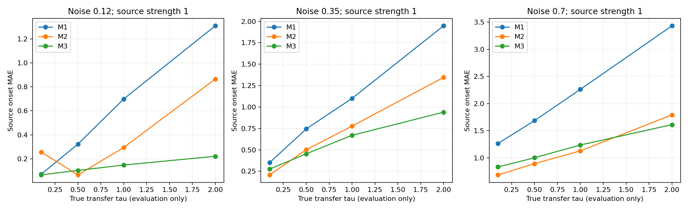
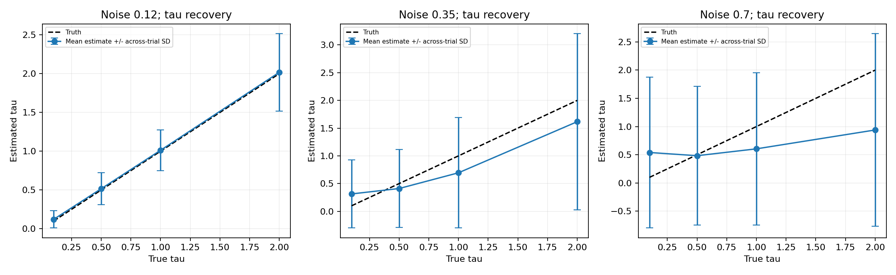
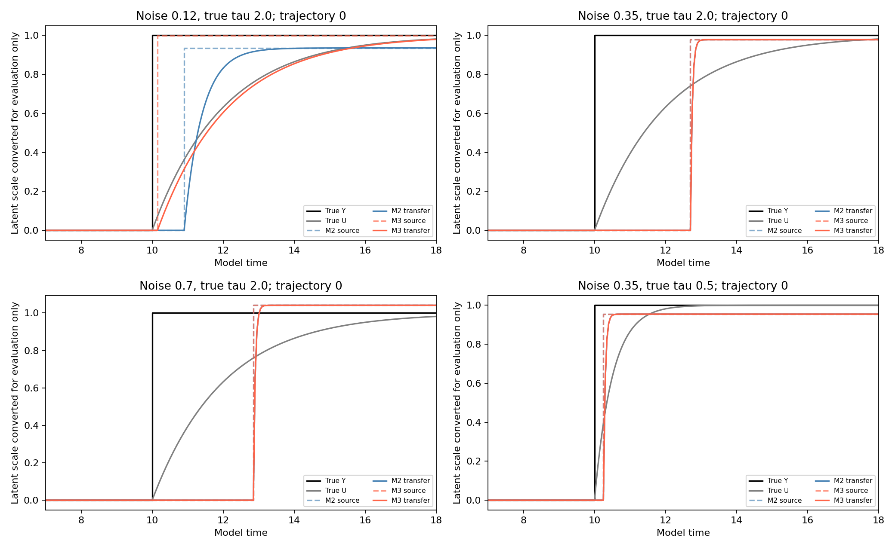
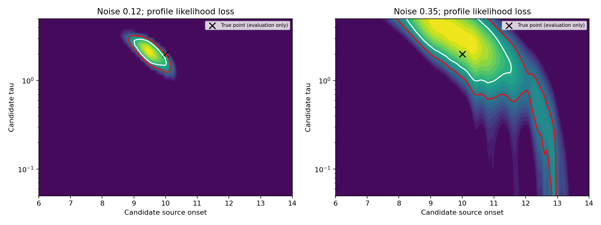
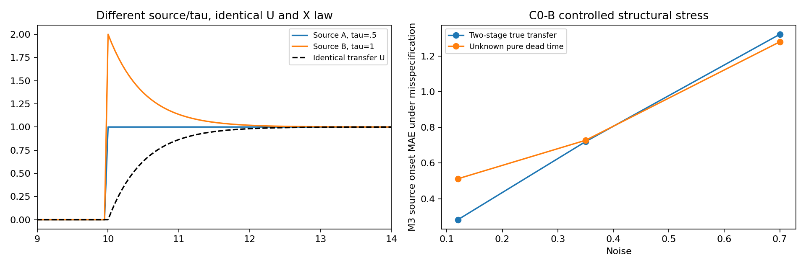

# C0：隐藏作用源 Y 与作用传递 U 的解耦识别

运行日期：2026-11-13。**结论：在已知“一次持续阶跃＋一阶传递”结构的前提下，低噪声时未知 τ 模型能够较好区分作用起点和传递过程；中高噪声下 τ 仍明显不稳定。未知结构下存在严格的观测等价反例，不能保证唯一恢复。**

## 做了什么、没有假设什么

C0-A 复用 A/B 的真实生成器、36个噪声×τ×作用强度条件及同样的随机种子；每格200条测试轨迹。真实 T1=10，但推断不接收这个时间、真实 Y、U、τ 或强度。起点搜索在0.5至观测终点−0.25，间隔0.05；未知τ统一在0.05至5的41点对数网格搜索，不按每格真值缩小范围。

本轮新模型预先知道：线性观测漂移、加性高斯过程噪声、隐藏源只有一次正向持续阶跃、初始传递状态为零，以及一阶传递结构。它们不是从任意未知系统里自动发现这些假设；这是按 C0-A 设计做的结构已知可行性实验。未知的正常漂移/强迫/创新方差由每噪声2000条独立无事件 X 拟合，不直接提供生成器系数。

主恢复结果使用完整25时长的X，是事后推断，不是实时预警。X预测另在固定时刻15截断，只用截至15的X重新估计，再预测0.05、0.5、2、5个时间单位之后；绝不把25时长的事后τ估计用于较早时刻预测。

## 三个模型

| 模型 | 实现 | τ信息来源 |
|---|---|---|
| M1 | A/B的冻结两状态HMM，取seed11检查点；完整平滑用于恢复，前向末端状态用于预测 | 没有显式τ |
| M2 | 显式源阶跃＋一阶U，联合估计源起点与作用幅度 | 在独立未标注训练X上学到的单一共享τ；不是每条测试的真实τ |
| M3 | 相同传递结构，联合估计源起点、幅度、每条轨迹的未知τ | 从该条X的似然估计，不读取真实τ |

M2/M3 使用精确条件高斯转移似然：对每个候选起点、τ，解析求正向作用幅度最小二乘解，再比较剖面似然。FFT只加速相关计算，不改变目标函数。M2的共享τ由200条独立训练X的总剖面似然最大化确定；训练事件起点随机在3–18、τ随机在0.05–5、强度随机在0.5–1.5且约30%无事件，训练标签从不传入拟合函数。

共享τ实际学为：sigma=0.12: 0.500, sigma=0.35: 0.050, sigma=0.7: 0.050。中高噪声学到搜索下界，是共享参数在异质响应与噪声下的失败结果，未用测试真值修正。M2不是已知τ的理想上界；在不泄漏真实τ的要求下，这是本轮固定τ对照的具体含义。

## 必须说明的尺度问题

只看X时，b×U能被观测约束，但b和U的绝对尺度可互相缩放。因此推断统一把增益约定为1，输出的是“对X的作用强度单位”的源与传递状态。为了给表格中的U/Y误差使用原模拟单位，**仅在评分时**把推断状态除以生成器增益1.5；推断和预测从不读取这个值。不能据此宣称独立识别了真实物理增益或绝对单位。

M1没有独立的Y变量，其Y强度重构误差不适用。为比较U，用冻结HMM的条件均值相对正常AR条件均值的差换算为作用强度并裁剪为非负；这是一项模型输出诊断，不等同于M1显式估计了U。

## C0-A：真实变化起点误差

下面是标准作用强度=1的平均绝对起点误差；越小越好，真实T1始终为10。

| 噪声 | 真实τ | M1旧模型 | M2固定共享τ | M3未知τ |
|---|---:|---:|---:|---:|
| 0.12 | 0.1 | 0.071 | 0.256 | 0.066 |
| 0.12 | 0.5 | 0.322 | 0.065 | 0.103 |
| 0.12 | 1.0 | 0.699 | 0.294 | 0.147 |
| 0.12 | 2.0 | 1.310 | 0.866 | 0.221 |
| 0.35 | 0.1 | 0.351 | 0.207 | 0.275 |
| 0.35 | 0.5 | 0.744 | 0.502 | 0.454 |
| 0.35 | 1.0 | 1.101 | 0.777 | 0.670 |
| 0.35 | 2.0 | 1.948 | 1.346 | 0.940 |
| 0.7 | 0.1 | 1.265 | 0.687 | 0.833 |
| 0.7 | 0.5 | 1.687 | 0.895 | 1.003 |
| 0.7 | 1.0 | 2.262 | 1.130 | 1.238 |
| 0.7 | 2.0 | 3.433 | 1.792 | 1.612 |

重点例子：低噪声、τ=2，M1误差1.310，M3为0.221；同轨迹配对改善1.090，95% CI [1.031,1.148]。中噪声、τ=2，M1为1.948，M3为0.940；配对改善1.008，95% CI [0.856,1.161]。新结构显著减轻了“把传递响应当作源起点”的偏晚，但中噪声仍未达到精确回溯。

M3不是所有条件都优于M2：快速响应、中高噪声时，增加τ自由度会带来额外估计方差；低噪声真实τ=0.5恰与M2训练得到的共享值相近时，M2也更准确。不能只展示有利的慢响应条件。

## U恢复、Y恢复与τ不确定性

| 噪声 | 真实τ | M3 Y-RMSE | M3 U-RMSE | τ平均绝对误差 | τ名义95%区间平均宽度 | 实际覆盖率 | τ估计触边比例 |
|---|---:|---:|---:|---:|---:|---:|---:|
| 0.12 | 0.1 | 0.045 | 0.027 | 0.070 | 0.272 | 94.5% | 29.5% |
| 0.12 | 0.5 | 0.059 | 0.026 | 0.161 | 0.660 | 91.0% | 1.0% |
| 0.12 | 1.0 | 0.071 | 0.026 | 0.204 | 0.925 | 91.0% | 0.0% |
| 0.12 | 2.0 | 0.088 | 0.026 | 0.365 | 1.476 | 86.0% | 0.0% |
| 0.35 | 0.1 | 0.101 | 0.077 | 0.279 | 1.523 | 99.5% | 57.0% |
| 0.35 | 0.5 | 0.132 | 0.084 | 0.488 | 1.926 | 91.5% | 53.5% |
| 0.35 | 1.0 | 0.162 | 0.093 | 0.833 | 2.658 | 87.0% | 43.5% |
| 0.35 | 2.0 | 0.194 | 0.094 | 1.402 | 3.793 | 86.0% | 35.5% |
| 0.7 | 0.1 | 0.189 | 0.158 | 0.522 | 3.514 | 100.0% | 84.5% |
| 0.7 | 0.5 | 0.207 | 0.159 | 0.747 | 3.690 | 99.5% | 84.5% |
| 0.7 | 1.0 | 0.231 | 0.165 | 1.176 | 3.866 | 97.5% | 83.0% |
| 0.7 | 2.0 | 0.263 | 0.176 | 1.932 | 4.338 | 93.0% | 82.5% |

τ区间是单条轨迹的近似剖面似然区间（似然损失阈值3.841），不是均值置信区间或贝叶斯可信区间。变化点非正则、参数有边界，网格离散、正常AR参数估计误差均会影响覆盖；实际覆盖不总达到95%，例如中噪声τ=2只有86%，不能把“名义95%”当成已校准保证。完整均值/标准差/中位数及跨轨迹误差均值95% CI见summary.json，两种区间不可混用。

中噪声τ=2时，τ平均绝对误差约1.40、区间平均宽约3.79，说明单条轨迹中的起点与响应速度仍有明显混淆。高噪声τ=2约82.5%点估计碰到0.05或5的搜索边界；平均估计接近某个真值也不能代表稳定恢复。所有未检出者继续计入状态RMSE；起点条件MAE同时给出全样本惩罚误差（未检出记15）。

## X样本外预测

只用截至15的X，预测17时刻的X（未来2单位）。

| 噪声 | 真实τ | M1 MSE | M2 MSE | M3 MSE |
|---|---:|---:|---:|---:|
| 0.12 | 0.1 | 0.500 | 0.039 | 0.032 |
| 0.12 | 0.5 | 0.502 | 0.032 | 0.039 |
| 0.12 | 1.0 | 0.497 | 0.060 | 0.065 |
| 0.12 | 2.0 | 0.391 | 0.199 | 0.102 |
| 0.35 | 0.1 | 1.177 | 0.227 | 0.253 |
| 0.35 | 0.5 | 1.181 | 0.238 | 0.299 |
| 0.35 | 1.0 | 1.185 | 0.283 | 0.368 |
| 0.35 | 2.0 | 1.141 | 0.421 | 0.441 |
| 0.7 | 0.1 | 3.604 | 1.145 | 1.285 |
| 0.7 | 0.5 | 3.614 | 1.190 | 1.318 |
| 0.7 | 1.0 | 3.675 | 1.452 | 1.684 |
| 0.7 | 2.0 | 3.717 | 2.243 | 2.307 |

M2/M3通常比旧HMM预测更好，但部分收益来自新模型知道“源持续开启”的正确结构，而旧HMM源于短脉冲数据；不能据预测改善单独证明解耦或因果识别。未知τ的M3也不统一优于固定共享τ的M2，例如中噪声τ=2的预测误差差值区间跨零。全4个预测时距及配对比较保留在结果中。

## 漏报和误报

M2/M3通过与无事件模型的最大剖面似然比判断有无事件；用独立500条无事件X按约5%目标校准，完整恢复与15时刻预测的前缀分别校准。M1沿用A的实时阈值再用于完整平滑，因此三者实际离线误报预算不完全相同；这限制了直接比较检出率的公平性。

| 噪声 | M1无事件误报 | M2无事件误报 | M3无事件误报 |
|---|---:|---:|---:|
| 0.12 | 0.6% | 3.4% | 3.8% |
| 0.35 | 0.4% | 3.0% | 3.0% |
| 0.7 | 2.2% | 9.0% | 9.4% |

无事件测试每噪声500条，独立于校准数据。高噪声M3实际误报9.4%，高于目标5%，不能宣称误报已充分控制。主表标准强度的持续事件检出率均为100%；弱强度等所有36格的漏报情况见core_table.csv，检出率高不意味着起点或τ估计准确。

## C0-B：结构未知时的有限对照

由于C0-A尚未在全部噪声下稳定恢复τ，本轮没有训练“任意未知结构自动发现”的模型。先做可识别性审计：同一M3面对真实两级传递、以及额外0.5纯死区的结构失配；每噪声每种200条全新轨迹。

| 真实结构 | 噪声 | M3起点MAE | 平均有符号偏差 | U-RMSE |
|---|---:|---:|---:|---:|
| two_stage | 0.12 | 0.283 | 0.255 | 0.029 |
| dead_time | 0.12 | 0.512 | 0.511 | 0.028 |
| two_stage | 0.35 | 0.720 | 0.356 | 0.092 |
| dead_time | 0.35 | 0.728 | 0.514 | 0.089 |
| two_stage | 0.7 | 1.322 | 0.468 | 0.167 |
| dead_time | 0.7 | 1.280 | 0.506 | 0.165 |

低噪声额外死区0.5时，模型U恢复误差仅约0.028，但起点仍平均偏晚0.511。这说明能重构U并不等于能找回真正的源动作时间。两级传递没有唯一的“一阶真实τ”，因此不把拟合的一阶τ与任一真实级τ强行作准确率评分。

还构造并验证了三种严格歧义：

1. **源形状与τ歧义**：任给同一个U，令Y=U+τ·dU/dt；选τ=0.5或1，会得到不同Y，却产生同一个U和同一个X分布。若不约束Y只能是阶跃，就不能保证唯一分离Y和τ。
2. **源起点与纯死区歧义**：第10发生源变化、传递前等待0.5；与第10.5发生源变化、无等待，可以产生完全相同U和X。没有额外信息就无法区分两个源起点。
3. **增益与状态尺度歧义**：b=1.5、U与b=0.75、2U对X作用完全相同。物理尺度需要约定或外部标定。

这些是代数与动力学等价验证，不是训练出一个黑箱模型“发现了”未知结构。它们限定了哪些问题单靠X没有唯一答案。

## 验证、统计与复现

已验证：无噪声时仅从X正确估计起点10、τ=0.5与作用幅度；U重构与精确模拟一致；FFT计算与直接内积似然一致；前缀估计的预测与确定性真值一致；不同源/τ相同传递的等价关系与增益尺度等价成立。

每格以200条轨迹为独立统计单位。跨τ/强度共用创新序列以进行配对；没有把同条轨迹或不同模型当成独立重复。均值置信区间为近似95%，多重比较未校正，未覆盖重新抽取正常训练数据的全部不确定性。M1使用预先固定seed11；M2/M3剖面搜索在固定网格上是确定性的，不存在优化初始化种子的重复。

```bash
OPENBLAS_NUM_THREADS=1 python run.py
OPENBLAS_NUM_THREADS=1 python validate.py
OPENBLAS_NUM_THREADS=1 python audit.py
OPENBLAS_NUM_THREADS=1 python paired.py
OPENBLAS_NUM_THREADS=1 python report.py
```

全部配置、校准阈值、冻结模型、逐轨迹压缩CSV、条件统计、配对CI、参数区间、示例状态和结构审计均在results目录。没有把真实隐藏答案反馈给训练或推断，也没有根据测试结果重新选择τ范围、阈值或模型。

## 图表









