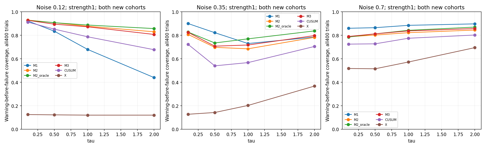
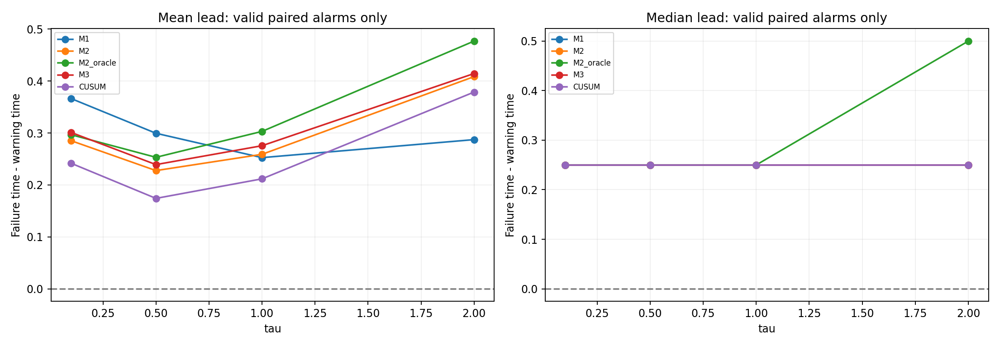
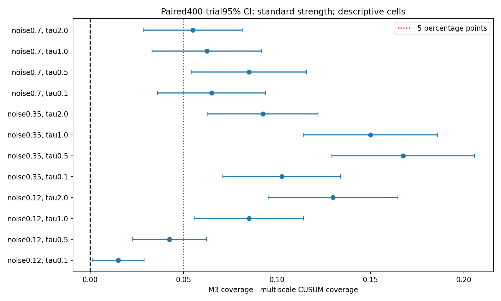
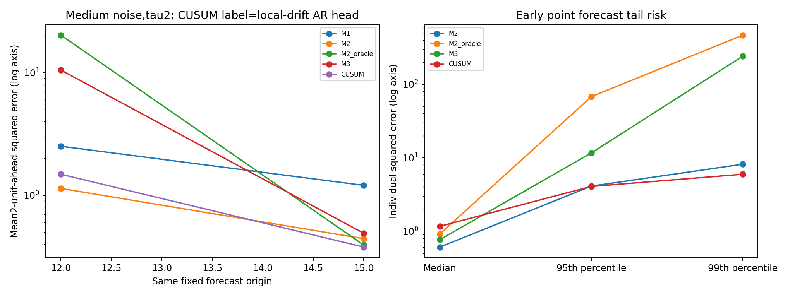
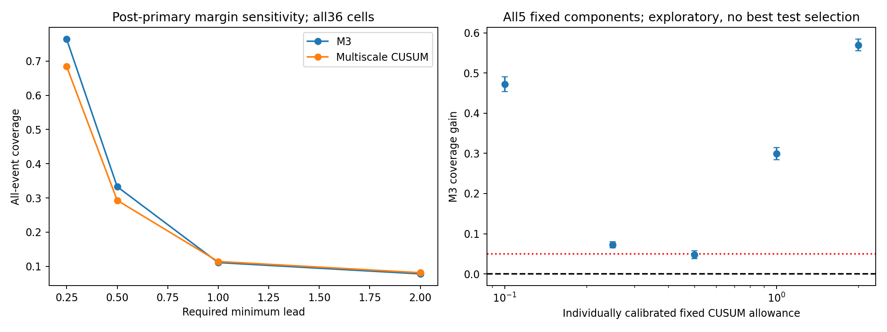

# C4：动态传递结构的公平对照与增量价值

日期：2026-11-13。**仅开展C4，没有修改旧C1–C3，没有开展C5/C6/D。预先登记的主对照中，M3通过“短窗口预警覆盖率”标准；平均检测延迟和同历史预测没有同时改善。优势依赖所需提前窗口和CUSUM配置，不能概括为全面、独有的因果机制优势。**

## 协议、样本与独立性

先固定PROTOCOL.json，最终校准完成后将其SHA256写入TEST_START.json，才开始新事件测试。5000条正常校准和5000条正常测试分别来自独立种子；两批事件测试每格各200条（合计400），三噪声、四τ、三强度共36格。所有新种子大于80000，与前轮C1–C3及探索CUSUM种子隔离。正常AR、共享τ、旧HMM参数均冻结自C0/A，不按本轮结果改M3。

继续使用C1相同生成器：Y在10阶跃，U一阶传递，X只受U驱动；dt=0.05，时长25；各方法统一0.25更新、连续2次确认。跨τ/强度共用同一创新以配对。总体统计先把同一创新下12个条件平均，再在噪声×独立批次6个固定层内重抽200条创新，避免把14400次条件响应误当成全部独立。主判定有1200个独立创新块。

## 六个对照与oracle隔离

| 方法 | 说明 |
|---|---|
| M1 | 冻结旧HMM的实时前向概率 |
| M2 | 冻结的共享τ；低噪声约0.5，中/高噪声0.05，来自前轮X训练 |
| M2-oracle | 仅此方法获得该条件真实τ；源起点和幅度仍未知，分别估计 |
| M3 | 与前轮一致的41点未知τ、未知起点/幅度实时剖面似然 |
| CUSUM | 五个预先固定allowance组成多尺度CUSUM，组合整体校准 |
| X异常 | 正常AR均值轨迹的下偏异常参考 |

另有共同预测失效参考FAIL，不作为结构模型。oracle每个τ单独校准5%预算，测试时只使用对应真实τ的那一个，不能把多个oracle取最大后仍声称5%。普通M2/M3只搜索原来的候选集，已验证新增oracle不会改变它们的输出；真实Y/U/起点/强度从未传入推断。

oracle不是数学性能上界：只提供τ，其他参数仍须估计，使用相同网格/似然/阈值规则，因此某些样本甚至某些预测指标可以更差。

## CUSUM与预测对照怎样确定

allowance预先设为0.1、0.25、0.5、1、2。用独立2000条正常轨迹的一次越界全程最大值95分位确定各分量的尺度，再逐时刻取标准化分数最大值。整个自适应组合用另一批5000正常轨迹重新校准“连续2次、全25时长至少一次报警”的5%概率，已计入参数组合带来的多重搜索。没有使用事件标签挑选检测参数。

CUSUM本身不产生X预测。为检验预测增量价值，另配一个局部漂移AR预测器：正常AR的创新均值用最近0.5/1/2/4单位估计，正向异常作用方向约束与结构模型一致。窗口只按独立验证X的未来预测误差选择，低/中/高噪声分别选择0.5/2/4。验证X含600条未标注混合响应和600条正常轨迹，不用其隐藏标签。

预测统一在固定12、15时刻，用相同历史预测未来2单位X；不按各自报警时刻选择不同样本，也不以报警为门槛。M3的τ/起点/幅度必须在对应前缀重估。表中CUSUM的预测误差指配套局部漂移AR，不能解释为CUSUM统计量本身的预测能力。

## 共同失效定义保持固定

沿用C1：正常AR提前1单位预测，等真实X到达后计算标准化平方误差；最近4个已成熟误差均值连续2次过阈，记T_failure。统计规则、预测时距、窗口、确认数不变；数值阈值按本轮统一独立正常校准重新确定并在测试前冻结。所有方法共享同条轨迹的同一个T_failure，没有为某个方法重定义。

早于真实变化的首报记误报，不重置到10；漏报保留。平均提前量保留正负配对，只在有效报警和有效失效均已观测的轨迹中计算；全样本覆盖率的分母始终为全部事件轨迹。没有观测到失效不等于无限提前量。

## 事先冻结的判定标准与结果

主比较是M3对多尺度CUSUM。广义36格以及预先指定的慢响应τ∈{1,2}/标准强度子组，分别评价：①全样本覆盖率增量；②全样本截尾检测延迟改善（早报/漏报计15）。为4个组-结局比较使用98.75%分层配对簇自助区间，且要求两个独立批次方向一致。实用门槛是覆盖率增加≥5个百分点，或平均延迟缩短≥0.25。同时每噪声两方法FPR点值在4%–6%，配对95%FPR差区间落在±1个百分点内。

冻结规则输出：**类别A，由覆盖率通道通过；不是所有指标全面胜出。**

| 总体主比较 | 点估计 | 配对簇95% CI | 判定用98.75% CI |
|---|---:|---|---|
| M3覆盖率增量 | +7.993个百分点 | [+7.382, +8.625] | [+7.201, +8.757] |
| CUSUM延迟减M3延迟 | -0.003时间单位 | [-0.052, +0.051] | [-0.065, +0.065] |

总体覆盖率：M3为76.38%，多尺度CUSUM为68.39%，增量7.99个百分点。两批测试分别增加7.35、8.64个百分点。平均截尾检测延迟差约−0.003，区间跨零，没有证明平均检测时间缩短。覆盖率更高可以与平均延迟基本不变同时出现：收益集中在相对失效阈值的边界附近。

预定义慢响应子组覆盖率增量9.58个百分点；平均延迟改善约0.054，未达到0.25且判定区间跨零。不能把“覆盖率通道通过”改写成“所有轨迹都更早、已准确理解传递机制”。

## 误报预算是否可比

| 噪声 | M1 | M2 | M3 | 多尺度CUSUM | X异常 | oracle四τ范围 |
|---|---:|---:|---:|---:|---:|---:|
| 0.12 | 4.98% | 4.62% | 4.84% | 4.94% | 4.42% | 4.54%–4.76% |
| 0.35 | 4.64% | 4.70% | 4.56% | 4.66% | 5.22% | 4.66%–4.88% |
| 0.7 | 5.24% | 5.28% | 5.26% | 5.34% | 4.96% | 4.90%–5.22% |

每个FPR基于独立5000正常测试轨迹，Wilson区间和配对差均已保存。M3与CUSUM的三档噪声均通过事前±1个百分点的等价预算检查；没有拿测试集再调阈值来强行匹配经验误报率。误报率相近不代表真实概率数学上完全相等。

## 完整模型比较示例：中噪声、真实τ=2、强度1

| 方法 | 平均有效检测延迟 | 平均失效提前量 | 提前量中位数 | 全事件覆盖率 | τ平均绝对误差 |
|---|---:|---:|---:|---:|---:|
| M1 | 2.947 | 0.287 | 0.250 | 78.50% | 不适用 |
| M2 | 2.824 | 0.409 | 0.250 | 78.25% | 1.950 |
| M2_oracle | 2.759 | 0.477 | 0.500 | 83.75% | 已提供真值 |
| M3 | 2.819 | 0.415 | 0.250 | 79.75% | 1.991 |
| CUSUM | 2.856 | 0.379 | 0.250 | 70.50% | 不适用 |
| X | 3.246 | -0.004 | 0.000 | 36.75% | 不适用 |

这格M3比CUSUM覆盖率增加9.25个百分点，配对95% CI [6.31,12.19]；平均有效配对提前量只多约0.036。M2固定τ覆盖率78.25%，M3为79.75%，两者1.5个百分点差的区间跨零，未知τ自适应的额外收益未稳定成立。oracle覆盖率83.75%，表明准确τ在该条件有潜在检测价值，但仍不是唯一瓶颈。

M3报警时τ平均绝对误差约1.99，真实τ=2；取得预警覆盖率收益不等于已恢复真实τ。

完整36格还显示，旧HMM在部分高噪声条件的覆盖率高于M3。因此，主对照覆盖率通道通过并不等于M3统一胜过M1/M2，更不等于优势已被归因为准确恢复真实传递机制。

## 收益是否足够长、是否依赖CUSUM选择

以下是主结果之后的解释性敏感性检查，不替换主判定，不在看完结果后改成功标准。

| 要求最少提前 | M3总体覆盖率 | 多尺度CUSUM总体覆盖率 | 差值 |
|---|---:|---:|---:|
| 0.25 | 76.38% | 68.39% | +7.99个百分点 |
| 0.5 | 33.28% | 29.29% | +3.99个百分点 |
| 1.0 | 11.09% | 11.40% | -0.31个百分点 |
| 2.0 | 7.78% | 8.12% | -0.34个百分点 |

要求至少提前0.5时优势缩为约3.99个百分点；要求至少提前1时优势没有保留。当前收益主要是1–2次更新的短窗口预警，不应夸大为长期预知。

另外把协议中已固定的5个CUSUM分量分别校准到5%，在全部测试条件逐一公开，未按事件测试结果选择“最佳δ”再当作确认性基准。

| 固定CUSUM allowance | M3总体覆盖率增量 | 描述性95% CI |
|---|---:|---|
| 0.1 | +47.20个百分点 | [+45.34, +49.07] |
| 0.25 | +7.27个百分点 | [+6.51, +8.04] |
| 0.5 | +4.73个百分点 | [+3.74, +5.71] |
| 1.0 | +29.90个百分点 | [+28.37, +31.44] |
| 2.0 | +56.98个百分点 | [+55.56, +58.40] |

对固定allowance0.5，增量缩为4.73个百分点，点估计低于预定5个百分点实用门槛。这不撤销预登记主对照的覆盖率结果，但说明不能概括为对所有合理CUSUM配置都具有同样强的实用优势。全部参数的独立误报率保留于fixed_CUSUM_sensitivity.json。

## 预测增量价值：没有得到支持，而且存在尾部风险

下面是相同历史的2单位前瞻MSE（中噪声、τ=2、强度1），未选择有利报警样本。

| 预测器 | 在12预测14：平均MSE | 在15预测17：平均MSE |
|---|---:|---:|
| M1 | 2.511 | 1.205 |
| M2 | 1.137 | 0.443 |
| M2_oracle | 20.227 | 0.392 |
| M3 | 10.487 | 0.490 |
| 局部漂移AR（CUSUM预测对照） | 1.484 | 0.378 |

M3没有稳定改善这个预测对照。总体块配对的预测MSE增量在12与15均为负；不能只展示预测中位数较好而忽略平均损失。早期M3的平方误差中位数约0.767，局部漂移AR约1.164，但M3最差1%的4个样本占总平方误差约69.1%，拉高均值至10.49。

逐例检查发现，部分样本把起点估在11.75，留下很短的证据窗口，再把作用幅度估得很大；沿一阶传递外推时产生极端预测。对预先选定条件的最大误差样本做独立逐步动力学递推，结果与公式一致，排除了简单计算错误。本轮没有为了让结果好看而增加幅度上限、先验或修改M3。

oracle早期预测也可能更差，因为真τ并没有解决未知起点与幅度的联合不确定性。oracle只提供参数参照，不是每项指标的理论上界；这恰好说明可靠预测还需要不确定性处理。诊断样本按大误差选取，明确不是代表性随机展示。

正常轨迹预测误差也单独保留在null_summary.json，避免只展示有事件时的预测收益。新增模型参数的波动、误差分布和尾部不能被报警覆盖率一个数字替代。

## 预测门控的补充检查（探索性）

主预测结果是预登记的不带报警门槛的剖面点估计外推，不能概括为所有结构化预测策略均失败。为检查结论是否只来自无证据时强行拟合变化，又固定使用既有报警阈值作门控读出：没有过去报警则回退健康AR；一个版本两预测器共用CUSUM报警门，另一个各用自身报警门。没有重训、没有挑测试阈值、没有改主判定；所有事件样本保留。

| 门控规则 | 预测起点 | 局部漂移AR误差减M3误差：总体块均值 | 描述性95% CI |
|---|---:|---:|---|
| common_CUSUM_gate | 12 | -0.000 | [-0.073, +0.072] |
| common_CUSUM_gate | 15 | -0.084 | [-0.134, -0.035] |
| own_detector_gate | 12 | +0.081 | [-0.001, +0.163] |
| own_detector_gate | 15 | -0.081 | [-0.132, -0.029] |

门控显著减轻原始点估计尾部风险，但未给出稳定的额外预测收益：共同门控在12时的区间跨零，15时仍偏向局部漂移AR。各自门控也未形成两个时刻都一致的正收益。这些是补充读出诊断，不代替预登记结果，也不把门控方案包装为已独立验证的新模型。

## 结论应如何表述

1. 在本次已知结构、持续阶跃的模拟中，M3相对预登记多尺度CUSUM具有可复现的**短窗口覆盖率增益**，达到冻结的覆盖率标准。
2. 没有证明平均检测延迟缩短一个更新间隔，也没有证明未知τ估计或同历史预测整体更好。固定τ对照已获得相近的覆盖率，参数估计仍是瓶颈。
3. 更长提前窗口和单参数CUSUM敏感性使优势缩小；不能宣称普遍超过传统变化检测，更不能把它当作真实因果机制唯一识别的证据。
4. 本轮不改进M3、不进入C5/C6/D。后续应根据这些正负结果决定研究重点，而不是继续以报警提前量替代参数恢复与预测可靠性。

## 文件与复现

model_performance_table.csv包含全部36格×6方法的完整性能表；summary.json还分别保留两批结果。paired_summary.json是逐格配对区间；decision.json保留主判定、分层簇自助区间及误报预算检查。PROTOCOL.json与TEST_START.json验证协议在测试前冻结。

```bash
OPENBLAS_NUM_THREADS=1 python calibrate.py
OPENBLAS_NUM_THREADS=1 python evaluate.py
OPENBLAS_NUM_THREADS=1 python analyze.py
OPENBLAS_NUM_THREADS=1 python validate.py
OPENBLAS_NUM_THREADS=1 python sensitivity.py
OPENBLAS_NUM_THREADS=1 python diagnostics.py
OPENBLAS_NUM_THREADS=1 python gating_diagnostic.py
OPENBLAS_NUM_THREADS=1 python report.py
```

未多重校正的逐格95%区间仅作描述；正式主判定使用预登记98.75%区间及实用门槛。统计单位为独立轨迹创新块，不是模型数、时刻数或同一噪声下的条件数。区间条件于冻结的训练参数与校准阈值，不覆盖重新抽取训练集的全部不确定性。

已验证：新M2/M3与旧实时实现一致；oracle与直接前缀似然一致；oracle信息未进入其他模型；检测与两个预测起点均不读未来；配对样本键完整且共享失效时间；种子隔离；协议哈希未变；异常预测与独立模型递推一致。

## 图表









