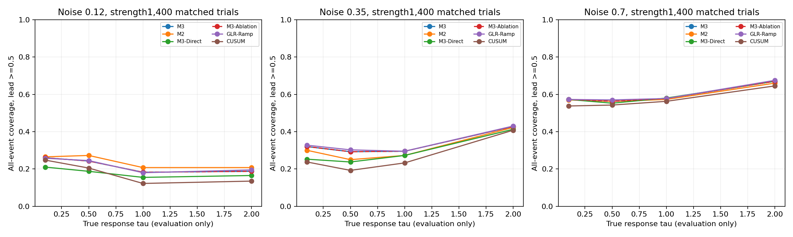
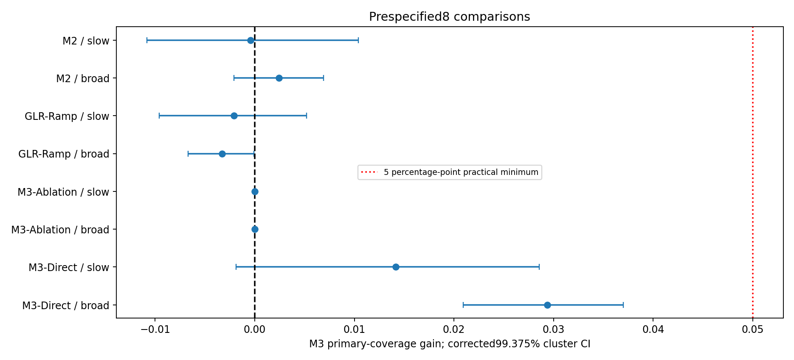
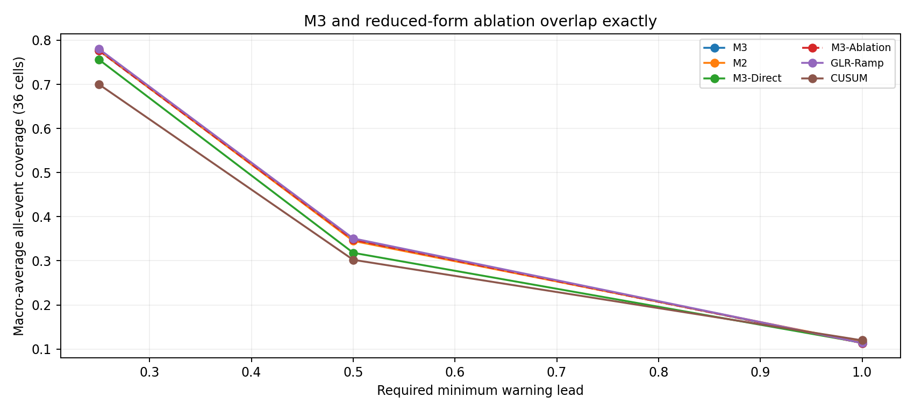
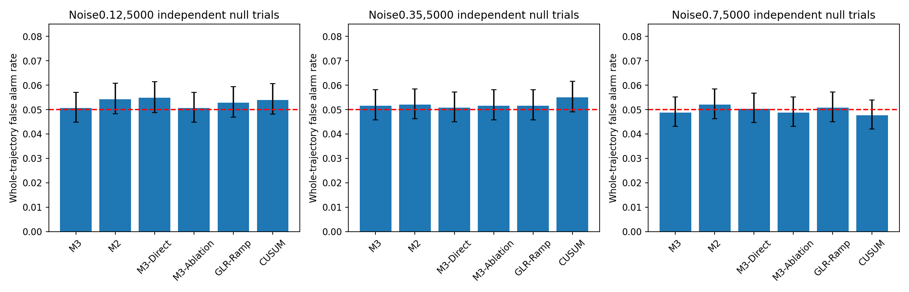
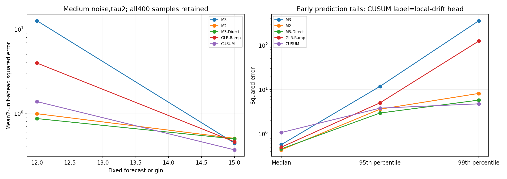
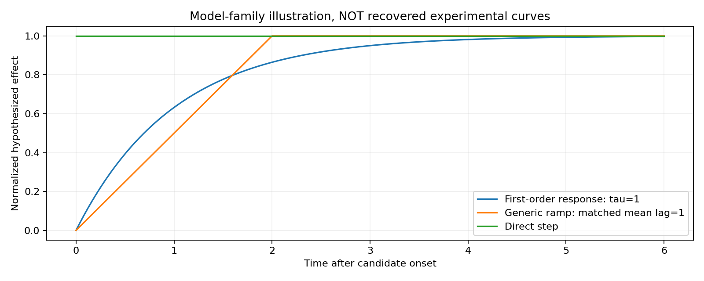

# C5：机制结构消融与增量价值验证

日期：2026-11-13。**本轮没有达到预设的机制结构独立优势标准。M3与相同自由度的通用斜坡GLR表现接近，未知τ相对固定τ无稳定实用增益；去掉Y/U显式命名但保留同一观测核时，结果严格等价。** C4的短窗口预警收益仍可复现，但不能据此认定收益来自真实机制恢复。

## 先澄清：当前M3实际计算什么

此前“显式双状态模型”的说法需要限定：当前冻结M3假定Y为一次持续阶跃、U按一阶ODE响应且没有独立过程噪声，实际求解器对源起点、正向幅度和τ做剖面似然搜索。它不是已经从任意未知系统里学出了两条独立随机隐状态的通用模型。

把这两个状态代数消去后，正常AR创新 z_t=−(X_(t+1)−qX_t−c) 的条件均值是 A h_tau(t−s)。其中 h=k−j exp(−age/τ)，k=(1−q)/a，j=(exp(−dt/τ)−q)/(a−1/τ)，a=−log(q)/dt。直接给X的创新规定这个均值而不写Y/U，观测高斯似然完全相同。

因此，不能诚实地要求M3显著优于这个严格等价的简写模型；若出现性能差异，首先应检查实现或阈值。这里保留等价控制，同时另用非等价的直接作用与同复杂度通用响应核，检验真正可检验的时间形状贡献。这个判断在校准和事件测试前写入PROTOCOL.md与PROTOCOL.json，未按结果修改。

## 六种方法及观测似然

| 方法 | 条件创新均值/统计量 | 待估自由参数 |
|---|---|---|
| M3 | 精确指数响应核，源阶跃经一阶传递 | 起点、幅度、τ |
| M2 | 同指数响应核，冻结C0共享τ | 起点、幅度 |
| M3-Direct | 隐藏作用立即造成创新均值阶跃，无传递过程 | 起点、幅度 |
| M3-Ablation | 不区分Y/U，直接使用单指数观测响应核 | 起点、幅度、衰减尺度；与M3等价 |
| GLR-Ramp | 通用线性上升后平台的观测核，不假设指数传递 | 起点、幅度、平均滞后尺度κ |
| CUSUM | 冻结C4多尺度CUSUM，重新统一校准总误报 | 固定的五分量组合 |

GLR-Ramp的完整上升时间取R=2κ，使平均响应滞后κ与指数核的τ在同一区间0.05–5比较。两者均有41个形状候选、同样的过去起点网格0.25、正向幅度解析拟合、共同正常创新方差。通用核对每个观测区间做精确AR加权积分，既不是随便删代码，也不因数值近似而额外劣化。

M3和GLR每条轨迹同样搜索198891个形状-起点候选。M2和Direct的形状候选只有1，这是有意降低自由度的消融。实际后端CPU耗时不同且已公开；相同参数数/候选数不等于函数类几何复杂度完全相同。所有方法使用相同观测、决策更新频率和完整监测时长。

M3-Ablation在生产计算中复用已经证明相同的充分统计量，以免浪费双倍计算；另用不含Y/U的直接观测高斯回归逐前缀穷举全部候选，独立核对似然最大值。不能把共享代码误认为未定义消融；数学上的观测等价本身就是本轮的明确研究结果。

## 协议、数据和公平性

只开展本次C5结构消融，不开展C6或D，也未覆盖C1–C4。继续原生成器、T1=10、四τ、三噪声、三强度共36格；两批新测试每格各200条，合计400。新校准和正常测试每噪声各5000条，种子均大于120000，与前轮隔离。真实Y、U、τ、T1只在生成/评分中使用。

正常AR、共享τ、CUSUM尺度、预测局部漂移窗口冻结自C0/C4；只用新正常数据校准每种方法25时长内至少一次报警约5%的阈值。C4健康预测器、1单位预测时距、最近4个已成熟误差均值、连续2次确认以及数值失效阈值全部冻结，不为任何消融调整。

主指标固定为至少提前0.5的全事件覆盖率；0.25和1为次要窗口。四个必需比较（Direct、Ablation、GLR、M2）在总体和预定义慢τ1/2标准强度组形成8个比较，使用名义99.375%分层配对簇自助区间（Bonferroni），实用增益≥5个百分点，两批方向一致，并要求误报预算相当。

跨τ/强度共用创新作配对；总体先对同一创新的条件结果平均，再在噪声×批次6层内重抽200个创新，主分析为1200个独立创新块，不能把14400次条件响应视为全部互相独立。协议哈希在事件测试前锁定。

## 三个提前窗口的总体结果

36格等权平均，分母包括所有事件轨迹。早报、漏报、没有有效失效参考的轨迹不伪装为成功预警。

| 方法 | 至少提前0.25 | 至少提前0.5（主要） | 至少提前1 |
|---|---:|---:|---:|
| M3 | 77.69% | 34.76% | 11.36% |
| M2 | 77.76% | 34.51% | 11.53% |
| M3-Direct | 75.64% | 31.82% | 11.44% |
| M3-Ablation | 77.69% | 34.76% | 11.36% |
| GLR-Ramp | 78.06% | 35.08% | 11.38% |
| CUSUM | 70.03% | 30.23% | 11.98% |

M3相对CUSUM在0.25窗口仍有约7.66个百分点收益，与C4的短窗口发现相符；但主要0.5窗口收益约4.53个百分点，未达预设5个百分点门槛。要求1单位时，M3也没有保留优势。本轮不会因0.25结果更有利而更换主要结论。

## 多重比较校正后的主判定

| M3减对照：主要覆盖率增量 | 总体增量 | 校正99.375% CI | 达到5个百分点等全部标准？ |
|---|---:|---|---|
| M3-Direct | +2.938个百分点 | [+2.094, +3.698] | 否 |
| M3-Ablation | +0.000个百分点 | [+0.000, +0.000] | 否 |
| GLR-Ramp | -0.326个百分点 | [-0.667, -0.007] | 否 |
| M2 | +0.243个百分点 | [-0.208, +0.691] | 否 |

相对Direct的约2.94个百分点增益具有统计证据，但低于预设实用门槛；不能说传递过程完全无用，也不能把这个小差异放大为独特机制优势。通用斜坡GLR约高0.33个百分点，实际表现接近；微小的统计差异不应包装为通用模型的重大实用优势。M3相对固定τ的增益仅约0.24个百分点，区间跨零。

严格“优于所有必需对照”的判据在总体和慢响应组均未通过。等价对照的零差本来就不可避免；更有实质意义的是，非等价、自由度匹配的GLR同样没有被M3击败，未知τ对M2也没有稳定增益。因此结论并非仅由一个必然为零的对照推出。

完整慢响应组和逐格配对结果全部保留；不事后寻找有利噪声或τ单格作为主要证明。

## 误报率与计算预算

| 噪声 | M3 | M2 | Direct | Ablation | GLR-Ramp | CUSUM |
|---|---:|---:|---:|---:|---:|---:|
| 0.12 | 5.06% | 5.42% | 5.48% | 5.06% | 5.28% | 5.40% |
| 0.35 | 5.16% | 5.20% | 5.08% | 5.16% | 5.16% | 5.50% |
| 0.7 | 4.88% | 5.20% | 5.04% | 4.88% | 5.08% | 4.76% |

独立误报率约4.76%–5.50%，所有主要比较通过事前误报预算公平性检查：各点率4%–6%，每噪声配对95%差区间位于±1个百分点内。没有用事件测试调阈值。无事件时Y=U=0，τ不影响X分布，故按噪声报告误报，不虚构τ依赖的正常误报差异。

| 噪声；批量200 | M3+M2后端中位耗时 | GLR+Direct后端中位耗时 | 每主形状模型候选数 |
|---|---:|---:|---:|
| 0.12 | 0.315秒 | 0.544秒 | 198891 |
| 0.35 | 0.310秒 | 0.522秒 | 198891 |
| 0.7 | 0.274秒 | 0.515秒 | 198891 |

耗时在正常校准数据上测量，重复3次，没有按速度或事件表现选择参数；这是云端CPU的成组后端耗时，不是物理模型时间0.25对应的部署延迟保证。

## 起点与传递尺度：中噪声、真实τ=2、标准强度

| 方法 | 平均检测延迟 | 平均失效提前量 | 起点MAE | 物理τ-MAE | 通用平均滞后尺度误差 |
|---|---:|---:|---:|---:|---:|
| M3 | 2.692 | 0.439 | 0.980 | 2.016 | 不适用 |
| M2 | 2.688 | 0.443 | 1.078 | 1.950 | 不适用 |
| M3-Direct | 2.701 | 0.436 | 1.104 | 不适用 | 不适用 |
| M3-Ablation | 2.692 | 0.439 | 0.980 | 2.016 | 不适用 |
| GLR-Ramp | 2.689 | 0.443 | 0.992 | 不适用 | 1.596 |
| CUSUM | 2.730 | 0.411 | 不适用 | 不适用 | 不适用 |

通用GLR的κ是平均滞后尺度，不应伪装成已经识别了一阶物理τ；其平均滞后恰可与真实核τ比较，但意义另列。M3/Ablation的参数相同，只说明在同一物理映射假设下可以给核参数加解释，不证明解释唯一正确。

中噪声、真实τ=2时，M3首次报警的τ平均绝对误差约2.02，固定τ模型约1.95，仍未显示可靠实时参数恢复。起点误差约0.98，通用GLR约0.99；谁能报警和谁理解真实机制依然不能混为一谈。

## 预测误差及极端风险

继续C4固定读出：同样过去X，在12和15分别预测14与17，无报警样本选择、不重新训练。CUSUM本身没有预测输出，表中的预测对照是C4已固定的局部漂移AR头，不能把它混称为CUSUM统计量预测。

| 中噪声τ=2，强度1 | 在12预测14的平均MSE | 在15预测17的平均MSE |
|---|---:|---:|
| M3 | 12.573 | 0.443 |
| M2 | 0.989 | 0.504 |
| M3-Direct | 0.865 | 0.496 |
| M3-Ablation | 12.573 | 0.443 |
| GLR-Ramp | 3.950 | 0.459 |
| CUSUM | 1.376 | 0.368 |

该条件M3早期平方误差中位数0.571，99分位355.127，最大值972.241；最差1%样本贡献总平方误差59.2%。完整每格的均值/中位数/95与99分位/最大值保留在prediction_tails.json，没有删除极端样本。

M3与Ablation预测也逐条相同；通用GLR同样有点估计不确定性，但不能因模型写出更多物理状态就假设外推更安全。这里评估的是冻结剖面点估计方案，不是否定所有带不确定性处理的结构化预测策略；本轮未根据新测试风险增加先验或幅度上限。

## 应如何理解这次结果

1. **显式Y/U命名没有独立增加观测信息。** 在当前确定性阶跃/一阶传递模型中，它与消去状态后的指数观测核严格等价。这不表示真实系统没有Y/U，而是报警性能不能单独证明隐藏分解解释。
2. **响应形状约束可能有小作用，但未显示独特指数机制优势。** M3略优于即时阶跃，而相同自由度的通用动态形状可取得相当结果。
3. **自适应τ没有达到预设独立增益标准。** 固定τ模型表现接近，早期τ仍不准，预测尾部风险仍在。
4. **C4的短窗口统计收益未被推翻。** 本轮0.25窗口相对CUSUM仍有增益；新的结论是不能把它直接归因于成功识别真实Y/U或指数传递机制。

因此，现有证据更适合表述为“在已知响应族假设下的结构化变化检测与有限短窗预警”，还不足以表述为对真实因果机制失效的唯一识别。没有据此证明所有可能结构都无价值；本轮只检验冻结的这一版方法和生成家族。

## 复现和交付

```bash
OPENBLAS_NUM_THREADS=1 python calibrate.py
OPENBLAS_NUM_THREADS=1 python budget.py
OPENBLAS_NUM_THREADS=1 python evaluate.py
OPENBLAS_NUM_THREADS=1 python analyze.py
OPENBLAS_NUM_THREADS=1 python validate.py
OPENBLAS_NUM_THREADS=1 python report.py
```

PROTOCOL.md/PROTOCOL.json在校准前写好；TEST_START.json记录测试前的协议哈希。model_performance_table.csv为全36格×6方法的完整性能表，summary.json另保留两批结果；paired_summary.json、decision.json为配对区间和校正判定；原始配对逐轨迹指标为压缩CSV。

通过：精确斜坡积分、通用GLR/Direct与独立穷举回归一致、无Y/U约简模型的独立观测似然核对、全部模型与两预测起点的未来排除、配对键/共享失效时刻检查、严格消融等价性、C4失效数值阈值冻结、种子隔离与协议哈希校验。

逐格普通95%区间为描述性结果，主判定使用预定义99.375%配对簇区间。固定训练参数与校准阈值的统计区间不覆盖重新抽取训练集的全部不确定性；所有时间是模型时间单位。

## 图表











