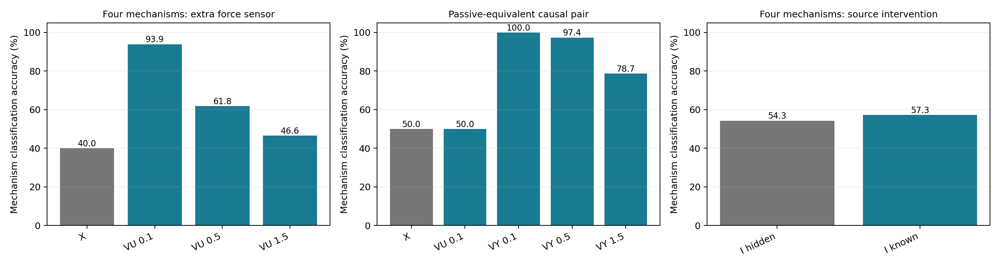
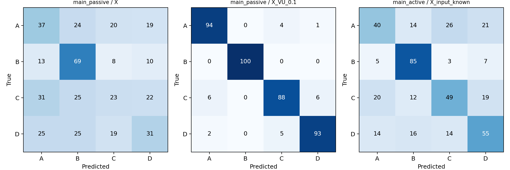

# C6：动态因果机制可识别性与观测信息增益

**结论：只看 X，不能可靠地区分所有隐藏机制；新增信息的价值取决于测量位置与干预设计。** 本轮完成 C6-A/B/C，两批结果方向一致。没有修改 M3，没有覆盖 C1–C5，没有开展真实数据 D。

四机制分类仅 X 准确率40.00%，低噪声 U 传感器提高到93.94%。但是对于严格被动观测等价的两个因果模型，X 和 U 均无法区分（50%），测量源头 Y 或对源头施加输入才提供区分信息。已知具体输入相对将输入作为未知量的四机制增益为3.01个百分点，未达到预设5个百分点实用门槛。

这些结果**不是**任意未知系统的唯一因果结构恢复证明，也不是新的实时提前预警优越性证明。

## 1. 冻结协议与数据隔离

完整协议见 [PROTOCOL.md](PROTOCOL.md)及 [PROTOCOL.json](PROTOCOL.json)。`results/TEST_START.json` 在测试前保存协议、生成器、推断器、运行器及训练设置的 SHA256；`results/audit.json` 确认这些文件未改。统计汇总脚本只读结果，未用于选择报警规则。

- dt=0.05，总观测25，实时报警更新0.25；主要机制辨别使用完整25，属于事后辨别。仅 X 的15单位前缀结果单列。
- X 噪声0.12/0.35/0.7，平均响应滞后0.1/0.5/1/2。每类每条件两批各100条，主被动任务9600条，主主动任务9600条；等价因果对4800条。相同轨迹被不同信息条件重复分析，110400条分类记录绝不是110400个独立样本。
- 真实机制间与滞后条件间共享创新噪声，直接作用 B 在不同名义滞后组甚至重复。区间按噪声×批次×独立轨迹聚类，先平均其内部的滞后和机制；每项比较600个独立随机块，六个分层各100块。
- 每噪声2000条健康 X 学背景 AR；混合后去标签的400条训练 X 选择幅度先验；每档1000条健康传感器序列估计测量方差。真实单轨迹 Y/U/响应参数/起点不传入拟合或被动推断。
- 每噪声独立3000条健康校准轨迹、3000条健康误报审计轨迹。测试随机种子与训练校准分离。

## 2. 四个候选机制与两种等价

统一观测方程 dX=(1.5−0.15X−U)dt+σdW。将原方程中1.5的作用增益吸收进 U/Y 的单位，保持可观测量级；传感器也使用这些实际作用力单位。

| 候选 | 传递结构 | 匹配方式 |
|---|---|---|
| A | 一阶：Udot=(Y−U)/κ | 平均滞后 κ |
| B | 直接：U=Y | 无内部传递延迟；名义κ分组不改变B |
| C | 两个一阶串联，各时间常数κ/2 | 总平均滞后 κ |
| D | 一阶时变：先κ/(1−0.75/e)，在起点加该尺度后缩短为1/4 | 总平均阶跃响应滞后 κ |

被动源是未知幅度的正阶跃，生成起点10；推断不知起点，而是在0.5–20、步长0.25的网格边缘化。κ在0.05–5的21点对数网格边缘化。真实幅度均匀分布1.125–1.875；半正态幅度先验尺度从0.5/1/2/4由无标签训练混合似然选择，三档均选2。模型库、源类型、噪声形式及潜在量单位已声明，因此这是**条件于结构库与源先验的模型选择**，不是无假设结构发现。真实κ不必落网格，网格近似会产生误差。

必须区分：

1. **同一物理模型的两种表达**：显式一阶 U 与消去 U 后的指数卷积。两者在所有本轮观测和注册干预下都相同，无法靠实验区分“写法”。
2. **不同因果模型的被动等价**：H1 为阶跃 Y 经过一阶传递；H2 为指数平滑 Y 直接作用。它们的连续 U(t) 和 X 分布完全相同，但源头 Y 不同。只看 X 或测 U，等先验最优正确率就是50%；测 Y 或 do(Y=I) 才可能区分。

第二组不是把同一个模型换名。do(Y=I) 会覆盖两个模型各自的源生成器：H1过滤 I，H2直接应用 I。这个判断依赖同一物理源定义及干预模块不变性。详见 [等价证明](results/equivalence_proof.md)。

`separability.csv` 还给出四类在固定真实幅度/起点/尺度下的解析高斯 KL、已知干扰参数时二元最优分类率，以及允许竞争模型优化幅度/网格起点/尺度后的距离。正的固定参数KL不构成全局复合可识别性证明。例如低噪声、κ=0.1时C与D的已知参数最优二元准确率也仅约57%，说明曲线差异很弱。

## 3. 机制辨别结果

准确率为所有样本的强制 argmax；最大后验<0.8另行拒判。高拒判率表示数据不足，不能把少量高置信样本的正确率冒充全体正确率。四机制机会水平25%，二机制50%。区间为分层配对聚类bootstrap 95%，不是跨任意系统的保证。100%是有限测试中未观察到错误，不能推为普遍100%。

| 条件 | 强制分类准确率 | 95%区间，% | 拒判率 |
|---|---:|---:|---:|
| 四机制：仅 X | 40.00% | 39.01–40.93 | 93.44% |
| 四机制：X + 低噪声 U | 93.94% | 93.49–94.40 | 12.89% |
| 四机制：X + 中噪声 U | 61.81% | 60.93–62.69 | 73.69% |
| 四机制：X + 高噪声 U | 46.57% | 45.61–47.57 | 91.39% |
| 等价因果对：仅 X | 50.00% | 50.00–50.00 | 100.00% |
| 等价因果对：X + 低噪声 U | 50.00% | 50.00–50.00 | 100.00% |
| 等价因果对：X + 低噪声 Y | 100.00% | 100.00–100.00 | 0.00% |
| 等价因果对：X + 中噪声 Y | 97.38% | 96.69–98.02 | 4.60% |
| 等价因果对：X + 高噪声 Y | 78.67% | 77.35–79.98 | 48.38% |
| 四机制：主动输入、协议隐藏 | 54.28% | 53.18–55.39 | 81.55% |
| 四机制：主动输入、协议已知 | 57.29% | 56.12–58.45 | 78.26% |
| 因果对：主动输入、协议隐藏 | 84.25% | 82.96–85.56 | 41.35% |
| 因果对：主动输入、协议已知 | 86.06% | 84.81–87.29 | 34.77% |

**C6-A：仅 X 不足。** 四机制40.00%，95%区间39.01–40.93；拒判93.44%。仅观察至15时为39.45%，延长到25并没有解决根本困难。按低/中/高 X 噪声，完整 X 正确率56.72%/34.69%/28.59%。95%可信类别集合平均3.61类，真实类别集合覆盖率另存 `summary.json`；这些后验概率仅条件于给定模型库与先验。

**C6-B：合适传感器能显著改善，但位置决定边界。** 四机制低噪声 V_U 正确率93.94%，在三种 X 噪声下均约94%；中/高噪声 V_U 为61.81%/46.57%。低噪声传感器在κ=0.1时仍仅81.71%，采样频率与短响应形状继续限制辨别。严格等价对的 V_U 三档全部50%，似然完全相等且全部拒判；V_Y 三档为100.00%/97.38%/78.67%。所以“加传感器必然识别”不成立，必须测到候选机制真正不同的部分。V_Y 是额外源头传感器实验，已超出“只观测 X”的原始条件。

**C6-C：干预打破部分被动等价，但四类仍难全面区分。** 27种源脉冲随机组合幅度1/1.5/2、开始7/10/13、持续0.5/2/4，所有候选面对相同输入与过程创新。已知输入臂只用该协议；隐藏输入臂在同一主动 X 上正确边缘化全部27种协议，没有故意使用错误的阶跃基准。

等价因果对在主动 X 上即使协议隐藏也为84.25%，告知协议后86.06%，说明设计的输入响应已经包含区分信息；知道具体输入再增加1.81个百分点。四机制为54.28%→57.29%，增加3.01个百分点。这两个“已知相对隐藏”的配对增益未达5百分点门槛。被动50%与主动86.06%的差异描述整个输入设计的结果，**不是**同一 X 的配对增益；被动与主动源波形也不同，不能把36.06百分点全部归给“知道协议”。低噪声四机制主动已知输入76.56%，高噪声仅41.56%；并非所有条件均可识别。

## 4. 八项预设主要信息增益

先按随机块配对，再在六个分层内bootstrap 4000次。八项Bonferroni校正采用99.375%区间；实用标准为平均增量≥5百分点、区间下界>0、两批均正向。以下六个传感器比较通过，两项输入协议知识比较未达实用门槛。校正区间是预设估计方法，不代表无限精度，边界值需后续独立复核。

| 比较 | 增量，百分点 | 校正区间 | 两批增量 | 判定 |
|---|---:|---:|---:|---|
| main_passive / X_VU_0.1 | +53.94 | 52.55–55.27 | +53.85 / +54.02 | 通过 |
| main_passive / X_VU_0.5 | +21.81 | 20.20–23.46 | +21.35 / +22.27 | 通过 |
| main_passive / X_VU_1.5 | +6.57 | 5.05–7.95 | +6.54 / +6.60 | 通过 |
| causal_equivalent / X_VY_0.1 | +50.00 | 50.00–50.00 | +50.00 / +50.00 | 通过 |
| causal_equivalent / X_VY_0.5 | +47.38 | 46.44–48.25 | +47.58 / +47.17 | 通过 |
| causal_equivalent / X_VY_1.5 | +28.67 | 26.84–30.56 | +28.71 / +28.62 | 通过 |
| main_active / X_input_known | +3.01 | 1.71–4.28 | +3.35 / +2.67 | 未达5百分点门槛 |
| causal_active / X_input_known | +1.81 | 0.24–3.49 | +2.75 / +0.88 | 未达5百分点门槛 |

精确等价对的 V_U 零增益为负对照，不列入八项主要有效性假设。全体逐条件与混淆结果见 `by_noise.csv`、`by_lag.csv`、`by_cohort.csv`、`confusion.csv`。

## 5. 起点、实时报警与误报审计

完整 X、按所选类别的最大边缘模板估计起点：A/B/C/D 平均绝对误差分别0.712/0.447/0.730/0.752时间单位。这是含分类错误的事后点估计，不是实时预警，不是唯一因果起点证明。B没有传递尺度，不能把给它的名义κ当可恢复真值。

保留未经改动的X-only M3（一阶阶跃响应GLR）和复杂度匹配的线性爬坡GLR。两者均只用当前及过去 X，连续两次越阈报警，传感器分类臂不改变它们。独立正常测试整轨迹误报如下，括号为Wilson95%区间：

| X噪声 | M3 | GLR | 预测性能参照 |
|---|---:|---:|---:|
| 0.12 | 6.20% [5.39, 7.12] | 6.33% [5.52, 7.26] | 5.70% [4.93, 6.59] |
| 0.35 | 4.73% [4.03, 5.55] | 4.67% [3.97, 5.48] | 4.87% [4.15, 5.70] |
| 0.7 | 4.63% [3.94, 5.45] | 4.93% [4.21, 5.77] | 4.83% [4.12, 5.66] |

低噪声下实际误报约6.2–6.3%，高于5%校准目标；没有根据审计集重新调阈。其余约4.6–4.9%。因此不能声称所有条件误报均严格≤5%，也不能据此做严格同误报的预警优势结论。

预测性能参照：健康 AR 的1时间单位预测误差成熟后，取最近4次已成熟误差平均，连续两次超过正常整轨迹校准阈值。这个时间是特定统计规则的报警时间，不是物理系统失效真值。早于真实源变化的首次报警算错误；首次报警不按真值重启；漏报、参照未触发或提前误报计覆盖失败。

| 方法 | 事件检出率 | 条件平均延迟 | 提前≥0.25覆盖 | 提前≥0.5覆盖 | 提前≥1覆盖 |
|---|---:|---:|---:|---:|---:|
| GLR | 98.33% | 2.043 | 81.39% | 36.31% | 12.10% |
| M3 | 98.50% | 2.042 | 81.76% | 36.15% | 12.27% |

两者结果相近，本轮没有证明新增结构的预警优势。主动干预用于机制辨别，没有把已知施加输入后的响应检测包装成未知故障提前预警，也没有评估一个传感器增强的实时报警器。

## 6. 数值、隔离与复现检查

- A/B/C/D 精确离散响应与独立连续ODE积分最大差3.19×10⁻⁹；包含短脉冲和时变切换。
- 半正态幅度似然积分与独立数值积分误差4.44×10⁻¹⁶。
- 被动因果对 X/U 位级相同；X和X+V_U的两种机制似然完全相同。
- 输入隐藏似然等于对所有已知协议似然取平均，最大误差8.89×10⁻¹⁶。
- 截短未来观测后，M3/GLR既有前缀分数最大变化均为0。
- 测试前冻结文件hash全部一致。推断函数没有真实机制标签、真实起点、真实κ或未观测未来误差参数。

运行依赖 NumPy/SciPy/pandas/matplotlib。`OPENBLAS_NUM_THREADS=1 python validate.py`；`python run.py`（训练校准及测试）；`python separability.py`；`python audit.py`；`python analyze.py`；`python make_report.py`。运行时保留原始25单位序列；仓库保存全部逐轨迹分类、报警、起点估计（gzip CSV）、种子与生成代码，并保存每条件前10条示例轨迹。完整输入可由 `replay.py` 按冻结种子重建，避免在git重复存放大量可生成浮点数组。

## 7. 可以与不可以得出的结论

可以支持：在本轮候选族和先验下，只看 X 的机制辨别有限；传感器确有信息增益且位置重要；两种不同因果模型能够严格被动等价；正确作用于源头的输入可使它们的响应不同。

不能支持：任意未知系统只看 X 都能恢复唯一隐藏因果；所有传感器都能打破等价；同一模型的等价表达可被干预区分；M3已证明具有独特因果结构优势；回顾性机制辨别等于实时故障预警；本实验已具备真实系统可用性。

下一步应依据这里的边界，单独设计“传感器/输入预算下的在线辨别和预警”，并独立校准；本轮不据测试结果调参或启动真实数据D。
