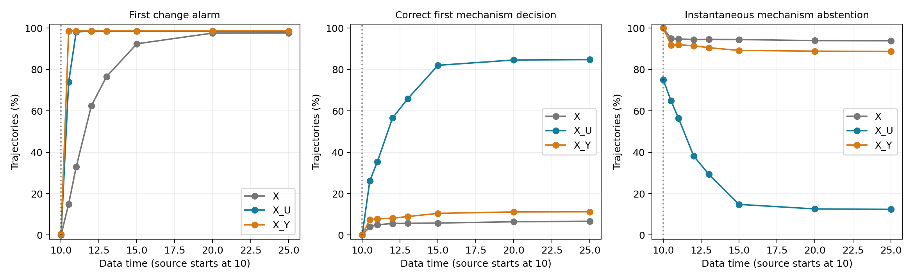
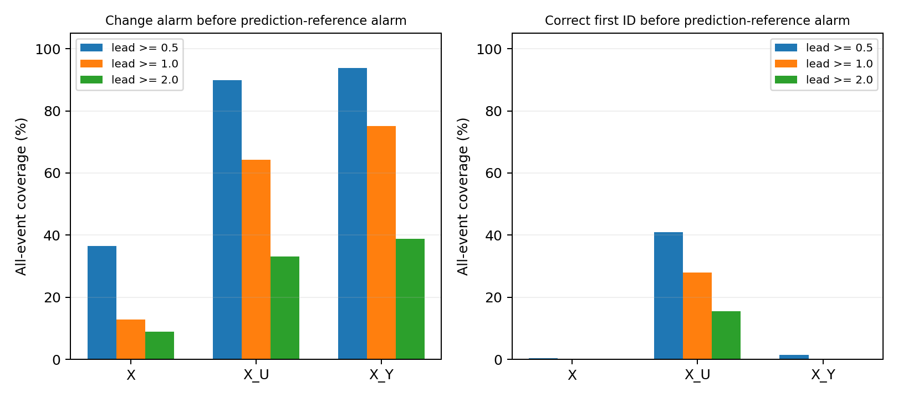

# C7-A：有限观测条件下的在线隐藏作用检测与传递机制辨别

本轮完成 **C7-A**：全新数据、独立训练/校准/审计、两批测试、每0.25时间单位更新。没有开展C7-B/C，没有修改原始M3，没有覆盖C0–C6。

最需要分开的两件事是：**发现有变化**与**正确判断是什么机制**。所有算法使用当时已经到达的数据，首次机制决定锁定，不能看真值后不断重试直到“认对”。

**主要结论：测Y最早发现源启动；测U最有利于四种传递机制的在线辨别。**

- 平均合法报警延迟：X为2.083，X＋U为0.514，X＋Y为0.253时间单位。
- 事件后2单位内正确首次机制决定覆盖：X为5.63%，X＋U为56.59%，X＋Y为8.16%。U相对X提高50.97百分点，校正区间49.56–52.38；Y仅提高2.53百分点，未达5百分点实用门槛。
- 到25时，U方案正确首次决定84.79%、错误5.25%、拒判9.96%。不能把这项能力写成零误判；Y方案在四机制任务仍有87.92%拒判。
- 变化报警提前预测性能参照至少1单位的覆盖：X为12.86%，U为64.23%，Y为75.06%；但要求**正确首次机制判断**也提前至少1单位时，分别为0%、28.04%、0.08%。较早报警不能替代较早认因。
- 严格等价因果对中，X/U可以报警但全部拒绝机制判断；测Y则有99.13%正确首次决定。这与四机制主任务是不同辨别问题，不能把二元99.13%当作四机制正确率。

预设四个主要比较三项通过，Y对四机制正确识别的增量未达到实用门槛。结论支持低噪声U传感器在本模型族中的在线辨别价值，尚不支持原始M3的独特因果结构优势。

## 1. 实验含义与限制

沿用C6四类固定传递结构：A一阶、B直接、C两级、D时变传递；第10时刻启动幅度1.125–1.875（推断未知）的源Y，U传递作用，X为结果。增益吸收进作用力单位，观测式为 dX=(1.5−.15X−U)dt+σdW。**各条轨迹的候选结构族预先固定；D包含既定的时变传递律，但主评价事件是作用源从无到有，不是另设未知时刻的因果连接参数失效。**

S1只看X；S2额外测U；S3额外测Y。两种传感器都为标准差0.1的独立白测量噪声、每0.05时间单位采样，随同一时刻X一起到达。算法看到的是带噪声测量值，不是真实隐藏答案。比较的是同等额外通道数和信噪设定，没有真实货币成本结论。这里只有低噪声传感器可行性测试，不推广到C6所有传感器噪声水平。给定源后U是确定性传递，没有额外的U过程噪声或其他隐藏驱动，因此传感器带来的收益也不能直接外推到复杂实测系统。

S3的Y在四类主任务中都是同一个阶跃源，因此“看到Y变化”本身不等于知道传递结构。另设C6严格被动等价因果对：阶跃源经过一阶传递，或平滑源直接作用；两者X/U相同而Y不同。该对照专门检验“可检测但不可辨别”。

这是候选结构与源先验已知的在线模型选择，不是无假设因果结构发现。本轮新算法为候选库顺序Gaussian GLR门控和边缘后验判别器，**不是给原始M3换名字，也没有做C7-C的M3/CUSUM/GLR全面优越性比较**。

## 2. 隔离、冻结与在线规则

- dt=.05，观察到25，更新.25；X噪声.12/.35/.7，平均响应滞后.1/.5/1/2。每类每条件两批各100条；四类主任务9600条名义轨迹、等价对4800条，共43200条方案评价记录。
- 共享过程创新、幅度和配对传感器噪声，B跨名义滞后重复。每项对比先在噪声×批次×轨迹随机块内平均四类/四滞后，共600个独立块；不是将43200条记录都当独立样本。
- 新种子301000起，与C0–C6不重复。背景AR只用健康X拟合；幅度先验只用混合去标签训练X选取；测量方差只用健康传感器数据估计。每噪声2000健康训练、每类100无标签混合训练、2000健康传感器训练。
- 每噪声4000独立无事件校准、4000独立无事件审计；主任务与等价对各三方案分别校准，外加预测性能参照，21个单元。
- 变化报警：首次连续两次GLR越阈，不根据真实T1重启。
- 机制决定：后验最大类别连续两次相同且概率≥.8，结束时已达到变化报警；首次决定立即锁定。误判不能被后来正确判断覆盖，早于真实事件的决定算错误。
- 另存首次真实类别达到高置信连续条件的时间，**它使用评价真值，是事后诊断，不能充作算法的实际识别时间**。
- 起点、幅度和尺度不提供给推断；沿用C6的21尺度/79起点网格，每次仅允许起点≤当前时刻−.25。顺序累计充分统计量，不访问未来X、未来传感器或未成熟预测误差。

机器协议见 [PROTOCOL.json](PROTOCOL.json)，可读协议见 [PROTOCOL.md](PROTOCOL.md)。测试前 `TEST_START.json` 和 `DEPENDENCIES_START.json` 保存主代码、依赖及训练产物hash；独立数值/时间隔离验证和运行后审计见results目录。

## 3. 主任务在线结果

真实源在10启动；表中“2单位内”即截至数据时刻12。延迟只对合法事件后首次报警计算，容易受删失影响，因此同时报告将早报/漏报计15单位的惩罚延迟。最终首次决定正确/错误/拒判三者总和为100%；拒判是截至25仍无决定，不是错误样本被删除。

| 观测方案 | 条件报警延迟 | 惩罚报警延迟 | 2单位内发现变化 | 2单位内正确首判 | 截至25正确首判 | 截至25错误首判 | 截至25仍拒判 |
|---|---:|---:|---:|---:|---:|---:|---:|
| S1：仅X | 2.083 | 2.384 | 62.49% | 5.63% | 6.66% | 0.39% | 92.96% |
| S2：X＋U传感器 | 0.514 | 0.732 | 98.50% | 56.59% | 84.79% | 5.25% | 9.96% |
| S3：X＋Y传感器 | 0.253 | 0.449 | 98.67% | 8.16% | 11.26% | 0.82% | 87.92% |

这组比较应依据“在相同时间内有多少事件被正确识别”判断在线能力，不应只选成功样本的平均识别时间。条件身份识别延迟、逐噪声、逐机制、逐滞后和分批结果均有原始表。

下表进一步分开“看至25时的即时强制分类”和“此前已锁定的首次决定”。即时分类可以随新数据变化；一次较早的错误决定，不能被终点更好的分类结果抹掉。仅在已决定样本中的准确率也不能代表全体覆盖。

| 方案 | 时刻25即时强制准确率 | 时刻25即时拒判率 | 已作首次决定者中的正确率 |
|---|---:|---:|---:|
| S1：仅X | 40.57% | 93.93% | 94.53% |
| S2：X＋U传感器 | 93.79% | 12.43% | 94.17% |
| S3：X＋Y传感器 | 48.91% | 88.73% | 93.19% |

## 4. 四项预设主要配对对比

主要终点预先指定为时刻12的变化检出覆盖和正确首次机制决定覆盖；S2/S3各对S1，共四项。按六层配对聚类bootstrap4000次，Bonferroni四重校正区间98.75%；实用参考为平均增量≥5百分点、区间下界>0、两批均正向。其他时点不替换主要终点。

| 指标/对比 | 增量，百分点 | 校正区间 | 两批增量 | 判定 |
|---|---:|---:|---:|---|
| detect_by_2.0 / X_U−X | +36.01 | 33.33–38.83 | +36.54 / +35.48 | 通过 |
| detect_by_2.0 / X_Y−X | +36.18 | 33.57–38.81 | +36.54 / +35.81 | 通过 |
| correct_id_by_2.0 / X_U−X | +50.97 | 49.56–52.38 | +51.77 / +50.17 | 通过 |
| correct_id_by_2.0 / X_Y−X | +2.53 | 1.80–3.34 | +2.40 / +2.67 | 未通过 |

拒判/首次错误必须与覆盖一起解释。后验≥.8是预先给定决定规则，不能解释为真实系统中已保证80%正确，实际正确率由独立测试评价。

## 5. 严格被动等价对：报警与认因不是一回事

| 方案 | 条件变化报警延迟 | 2单位内正确首判 | 截至25正确首判 | 错误首判 | 拒判 |
|---|---:|---:|---:|---:|---:|
| S1：仅X | 2.278 | 0.00% | 0.00% | 0.00% | 100.00% |
| S2：X＋U传感器 | 0.550 | 0.00% | 0.00% | 0.00% | 100.00% |
| S3：X＋Y传感器 | 0.401 | 99.13% | 99.13% | 0.88% | 0.00% |

X和U的两类预测分布严格相同，所以对应类别后验始终各0.5，算法应拒绝机制判断。即使变化报警很早，也不能说知道了隐藏原因。Y传感器在此对照测到了两类真正不同的部分，才有区分信息。

同一物理模型显式写U或消去U的等价表达，在观测和注册干预下仍然相同；本轮不把这两种写法伪装成可被识别的不同因果模型。

## 6. 提前量：分别计算报警和正确认因

参照时间来自独立健康AR的1单位预测误差，预测成熟后取最近4次标准化平方误差均值，连续两次越独立校准阈值。它是**特定预测性能报警规则**，不是物理失效真值。此前、此时、未来的预测误差不会提前提供给在线算法。

以下以所有事件为分母：早报、漏报、身份误判、参照未触发或早于真实事件均算覆盖失败。后3列要求机制首判正确，不能用“报警了”替代“认对了”。

| 方案 | 变化报警提前≥.5 | ≥1 | ≥2 | 正确首判提前≥.5 | ≥1 | ≥2 |
|---|---:|---:|---:|---:|---:|---:|
| S1：仅X | 36.60% | 12.86% | 8.99% | 0.33% | 0.00% | 0.00% |
| S2：X＋U传感器 | 89.93% | 64.23% | 33.17% | 40.97% | 28.04% | 15.60% |
| S3：X＋Y传感器 | 93.82% | 75.06% | 38.85% | 1.42% | 0.08% | 0.00% |

提前于这条参照不等于早于真实源变化，也不等于已证明动态因果失效的普遍提前预警优势。

## 7. 独立无事件误报审计

每单元整轨迹预算5%。校准使用二项顺序统计量的保守容忍阈值，21单元同时95%置信；目标不是事后把测试误报调到恰好5%。区间为独立审计的Wilson95%。主任务和二元等价任务不共用阈值。

| X噪声 | 方案（EQ为二元对） | 整轨迹变化误报 | 95%区间，% |
|---|---|---:|---:|
| 0.12 | X | 3.73% | 3.18–4.36 |
| 0.12 | X_U | 4.30% | 3.71–4.97 |
| 0.12 | X_Y | 4.33% | 3.74–5.00 |
| 0.12 | EQ_X | 3.80% | 3.25–4.44 |
| 0.12 | EQ_X_U | 4.33% | 3.74–5.00 |
| 0.12 | EQ_X_Y | 4.35% | 3.76–5.03 |
| 0.12 | failure_reference | 3.68% | 3.13–4.30 |
| 0.35 | X | 4.53% | 3.92–5.21 |
| 0.35 | X_U | 3.20% | 2.70–3.79 |
| 0.35 | X_Y | 3.60% | 3.07–4.22 |
| 0.35 | EQ_X | 4.60% | 3.99–5.29 |
| 0.35 | EQ_X_U | 3.13% | 2.63–3.71 |
| 0.35 | EQ_X_Y | 3.25% | 2.74–3.85 |
| 0.35 | failure_reference | 4.28% | 3.69–4.95 |
| 0.7 | X | 4.60% | 3.99–5.29 |
| 0.7 | X_U | 3.88% | 3.32–4.52 |
| 0.7 | X_Y | 3.58% | 3.04–4.20 |
| 0.7 | EQ_X | 4.30% | 3.71–4.97 |
| 0.7 | EQ_X_U | 3.90% | 3.34–4.55 |
| 0.7 | EQ_X_Y | 3.85% | 3.30–4.49 |
| 0.7 | failure_reference | 4.70% | 4.09–5.40 |

身份决定由变化门控约束，因此无事件下身份假报不超过相应变化误报；本轮未另跑无事件身份后验来估计其精确假报率。相同误报预算并不意味着实际误报率完全相等，不能把这组比较解释为原始M3在严格同实际误报率下优于传统方法。

## 8. 核验与复现

- 截断未来X/传感器后，三种方案既有分数与后验变化均为0。
- 顺序后验与独立前缀批处理似然核对，最大误差约2.13×10⁻¹²。
- 传感器使用同一数据时刻的U/Y，不读下一时刻；与独立一阶闭式响应核对。
- 人工构造“先错误、后正确”的后验序列，首次错误决定保持锁定。
- 等价对的X后验严格0.5；运行后再审计X/U全部拒判、指标分区、记录键、冻结hash和阈值重建。

依赖见requirements.txt。执行：`OPENBLAS_NUM_THREADS=1 python validate.py`、`python validate_online.py`、`python run.py`、`python analyze.py`、`python audit.py`、`python make_report.py`。全新的训练须移除已有trained_settings.json；保留该文件则使用冻结训练产物重放测试。

保存全部逐轨迹指标、每0.25时刻分数/类别后验、逐条件时间曲线和参数。传感器噪声、X和隐藏评价答案可由replay.py以冻结种子重建。仓库保留完整在线测试输出及校准最大连续分数；云端工作目录另保留完整校准/无事件分数矩阵。

本轮只能支持所声明结构、正阶跃源和低噪声传感器下的在线能力评估。C7-B干预设计、C7-C与传统方法公平比较、传递参数突变、未知结构、非白传感器噪声和真实系统均未在本轮验证。
