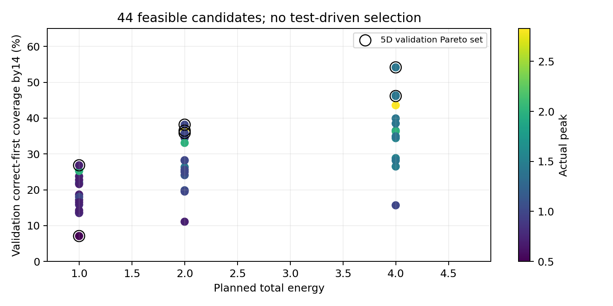
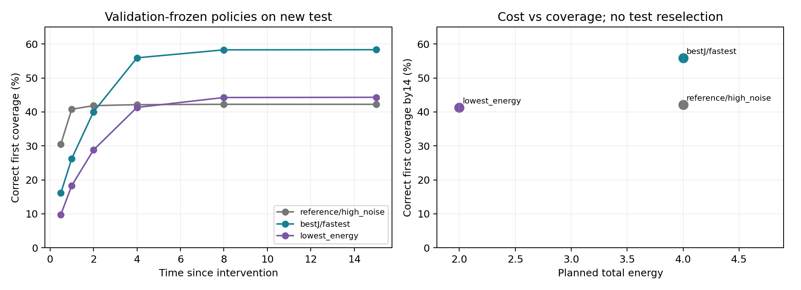
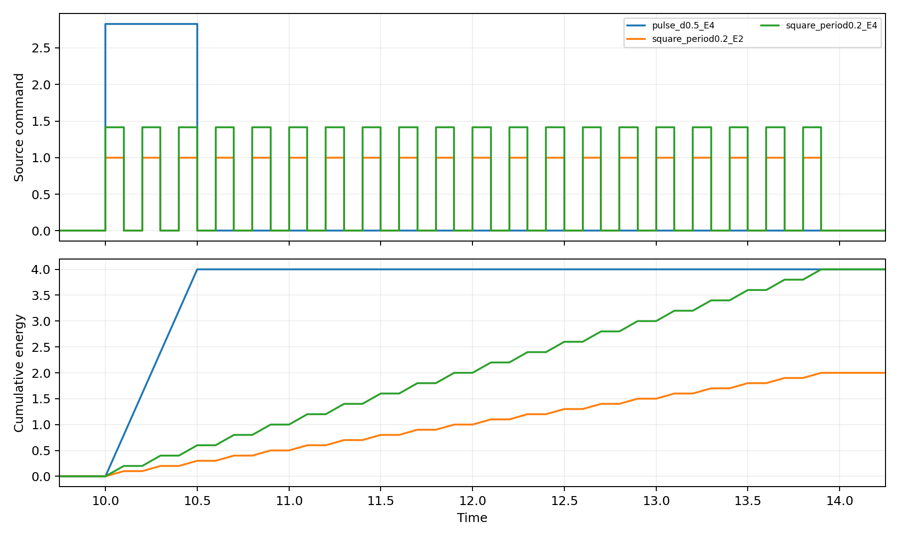
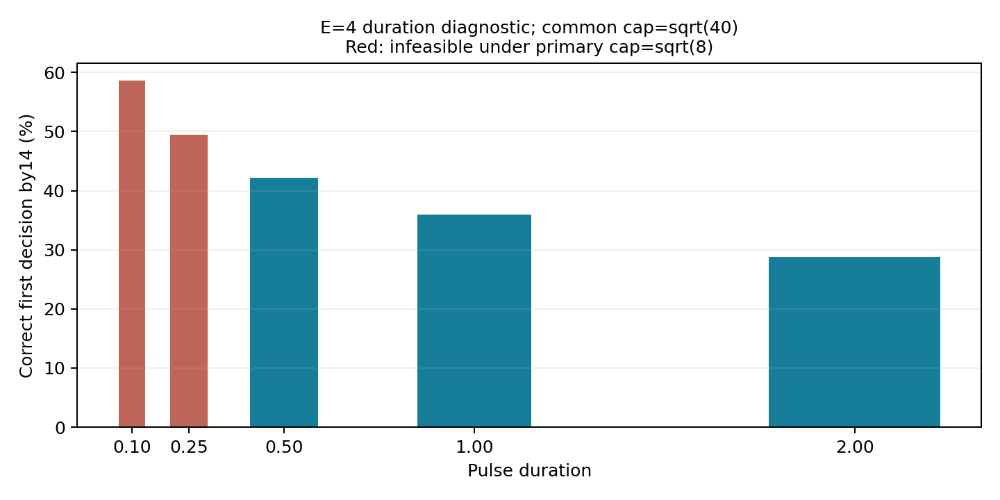

# C7-B2：受成本约束的干预输入选择与独立验证

**主要结论：验证集选出的周期方波在新测试中改善了整体识别覆盖与成本；节能方案将计划能量减半、平均覆盖接近参照；高噪声的优势没有建立。** 这些改善是当前候选集、成本权重和硬约束下的结果，不是所有输入/系统的普遍最优。

本轮完成B2波形/持续时间对照、离线输入选择、独立测试和极短tau压力测试；没有做B3在线自适应选择、C7-C因果失效预警或真实数据。

## 1. 可以直接读出的结果

- 同为能量4，验证冻结的.2周期方波，4单位内正确首次决定覆盖 **55.94%**，重跑.5脉冲为 **42.15%**，增加 **13.79百分点**；四重校正区间 **11.31–16.29**。
- 方波实际峰值1.414，参照2.828，降低50%；J由 **0.848降至0.668**，降低约21.25%。J改善校正区间0.1488–0.2109。
- 预先冻结的能量2方波，覆盖 **41.33%**，比参照低 **0.81百分点**，校正区间−3.46至+1.67；计划总能量确实减少50%，通过预设−10百分点非劣界。不能把“未发现明显下降”写成严格等效或每种条件无损。
- **节能收益很不均匀：** 高噪声.7时，节能方案覆盖仅2.56%，参照18.19%；能量4方波15.38%也低于参照。高噪声验证策略仍选原脉冲，没有新的稳健优势。
- **没有全面加快识别：** 成功样本的条件平均延迟，参照.651、能量4方波1.677；方波全事件惩罚延迟7.228低于参照8.937。它提高了“能认出的比例与整体时效”，不能宣称成功样本平均更快。

## 2. 协议、范围与公平性

[PROTOCOL.json](PROTOCOL.json) 与 `PROTOCOL_REGISTERED.json` 在数据运行前登记。实际生成器、推断器、运行器、训练/校准设置和验证选择 `SELECTION.json` 在测试前hash冻结，运行后全部核对一致。可读细节见 [PROTOCOL.md](PROTOCOL.md)。

沿用B1两种真正被动等价的因果模型：H1为阶跃源经过一阶传递，H2为平滑源直接作用；主动条件都实际 do(Y=I)，覆盖相同校准源端口。源端口增益假设已知为1，X方程 dX=(1.5−.15X−U)dt+σdW 不变；给定命令后U为确定性传递，没有额外U过程噪声。本轮只看X，不用U/Y传感器。

输入时间范围10–14，其他时刻0；采样.05，更新.25，观察到25。主硬限制为**总能量≤4、峰值≤sqrt(8)**。同一最大预算不等于实际能量相同，固定能量比较另外分层。

44个主可行候选：14种形状各E=1/2/4，共42个；另加.25脉冲E=1/2。形状包括阶跃保持、.5/1/2脉冲、.2/.5/1/2周期50%占空方波、正偏置扫频(.25扫到1/2/4)、.1/.25/.5位宽平衡PRBS。输入全部非负、离散保持并按实际采样精确归一化能量；PRBS第一位开启，其他按注册种子随机平衡，无真实标签或tau输入。

**.1/.25脉冲E=4无法满足旧峰值上限。** 它们分别需6.325/4的峰值，主优化中明确不可行。另设**统一sqrt(40)上限、E=4**的五持续时间诊断，不将高峰值收益混入原预算选择。高峰值候选从未成为主策略候选。

没有规定总变差、切换次数、执行器带宽或磨损成本。.2周期方波需要较快反复开关；其优势不能直接推到受严格带宽/斜率限制的真实执行器。

## 3. 独立数据、先验与“最优”的含义

- 背景AR只学2000条健康X；正常响应校准/审计、验证、主测试、压力测试使用不同种子。验证每噪声/主tau/身份50条，主测试两批各100条。
- 全部46候选有55200条验证记录、220800条主测试记录；记录因配对而相关，不当成全部独立样本。对比在噪声×批次×序号块内先平均tau/身份，共600个主块，高噪声200块；主动H2在名义tau组重复。
- 主真实tau为.1/.5/1/2，噪声.12/.35/.7；未参与选择的压力tau为.01/.05，三种冻结输入共7200条压力记录。
- **本轮H1先验为.005–5的41点网格**，覆盖更快、更像直接作用的机制；B1为.05–5的21点。它改变了辨别难度和置信拒判，所有参照因此重跑。旧B1的66.54%不能与本轮55.94%直接比较。模型族、源端口和高斯噪声假设仍已知，压力测试不是未知因果结构泛化。
- 在线规则保持同类别后验≥.95连续两次、首次决定锁定。未来命令可以预知，未来实际观测不能使用。错误不能被后来改对覆盖。

验证集可用答案评价一个全局固定输入，但测试阶段不按真实身份/tau选择命令。验证冻结结果：

| 角色 | 验证选定输入 |
|---|---|
| 综合成本最低 | square_period0.2_E4 |
| 全事件惩罚延迟最小且覆盖达标 | square_period0.2_E4 |
| 最低能量且覆盖达标 | square_period0.2_E2 |
| 高噪声覆盖最好 | pulse_d0.5_E4（原参照） |

只在验证总体错误首判≤2%的主候选内选J；节能/时效角色另要求覆盖≥参照的80%。高噪声角色单用验证高噪声评分，不使用测试排序。无法达到规则时应报无可行方案，未放宽规则。验证Pareto前沿有7个候选，测试Pareto只作描述，没有重新挑“最优”。

## 4. 综合成本与Pareto

预先固定

J=.15×(计划总能量/4)+.20×(Tcap/15)+3×错误首判率+拒判率。

Tcap为正确首判延迟，错误/拒判赋15。这会同时惩罚失败和错误，不可用条件平均延迟替代。峰值是硬约束和Pareto维度，未偷偷并入事后改变权重的J；不同权重可能选出不同输入，不能把此J当普遍经济效益。

**判断后输入并不自动停止。** 因此J按全部预定能量收费。参照在判断时平均已用4，能量4方波约1.716、能量2方波约.926，但它们最终仍用4和2；这些条件能量不能当作已经实现的自动停机节能。B3的自适应停激励未开展。

## 5. 独立主测试

“4单位内”是数据时刻14，分母是全部试验。拒判和错误均保留；强制终点准确率另存表，不冒充在线首次决定覆盖。

| 冻结策略 | 计划能量 | 实际峰值 | 4单位正确首判 | 至25正确首判 | 错误首判 | 拒判 | J |
|---|---:|---:|---:|---:|---:|---:|---:|
| 重跑参照：.5脉冲 | 4.0 | 2.828 | 42.15% | 42.25% | 0.08% | 57.67% | 0.848 |
| 综合成本/惩罚时效：.2周期方波 | 4.0 | 1.414 | 55.94% | 58.33% | 0.25% | 41.42% | 0.668 |
| 节能：.2周期方波 | 2.0 | 1.000 | 41.33% | 44.31% | 0.17% | 55.52% | 0.757 |

四项预设对比使用配对六层随机块bootstrap4000次、Bonferroni98.75%区间。J行单位为J，其他行为百分点。

| 预设对比 | 差值 | 校正区间 | 判定 |
|---|---:|---:|---|
| J_superiority | +0.1803 | 0.1488–0.2109 | 通过 |
| coverage_noninferiority | +13.7917 | 11.3125–16.2917 | 通过 |
| energy_noninferiority | -0.8125 | -3.4585–1.6668 | 通过 |
| high_noise_superiority | +0.0000 | 0.0000–0.0000 | 未通过 |

三项通过，高噪声优势未通过。节能非劣界预先为−10百分点，bestJ覆盖非劣界−5百分点；非劣不等于严格等效。测试并未改变高噪声策略，仍是参照，所以相对参照增量为0。

## 6. 噪声差异不能被平均数掩盖

| 冻结输入 | X噪声 | 4单位正确首判 | 错误首判 | 至25拒判 |
|---|---:|---:|---:|---:|
| pulse_d0.5_E4 | 0.12 | 67.50% | 0.00% | 32.50% |
| pulse_d0.5_E4 | 0.35 | 40.75% | 0.00% | 59.25% |
| pulse_d0.5_E4 | 0.7 | 18.19% | 0.25% | 81.25% |
| square_period0.2_E4 | 0.12 | 95.00% | 0.00% | 4.50% |
| square_period0.2_E4 | 0.35 | 57.44% | 0.75% | 38.94% |
| square_period0.2_E4 | 0.7 | 15.38% | 0.00% | 80.81% |
| square_period0.2_E2 | 0.12 | 86.50% | 0.00% | 12.00% |
| square_period0.2_E2 | 0.35 | 34.94% | 0.50% | 59.50% |
| square_period0.2_E2 | 0.7 | 2.56% | 0.00% | 95.06% |

节能方案的总体覆盖接近参照，主要由低噪声改善抵消高噪声下降；不能据总体非劣推广为高噪声同样非劣。能量4方波的宏观优势也不代表每档噪声都优于脉冲。

## 7. 脉冲持续时间诊断（另一个公共峰值上限）

以下五方案都为E=4、共同峰值上限sqrt(40)；前两项不满足主硬上限，不能拿它们替换主策略。

| 脉冲方案 | 实际峰值 | 4单位覆盖 | 错误 | 拒判 | 可参加原峰值优化？ |
|---|---:|---:|---:|---:|---|
| pulse_d0.1_E4 | 6.325 | 58.63% | 0.08% | 41.29% | 否，仅高峰值诊断 |
| pulse_d0.25_E4 | 4.000 | 49.44% | 0.00% | 50.54% | 否，仅高峰值诊断 |
| pulse_d0.5_E4 | 2.828 | 42.15% | 0.08% | 57.67% | 是 |
| pulse_d1_E4 | 2.000 | 36.00% | 0.25% | 63.65% | 是 |
| pulse_d2_E4 | 1.414 | 28.73% | 0.17% | 70.65% | 是 |

本设定E固定时短脉冲覆盖更高，但峰值和早期累计能量同时增大，不能称为排除了成本影响的纯持续时间最优。0.1脉冲的58.63%不属于原峰值预算可实现结果。方波/扫频/PRBS与各能量层的全部结果保留，不只列出胜出者。

## 8. 未参加选择的极短tau压力测试

| 输入 | tau | 4单位覆盖 | 错误首判 | 拒判 |
|---|---:|---:|---:|---:|
| pulse_d0.5_E4 | 0.01 | 7.25% | 1.08% | 91.67% |
| pulse_d0.5_E4 | 0.05 | 24.00% | 0.17% | 75.83% |
| square_period0.2_E2 | 0.01 | 16.33% | 2.25% | 80.17% |
| square_period0.2_E2 | 0.05 | 36.50% | 0.25% | 61.92% |
| square_period0.2_E4 | 0.01 | 29.00% | 2.25% | 67.08% |
| square_period0.2_E4 | 0.05 | 49.50% | 0.08% | 48.92% |

在tau=.01时，能量4方波虽优于参照，但正确覆盖仍仅29%，错误2.25%、拒判67.08%。95%后验决定规则不是对每种真实tau的95%频率学正确保证。极短滞后趋近直接作用的可识别性困难没有消失；测试压力结果没有反过来改选输入。

## 9. 正常响应误报与失效预警的区别

沿用B1的注册输入适配监测：候选预测残差平方和取最小，标准化，连续两次越阈。它不会把预期输入响应自动叫作故障。每候选×噪声独立1000正常校准、1000正常审计，共138单元，各自阈值、同时95%容忍校准、每单元整轨迹5%目标。校准混合两身份/四主tau，不保证每个隐藏子条件均≤5%。

独立正常审计的138个点估计为1.30%–4.30%，全部低于5%，但有14个单元的Wilson95%上界超过5%。**不能据此宣称已经以95%置信证明每个单元真实误报都低于5%。** 全表在 `nominal_audit.csv`。这些阈值未用于删除识别样本。

### 测试后的独立正常响应复核（补充，不是预设主要检验）

能量4方波低噪声主测试的正常响应异常误报点为5.44%，高于5%；该主测试本身按tau/身份配对复用噪声，并非1600条独立正常样本。未删除这个结果、未改阈值、未改输入选择。为核对可靠性，另用全新正常样本每个冻结方案×噪声5000条补充审计，共45000条；设计/种子与“测试后”性质明确保存于 `post_test_nominal_confirmation_design.json`。

| 固定输入 | X噪声 | 正常响应异常误报 | Wilson95%区间，% |
|---|---:|---:|---:|
| pulse_d0.5_E4 | 0.12 | 2.46% | 2.07–2.93 |
| pulse_d0.5_E4 | 0.35 | 3.14% | 2.69–3.66 |
| pulse_d0.5_E4 | 0.7 | 3.04% | 2.60–3.55 |
| square_period0.2_E2 | 0.12 | 3.60% | 3.12–4.15 |
| square_period0.2_E2 | 0.35 | 2.98% | 2.54–3.49 |
| square_period0.2_E2 | 0.7 | 3.12% | 2.67–3.64 |
| square_period0.2_E4 | 0.12 | 3.76% | 3.27–4.32 |
| square_period0.2_E4 | 0.35 | 3.16% | 2.71–3.68 |
| square_period0.2_E4 | 0.7 | 2.46% | 2.07–2.93 |

这项复核只描述冻结参数下的正常误报，不并入四项预设有效性检验，不用于重新排名。仍不构成故障召回或因果失效预警验证。

## 10. 数值、时间隔离与复现

- 加速精确线性滤波与独立逐步递推最大差8.88×10⁻¹⁶；不是Euler近似。
- 所有输入能量/时间范围/峰值通过检查；主选择均属于44个可行候选。
- 截断未来实际X后已有前缀输出不变；独立完整高斯似然误差约1.22×10⁻¹⁴；空白命令全部拒判。
- 验证选择从保存的验证记录精确重建；协议登记在选择前、选择在测试前，冻结hash全部一致。
- 138个校准阈值全部重建；记录键和正确/错误/拒判分区有效；回放分数完全一致，float32后验差小于3×10⁻⁸。

依赖requirements.txt；执行 `OPENBLAS_NUM_THREADS=1 python validate.py`，`python run.py`（训练/校准、验证冻结、测试和压力测试），`python analyze.py`，`python audit.py`，`python confirm_nominal.py`（额外测试后审计），`python make_report.py`。本轮run.py从头运行，不自动跳过已有训练。

保存每候选的验证/测试/压力逐轨迹指标、各条件摘要、选择/阈值/种子/协议和Pareto列表；参照与bestJ保存完整在线后验/适配分数及前10条原始输入/X示例。其他输入可由replay.py按冻结种子重建，未保存完整数组不等于未运行。

所有结论仍条件于两个已知因果模型、校准源端口、有限tau先验与高斯噪声。没有证明任意隐藏结构可识别，没有证明原始M3优于传统方法，也没有发生并检验真正的因果关系失效。
