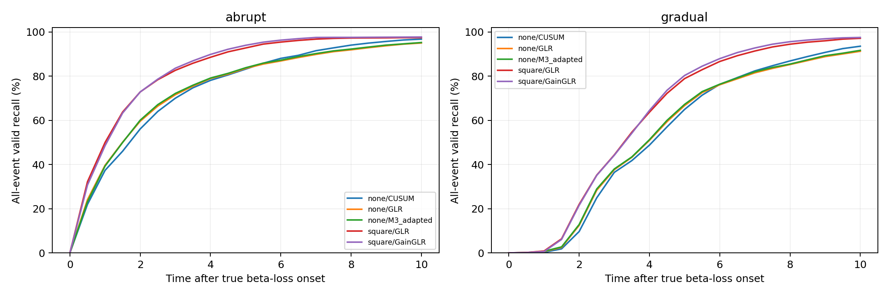
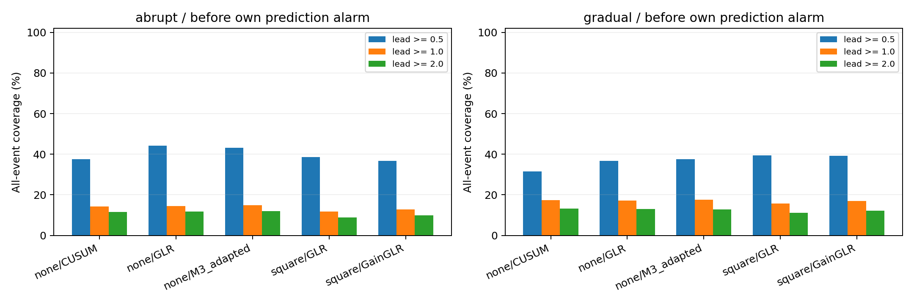

# C7-C1：真实因果作用系数失效的检测与预测性能报警提前量

**结论：主动方波使真实β失效更快被发现，但新增模型的独立预警增益较小，可靠归因的提前预警尚未实现。** 本轮已从“固定机制身份辨别”进入真正的U→X系数变化实验。没有修改B2波形或继续搜索输入，没有做B3或真实数据。

## 1. 主要结果与未达成之处

- 突发失效：无输入GainGLR的合法平均延迟2.464，方波为1.643；包含早报/漏报惩罚的延迟改善 **0.762** 时间单位，校正区间 **0.663–0.859**。
- 渐进衰减：合法平均延迟4.530→3.649；惩罚延迟改善 **0.848**，校正区间 **0.761–0.935**。两项主动输入延迟判据均通过。
- 同一方波、同一观测下，新增GainGLR相对通用GLR“至少提前预测误差报警1单位”的全事件覆盖，仅提高 **1.08/1.33百分点**（突发/渐进）。统计区间正向，但均**未达到预设5百分点实用门槛**，不能说已建立明显的独立因果模型优势。
- 方波GainGLR的至少提前1单位覆盖为 **12.83%/17.00%**。无输入同方法反为15.50%/18.42%，因为主动输入也使预测误差参照更早报警。**检测变快不等于相对预测性能的提前窗口变大。**
- 只改变源头、β并未失效时，若把方波GainGLR每次报警都称作β失效，将在 **87.75%** 轨迹上作此错误归因。更严格规则降至3.17%，却通常晚于预测误差报警。
- 主要5%名义运行点的独立正常实测FPR存在3.2%–7.8%的条件差异，未证实所有工况严格≤5%。预注册1%和2.5%更严点下，实测范围分别.2%–2.3%、1.5%–4.2%，主要结论方向一致。**不能把名义同目标写成真实误报恰好相等。**

四项预设主要判据中，两项输入延迟改善通过，两项同数据模型预警增量未达实用门槛。最终课题目标没有因此被宣告完成。

## 2. 真正变化了什么？

Udot=(1+I−U)/tau；dX=(1.5−.15X−beta(t)U)dt+sigma dW。I是已知注册控制，U和自然源不因β变化而改变。完全失效后β严格0，U不再进入X未来漂移；独立积分和漂移残差检查已验证。

正常β为1+.05sin（随机相位、周期4–12），在.05间隔内保持，表示允许的正常范围波动。主事件随机时刻Tβ在10–18的.25网格上生成，与探测相位独立：

| 场景 | 真正物理变化 | 本轮地位 |
|---|---|---|
| abrupt / C1a | 正常β瞬间乘0 | 主要 |
| gradual / C1b | 正常β乘4单位线性因子1→0 | 主要 |
| partial / C1c | 正常β乘4单位因子1→.5 | 次要 |
| null / C1d | β保持允许范围波动 | 独立正常校准/误报审计 |
| source_only | β保持正常，源基线1→.5 | 误归因诊断，不当β失效成功 |

因此本轮确实改变了因果路径系数，而不是重做源头从无到有的实验。渐进组的实际β叠加小幅正常波动，名义包络线性下降；完全结束后为0。

注册时钟.05、判断更新.25、观察32；X扩散噪声.12/.35/.7，真实正常tau .1/.5/1/2。每场景每工况两批各100条；主要每个策略/方法有2400条事件。跨输入/模式/方法/阈值为配对重复，不当独立样本。

## 3. 固定探测与已知信息

- 无干预：测试期自然源基线1。
- 参照脉冲：每8单位额外sqrt(8)×.5。
- B2方波：每8单位中4单位，额外sqrt(2)，.1开/.1关。

输入相位在0–8随机并预登记，失效时刻独立，算法不据真Tβ选择输入。两种主动策略附加能量均为每周期4、全程16；算法不改输入，也不在判断后停激励。

能量匹配不等于平均源强匹配：非负方波的平均附加源高于短脉冲，物理失效引起的X变化也会更大。输入收益可能包含信号增强，不能全部归为因果推断。因此所有方法也在相同输入和X下交叉比较。

## 4. 训练、校准与时间隔离

[机器协议](PROTOCOL.json)、[可读协议](PROTOCOL.md) 和登记哈希在正式数据运行前固定。测试前保存执行代码、原M3依赖、健康模型和全部阈值hash，运行后全通过核验。

1. 每噪声1000条健康、源端口清零且U初值0的标定X，学习背景q/c；这是可控端口的训练假设，不是偷偷给真实背景参数。
2. 每正常设备/输入160条健康输入激励（共480），只从X和注册I学习有效基线力、增益、tau和噪声；tau在.05–5的41点上剖面选择。
3. 另300条健康记录学CUSUM尺度；每输入/噪声/设备1000条阈值校准、1000条独立正常审计。β正常波动包含在这些数据中。
4. 故障数据是全新种子，两批每工况100条，不用失效标签调模型或阈值。

“无干预”指测试监测期，所有方案共享训练期健康标定；不声称从未主动标定的系统也具备同样参数知识。真实U、β、tau、Tβ均不传入推断。模型知道正常设备身份以使用该设备的健康参数，不是新设备零样本迁移。只观测X，无U/Y传感器。

所有算法从0监测，首个连续两次越阈为报警；早于Tβ的首报单列并算失败，不在Tβ重启。独立输入/失效相位、配对噪声、阈值和首次报警均可重放。核验去除未来实际数据后已有输出不变。

## 5. 方法、M3适配与五个主要方案

全因子比较：三输入×四检测器，另每输入自己的预测误差参照。

- **CUSUM**：单边正向健康创新，五个允许偏移尺度，各尺度标准化只学健康数据。
- **GLR**：通用正向外力/均值偏移，未知起点、幅度、突变或.5/1/2/4/8单位线性变化。
- **M3_adapted**：原评分代码逐字复用，输入先扣除健康注册输入的预期影响并反号，因为原M3方向针对作用增强导致X下降。本轮为削弱作用导致正向创新。它是方向/健康条件适配，**不是原任务未经适配的完整复现**，也不是重新训练的神经模型。
- **GainGLR**：新增β损失假设。用学习的正常总有效作用力构造损失模板，起点/持续时间与通用GLR相同，估计损失比例rho∈[0,1]；不知道真实失效时间/类型/幅度。

B2方波本身不是报警器。第五方案对照D是“B2固定方波+通用GLR”，新方案E是“同方波+GainGLR”；其余三个headline为无干预CUSUM/GLR/M3。完整交叉数据都保存，不只选择有利对照。

这些是高斯工作似然统计量；正常β波动带来未显式建模的相关创新，故其误报和多次搜索用完整健康轨迹经验校准，不把近似分数叫作原论文ACI完整复现。

## 6. 三个时间与提前量定义

Tβ：真正路径参数开始失效；Tdet：算法首次报警；Tpred：冻结健康模型预测性能报警。

预测参照在时刻s发行1单位预测，仅用当时X、健康参数和已登记未来输入计划；预测成熟后才计算误差，取最近4次已成熟标准化平方误差均值，连续两次越阈。未来命令可以已知，未来实际X/β不可以。

**Tpred是特定性能规则，不是物理失效真值。** 它包含预测兑现与平滑的程序性延迟。早于Tpred不等于早于真实失效，不能把当前创新较早报警全部称作神秘的因果先兆。突发组所有合法报警都已晚于真实路径消失。

提前量为Tpred−Tdet，窗口.5/1/2。以全部事件为分母；检测早报、漏报、参照早报/未触发均算覆盖失败。条件平均提前量只算两者都合法的子集，单独保存，不用它代表全体效果。惩罚延迟对早报/漏报赋剩余观察时间32−Tβ；比较输入时每条配对有相同Tβ。

## 7. 五方案独立主要结果（5%名义校准点）

合法延迟仅统计合法首次报警；惩罚延迟与全部事件覆盖同时列出，避免删除失败样本。

| 真实事件 | 方案 | 合法平均延迟 | 惩罚延迟 | 失效召回 | 提前≥.5覆盖 | 提前≥1覆盖 | 提前≥2覆盖 |
|---|---|---:|---:|---:|---:|---:|---:|
| abrupt | none/CUSUM | 2.595 | 2.839 | 98.38% | 37.63% | 14.33% | 11.58% |
| abrupt | none/GLR | 2.534 | 2.910 | 97.42% | 44.21% | 14.50% | 11.71% |
| abrupt | none/M3_adapted | 2.509 | 2.879 | 97.50% | 43.17% | 14.79% | 12.04% |
| abrupt | square/GLR | 1.661 | 2.055 | 97.50% | 38.67% | 11.75% | 8.92% |
| abrupt | square/GainGLR | 1.643 | 1.997 | 97.75% | 36.63% | 12.83% | 9.83% |
| gradual | none/CUSUM | 4.684 | 4.908 | 98.25% | 31.58% | 17.38% | 13.17% |
| gradual | none/GLR | 4.661 | 5.000 | 97.25% | 36.63% | 17.21% | 12.96% |
| gradual | none/M3_adapted | 4.613 | 4.957 | 97.25% | 37.63% | 17.63% | 12.71% |
| gradual | square/GLR | 3.701 | 4.044 | 97.50% | 39.50% | 15.67% | 11.04% |
| gradual | square/GainGLR | 3.649 | 3.958 | 97.75% | 39.13% | 17.00% | 12.08% |

主动方波让检测和预测参照都提前，所以不能用它的较短绝对检测延迟推导更大的相对提前量。相同输入下的GLR、M3和新检测器表现接近，新增结构收益有限。

## 8. 四项预设配对判据

每事件在噪声×设备×批次×序号内配对，共2400独立块；24层bootstrap4000次。四重Bonferroni区间98.75%。首项为百分点，延迟项为时间单位。要求两批同向和正常误报公平门槛。

| 事件 | 对比类型 | 改善 | 校正区间 | 判定 |
|---|---|---:|---:|---|
| abrupt | same_input_model | +1.083 | 0.458–1.750 | 未达实用门槛 |
| abrupt | active_input_delay | +0.762 | 0.663–0.859 | 通过 |
| gradual | same_input_model | +1.333 | 0.625–2.042 | 未达实用门槛 |
| gradual | active_input_delay | +0.848 | 0.761–0.935 | 通过 |

同输入模型门槛为覆盖增量5百分点；输入延迟门槛.25。模型增量区间虽排除0，仍未达实用门槛，不能写成“没有任何统计提升”，也不能写成“已明显优于通用检测”。

误报公平门槛独立审计检查：同方波GainGLR汇总正常FPR5.13%，GLR5.48%；无输入GainGLR5.30%。新方法没有靠更高汇总FPR获得主要增益，预设相对公平门槛通过。但此门槛不证明每个工况真实FPR均≤5%。

## 9. 高噪声及渐进完全失效前的检测

| 事件/方波GainGLR | σ | 合法平均延迟 | 召回 | 提前≥1覆盖 |
|---|---:|---:|---:|---:|
| abrupt | 0.12 | 0.529 | 97.38% | 0.00% |
| abrupt | 0.35 | 1.295 | 97.88% | 3.50% |
| abrupt | 0.7 | 3.097 | 98.00% | 35.00% |
| gradual | 0.12 | 2.007 | 97.38% | 0.50% |
| gradual | 0.35 | 3.514 | 97.88% | 8.38% |
| gradual | 0.7 | 5.415 | 98.00% | 42.13% |

高噪声下预测参照更迟、偶尔不触发，因而“提前≥1覆盖较高”不意味着高噪声检测更容易。其真实检测延迟明显更长。必须同时读延迟、预测参照检出率和提前量。

渐进组在4单位后路径完全消失；方波GainGLR在其完全消失前合法报警的比例为59.46%，无输入46.83%。这是次要描述，表明部分轨迹能在完全失效前发现退化，但仍不是特定因果来源的唯一确认。

部分失效（名义1→.5）的次要结果：

| GainGLR输入 | 合法检出 | 条件延迟 | 提前≥1覆盖 | 未报警 |
|---|---:|---:|---:|---:|
| none | 85.71% | 6.796 | 15.96% | 12.29% |
| pulse | 90.79% | 6.240 | 18.17% | 7.08% |
| square | 93.25% | 5.952 | 19.21% | 4.50% |

## 10. 误报、同预算与预设敏感性

所有方法对同一正常记录使用同样的整轨迹校准分位规则，目标1%/2.5%/5%，主要5%。同名义预算不可能保证有限数据中实际FPR恰好相等，必须看独立审计。5%点的普通方法单元点估计3.2%–7.8%，未全部达到严格5%实测上限，不能隐去超标单元。

| 输入/方法 | 汇总正常FPR，5%名义点 |
|---|---:|
| none/CUSUM | 5.29% |
| none/GLR | 5.27% |
| none/GainGLR | 5.30% |
| none/M3_adapted | 5.44% |
| none/PredictionError | 4.84% |
| pulse/CUSUM | 5.24% |
| pulse/GLR | 5.59% |
| pulse/GainGLR | 5.31% |
| pulse/M3_adapted | 5.54% |
| pulse/PredictionError | 4.91% |
| square/CUSUM | 5.30% |
| square/GLR | 5.48% |
| square/GainGLR | 5.13% |
| square/M3_adapted | 5.56% |
| square/PredictionError | 4.82% |

全部36工况×6方法×3预算的点估计与Wilson区间保留。主要比较另要求欲宣称优势者的汇总FPR不能高于对照>1百分点且配对95%差异排除0；未按审计或故障结果重新调阈。

较严预算在运行前已登记，不事后替换主要结论；所有方法同点重评，方向相同：

| 名义点 | 事件 | 正常普通方法实测范围 | 新模型相对同方波GLR提前≥1增量，百分点 | 方波相对无输入的惩罚延迟改善 |
|---|---|---:|---:|---:|
| 1% | abrupt | 0.20–2.30% | +0.42 | 1.059 |
| 1% | gradual | 0.20–2.30% | +0.67 | 1.134 |
| 2.5% | abrupt | 1.50–4.20% | +1.37 | 0.905 |
| 2.5% | gradual | 1.50–4.20% | +1.92 | 1.007 |
| 5% | abrupt | 3.20–7.80% | +1.08 | 0.762 |
| 5% | gradual | 3.20–7.80% | +1.33 | 0.848 |

在2.5%点所有实测普通单元为1.5%–4.2%，1%点为.2%–2.3%；这为较严预算提供了复核，但不把主5%点的超标结果改写成达标。

**追加可靠性区间审计（不改主要检验）：** 对全部648个方法/工况/预算，采用单侧Clopper–Pearson区间、Bonferroni同时95%校正。1%运行点的最差上界为4.65%，因此在本已测试正常分布及固定模型下，这个预设较严点可支持全部单元真实整轨迹FPR低于5%；2.5%/5%点最大上界分别7.13%/11.48%，不支持同样结论。完整结果与复现代码分别在normal_simultaneous_bounds.csv、reliability_bounds.py。没有用这些区间重新调阈，也不把敏感性点事后提升成预设主要检验。区间不证明真实FPR恰好相等，更不保证未测分布。

## 11. 关键限制：能报警不等于能认出β失效

source_only只改变源头，β保持正常。如果将每次普通GainGLR告警都声称为β失效，则以下是错误归因的轨迹比例（不是正常系统FPR）：

| 方法 | 源头变化对照上的β告警/归因比例 |
|---|---:|
| none/GainGLR | 88.92% |
| none/GainSpecific | 0.00% |
| pulse/GainGLR | 87.42% |
| pulse/GainSpecific | 2.46% |
| square/GainGLR | 87.75% |
| square/GainSpecific | 3.17% |

GainSpecific增加固定证据条件：GainGLR相对通用外力偏移GLR的2log似然差>2log10，且报警阈值不低于GainGLR。它拒绝很多源头变化，但这个差值不是“90%真实因果概率”，也不保证排除所有其他原因。其实际正常FPR更低，因此**不作为同实际FPR下的主优越性比较**。

| 真β失效 | 输入 | 严格规则合法检出 | 未归因/未报警 | 条件延迟 | 提前≥1覆盖 |
|---|---|---:|---:|---:|---:|
| abrupt | pulse | 74.83% | 25.08% | 6.107 | 0.54% |
| abrupt | square | 68.96% | 31.04% | 6.789 | 0.00% |
| gradual | pulse | 71.79% | 28.13% | 8.158 | 0.67% |
| gradual | square | 64.88% | 35.13% | 9.338 | 0.04% |

方波严格归因的提前≥1覆盖：突发0%、渐进约.04%，通常晚于性能报警；渐进组在完全失效前严格归因仅1.96%。源头变化对照误归因降为3.17%，代价是更迟和更多拒判。**本轮没有实现同时早、可靠且特定于β路径失效的预警。**

无输入时GainSpecific全部拒判是应有行为：常数有效U的系数下降与外力均值偏移在X中同形，统计异常无法唯一指认因果来源。主动控制可提供区分信息，但当前固定输入与诊断规则积累足够归因证据较慢。本实验没有证明所有可行方法都不可能更早。

## 12. 核验、工件与复现

独立ODE积分与精确离散β×U乘积最大误差约5.00×10⁻¹¹；完全失效后的创新漂移独立于U。真失效前路径相同，输入/U不因β而变。所有方法通过截断未来检查，原M3及依赖文件与C7-A字节一致。648个阈值重建、首次报警、配对输入相位/事件、正确事件/提前误报/未报警分区全部通过核验。

全部518400行评价记录包含四场景×三输入×六统计规则×三预算，**不是518400个独立实验**。主场景每工况两批各100条；输入及方法为配对重复。区间是针对已训练模型的独立测试条件，不包含重新训练的额外不确定性。

依赖requirements.txt。`OPENBLAS_NUM_THREADS=1 python validate.py`；`python run.py`（健康学习、正常校准审计、两批故障测试）；`python analyze.py`；`python audit.py`；`python reliability_bounds.py`（追加正常区间审计）；`python make_report.py`。运行用两个普通计算进程，不是多代理选择实验。完整主要分数、前10条每条件X/I/U/β示例、全部指标、阈值和种子都保存；replay.py可重建全部输入和评价真值。

结论只适用于本线性结构、稳定背景/源端口校准及已声明正常波动。附加控制总能量和源平均水平改变了问题本身，源变化/执行器变化仍可能混淆路径系数变化。没有证明未知真实系统的唯一因果关系，也没有证明原论文ACI/CIR的完整复现。
