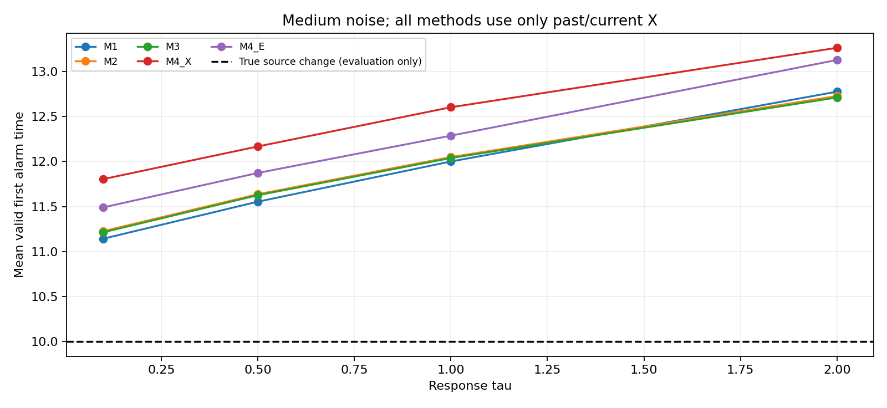
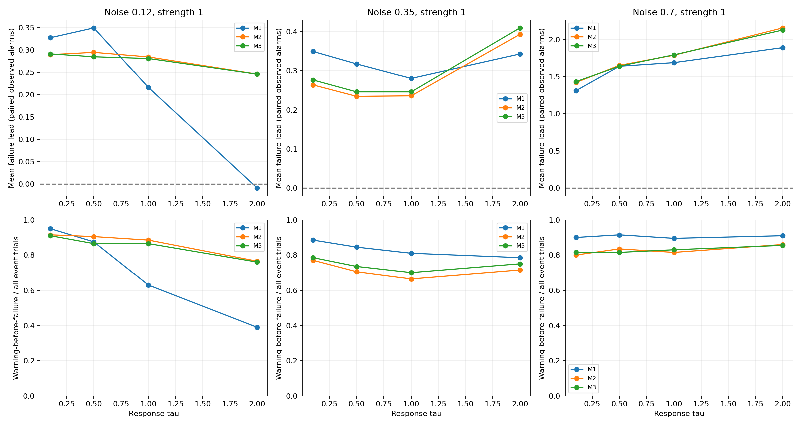
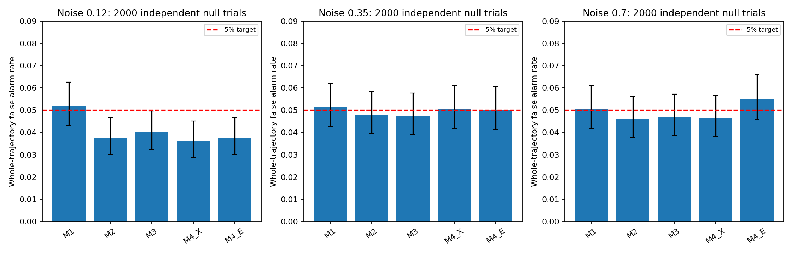
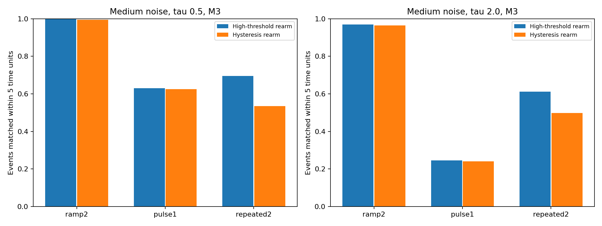
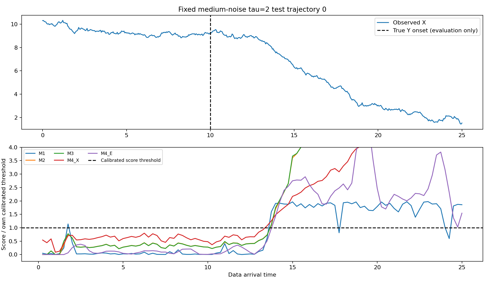
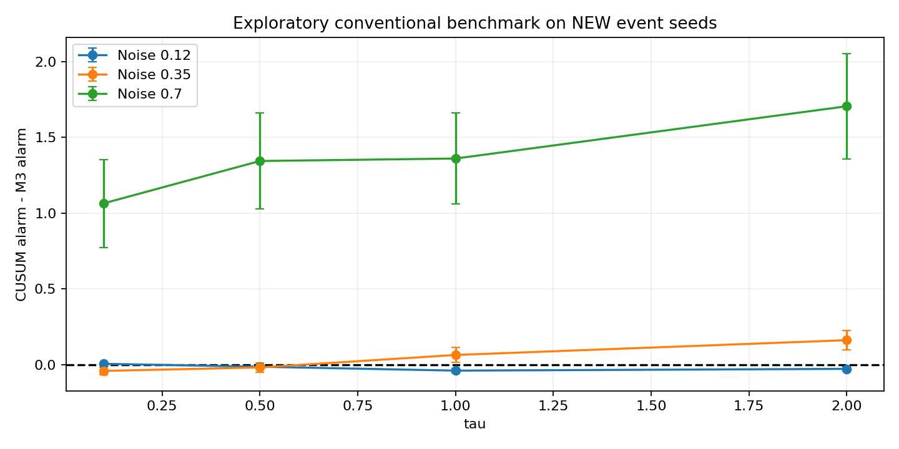

# 实验 C：实时结构化变化预警、阈值可靠性与复杂变化

日期：2026-11-13。**C1/C2/C3已完成。结论：在已知一阶传递结构的模拟中，可以在预先定义的X异常与预测误差报警之前获得有限提前量；未知τ模型并未普遍胜过旧HMM、固定τ模型或传统CUSUM。短事件与重复事件的可靠性仍不足。证据支持结构化统计预警，尚不支持唯一识别物理因果机制失效。**

## 设计与信息边界

C1复用C0的生成器与36个噪声×τ×强度条件，每格200条响应；T_Y=10。Y经一阶U作用于X，所有系数、状态定义与前轮一致。跨τ/强度共用同一组噪声创新进行配对，不能把7200个条件响应视为7200条互相独立的随机创新。

C2每噪声用2000条独立无事件X做阈值校准，再用另外2000条测试误报。参数沿用C0独立正常X学习的AR与共享τ，M1沿用冻结seed11 HMM。阈值不使用事件测试的Y/τ/起点/预测失败时间。所有方法目标是25时长内“至少报警一次”的概率约5%，不是每个采样点5%。

C3额外18格（3噪声×2个τ×3种变化），每格200条：2单位渐变、1单位短脉冲、两次各持续2单位的脉冲；首事件时间随机8–12，第二次在首事件后6单位，不再都固定10。

真实数据间隔0.05，所有检测器统一每0.25更新。M2/M3候选起点也用0.25网格；M3保留C0的41点τ搜索。统计量在每个数据终点重新使用此前观测计算，候选源起点始终在过去。通过递推累计相关量加速，与独立前缀剖面似然完全一致；没有用完整轨迹的τ估计去回填更早的实时报警。

## 方法与报警时刻

| 方法 | 报警依据 |
|---|---|
| M1 | 旧HMM前向负向作用状态概率 |
| M2 | 共享τ的一次持续源变化＋一阶传递假设，对正常模型的最大似然比 |
| M3 | 每个当前前缀联合估计未知τ、源起点与强度后的最大似然比 |
| M4_X | X显著低于正常AR条件均值轨迹 |
| M4_E | 固定正常预测器的已完成预测误差异常 |

M4分成X异常与预测误差两条传统参考，不能把它们混成一个时间。下文T_alarm为某方法报警，T_X为主规则M4_X报警，T_failure为主规则M4_E报警。全部数据时间是模型时间单位，不是真实秒数。

## 预测失效标准预先固定

正常AR预测器在每次发出未来1单位的预测；只有目标X真正到达时才计算误差。将误差平方除以正常1单位预测方差，取最近4个已完成预测的均值，再连续2个更新超过独立校准阈值，记T_failure。最早4个成熟预测对应1、1.25、1.5、1.75；不会在预测目标到达前使用它的误差。

主规则为连续2次确认。C2另比较1/2/3次确认，各自校准阈值；评估这些变体时，T_X和T_failure仍固定为主规则连续2次的参考时间，不因预警器变体改变“失效”的定义。这个T_failure是可观测性能报警标准，不是唯一的物理设备故障时间；提前量会依赖预测时距、窗口和阈值。

## C1主要结果：中噪声、标准强度、连续2次确认

| τ | M3有效平均报警时间 | 参考X异常时间 | 参考预测失效时间 | 配对X提前量 | 配对失效提前量 | 全事件预警覆盖率 |
|---|---:|---:|---:|---:|---:|---:|
| 0.1 | 11.215 | 11.806 | 11.491 | 0.585 | 0.277 | 78.5% |
| 0.5 | 11.626 | 12.168 | 11.874 | 0.533 | 0.246 | 73.5% |
| 1.0 | 12.039 | 12.604 | 12.288 | 0.552 | 0.246 | 70.0% |
| 2.0 | 12.712 | 13.264 | 13.129 | 0.537 | 0.410 | 75.0% |

例如τ=2：真实源变化在10，M3平均约12.71报警；预测失效参考平均约13.13。配对失效提前量0.410，95% CI [0.337,0.482]；检测延迟2.712，95% CI [2.610,2.815]。这两个量不同：虽然比失效标准早，仍然晚于真实源变化。平均提前量约1–2个更新步，不能夸大为很长的工程处置时间。

三列时间各取有效首报条件均值；提前量只在同条轨迹两种有效首报都有观测时配对计算，因此不必等于列均值之差。提前量为负的配对保留，没有只选择提前成功者。

全事件覆盖率=200条事件轨迹中，预警有效且严格早于观测到的有效T_failure的比例。未失效、失效参考先于源变化误报、预警漏报/早报，均不算覆盖成功；另单独报告在观测到有效失效者中的条件覆盖率。未观察到失效不会被当成无限大的提前量。

## M3是否优于更简单的模型

| 中噪声τ | M1失效提前量 | M2失效提前量 | M3失效提前量 |
|---|---:|---:|---:|
| 0.1 | 0.349 | 0.264 | 0.277 |
| 0.5 | 0.318 | 0.235 | 0.246 |
| 1.0 | 0.281 | 0.236 | 0.246 |
| 2.0 | 0.343 | 0.393 | 0.410 |

未知τ没有带来普遍的更早报警：快响应条件旧HMM反而更早，M2与M3多数条件非常接近。τ=2中噪声时，M3报警时τ估计中位数约0.126，真实τ是2；说明取得提前量时仍未可靠估计真实传递速度。它是在积累对某种变化假设的证据，不能把报警解释成已经准确恢复机制参数。

低噪声、τ=2时，M1平均失效提前量约−0.009，M3约0.246；结构约束在这一条件有帮助。高噪声的平均提前量较大，同时分布更偏斜、检测也更晚，应同时读中位数、覆盖率和误差分布，而不能说高噪声更容易预警。

## C2：独立阈值校准与误报

| 噪声 | M1 FPR | M2 FPR | M3 FPR | M4_X FPR | M4_E FPR |
|---|---:|---:|---:|---:|---:|
| 0.12 | 5.20% | 3.75% | 4.00% | 3.60% | 3.75% |
| 0.35 | 5.15% | 4.80% | 4.75% | 5.05% | 5.00% |
| 0.7 | 5.05% | 4.60% | 4.70% | 4.65% | 5.50% |

高噪声M3为4.70%，2000条独立无事件测试的Wilson 95% CI [3.86%,5.72%]，与5%目标相符。不能据此保证所有环境中误报≤5%。这轮监测时序与校准量均不同于C0离线9.4%的测试，不是简单把旧结果改写成低误报。

中噪声标准强度M3有效首报召回99.0%；在预先规定的1:1事件/无事件构成下精确率约94.7%。真实应用事件更罕见时精确率会下降，不能把这个数当作任意事件发生率下的性能。早于真实事件的首报记作误报，不在T_Y重置，不把它算成成功提前预警。

| 中噪声τ=2的M3 | 检测延迟 | 相对固定失效标准的提前量 | 独立无事件FPR |
|---|---:|---:|---:|
| 连续1次确认 | 2.666 | 0.462 | 5.15% |
| 连续2次确认 | 2.712 | 0.410 | 4.75% |
| 连续3次确认 | 2.838 | 0.292 | 5.10% |

连续确认有检测延迟代价；相同目标误报预算下，不能假定确认越多所有指标都更好。迟滞重置只在分数连续两次低于高阈值一半时重启；首个报警与普通高阈值重置完全相同，所以它不会改善首次报警误报率。它影响的是后续重复报警与重新检测能力，放在C3对照。

## C3：渐变、短暂恢复、多次变化

事件级匹配规则固定为每个正向作用开启后5单位内第一次未匹配报警；同一个报警不能匹配两个事件。生成了作用关闭后的恢复过程，但主要召回针对正向异常作用开启，没有声称所有方向的机制变化都被检出。

| 中噪声τ=2，M3 | 轨迹内至少一次有效报警 | 5单位窗口事件召回 | 迟滞后事件召回 |
|---|---:|---:|---:|
| ramp2 | 99.5% | 97.0% | 96.5% |
| pulse1 | 27.0% | 24.5% | 24.0% |
| repeated2 | 99.0% | 61.3% | 49.8% |

中噪声慢响应的1单位短作用，5单位内事件召回只有24.5%；多数被噪声掩盖或未能及时形成证据。两次事件的轨迹召回虽为99%，不等于两次都找到了：普通重置下第二次事件召回50%，迟滞后降到27.5%。迟滞减少重复报警、提高事件精确率，但可能使系统无法及时重新武装。一次持续阶跃假设的模型没有被证明适合多次反复变化。

事件级区间用轨迹为单位的簇自助法计算，避免把同条轨迹的两个事件当成独立样本。每次重复报警与事件匹配结果保留于episodes.csv.gz。

## 补充传统CUSUM对照：探索性、新测试种子

主实验之后增加固定allowance=0.5的单侧创新CUSUM，作为更强的传统累积变化基准。该选择没有按事件结果搜索参数；仍用独立无事件校准，在全新的事件种子34000+噪声编号上测试每格200条标准强度轨迹。由于是在主结果之后提出，本项标为探索性补充，不与预先固定的主实验混称。

| τ，中噪声 | M3比CUSUM早多少 | 配对95% CI |
|---|---:|---|
| 0.1 | -0.042 | [-0.067, -0.016] |
| 0.5 | -0.019 | [-0.049, +0.011] |
| 1.0 | +0.063 | [+0.013, +0.114] |
| 2.0 | +0.161 | [+0.095, +0.227] |

CUSUM也能在预测误差标准前报警。中噪声快响应时CUSUM稍快；慢响应τ=2时M3稍快约0.161个时间单位，但优势仍小于一个更新间隔。这个对照说明，提前报警的收益并非只有“因果模型”才能得到。完整三噪声结果和独立CUSUM误报率单独保存。

补充对照中，M3与CUSUM也使用同一批新的2000条无事件轨迹核对误报；目标相同不代表有限样本的实际误报率完全相等。

| 噪声 | 补充集M3 FPR | 补充集CUSUM FPR |
|---|---:|---:|
| 0.12 | 4.70% | 5.65% |
| 0.35 | 4.50% | 5.05% |
| 0.7 | 5.05% | 5.55% |

## 结论的因果含义与边界

本轮源Y强度变化，在已知传递结构下导致X分布变化；M2/M3计算的是结构化假设相对正常模型的似然证据，没有引入已验证的新动态因果强度指标。若令另一系统Y恒为1、源到U的耦合g(t)发生同样阶跃，则有效输入g(t)Y与原来的Y阶跃完全相同，产生同样U和X。只看X不能区分“源状态改变”还是“耦合机制改变”。等价检查保留于mechanism_equivalence.json。

因此，本轮支持“对已发生的、可观测分布中已有微弱证据的变化进行有限预警”。尚不能据此宣称唯一识别真实因果边的变化、在X完全没有信息时预知事件，或已经验证任意未知机制失效的提前识别。实际失效标准的时距/窗口、模型族与其他传统基准仍会影响结论。

## 统计、验证和复现

均值/标准差/中位数及近似95% CI以每格独立轨迹为单位；误报、召回、平衡精确率使用Wilson区间；复杂事件用轨迹簇自助区间。跨条件共享创新的比较按配对处理，未把多个模型/时刻/同轨迹事件当成额外独立样本。区间不覆盖重新抽样正常参数训练集的不确定性；多重比较未校正。

通过：实时递推与独立前缀似然一致；所有检测器改变未来X不改变此前输出；预测失效仅使用已成熟的误差；确认报警记录完成时刻；迟滞不改变首报；校准控制的是整轨迹越界概率。C2所有确认变体共享固定主规则T_X/T_failure，未为变体挑有利失效时间。

```bash
OPENBLAS_NUM_THREADS=1 python run.py
OPENBLAS_NUM_THREADS=1 python validate.py
OPENBLAS_NUM_THREADS=1 python supplement.py
OPENBLAS_NUM_THREADS=1 python report.py
```

配置、阈值、逐轨迹压缩CSV、分条件统计、预测失效时间、起点估计、复杂事件匹配、补充CUSUM结果、模型来源与数值检查均已保存。

## 图表











