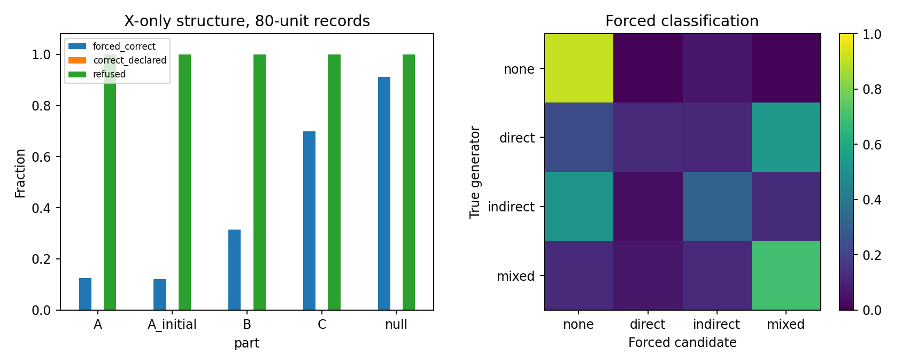
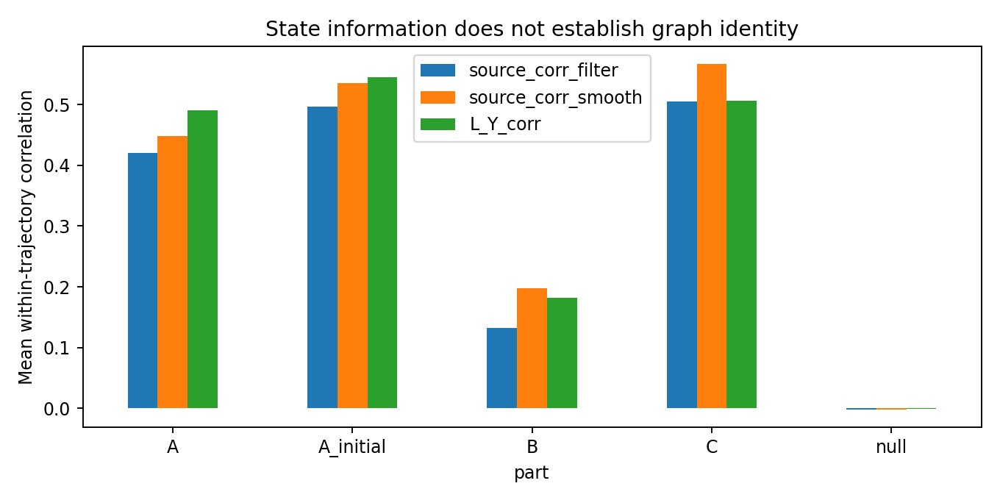
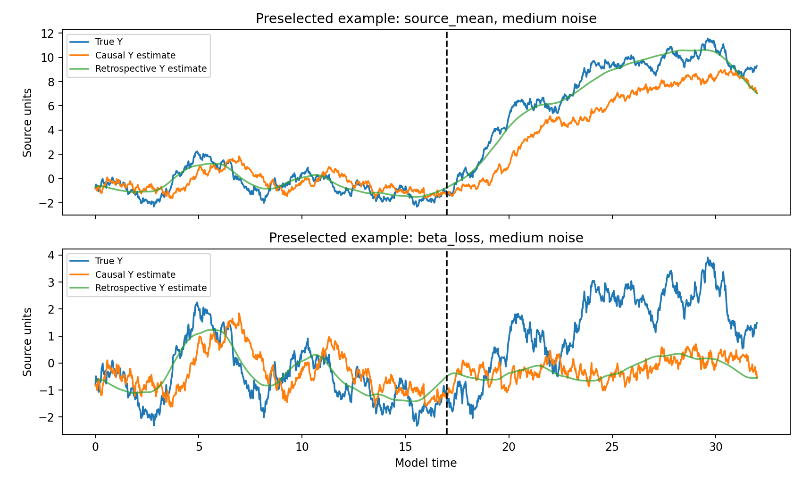

# D1：只观测 X 时，能否识别直接／间接作用，以及利用上游状态预警？

2026-11-16，云端实际运行。**本轮没有达到可靠识别直接／间接因果结构的目标。** 能恢复部分隐藏动态线索；但在冻结的严格结构判定规则下，几乎所有轨迹都证据不足。数学反例还表明，不增加假设或信息时，不同真实结构甚至能产生完全相同的 X 分布。

用户提出的“Y 先变化，经 Z 传到 X，因此从估计的 Y 预警”的思路，具有条件性的可行性：X 已包含上游异常的微弱信息、正常传递规律足够可信、异常会影响未来预测，才可能有帮助。本轮条件性诊断有这种现象，但没有证明完整结构发现成功，也没有证明优于通用变化检测。

## 1. 实际完成的规模和连续性

沿用此前实验的线性随机动力学、延迟编码潜在状态、源头—传递分离及滤波／回溯思想。本轮新增直接、间接、混合候选观测似然，重新训练 X-only 编码器，并未直接复用旧权重，也不是完整 ACI/CIR 复现。

- 结构／状态主测试：261 个条件，每条件两批各 100 条，共 **52,200 条**。
- D1-D：5 类精确等价反例、3 档噪声、两批、每个标签各 100 条，共 **6,000 条**。
- 补充实时预警：3 档噪声、两批、每种场景 100 条；共 **1,800 条物理轨迹、7,200 条方法指标记录**。各场景共用随机扰动，属于配对比较。
- X-only 训练每档噪声 120 条、验证 60 条；编码器 3 个优化种子。补充预警另用每档 30 条正常训练、1,000 条正常校准。

采样间隔 0.025；主测试观测长度 80，通常先热身 20；初始相关性压力测试不热身。所有时间均为模型时间单位，不能直接当现实秒数。

## 2. 变量和数据权限

Y 是隐藏源；物理 Z 是中间传递状态；**L 才是神经网络学得的潜在表示**，三者不能混用。间接系统只可能恢复某种等价尺度，本轮报告有效中间作用 W=βZ；不把 α、β 分别估准作为成功指标。

生成器保留 Y、Z、参数作为答案；模型训练、候选结构比较及实时状态推断只读 X。神经网络冻结后，用独立验证集的隐藏答案拟合线性探针，仅检验 L 是否编码隐藏信息；该有答案的诊断探针不用于结构判定、报警或参数训练。因此其相关性不能被解释为模型无监督恢复了真实 Y 的绝对单位。

## 3. 系统和条件

直接：dY=-aYdt+dW_Y；dX=(-bX+βY)dt+σdW_X。

间接：再加入 dZ=(-cZ+αY)dt，X 由 βZ 驱动。

混合：dX=(-bX+β₁Y+β₂Z)dt+σdW_X。

主测试：β=0.3/0.5/1/2；a=0.25/1/4；c=0.5/2/8；σ=0.12/0.35/0.7。B 组主要交叉 α、β=0.3/0.7/1.5；C 组主要交叉直接系数与路径乘积=0.3/0.7/1.5；另有快／慢源压力条件。中间记忆时间为 1/c，与传递速度并非两个独立旋钮。A_initial 检验初始 Y-X 相关 ±0.7，β=1，独立于平稳主结论。

正向面板的结构先验很强：已知 b=0.7；源创新尺度规范为 1；正作用、有界参数；中间没有独立创新噪声；源与中间衰减率使用预先给定的不重叠候选带。噪声强度从训练 X 的二阶差分估计，测试时再对其 ±15% 作似然剖面。没有把单条测试真实 a、c、β、Y、Z 交给推断器。

这些不是“完全未知系统”。特别是源噪声尺度、隐藏噪声结构和时钟角色先验，不能仅靠一个 X 自动认证。

## 4. 方法和冻结标准

L：81 点历史窗、二维表示、两层 32 单元 tanh，联合预测未来 0.1/0.5/1 时间单位 X 增量与潜在动态，验证仅看 X 损失。每条轨迹先对三个种子的探针预测取均值，再计算指标。

结构：四个候选 none/direct/indirect/mixed；使用精确采样 OU 协方差导出的 Hann 加窗期望谱，间隔频点的 Whittle 工作似然。各类等先验，类内有限参数先验平均。**条件后验≥0.95 且与次优家族的最大似然差≥3，才作正向结构声明**；none 代表没有解析出隐藏作用、按操作规则拒判，并非证明不存在隐藏原因。工作后验不是一般因果正确概率。

全长 80 的结构分析是事后分析。实时状态模型只用最初 20 时间单位 X 拟合参数并冻结，随后前向 Kalman 滤波只用当前及过去 X；RTS 平滑会使用未来，仅作回溯。

主协议和实现／模型哈希见 [PROTOCOL.json](PROTOCOL.json)、[PROTOCOL_REGISTERED.json](PROTOCOL_REGISTERED.json)、[TEST_START.json](results/TEST_START.json)。预警是单独冻结的补充阶段，见 [TIMING_PROTOCOL.json](TIMING_PROTOCOL.json)。首次预警实现运行保留在 timing_development_pilot；没有读取其结果汇总调参，另用新测试种子 833000、预先记录代码哈希后复跑。该补充冻结不能冒充主测试前的同一冻结时点。

## 5. D1-A/B/C 主结果

| 真实生成结构 | 条数 | 强制选一个候选时正确率 | 正确且达到声明标准 | 错误且达到声明标准 | 拒判率 |
|---|---:|---:|---:|---:|---:|
| A 直接 | 7,200 | 12.40% | 0 | 0 | 100% |
| A 初始相关性压力测试 | 3,600 | 12.03% | 0 | 1 | 99.972% |
| B 间接 | 19,800 | 31.54% | 9 | 0 | 99.955% |
| C 直接＋间接 | 19,800 | 69.88% | 16 | 0 | 99.919% |
| 无隐藏作用对照 | 1,800 | 91.17% | 0 | 0 | 100% |

强制分类正确率只是诊断，不代表满足可靠识别标准。总共只有 26 条正向声明，其中 1 条错误；不能只报“25/26 正确”而忽略几乎没有覆盖率。A 组常把直接作用分配给混合候选；严格规则阻止了这些低信心输出成为因果结论。

**本轮既没有证明“直接作用识别成功”，也没有证明“间接结构可靠恢复”。** 有限窗、有限参数先验、弱信号和候选近似都会影响结果；失败只说明当前实现和条件未达到目标，不证明所有满足更强条件的方法都不可能成功。没有根据测试结果放宽阈值，也未挑条件重算主要结论。



| 主组 | 实时 Y 估计相关 | 事后平滑 Y 相关 | 学习表示 L 的诊断 Y 相关 |
|---|---:|---:|---:|
| A | 0.420 | 0.448 | 0.491 |
| B | 0.132 | 0.197 | 0.182 |
| C | 0.505 | 0.567 | 0.506 |

均为逐轨迹相关的平均，包含错误候选／无隐藏证据情况，未仅选择成功案例。B 组间接上游最难恢复。低噪声 A 组 L-Y 平均相关 0.707，高噪声 0.364；B 分别为 0.317 和 0.112。

在 A 组，L 相对只用当前 X 的探针总体增量 R² 约 0.021；B 组约 -0.003；C 组约 0.060。中间 W 的跨机制线性探针在部分条件明显失配，增量 R² 不限于 [-1,1]，不能把很大的正数当成解释比例或结构证据。完整指标（含误差而非只有相关）在 summary_noise.csv。

β 强度增大时拟合直接系数均值呈上升趋势（低噪声约 0.118→0.387→0.909→1.937），但结构多数选错或拒判；这不是正确分离路径强度的证明。间接只报告 γ=αβ 的候选估计；不声称分别恢复 α、β。稳态 Y→X 间接增益是 αβ/(bc)，两条路径比较时不能遗漏 c。



## 6. D1-D：什么时候从原理上不可能区分？

构造了五类平稳线性高斯机制，解析 X 谱相同，故所有有限维 X 分布相同。使用真实协方差独立数值验证，15 个“反例×噪声”条件最大相对误差 **1.19×10⁻¹⁴**。

1. 直接 vs 带独立中间创新的间接：调整噪声与衰减率发生谱极点抵消，X 分布精确相同。
2. 干净混合路径 vs 带中间创新的纯间接路径：混合路径的谱分子可由中间独立噪声复制。
3. 干净间接链交换 a 与 c：X 谱不变；不能自动判断哪个时钟属于源、哪个属于中间。
4. Y 尺度改变、β 相反缩放：X 不变，单靠 X 无法恢复物理 β 的唯一尺度。
5. 即使没有中间创新，**正的混合路径也能精确抵消一个极点**，使混合结构看起来就是直接结构。

例如第 5 对：混合 a=2,c=0.5,α=1,β₂=0.75,β₁=0.5，其作用传递分子为 0.5(s+2)，恰好消去源极点；与 a=0.5、β=0.5 的直接模型得到相同 X 谱。

对已明确给出的等价候选，等先验后验只能各 0.5，必须拒绝二选一。6000 条数据检验是等价机制采样；“0.5／拒判”由解析等价规则给出，**不是训练出了能自动识别所有未知不可识别情况的分类器**。受限家族的高信心也不能排除家族外的等价机制。

### 哪些附加条件可能使识别成为可能？

在已知线性 OU 家族、独立白噪声、qZ=0、噪声尺度／b 已知或可独立估计、非零作用、无极点抵消、足够长且高信噪比的观测等条件下，直接和纯间接候选的隐藏信号谱具有不同阶数，理论上可区分；要给源与中间分别命名，还需时钟角色或额外观测先验。混合结构还需最小性与不抵消条件。

这只是受限模型的可辨识条件分析，本次有限样本方法没有把它变成可靠分类。若要识别真实路径而非候选动态阶数，应增加观测 Y/Z、已知针对源头的外部输入／干预、独立噪声与自衰减标定，或明确更强物理约束；单纯把模型做复杂无法消除精确等价。

## 7. 补充：估计 Y 能不能提前预警预测失效？

该部分**预先假设间接家族成立**，从正常 X 学参数，不把主测试的结构分类当已成功。固定 a=0.25,c=2,α=β=1 的物理场景；事件时刻在 10～18 随机，方法不知道它。三个方法各自用 1000 条独立正常轨迹校准整轨迹 5% 误报目标，每 0.25 更新、连续两次超阈报警；测试 600 条／场景。

预测参照用冻结健康模型预测 1 时间单位后的 X，等真实值到达才计算误差，最近 4 次误差均值超阈确认；没有将未来误差提前送给 Y 预警器。它是一个预先定义的**预测误差报警规则**，不是不可争议的真实业务失效时刻。

### 场景一：源过程均值发生较强异常（目标均值 0→8）

路径参数保持正常，只改变 Y 的驱动规律。这是上游分布异常，不是因果连接断裂。

| 方法 | 无事件整轨迹误报率 | 事件后有效检出率 | 检出者平均延迟 | 与预测误差均有效报警时的平均提前量 | 全部事件中至少提前 1 的覆盖率 |
|---|---:|---:|---:|---:|---:|
| 实时估计 Y | 4.17% | 96.67% | 5.78 | 1.41 | 20.33% |
| 创新 CUSUM | 4.50% | 97.83% | 6.16 | 1.93 | 29.50% |
| 预测误差报警 | 4.33% | 67.00% | 7.43 | 0 | 0 |

“检出率”把事件前误报视为该轨迹不能有效预警，未重置后再报成功。提前量仅在双方事件后有效报警的配对上计算，各方法的子集不同，不能用列均值直接排名。至少提前 1 的覆盖率分母是全部事件，参照未报警不当作无限提前。Wilson 区间保留在 timing_intervals.json，噪声分层在 summary_timing_noise.csv；训练／校准不确定性未纳入这些条件区间。

Y 预警确实在一部分轨迹早于预测误差报警，但 **CUSUM 也做得到，且提前≥1 的覆盖率更高**。所以没有证明隐藏机制结构具有独有预警优势。实时估计仍在事件后平均约 5.78 才报警，绝不是看到了 Y 变化、X 还完全没有信息就能预知。

事后 RTS 的平均时间标记更早（约事件后 3.37），但其全部结果到 t=32 才可用；不计入实时提前量。图中曲线即使在较早时刻弯曲，也不能改写信息可用时间。

### 场景二：下游 β 从 1 突然降为 0

同一随机扰动下，真实 Y、真实 Z 与正常对照逐点完全一致，代码有断言。因此监测真实 Y 的异常也没有必然的先兆；从 X 估计的 Y 则可能因模型失配而改变，那是下游表现引起的估计变化，不能解释为真实上游先变。

本轮 Y 阈值和均值型 CUSUM 的有效检出率均 0，预测误差报警约 0.33%。这不是所有检测器都不能检测 β 失效：当前规则不擅长检测方差下降／去耦，已知目标干预、方差或响应增益检测可能提供额外证据。

健康模型的标准化晚期预测 MSE：正常 1.033，源均值异常 5.169（约 5.01 倍），β 断裂 0.561（约正常 0.54 倍）。**连接失效并不必然导致均方预测误差变大**，这里去掉随机驱动反而减少误差；因此不能把“β=0”强行命名为已经达到预测误差失效标准。



## 8. 对原研究问题的直接回答

“Y 最先变，所以可以通过 Y 预警”的推理缺少一个步骤：**我们没有直接看到 Y，估计 Y 的所有信息仍来自已经观测到的 X。**

若 X 已含早期微弱信号，利用可信动态模型重构 Y，可能早于简单的 X 阈值或预测误差阈值报警；这是一种有价值的信号提取，本轮源异常诊断提供了条件性例子。若 X 在某段时间内与正常系统的分布完全一样，则任何 X-only 方法都没有可靠预警依据。若未来失效来自与 Y 无关的连接变化，Y 不一定有任何先兆。

因此这轮证据支持“在受限结构和可观测早期信息下研究预警”，不支持“仅凭 X 已识别真实直接／间接因果关系，并可普遍预知失效”。当前最需要补强的是可辨识条件及结构判定覆盖率，而不是把相关性继续包装成因果识别成功。

## 9. 验证、区间与复现

- 精确离散 SDE（矩阵指数与连续 Lyapunov），没有用粗 Euler 近似制造传递延迟。
- 快速滤波与独立逐步 Kalman 实现最大差约 4.03×10⁻¹³；RTS 最大差约 8.82×10⁻¹³。
- 截断未来 X 不改变前向状态；加窗谱与独立矩阵指数协方差计算相对误差 1.70×10⁻¹⁶。
- 主代码／训练模型与测试前哈希一致；补充预警与其单独冻结哈希一致；52200 条主记录唯一且判定完备；等价 6000，预警 7200 记录数核对通过。
- state_intervals.json：固定条件网格内逐轨迹分层 bootstrap 的相关／增量指标区间；每条件每轨迹为采样单位，不把时间点当独立样本；三个 NN 种子不算三倍测试量。区间均条件于已冻结训练模型，不能代表对任意系统的总体不确定性。
- 不可识别反例通过解析谱相等论证，协方差数值检验是核对，不用有限样本检验“不显著”冒充证明等价。

```bash
export OPENBLAS_NUM_THREADS=1
python validate.py
python main.py
python equivalence.py
python timing.py
python analyze.py
python audit.py
python replay.py --cell 0 --cohort 0 --out replayed.npz
```

主训练约 176 秒（当前 2 核云端 CPU）；不同机器时间有差异。`audit.py` 对存档训练权重和协议核验；重新训练后浮点／版本差异可能改变模型字节，须将新实验另存并重新生成冻结记录，不能改旧哈希伪装同次复现。

完整原始逐轨迹指标、9 个编码器、协议、代码、训练参数、数学反例和图表保留在本目录。未覆盖 A～C7 的历史结果。
