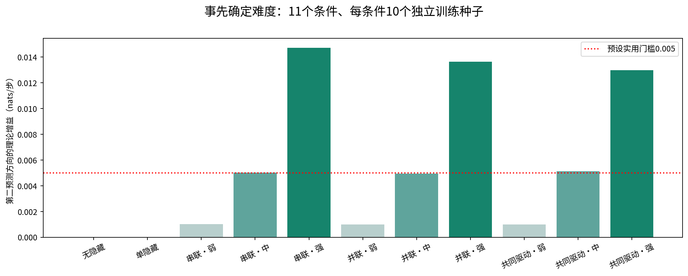
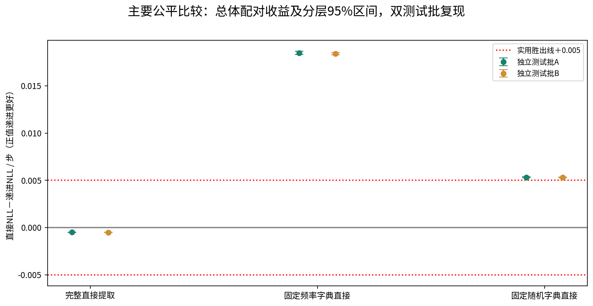
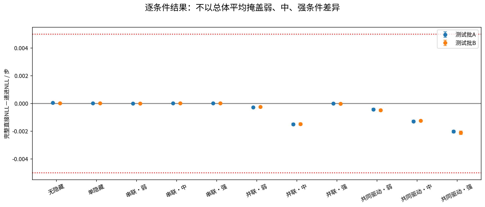
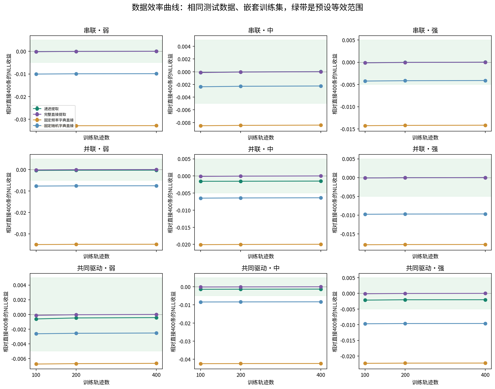
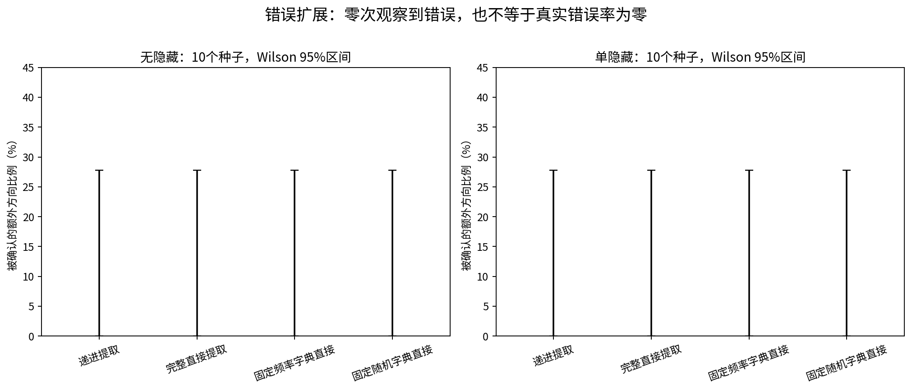
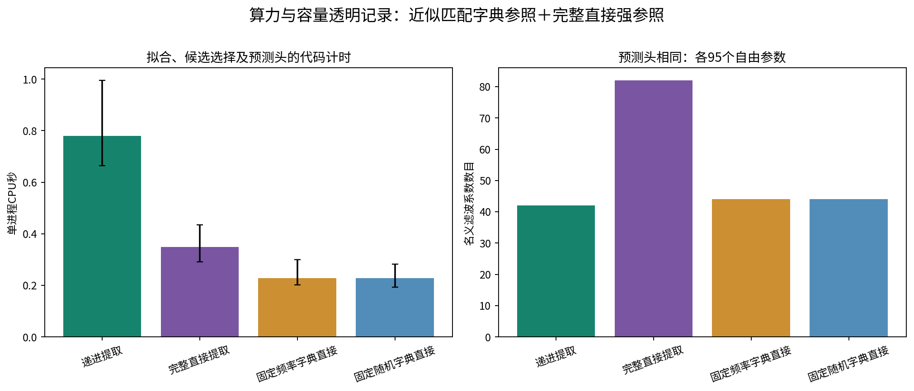
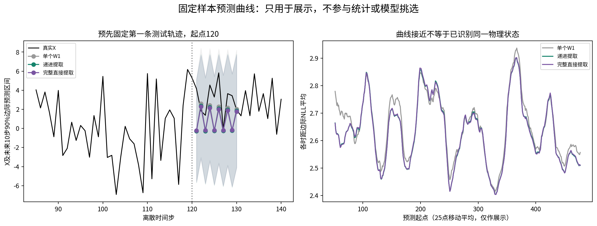
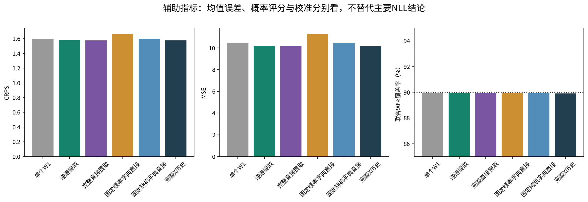

# E2.5：递进提取与直接提取公平竞争

日期：2026年11月23日。仅做 E2.5，未运行 E3、因果识别或失效预警。

## 核心答案

**没有证明递进式发现提供了直接提取无法同样获得的预测价值。** 相对完整直接模型，两批等权总体均达到预设等效标准。这里的“等效”只针对本轮线性高斯系统、预定指标和±0.005实用范围，不意味着两种算法在任意系统都一样。

本轮先冻结协议，再生成11个条件×10个种子共88000条独立轨迹，比较100/200/400条嵌套训练规模，共330个训练组合。每组合使用相同训练、选择、确认数据，并在两批各100条未见测试轨迹上配对比较；第二批是独立测试数据，不是新一批训练种子。两批合计22000条独立测试轨迹；同一轨迹被不同模型和训练规模反复评分，不能把CSV行数当成独立样本数。

主要评价 Delta=NLL直接−NLL递进，正数才是递进更好。必须超过0.005 nats/步，区间及复现均支持，且错误扩展和预算合规，才认定总体实用优势。没有把“p不显著”当成“相同”。

|测试批|直接参照|NLL差值|95%下界|95%上界|90%下界|90%上界|等效±0.005|
|---|---|---|---|---|---|---|---|
|A|完整直接|-0.000497|-0.000515|-0.000480|-0.000510|-0.000484|是|
|A|固定频率字典直接|0.018489|0.018340|0.018646|0.018377|0.018601|否|
|A|固定随机字典直接|0.005323|0.005270|0.005379|0.005278|0.005368|否|
|B|完整直接|-0.000508|-0.000523|-0.000493|-0.000518|-0.000498|是|
|B|固定频率字典直接|0.018399|0.018272|0.018525|0.018334|0.018464|否|
|B|固定随机字典直接|0.005318|0.005269|0.005367|0.005280|0.005355|否|

95%列为种子块＋轨迹分层10000次bootstrap区间；等效判定使用10个种子配对90% t区间完全落入±0.005。不同检验回答不同问题。主规模400的总体实用优势检验对三个直接参照做Holm3校正，逐条件比较另做Holm33；原始数据与所有条件结果保留。

## 协议、数据和模型

完整生成方程及精确参数在 [PROTOCOL.md](PROTOCOL.md)、[SYSTEMS.json](SYSTEMS.json)，设计阶段解析计算在 [design.py](design.py)。五类结构是无隐藏AR、单隐藏、串联、并联、共同驱动；后三类各弱中强。S4两个作用状态另有未观测共同驱动C，实际物理隐藏状态为三个，不隐去这个事实。

强度由生成方程下第二预测方向的理论可检测信息定义，约0.001/0.005/0.013–0.015，不能读成某条物理因果边的强度。参数选择在模拟数据生成之前，不因测试结果筛条件。各档同时改变持续性和观测噪声，不能解释为某一个物理参数的单因素效应。

每种子800条长度500轨迹：训练400、选择100、确认100、测试A100、测试B100；只在训练池内嵌套取100/200/400。所有模型只读X，没有真实隐藏答案。每条轨迹有效预测起点40至489，共450个未来10步向量；统计先按轨迹、再按种子平均，时间点不作为独立重复。

递进A：20步X过去→W1，再从20步W1过去提取W2；第二阶段目标是未来W1，选择集用未来X评分选6个候选之一。其最大原始感受野为40个滞后加当前值。

完整直接B：同样的原始感受野，一次学习两个方向，不经过W1；输出维数一致。再增加固定DCT字典和固定随机字典的直接参照，尽量匹配滤波参数预算。所有主方法使用相同当前X＋两个状态、相同线性均值和完整10维高斯协方差预测头，头参数均95。

**容量匹配是近似而非严格同一函数类。** 递进两段滤波名义42个系数，压缩字典直接模型计入当前X残差化后的名义系数44，完整直接为82。固定21维字典有固定子空间偏置；DCT使用均匀频率，不能保证对所有信号无损。递进又有6个第二方向候选，选择开销更高。故仅胜过压缩字典不足以支持架构优势，必须同时对完整直接模型成立。编码器的协方差预处理、坐标尺度冗余不等于这些数字所示的独立可辨识自由参数，不能声称严格同容量最优定理。

线性递进滤波可以卷积为原始X历史上的线性滤波，完整直接两状态模型的函数类包含这种表示。因此在无限样本、理想最优的线性高斯条件下，不应期待处理顺序创造额外信息；本轮真正检验的是有限样本正则化、压缩和数据效率。这个解释不外推为所有非线性递进模型都无价值。

所有方法同一个训练池、同一选择集，CPU预算均60秒，无迭代超参搜索；实际计算不强行空转补齐。数据相同、窗口相同、头相同、输出维数相同是严格控制项；滤波函数类和实际耗时不是完全相同。这些限制保留在结论中。

## 图1：事先标定的信息强度

纵轴为条件当前X后，第二个最优有限历史预测方向对未来10步联合分布的理论信息增益。无隐藏和单隐藏理论第二方向近零；弱档低于门槛，中档在门槛附近，强档明显高于门槛。解析上“可检测”不保证任何有限样本算法都通过。计算只给设计者用于冻结条件，没有输入提取器。

## 图2：总体公平竞争

每个点是11条件等权、10种子配对平均差，误差线为分层95%区间。正值代表递进更好，负值代表直接更好；虚线是±0.005的实用范围。A/B两批测试用相同冻结模型和独立轨迹，方向是否复现比单次最好成绩更重要。要区别总体均值的等效与逐条件的实际损失。

## 图3：逐条件差异

所有11条件均展示，没有只保留递进有利系统。误差线是种子配对95% t区间，逐条件实用胜出需另外通过Holm33，图中普通区间不是同时置信区间。正负变化表示归纳偏置和压缩损失可能依系统而异；不能从某个正点宣称总体方法优越。

## 图4：训练数据效率

固定测试批A，对比各方法用100/200/400条训练轨迹后，相对完整直接400条的分数差。绿带为±0.005，误差线90%种子区间。完整区间进入绿带才记为达到参考精度；测试B必须复现。相同训练池的嵌套规模相关，不是额外独立种子。若所有方法100条已达到参考，不能拿它当递进独有的数据效率。

## 图5：无隐藏和单隐藏的错误扩展

只根据独立确认集决定是否接受第二方向，未挑测试得分。计数为10种子中的接受次数，误差线是Wilson95%区间。0/10的区间上界仍约28%，所以没有观察到误扩展不等于真实错误率严格为零或已经证明方法间相等。它评价预测坐标扩展，并不是任意系统的真实因果变量数量识别。

## 图6：参数与计算成本

左侧实测代码计时包含递进两次编码、6个候选头与选择；直接计时含其编码、两状态头及第一状态诊断头。它不是高度优化实现的复杂度定理，单个诊断计时范围也有细微差别；不能把这一实现耗时外推为普遍下界。右侧参数预算解释为什么还需保留完整直接强参照。峰值RSS是worker进程累计峰值，不能归因于某一方法。

## 图7：固定轨迹的概率预测曲线

事先固定并联强组、种子1011、测试A第一条轨迹、起点120。左图展示真实X及单W1、递进、完整直接的10步均值与90%边际区间。右图是各时距边际NLL的25点移动平均，仅作展示，不是主要联合NLL，也不用于任何筛选。单条曲线不能代替110组合的统计，预测均值相近不代表识别了同一物理变量。

## 图8：辅助评分与校准

CRPS和MSE越低越好，90%联合区域覆盖应接近90%。这是测试A、主规模400、条件等权平均。指标各有侧重，若某个辅助指标更好，也不能替代预定联合NLL的实用胜出判据；校准接近90%也不代表所有极端尾部风险已解决。

## 每个条件的主要差值

单位 nats/步，正值递进更好；完整区间和校正p见CSV。

|条件|测试A：直接减递进|测试B：直接减递进|
|---|---|---|
|S0|0.000039|0.000020|
|S1|0.000012|0.000013|
|S2_weak|-0.000000|-0.000004|
|S2_medium|0.000012|0.000007|
|S2_strong|0.000005|0.000006|
|S3_weak|-0.000279|-0.000251|
|S3_medium|-0.001503|-0.001491|
|S3_strong|0.000000|-0.000029|
|S4_weak|-0.000435|-0.000494|
|S4_medium|-0.001290|-0.001247|
|S4_strong|-0.002027|-0.002116|

## 辅助指标原始数值

测试A、400条训练、11条件等权。

|方法|联合NLL/步|CRPS|MSE|联合90%覆盖|边际90%覆盖|
|---|---|---|---|---|---|
|递进|2.020838|1.581064|10.186223|0.899426|0.899635|
|完整直接|2.020341|1.578947|10.161134|0.899376|0.899605|
|固定频率字典直接|2.039326|1.661738|11.265505|0.899385|0.899609|
|固定随机字典直接|2.026160|1.602506|10.473807|0.899372|0.899597|
|单W1|2.025712|1.599038|10.428040|0.899344|0.899669|
|完整W1历史|2.020294|1.578570|10.156719|0.899288|0.899610|
|完整X历史|2.020345|1.578657|10.157838|0.899174|0.899568|

## 错误扩展与计算预算

|condition|方法|结果|95%区间|
|---|---|---|---|
|S0|固定频率字典直接|0/10|[0.0%, 27.8%]|
|S0|完整直接|0/10|[0.0%, 27.8%]|
|S0|固定随机字典直接|0/10|[0.0%, 27.8%]|
|S0|递进|0/10|[0.0%, 27.8%]|
|S1|固定频率字典直接|0/10|[0.0%, 27.8%]|
|S1|完整直接|0/10|[0.0%, 27.8%]|
|S1|固定随机字典直接|0/10|[0.0%, 27.8%]|
|S1|递进|0/10|[0.0%, 27.8%]|

|方法|平均CPU秒|最大CPU秒|名义滤波系数|
|---|---|---|---|
|递进|0.780|0.995|42|
|完整直接|0.349|0.434|82|
|固定频率字典直接|0.228|0.300|44|
|固定随机字典直接|0.228|0.282|44|

CPU超预算次数：0。额外方向接受要求收益超过0.005，且独立确认配对检验对1320项作Holm校正；第一方向另为1320项检验族。未把6个候选单独挑测试最优。

## 数据效率：达到完整直接400条参考的最小规模

只在两批测试90%区间均落入±0.005时登记。无隐藏和单隐藏条件较容易，必须区分一般预测达标与发现第二方向的能力。

|条件|递进达到参考的最小训练条数|完整直接达到参考的最小训练条数|
|---|---|---|
|S0|100|100|
|S1|100|100|
|S2_weak|100|100|
|S2_medium|100|100|
|S2_strong|100|100|
|S3_weak|100|100|
|S3_medium|100|100|
|S3_strong|100|100|
|S4_weak|100|100|
|S4_medium|100|100|
|S4_strong|100|100|

## 审计与复现

协议冻结、实现冻结、模型冻结、确认冻结、测试A冻结、测试B冻结均保存时间和SHA256。开发数据只是无关随机噪声，不用于系统条件或门槛选择。完整测试结果在输出后才分析；没有根据A调整模型再跑B。

审计通过：重新生成110个完整数据集并逐划分核对；对110个主规模模型进行未来扰动检查；复算33个已存模型在两批测试上的所有方法NLL；最大重放差4.44e-16，最大未来扰动前缀差0。代数展开至原始X滤波器仅检验实现一致，不是新信息的独立科学验证。

原始X数据在云端工作目录，Git仓库提交固定生成器与散列清单，不重复提交大数组。归档下载后，先运行 `python restore_inputs.py` 按原始散列精确恢复X数据，再运行 `python audit.py` 加载模型复核且不重训练；这两步不改冻结记录。若要重新拟合，请在新的副本目录清理旧results和冻结输出，重新登记后使用 `generator.py`、`fit.py`、`confirm.py`、`evaluate.py`，避免覆盖本轮原始结果。330个模型全部保存，两个测试CSV各363000行；每条件种子1011的400规模首条测试示例另存NPZ，其余完整预测数组未宣称全部归档，全部逐轨迹评分已归档。依赖见 requirements.txt。

## 对实际结果的解释

相对完整直接模型，总体差值在测试A约−0.000497，95%分层区间约[−0.000515,−0.000480]；测试B约−0.000508，区间约[−0.000523,−0.000493]。区间均低于零，说明细微差异稳定偏向直接模型；同时完整90%区间位于±0.005内，所以按事先规定的实用精度两者等效。这不是“完全相同”或“差异不显著”。

递进相对固定频率字典、固定随机字典分别约有0.0184、0.0053的总体收益，两批复现。它说明递进因子化比本轮两个受限字典更适合这些数据；但固定字典本来会丢失预测子空间，且函数类并不严格匹配，不能把这种胜出直接归为“递进发现顺序”的独立贡献。完整直接提取能够获得同等实用精度，因此核心预注册胜出条件未通过。

数据效率表中，递进与完整直接在全部11条件、两批测试上，都在最小已测规模100条达到完整直接400条的±0.005参考。没有观察到递进独有的数据效率收益；但本轮没有测试100条以下，更不证明任意精度或更少样本下两者复杂度相同。100条轨迹也已提供很多重叠训练窗口，不能当成极端小样本研究。

递进实现的400条训练平均CPU约0.780秒，完整直接约0.349秒；此代码计时没有展示训练速度优势。所有方法都低于60秒预算。S0/S1均未确认错误第二方向，但10次重复的错误率区间仍宽，不证明安全性已彻底解决。滤波系数预算较小是描述性事实，尚未用严格相同函数类和在线缓存实现证明参数/推断效率的独立收益。

## 回答课题下一步

本轮要回答的是递进提取是否具有直接提取无法同样获得的价值，而不是是否还能产生一个新坐标。总体结论应以开头的双批实用比较和逐条件表为准。即使从单W1起点加入W2确实改善预测，也不能据此推断顺序发现不可替代。

确定性W1和W2均是X历史的函数，不会创造完整X历史之外的信息。本轮没有把预测坐标解释为真实Y、Z，没有证明直接/间接因果关系，也没有运行在线概率更新。若没有稳定、复现的数据效率或预测优势，就不宜继续以增加递归层数作为主要创新依据；可以把下一步问题转向独立验证在线概率更新本身的价值，但需另立E3协议后再开展。
