# E3：X-only 概率状态发现、双线见证与在线结构概率更新

日期：2026年11月23日。**固定5次EM的预测协同通过，可靠隐藏状态发现尚未通过。** 这是有限候选图下的线性高斯概率原型，包含非线性及非平稳失配测试；不运行E4因果失效预警。

本轮先冻结协议，再冻结实现。共17个独立X条件×20个训练种子，嵌套20/50/100/200/400条训练规模，1700个训练组合，每组合三套独立/对照候选库、各K=0..3，合计20400个状态空间候选。两批测试各13600条独立轨迹，模型与规则在测试前冻结。相同轨迹的多模型、多规模及重叠窗口评分不是额外独立样本。

|问题/机制|两批均实用通过|测试A收益|测试B收益|
|---|---|---|---|
|直接路线在线更新|是|0.014208|0.014329|
|递进路线在线更新|是|0.021566|0.021788|
|有更新时递进贡献|是|0.026625|0.026603|
|递进×更新交互|是|0.007358|0.007459|
|递进结构反馈|否|0.003969|0.004037|
|相对滚动直接强参照|是|0.030310|0.030362|

收益均为对应旧方案NLL减新方案NLL，正值支持该机制；单位nats/步。主要判据为未来20步联合NLL/步，最小实用收益0.005，主规模100条/路线。实用通过要求95%区间下界超过0.005且Holm校正通过；“没有通过”不自动等于证明无差异。协同成功还必须同时满足有更新时递进贡献、交互项及相对滚动直接参照收益，两批复现，并满足错误扩展约束。

**完整结论需要同时看预测收益和状态可靠性。** 固定5次EM的正向收益在新增10个独立训练种子中复现，主规模合计30个种子。但延长到25次EM后，额外交互收益低于预设实用门槛；单隐藏系统存在维数过扩展，真状态读出区间偏宽。因此本轮完成并检验了概率原型，没有证明恢复唯一、可靠的真实隐藏状态或因果链。

## 本轮完成内容与边界

|阶段|实际实现|边界|
|---|---|---|
|E3.1 概率初始发现|X-only EM状态空间模型，完整均值、协方差和跨时刻协方差|未知维数只在统一上限3内，不是无限开放发现|
|E3.2 双线发现|从概率后验路径递进提案；另用独立训练池从原始X拟合见证库|两路线共享观测类型，一致性不是独立物理证据|
|E3.3 在线更新|每步预测、评分、更新；联合未来概率积分|得到模型条件后验，不是未知真实系统的精确后验|
|E3.4 概率反馈|后验不确定性参与训练提案，确认图内维数和路线权重在线变化|测试不新拟合；物理增加、拆分和合并身份未唯一识别|
|E3.5 可识别性|无隐藏、单隐藏、串联、并联、共同驱动及旋转等价反例|等价检查是构造性拒判，不是通用因果图可识别性分类器|
|E3.6 公平比较|完整2×2、固定结构E/F、滚动直接G、20种子和两批测试|两批共享冻结训练模型；第二批不是新增训练种子|

没有把统计候选直接命名为真实Y、Z，也没有给出缺乏识别依据的因果边准确率或提前预警率。

## 数学模型与数据规则

候选模型为 z_t=Fz_(t−1)+η_t，X_t=aX_(t−1)+Cz_t+ε_t。F、Q、C、a、R只从X学习；滤波q_t(z)=N(m_t,P_t)，P_t保留非对角相关。不同路线、不同K的解释组成q_t(路线,K,z)，未来20步对潜在状态积分，得到完整联合高斯混合预测。

单步新X到达时按各解释的更新前观测似然调整权重，再更新连续状态。候选切换概率固定0.01，属于动态模型平均近似，不宣称任意切换机制的精确Bayes后验。两路线解释作混合，不将同一个X的两份似然相乘。

递进路线先拟合概率状态，用后验协方差和未充分解释动态选择探索父状态，抽取2条完整FFBS后验路径，从其20步历史提出下一方向，再进行5次EM联合估计。直接路线用完整40步原始X历史初始化，随后同样5次EM。递进主要改变提案与初始化，最终概率模型族统一；若有收益，也要区分搜索/优化归纳偏置与新物理信息。

主训练池R与见证池D严格独立。直接对照另在R训练，所以直接和递进主线使用相同数据；所有组都使用独立D见证，不给递进组额外独占训练数据。每路线400条训练池，选择40、确认40；每规模等量取R、D前20/50/100/200/400。所有轨迹长度160。

初始K由选择集评分、复杂度惩罚和单标准误差规则决定。独立确认集用双路线预测非劣筛候选图；明确新增信息需两路线相邻维数预测收益都达到0.005并通过统一Holm校正。概率不确定候选与已确认新增证据分开登记。测试只在冻结图内推断，不用测试评分重新拟合或调门槛。

弱/中/强标签沿用E2.5的生成方程，未按E3的未来20步目标重新标定0.005边界；不能把继承的中档名称当作本轮精确可检测界限。

每时刻在线更新，未来联合预测在40、50、…、130发布，分别评价未来1/2/5/10/20步。原点重叠只在轨迹内平均。统计以20个种子为独立块，置信区间用10000次种子/轨迹分层bootstrap。完整协议、精确方程及实现细节见 PROTOCOL.md、BASE_SYSTEMS.json、IMPLEMENTATION_NOTES.md。协议文字列出8个对照却误计为7，开测前按完整列表更正为Holm8、逐条件Holm136，保留原协议及COUNT_CLARIFICATION.json。

这些分布条件于已估计的固定参数；解释权重使用预测似然、复杂度先验和0.01复位，不是对参数完整积分后的模型证据。未来20步内各解释独立传播，用当前混合权重形成联合预测，没有模拟预测区间内部的模型切换。维数熵受先验与复位影响，低置信度不等于学会了通用不可识别性判别。

## 七组比较如何理解

A/C的无更新组仍保留概率分布，并使用当前X的观测AR项，但40步前缀后不再做测量后验更新。它们是机制消融，状态误差累积不能作为新方法创新证据。

B/D分别开启直接/递进模型的状态与结构概率更新；E/F也在线更新状态和路线权重，但K固定为独立选择结果。G每个预测起点使用最近40个滞后加当前X重建直接概率状态，固定初始K、两路线等权，拥有最新观测信息。D必须对B、G也有收益，不能只胜过A/C。

交互项I=(C−D)−(A−B)。即使I为正，也可能因为C的无更新起点更差；因此必须与B−D、G−D共同判断，而非单独宣布双线协同。

## 主规模全部对照

|测试批|比较|收益|95%下界|95%上界|Holm校正p|实用通过|
|---|---|---|---|---|---|---|
|A|直接路线在线更新|0.014208|0.013905|0.014518|2.84e-24|是|
|A|递进路线在线更新|0.021566|0.021100|0.022037|4.71e-25|是|
|A|无更新时递进贡献|0.019268|0.018420|0.020078|9.31e-19|是|
|A|有更新时递进贡献|0.026625|0.025416|0.027742|3.72e-19|是|
|A|递进×更新交互|0.007358|0.006903|0.007816|1.44e-09|是|
|A|直接结构反馈|0.002580|0.002260|0.002912|1|否|
|A|递进结构反馈|0.003969|0.003716|0.004224|1|否|
|A|相对滚动直接强参照|0.030310|0.029230|0.031356|2.84e-21|是|
|B|直接路线在线更新|0.014329|0.014020|0.014638|3.2e-24|是|
|B|递进路线在线更新|0.021788|0.021393|0.022186|1.05e-27|是|
|B|无更新时递进贡献|0.019144|0.018090|0.020150|1.74e-16|是|
|B|有更新时递进贡献|0.026603|0.025193|0.027990|1.94e-17|是|
|B|递进×更新交互|0.007459|0.006992|0.007910|7.58e-10|是|
|B|直接结构反馈|0.002604|0.002284|0.002922|1|否|
|B|递进结构反馈|0.004037|0.003785|0.004301|1|否|
|B|相对滚动直接强参照|0.030362|0.029022|0.031709|3.89e-19|是|

逐条件校正与全部规模结果在 results/contrasts_condition.csv、contrasts_overall.csv、contrasts_seed.csv。

## 概率评分原始数值

|测试批|组别|20步联合NLL/步|边际CRPS|Energy|Variogram|边际90%覆盖|后验平均维数|
|---|---|---|---|---|---|---|---|
|A|直接不更新|2.111525|1.797602|10.591275|0.457002|0.905460|2.109842|
|A|直接在线更新|2.097317|1.664634|10.068092|0.438582|0.910913|2.134064|
|A|递进不更新|2.092257|1.796203|10.553973|0.451177|0.905944|2.324240|
|A|递进在线更新|2.070692|1.617824|9.791652|0.431459|0.909413|2.358569|
|A|直接固定结构|2.099897|1.668599|10.088962|0.439315|0.911425|1.250000|
|A|递进固定结构|2.074660|1.623024|9.822405|0.432627|0.910631|1.650000|
|A|滚动直接强参照|2.101001|1.672646|10.109177|0.439880|0.911188|1.250000|
|B|直接不更新|2.111359|1.798339|10.605940|0.457456|0.904984|2.108803|
|B|直接在线更新|2.097029|1.661398|10.050737|0.438426|0.910706|2.133996|
|B|递进不更新|2.092215|1.798812|10.581042|0.451744|0.905478|2.324654|
|B|递进在线更新|2.070426|1.614890|9.775299|0.431518|0.909559|2.359695|
|B|直接固定结构|2.099634|1.665411|10.072688|0.439152|0.911147|1.250000|
|B|递进固定结构|2.074464|1.620309|9.806769|0.432682|0.910646|1.650000|
|B|滚动直接强参照|2.100789|1.669878|10.094314|0.439765|0.910931|1.250000|

CRPS与覆盖在1/2/5/10/20步边际平均；Energy使用两套各16个联合样本的配对估计；Variogram对五个时距间10对做有限样本近似，受Monte Carlo误差影响。辅助评分不是新的成功指标；CRPS、Energy原始单位不同条件量级不同，应结合逐条件表解释。

## 图1：机制贡献分开检验

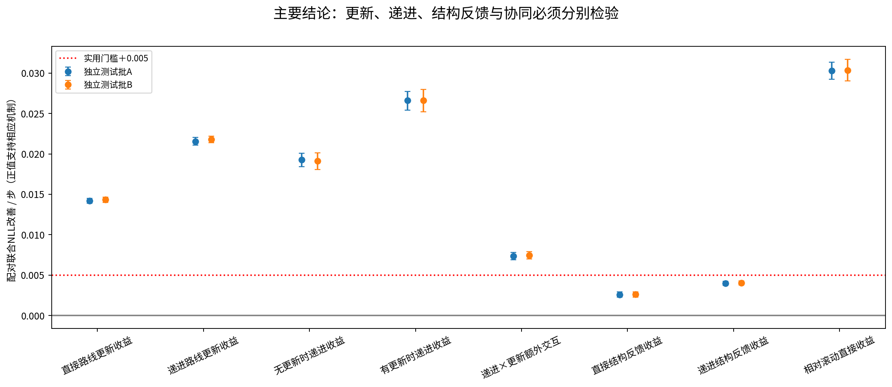

八个差值分别回答更新、递进、结构反馈和交互。误差线为预注册的分层95%区间，红线为0.005。每个机制须看两批是否复现及Holm8，不能把左侧的普通滤波收益自动归于递进发现。

## 图2：所有条件的架构及强基线比较

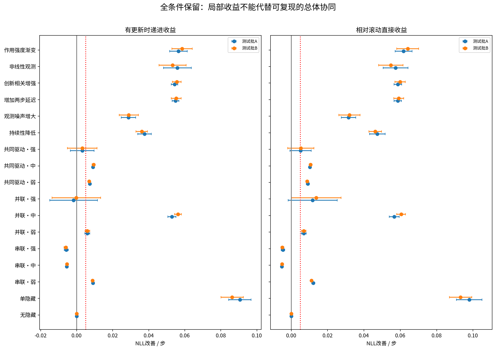

左图为B−D，右图为G−D，正值才支持递进在线方案。所有17条件均保留，含负收益。普通逐条件95%区间不是同时区间，局部实用成功还需Holm136；不从最好条件推断总体有效。

## 图3：小样本学习曲线

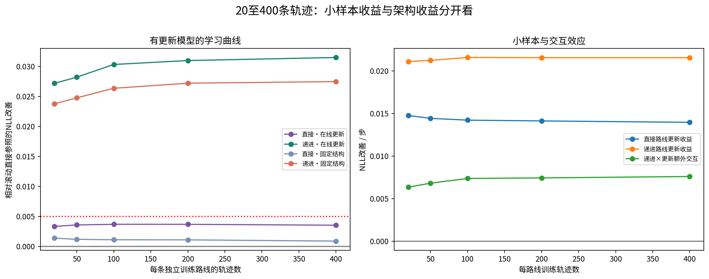

左图比较有更新模型相对滚动直接参照，右图展示更新和交互收益随训练规模变化。横轴是每路线轨迹数，总训练预算为两独立路线的两倍。嵌套规模相关，曲线平台或交叉不等于额外独立复现，也未证明20条以下的数据效率。

## 图4：预测时距和观测概率校准

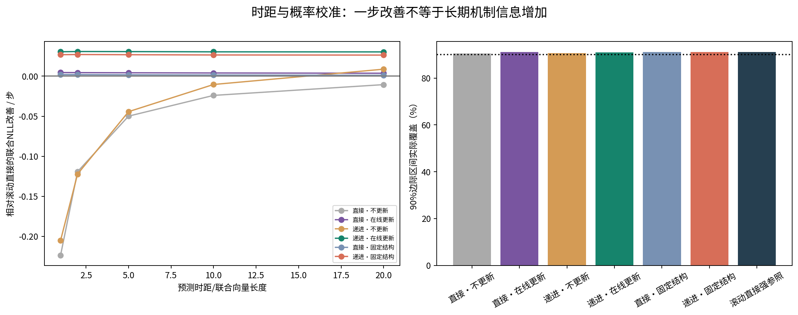

联合1/2/5/10/20步评分与90%边际覆盖分开显示。短期有收益不保证远期也有，覆盖接近90%也不保证尾部或物理隐藏状态正确。混合边际覆盖用实际观测的混合CDF检验，不用16个样本粗糙估计区间。

## 图5：固定轨迹上的完整概率状态

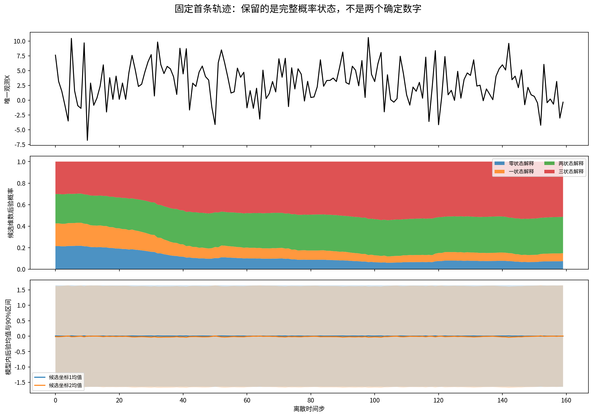

事先固定并联强组、种子3011、测试A第一条轨迹。第一行只展示观测X；第二行是四种候选维数后验质量；第三行是预先按组件顺序选取的连续状态均值与90%区间。阴影来自协方差，不是人为误差棒。坐标的符号、尺度和混合均不具有物理变量身份。

## 图6：状态数、过扩展与不确定性

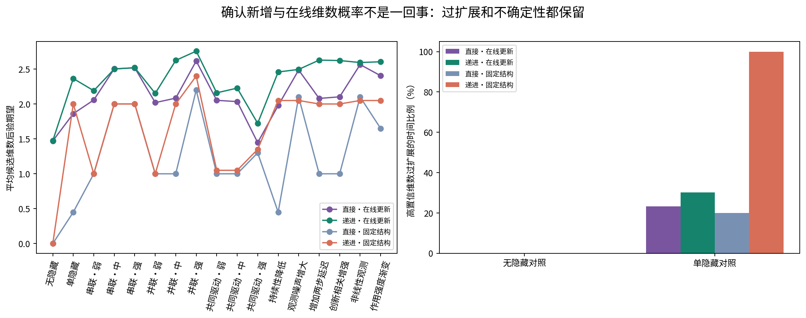

候选维数的后验期望不是自动发现真实变量数。右图特别保留无隐藏/单隐藏系统上后验MAP维数超过真值代理、且概率≥0.8的时间比例；它与独立确认的新增错误率不同。延迟条件真隐藏维数4而候选上限3，包含预设容量失配。

## 图7：隐藏状态质量的两种证据

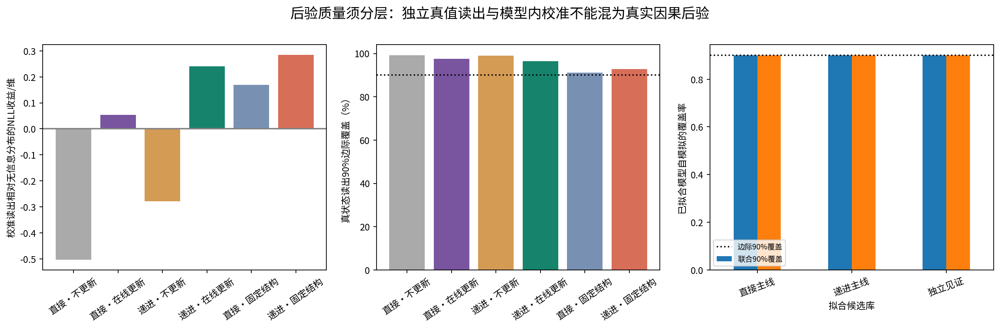

前两图是在全部X预测冻结后，额外独立40条真值轨迹拟合读出、另一40条评价的校准读出分数及覆盖。读出加入单独估计的残差，不等于原模型直接给出的真实Y/Z后验。右图为各已拟合模型自模拟的条件校准，仅检验模型内滤波概率实现；即使接近90%，也不解决真实系统的状态身份问题。

## 图8：观测等价机制保持拒判

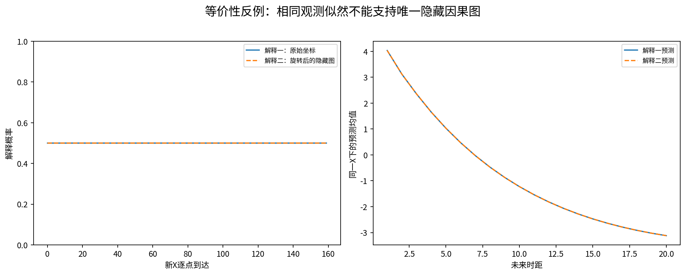

对固定候选做可逆正交状态旋转，F、C、Q、P同时变换。新坐标的隐藏图可以不同，X似然完全相同，等先验解释的后验应保持1/2。此构造允许相关创新，不能外推到具有额外独立创新假设的所有模型。它说明预测和概率更新不能独自消除观测等价性。

## 图9：单因素压力条件

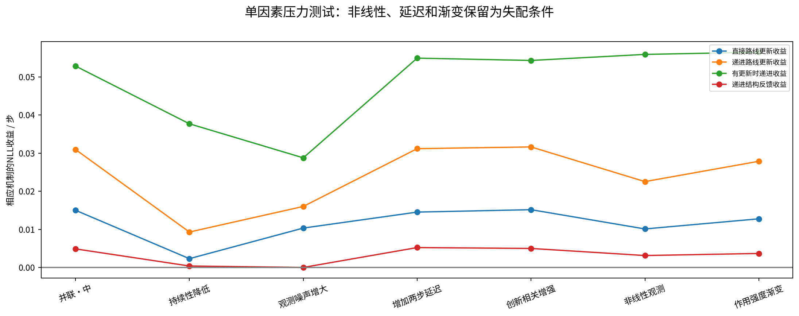

从同一个并联中等条件分别只改变持续性、观测创新噪声、传递缓存、创新相关、观测非线性或作用强度渐变。图中保留线性概率族在非线性/非平稳生成器上的失配结果。渐变条件不用于预警时刻结论，不把误差变化直接命名为因果失效报警。

## 图10：独立原始X见证

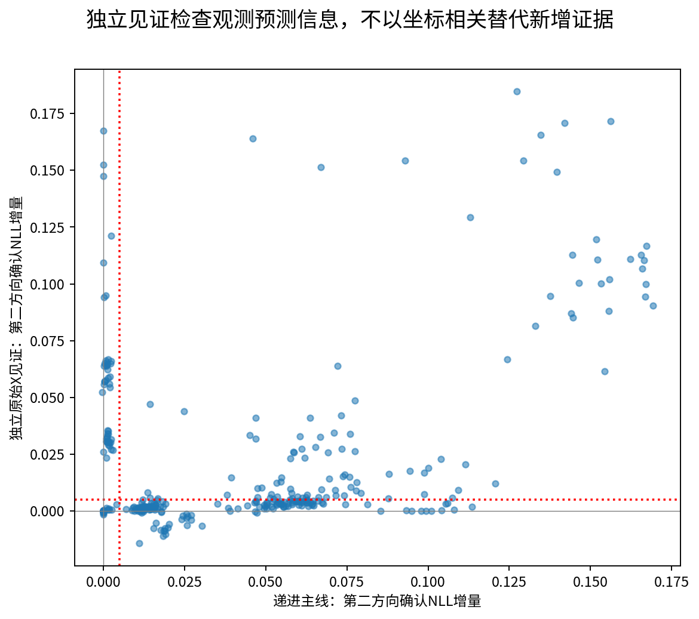

每点为一个独立种子的确认集第二方向增量，横轴递进主线、纵轴独立训练原始X见证。两轴都达到实用门槛仍需多重检验；只有递进一轴有收益不能确认新状态。两路线参数和训练池独立，但都来自同一类型X，不能把一致性升级为独立物理因果证据。

## 追加独立训练种子与收敛诊断

此部分在原20种子第一批正向信号后另行登记，属于后续复核，不能冒称原始预注册内容。保留全部17条件、只复核原主规模100，新增种子3031..3040。EM5严格复现原流程；EM25从同一EM5候选出发，对直接、递进、见证全部额外做20次EM，再用独立选择/确认数据确定图，之后冻结并测试。两种预算使用相同新增X轨迹，规则和阈值不变。

|独立新10种子|比较|收益|95%下界|95%上界|实用通过|
|---|---|---|---|---|---|
|5次EM·测试A|递进在线相对直接在线|0.025916|0.023319|0.027869|是|
|5次EM·测试A|递进×更新交互|0.007347|0.006780|0.007883|是|
|5次EM·测试A|相对滚动直接|0.029537|0.027056|0.031491|是|
|25次EM·测试A|递进在线相对直接在线|0.010874|0.009520|0.012298|是|
|25次EM·测试A|递进×更新交互|0.003943|0.003398|0.004516|否|
|25次EM·测试A|相对滚动直接|0.014889|0.013503|0.016406|是|
|5次EM·测试B|递进在线相对直接在线|0.025890|0.023575|0.027872|是|
|5次EM·测试B|递进×更新交互|0.007265|0.006707|0.007837|是|
|5次EM·测试B|相对滚动直接|0.029354|0.027141|0.031330|是|
|25次EM·测试B|递进在线相对直接在线|0.010948|0.009472|0.012442|是|
|25次EM·测试B|递进×更新交互|0.003916|0.003417|0.004432|否|
|25次EM·测试B|相对滚动直接|0.014962|0.013390|0.016558|是|

5次EM下，递进在线相对直接在线的收益约0.026，交互约0.0073，新增10种子两批均复现。25次EM下，递进相对直接仍有约0.0109的收益，**不能写成优势完全消失**；但交互约0.0039，95%区间整体低于0.005，额外协同的实用判据不再通过。直接模型延长优化的改善大于递进模型，递进相对差距缩小约58%。

这支持“有限优化预算下的概率递进初始化价值”，尚不支持“直接模型原则上无法取得同样信息”。当前直接基线只采用一个CVA初值，25次EM仍非全局收敛证明，尚未运行多起点、按实际CPU严格匹配的最优直接搜索。不能只凭迭代次数推断计算效率，也不能把初始化优势解释成新物理变量发现。

合计30种子的综合描述如下；独立新增10种子的表才是后续复核证据，不能用合并平均掩盖复现失败。

|合计30种子描述|比较|收益|95%下界|95%上界|
|---|---|---|---|---|
|合计30·5次EM·测试A|递进在线相对直接在线|0.026389|0.025241|0.027421|
|合计30·5次EM·测试A|递进×更新交互|0.007354|0.007005|0.007708|
|合计30·5次EM·测试B|递进在线相对直接在线|0.026365|0.025142|0.027523|
|合计30·5次EM·测试B|递进×更新交互|0.007394|0.007031|0.007743|

## 图11：独立新种子与优化预算

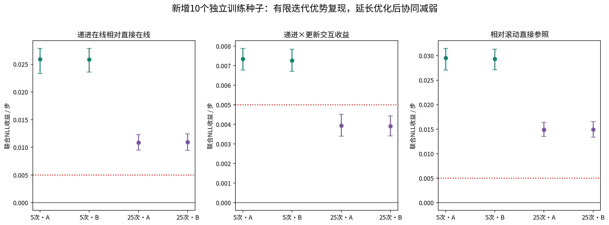

每点是独立新增10个训练种子上的配对收益，两种测试批均展示；误差线为分层95%区间。绿色为5次EM，紫色为25次。相对直接的残余收益与交互收益是不同问题：延长优化后前者仍为正，交互则低于实用线。原20种子结果和追加结果全部保留，不只展示有利预算。

## 状态可靠性未通过的具体证据

原20种子在单隐藏条件中，递进强新增确认错误2/20，直接1/20。与此不同，在线后验的高置信维数过扩展时间比例约为递进30.1%、直接22.8%；递进平均候选维数约2.37，而生成器物理隐藏维数为1。预测表示维数与物理原因数并不等价，这些数不能当真实原因恢复成功。

在无隐藏S0中，动态模型平均的维数期望约1.47，但高置信过扩展比例为0，维数解释始终低置信；它保留了不确定性，却没有稳定收敛到唯一零状态解释。固定结构组则在S0选择了0。确认新增错误与在线多解释质量必须同时报告。

独立真值读出中，递进在线组平均R2约0.53，直接在线约0.39，说明确实含部分隐藏动态信息；但递进读出的90%区间实际覆盖约96.4%，偏保守。固定结构递进的读出覆盖约92.8%、读出NLL收益还高于动态结构递进，未证明结构反馈让真实状态解释更可靠。无物理隐藏状态的S0不计算真状态读出，未以0值冒充准确。

预注册的结构反馈F−D在两批约0.004，低于0.005，说明本轮尚未证明动态拆分/合并具有预设的实用增益。主预测协同通过不代表所有E3子目标均通过。

## 图12：新增独立X中的同一线索检验

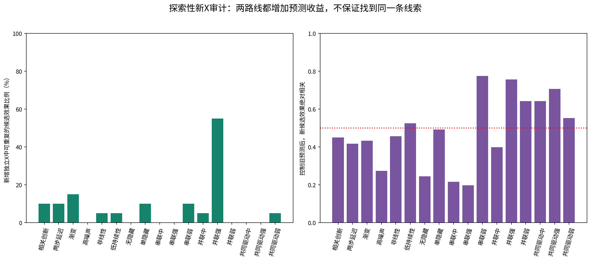

主确认检查两路线各自增加一维是否改善预测，这不足以保证找到同一条Wy。为此主实验结束后另行登记探索性审计：完全新阶段4的40条X拟合旧预测控制回归，阶段5的另40条X检查递进与独立见证的10步预测增量残差对应，并同时要求两路线在新X中有0.005的联合预测收益。它不修改模型、候选图或主结论。

指定的观测效果一致性检查仅26/340通过，强并联条件为11/20，其余大多较弱。这个比例是特定探索性诊断，不是通用物理识别率。它表明本轮未稳定建立同一新候选状态的双路线对应，不能把两路都有预测增量自动当成同一隐藏变量被独立发现。

这些限制与观测等价反例一致：概率更新能调整解释可信度，但不能独自消除状态坐标混合、维数冗余和因果机制的不可识别性。

## 错误扩展与维数代理

|条件|直接确认错误|递进确认错误|种子数|递进多出次数|
|---|---|---|---|---|
|S0|0|0|20|0|
|S1|1|2|20|1|

这些是强新增证据的确认次数；概率候选的不确定维数还需看图6和operational_states.csv.gz，不能用确认0次隐藏在线过扩展。20次仍不足以证明真实错误率为零或方法间严格相等。

|条件|组|期望维数|MAP过扩展比例|高置信过扩展比例|低置信时间比例|
|---|---|---|---|---|---|
|S0|B|1.4708|0.3259|0.0000|1.0000|
|S0|D|1.4737|0.2500|0.0000|1.0000|
|S0|E|0.0000|0.0000|0.0000|0.0000|
|S0|F|0.0000|0.0000|0.0000|0.0000|
|S1|B|1.8612|0.8759|0.2322|0.7678|
|S1|D|2.3646|1.0000|0.3008|0.6992|
|S1|E|0.4500|0.2000|0.2000|0.0000|
|S1|F|2.0000|1.0000|1.0000|0.0000|

## 真状态审计的正确解释

真实Y/Z的直接后验评分：未定义，因为没有识别唯一对应坐标。下面是独立校准读出代理；读出矩阵只用额外审计轨迹拟合，不使用正式测试真值、不回写预测模型。其残差噪声单独记录，因此覆盖好不代表原始潜在后验直接识别了物理状态。联合覆盖是矩匹配椭球诊断，不是混合后验精确HPD区域。

|组|读出NLL收益/维|读出CRPS|读出R2|边际90%覆盖|矩匹配椭球90%覆盖|
|---|---|---|---|---|---|
|A|-0.50253|15.73904|0.03325|0.99218|0.99100|
|B|0.05343|2.21477|0.38782|0.97591|0.97237|
|C|-0.27846|21.67754|0.07121|0.99001|0.99104|
|D|0.24097|1.78952|0.52966|0.96416|0.97032|
|E|0.16958|1.58270|0.24693|0.91236|0.91421|
|F|0.28494|1.50631|0.48006|0.92813|0.93450|

## 模型内条件概率校准

|候选库|模型内边际90%覆盖|模型内联合90%覆盖|
|---|---|---|
|直接主线|0.9003909313725491|0.9006446078431373|
|递进主线|0.8997928921568628|0.9003014705882353|
|独立原始X见证|0.9002720588235293|0.9003480392156863|

这是从已拟合模型自身模拟状态后，条件于固定参数的校准；没有包含参数估计不确定性，也没有证明未知真实系统中的Y/Z后验校准。

## 审计、计算与归档

所有冻结散列已复核。重新生成340个输入组合，数值重放覆盖34个固定条件/批次。最大未来扰动前缀误差0，最大评分重放差5.68e-14，权重归一化误差2.62e-14。状态旋转后预测/似然误差8.53e-14，等价解释权重差2.75e-14。

有限5次EM且带协方差下限、稳定性投影，不保证全局最优；审计记录1062个出现轻微非单调对数似然的拟合，不能据此把比较当模型族全局最优定理。主规模100每组合平均训练CPU 0.243秒；全部规模、进程峰值RSS见timing.csv。峰值RSS是进程累计值，不是单模型独占内存。

每个训练组合保存三套K0..3模型、选择评分、后验提案日志及确认图。两批全部逐轨迹指标在压缩CSV。仅每条件种子3011、规模100的首条测试轨迹保存完整代表后验均值、协方差和模型权重，不宣称所有轨迹的完整概率数组均归档。数据由固定生成器按阶段独立重建，不重复提交原始大数组。

原始附件、协议、补充计数澄清、源码、冻结记录、模型、图表、审计均随目录提供。复现方式见RUN.md。原始E1–E2.5结果保留，新实验使用独立分支。

## 回答研究目标

本轮原始预测协同判据通过且新增种子复现，但长迭代敏感性、状态维数及真值读出质量使完整可靠发现目标尚未通过。

本轮实际检验了模型定义的概率状态解释、新观测反馈、有限图内结构不确定性，以及递进相对完整直接概率方法的增量价值。是否通过以开头的配对判据为准；普通滤波有效不能自动说明递进发现有独特价值。

概率分布让模型能够保留多种解释和不确定性，但不能创造X中尚未出现的信息，也不能自动确定真实隐藏因果链。只有在进一步增加可识别假设或额外观测/干预并验证后，才有依据进入物理因果关系和预测失效提前预警。
