# E4-A：概率化双线隐藏动态发现实验报告

实验日期：2026年11月23日。实际执行最新请求的 **E4-A1、A2、A3**，未执行E4-B的ARD／Split-Merge或E4-C的因果图与干预。代码、协议、模型、确认、两批测试依次冻结；全部预测测试完成后才打开隐藏真值。

## 结论先读

- 双状态B类四个条件中，**0/4** 个条件达到“至少16/20个种子、双路线、双确认块均通过”的参考标准。单状态A与长记忆D各条件的最大错误新增为 **0/20**。
- 预测模式层的预设参考门槛：**未通过**。这是受限候选族下的新增预测证据，不是物理因素数或因果链恢复。
- 递进模型相对完整直接在线模型，在两批测试是否同时达到0.005 nats/步的实用增量与校正显著性：**否**。精确数值和区间见下表，负值同样保留。
- **隐藏状态概率仍有失准风险**：高相关C类测试A的边际90%状态区间，直接R实际覆盖约69.1%、递进R约83.8%，已知真实模型约90.0%。X预测覆盖接近90%，不能代替隐藏状态概率可靠性。
- **物理身份层No-Go**：两个独立AR1因素与单个ARMA(2,1)因素可以产生完全相同的X分布；更准确的概率预测也不能消除此等价性。因此本轮不进入E4-B/C，不声称发现真实上游因果变量或实现失效提前预警。

## 1. 本轮回答什么

这是最大Markov容量3的有限结构化高斯候选原型，不是完全无结构、无限状态数量的通用发现器。模型仅观察X，比较直接提取与后验路径递进提案，检验新增候选是否在独立数据中提供稳定预测增量，并检验把长记忆误当新因素的风险。所有学习函数只接收X和优化随机种子，不接收系统标签、U/V、真实系数或因素数。

必须区分三个对象：一个物理因素、维持其历史所需的Markov存储坐标数、可辨别的预测模式数。单个AR2过程需要两个存储坐标；两个AR1之和则可以改写为单个ARMA21过程。这些对象不能互换命名。

由于候选状态完全由同一X历史和算法随机数得到，若条件已经包含全部X历史，它不能再提供历史之外的新外部信息。本轮采用相对受限单因素摘要的样本外NLL增量，不把它冒称严格的条件互信息或因果独立性证明。

## 2. 系统与规模

| 类别 | 真实生成系统 | 要检验的边界 |
|---|---|---|
| A | 单个AR1因素＋观测噪声 | 错误新增 |
| B | 两个独立AR1因素之和＋观测噪声 | 额外预测模式 |
| C | 两个高相关AR1因素之和＋观测噪声 | 相关不等于重复；独立规范表示可能失配 |
| D | 单个振荡AR2因素＋观测噪声 | 长记忆不等于第二个物理因素 |
| E | 双AR1与单ARMA21的精确观测等价对 | 必须拒绝唯一物理身份判断 |

每类4个单因素变化条件，20种子4011–4030，共400个系统／种子组合。每个组合分别拟合长度1000和5000，得到800个模型组合。1000为同一轨迹的前缀，不能当独立复现。两批独立测试使用同一冻结模型，并不是两批独立训练。

每组合：R训练20条、D独立训练20条、选择10条、独立确认A/B各10条、独立测试A/B各20条，全部轨迹长5000。最终真值审计另20条，10条拟合读出、10条评价。两批预测指标各80000行（包括五方法、两长度、20条测试轨迹），不意味着80000个独立训练种子。完整参数见SYSTEMS.json与PROTOCOL.md。

## 3. 概率模型与公平性

工作族包括无潜在状态的观测AR1、单因素AR1／AR2／AR3、双独立AR1模式。潜在族均采用X=Cz+噪声，不再增加可与潜在记忆相互补偿的自由观测AR系数。采用自身训练X的RMS归一化并将预测密度与状态区间还原至原单位。C固定贡献坐标规范并不代表已识别未知物理量纲。

候选族的每次EM起始预算相同，但递进另有后验抽样提案开销，本轮未严格匹配总计算时间，也未证明数据效率优势。每个直接候选最多3初值×80次EM。递进线从选择的单因素完整FFBS后验路径（每提案2条、3组提案）形成双模式初值，再用X联合重估；无有效提案时保留缺失，不借用直接双模式冒充发现。不同路线均保留完整条件协方差和高斯混合预测；参数采用点估计，未积分全部参数不确定性。FFBS平滑只用于训练阶段的候选提案，正式测试使用因果滤波，未使用未来测试X修正当前预测。

| 方法 | 主要提取线 | 独立见证线 | 200点前缀后的更新 |
|---|---|---|---|
| M1 | 完整直接R | 直接D | 停止测量更新（消融） |
| M2 | 递进R | 直接D | 停止测量更新（消融） |
| M3 | 完整直接R | 直接D | 每到达一个X更新 |
| M4 | 递进R | 直接D | 每到达一个X更新 |
| Xhistory | 原始X的AR40／200 | 无 | 使用当前完整有限窗口 |

M3是主要公平直接对照。R与D训练数据互相独立；递进R与直接R共享单因素拟合，是配对架构对照。固定参数下的选择集惩罚预测似然用于解释权重，不是积分参数后的完整贝叶斯模型证据。两条路线对同一个X的似然不能当独立物理证据相乘。本实现采用规范混合，而非重复相乘。不同维度与不同路线的状态后验保留在各自候选空间中，以模型解释权重构成混合；没有声称两条路线的潜在坐标天然一一对应，也没有建立跨路线的物理联合后验。

在线候选状态先通过转移模型预测，再由新到达X进行Kalman更新；模型解释权重也按逐点预测似然更新。预测在看到未来X之前发出。无更新冻结隐状态测量滤波与解释权重，但不会遮蔽已经观测到的当前X，观测AR候选仍以当前X发出预测。无更新组仅为消融，不作为“递进优于强基线”的主要依据。

## 4. 主要概率预测对比

正增量=右侧改进方法NLL更低；主要单位nats／步。recursive_gain=M3−M4；direct_update=M1−M3；recursive_update=M2−M4；interaction=(M2−M4)−(M1−M3)。history_gain=Xhistory−M4为次要参照。

| 测试批   | 对照       |       改善量 |     95%下界 |     95%上界 | 校正p值     |
|:------|:---------|----------:|----------:|----------:|:---------|
| A     | 递进增量     | -4.42e-06 | -8.46e-06 | -5.62e-07 | 1.000000 |
| A     | 直接在线更新   |  0.022933 |  0.022517 |  0.023353 | 4.07e-38 |
| A     | 递进在线更新   |  0.022934 |  0.022518 |  0.023355 | 4.07e-38 |
| A     | 交互增量     |  1.59e-06 | -1.28e-06 |  4.61e-06 | 1.000000 |
| A     | 相对原始历史AR |  0.000176 |  0.000156 |  0.000196 | —        |
| B     | 递进增量     | -3.56e-06 | -7.09e-06 | -1.15e-07 | 1.000000 |
| B     | 直接在线更新   |  0.022944 |  0.02252  |  0.023371 | 3.58e-35 |
| B     | 递进在线更新   |  0.022946 |  0.022522 |  0.023373 | 3.58e-35 |
| B     | 交互增量     |  1.98e-06 | -7.84e-07 |  5.17e-06 | 1.000000 |
| B     | 相对原始历史AR |  0.000194 |  0.000175 |  0.000213 | —        |

95%区间按训练种子块及轨迹进行10000次分层bootstrap。主四对照分别Holm4，20条件主对照Holm80；history_gain为未纳入主校正的次要参照。显著性检验针对实用门槛0.005，而不只是针对零。整体改善不允许替代跨条件稳定性。

| 测试批   | 方法       |     NLL |     CRPS |   90%边际覆盖 |    区间宽度 |    均方误差 |
|:------|:---------|--------:|---------:|----------:|--------:|--------:|
| A     | M1       | 1.61867 | 0.905238 |  0.899822 | 5.27799 | 2.73623 |
| A     | M2       | 1.61867 | 0.905238 |  0.899826 | 5.27801 | 2.73623 |
| A     | M3       | 1.59573 | 0.800818 |  0.900143 | 4.67226 | 2.41634 |
| A     | M4       | 1.59574 | 0.80082  |  0.900153 | 4.6724  | 2.41636 |
| A     | Xhistory | 1.59591 | 0.800942 |  0.899979 | 4.67036 | 2.41693 |
| B     | M1       | 1.61886 | 0.904589 |  0.900406 | 5.27801 | 2.73649 |
| B     | M2       | 1.61886 | 0.90459  |  0.900408 | 5.278   | 2.73649 |
| B     | M3       | 1.59591 | 0.800463 |  0.900496 | 4.6723  | 2.41814 |
| B     | M4       | 1.59592 | 0.800462 |  0.900493 | 4.67237 | 2.41815 |
| B     | Xhistory | 1.59611 | 0.80059  |  0.900401 | 4.67036 | 2.41866 |

NLL按未来20步的完整联合协方差计算；CRPS与覆盖在1／2／5／10／20步边际上汇总。预测覆盖评价针对X，不等于隐藏物理状态覆盖。

## 5. 独立确认与错误扩展

候选相对选择集最佳单因素AR1／AR2／AR3记忆解释，需要R递进与D直接见证在确认A/B四次检验中均改善至少0.005，经3200项Holm校正通过；另要求极点间距≥0.05、跨路线最大极点差≤0.05及响应相关≥0.95。控制当前X和单因素预测后的功能相关仅作诊断，不冒充独立变量识别。

|   轨迹长度 | 条件   |   通过数 |   种子数 |   通过比例 |   Wilson下界 |   Wilson上界 |   有效提案 |   模式匹配 |
|-------:|:-----|------:|------:|-------:|-----------:|-----------:|-------:|-------:|
|   5000 | A0   |     0 |    20 |      0 |  -1.39e-17 |    0.16113 |     20 |      0 |
|   5000 | A1   |     0 |    20 |      0 |  -1.39e-17 |    0.16113 |     20 |      4 |
|   5000 | A2   |     0 |    20 |      0 |  -1.39e-17 |    0.16113 |     20 |      2 |
|   5000 | A3   |     0 |    20 |      0 |  -1.39e-17 |    0.16113 |     20 |      1 |
|   5000 | B0   |     0 |    20 |      0 |  -1.39e-17 |    0.16113 |     20 |     12 |
|   5000 | B1   |     0 |    20 |      0 |  -1.39e-17 |    0.16113 |     20 |     20 |
|   5000 | B2   |     0 |    20 |      0 |  -1.39e-17 |    0.16113 |     20 |      7 |
|   5000 | B3   |     0 |    20 |      0 |  -1.39e-17 |    0.16113 |     20 |      0 |
|   5000 | C0   |     0 |    20 |      0 |  -1.39e-17 |    0.16113 |     19 |      0 |
|   5000 | C1   |     0 |    20 |      0 |  -1.39e-17 |    0.16113 |     19 |      0 |
|   5000 | C2   |     0 |    20 |      0 |  -1.39e-17 |    0.16113 |     20 |      2 |
|   5000 | C3   |     0 |    20 |      0 |  -1.39e-17 |    0.16113 |     20 |      0 |
|   5000 | D0   |     0 |    20 |      0 |  -1.39e-17 |    0.16113 |      0 |      0 |
|   5000 | D1   |     0 |    20 |      0 |  -1.39e-17 |    0.16113 |      0 |      0 |
|   5000 | D2   |     0 |    20 |      0 |  -1.39e-17 |    0.16113 |      0 |      0 |
|   5000 | D3   |     0 |    20 |      0 |  -1.39e-17 |    0.16113 |      0 |      0 |
|   5000 | E0   |     0 |    20 |      0 |  -1.39e-17 |    0.16113 |     20 |      9 |
|   5000 | E1   |     0 |    20 |      0 |  -1.39e-17 |    0.16113 |     20 |     20 |
|   5000 | E2   |     0 |    20 |      0 |  -1.39e-17 |    0.16113 |     20 |      3 |
|   5000 | E3   |     0 |    20 |      0 |  -1.39e-17 |    0.16113 |     20 |      3 |

确认集上的平均NLL增量如下（仅有效候选计算均值；所有种子仍计入上方支持率分母，缺失提案不算通过）：

| 条件   | recursive_A   | recursive_B   |   witness_A |   witness_B |
|:-----|:--------------|:--------------|------------:|------------:|
| A0   | 4.01e-06      | 7.83e-06      |   -9.48e-06 |   -4.27e-06 |
| A1   | -7.37e-06     | -0.000024     |   -4.9e-05  |    4.37e-07 |
| A2   | -0.000012     | -2.18e-06     |   -3.1e-05  |   -2.4e-05  |
| A3   | 0.000028      | 0.000010      |    4.2e-05  |    4.5e-05  |
| B0   | 0.000554      | 0.000679      |    0.000629 |    0.000725 |
| B1   | 0.000031      | 0.000011      |    3e-05    |   -3.57e-06 |
| B2   | 0.000048      | 0.000069      |    9.9e-05  |    0.000153 |
| B3   | 0.000030      | 0.000038      |    0.000541 |    0.000552 |
| C0   | 0.000023      | -0.000014     |    1.8e-05  |   -1.1e-05  |
| C1   | -3.04e-06     | 0.000010      |    1.8e-05  |    1.9e-05  |
| C2   | 0.000027      | 0.000075      |    2.8e-05  |    4.6e-05  |
| C3   | 0.000011      | 0.000015      |    2.71e-06 |    1e-05    |
| D0   | —             | —             |   -0.131058 |   -0.132466 |
| D1   | —             | —             |   -0.256239 |   -0.255328 |
| D2   | —             | —             |   -0.032456 |   -0.030698 |
| D3   | —             | —             |   -0.061943 |   -0.062797 |
| E0   | 0.000692      | 0.000476      |    0.000696 |    0.000498 |
| E1   | 7.39e-06      | 0.000012      |    1.6e-05  |    6.89e-06 |
| E2   | 0.000076      | 0.000107      |    0.000102 |    0.000107 |
| E3   | 0.000105      | 0.000302      |    0.000559 |    0.000808 |

单因素记忆参照并不是一个没有动态容量的标量：它可以含2／3个Markov存储坐标。下面是选择集选中的原始解释数量；递进候选需要超越这一已有记忆解释，而不是只超越当前X。

| 条件   |   AR1单因素 |   AR2单因素 |   AR3单因素 |
|:-----|---------:|---------:|---------:|
| A0   |        5 |        6 |        9 |
| A1   |       12 |        2 |        6 |
| A2   |        7 |        4 |        9 |
| A3   |       13 |        5 |        2 |
| B0   |        0 |        0 |       20 |
| B1   |        0 |        0 |       20 |
| B2   |        0 |        0 |       20 |
| B3   |        0 |        0 |       20 |
| C0   |        7 |        5 |        8 |
| C1   |        8 |        5 |        7 |
| C2   |        5 |        5 |       10 |
| C3   |        7 |        2 |       11 |
| D0   |        0 |        7 |       13 |
| D1   |        0 |       13 |        7 |
| D2   |        0 |       11 |        9 |
| D3   |        0 |       13 |        7 |
| E0   |        0 |        0 |       20 |
| E1   |        0 |        0 |       20 |
| E2   |        1 |        0 |       19 |
| E3   |        0 |        1 |       19 |

因此确认未通过，不能解释成B类真实系统没有两个因素；它表示本轮未证明候选比强单因素记忆解释多提供了达到门槛的预测信息。

A、D上的支持属于错误新增预测解释风险；B上的支持属于两模式预测证据。即使B支持率高，也无法区分双AR1与单ARMA21的物理身份。20次试验的Wilson区间较宽，观察到≤1/20不能证明总体错误率≤5%。等价E的拒判依据是普遍适用的代数证书，而非一个训练出来的可识别性分类器；本轮未证明能自动识别所有未知等价结构。

## 6. 隐藏状态概率诊断

状态汇总只对有效的族条件后验计算，并列出available_cases／total_cases；缺失候选的原始行完整保留，不作为成功或覆盖达标。下面是**已知真实工作族后的条件审计**：A选factor1，B/C/E选factor2，D选memory2第一坐标。真实族仅用于模型冻结后的评价，不是模型自动选择出物理族的准确率。贡献坐标归一化约定也不能保证现实物理身份唯一。oracle为已知真实参数的Kalman滤波，仅用于信息参考上界；它仍受单变量可观测信息限制。

| 类别   | 路线   |       相关 |     均方误差 |      NLL |     CRPS |   联合状态NLL |
|:-----|:-----|---------:|---------:|---------:|---------:|----------:|
| A    | 直接R  | 0.842946 | 0.204949 | 0.526735 | 0.242978 |  0.526735 |
| A    | 已知参数 | 0.842974 | 0.204904 | 0.526588 | 0.24295  |  0.526588 |
| A    | 递进R  | 0.842946 | 0.204949 | 0.526735 | 0.242978 |  0.526735 |
| A    | 独立D  | 0.842947 | 0.204944 | 0.526764 | 0.242979 |  0.526764 |
| B    | 直接R  | 0.69644  | 0.417162 | 0.939706 | 0.356797 |  1.74854  |
| B    | 已知参数 | 0.697551 | 0.414698 | 0.936553 | 0.35577  |  1.74014  |
| B    | 递进R  | 0.69429  | 0.435505 | 1.2775   | 0.366874 |  2.46059  |
| B    | 独立D  | 0.696187 | 0.419605 | 0.942149 | 0.357742 |  1.77252  |
| C    | 直接R  | 0.829609 | 0.781461 | 3.05403  | 0.533015 |  5.69471  |
| C    | 已知参数 | 0.931116 | 0.131328 | 0.353558 | 0.199204 | -0.162948 |
| C    | 递进R  | 0.903789 | 0.538824 | 2.04896  | 0.435591 |  3.82302  |
| C    | 独立D  | 0.816617 | 0.817911 | 8.9342   | 0.552129 | 17.4079   |
| D    | 直接R  | 0.906718 | 0.175515 | 0.477762 | 0.22793  |  0.477762 |
| D    | 已知参数 | 0.906775 | 0.17541  | 0.477483 | 0.227867 |  0.477483 |
| D    | 递进R  | 0.906718 | 0.175515 | 0.477762 | 0.22793  |  0.477762 |
| D    | 独立D  | 0.906722 | 0.175512 | 0.477755 | 0.227928 |  0.477755 |
| E    | 直接R  | 0.696185 | 0.417882 | 0.940536 | 0.357113 |  1.75244  |
| E    | 已知参数 | 0.697716 | 0.414032 | 0.935812 | 0.35552  |  1.73869  |
| E    | 递进R  | 0.694209 | 0.442755 | 1.09255  | 0.366728 |  2.17773  |
| E    | 独立D  | 0.696752 | 0.415924 | 0.938595 | 0.356367 |  1.74666  |

| 类别   | 路线   |   90%边际覆盖 |   90%联合覆盖 |    区间宽度 | 后验相关      |   可用组合 |   总组合 |
|:-----|:-----|----------:|----------:|--------:|:----------|-------:|------:|
| A    | 直接R  |  0.900205 |  0.900205 | 1.41729 | —         |     80 |    80 |
| A    | 已知参数 |  0.899899 |  0.899899 | 1.41593 | —         |     80 |    80 |
| A    | 递进R  |  0.900205 |  0.900205 | 1.41729 | —         |     80 |    80 |
| A    | 独立D  |  0.899983 |  0.899983 | 1.41595 | —         |     80 |    80 |
| B    | 直接R  |  0.9007   |  0.898912 | 2.08569 | -0.468699 |     80 |    80 |
| B    | 已知参数 |  0.899844 |  0.89972  | 2.07329 | -0.460019 |     80 |    80 |
| B    | 递进R  |  0.876794 |  0.852798 | 2.00991 | -0.448812 |     80 |    80 |
| B    | 独立D  |  0.900627 |  0.894184 | 2.09131 | -0.478556 |     80 |    80 |
| C    | 直接R  |  0.690511 |  0.573205 | 2.03302 | -0.446465 |     80 |    80 |
| C    | 已知参数 |  0.900128 |  0.900217 | 1.16177 | 0.864713  |     80 |    80 |
| C    | 递进R  |  0.838067 |  0.764292 | 2.58327 | -0.591790 |     78 |    80 |
| C    | 独立D  |  0.652859 |  0.520211 | 1.89914 | -0.389100 |     80 |    80 |
| D    | 直接R  |  0.902244 |  0.902244 | 1.339   | —         |     80 |    80 |
| D    | 已知参数 |  0.900178 |  0.900178 | 1.32905 | —         |     80 |    80 |
| D    | 递进R  |  0.902244 |  0.902244 | 1.339   | —         |     80 |    80 |
| D    | 独立D  |  0.902261 |  0.902261 | 1.33888 | —         |     80 |    80 |
| E    | 直接R  |  0.901281 |  0.89864  | 2.09148 | -0.473526 |     80 |    80 |
| E    | 已知参数 |  0.90001  |  0.900144 | 2.07329 | -0.460019 |     80 |    80 |
| E    | 递进R  |  0.884157 |  0.858315 | 2.03736 | -0.474646 |     80 |    80 |
| E    | 独立D  |  0.90024  |  0.897988 | 2.0811  | -0.468431 |     80 |    80 |

C的真实创新高度相关，而工作双模式族使用独立创新；相同X预测分布可以对应不同内部状态后验，因而C出现预测好、物理状态区间不准完全可能。E表中的U/V是双AR1解释下的诊断，不能据此排除单ARMA解释。

独立真值审计读出：对选择集选中的工作族，用“当前X＋后验均值”拟合线性映射；只在独立审计前10条拟合、后10条评价。它衡量可恢复信息子空间，不是重新拟合真实物理后验，也不参与预测或确认。

| 类别   | 路线   |     读出R² |       相关 |     均方误差 |
|:-----|:-----|---------:|---------:|---------:|
| A    | 当前X  | 0.498546 | 0.696329 | 0.374603 |
| A    | 直接R  | 0.715791 | 0.841982 | 0.20474  |
| A    | 递进R  | 0.715785 | 0.841978 | 0.204744 |
| A    | 独立D  | 0.715801 | 0.841988 | 0.204733 |
| B    | 当前X  | 0.351128 | 0.582586 | 0.567513 |
| B    | 直接R  | 0.50802  | 0.697046 | 0.414278 |
| B    | 递进R  | 0.507634 | 0.696739 | 0.414669 |
| B    | 独立D  | 0.507992 | 0.697043 | 0.414319 |
| C    | 当前X  | 0.80989  | 0.898365 | 0.190156 |
| C    | 直接R  | 0.862528 | 0.92809  | 0.137482 |
| C    | 递进R  | 0.864049 | 0.928905 | 0.135949 |
| C    | 独立D  | 0.86244  | 0.928041 | 0.137568 |
| D    | 当前X  | 0.580738 | 0.755076 | 0.414946 |
| D    | 直接R  | 0.822372 | 0.905056 | 0.175972 |
| D    | 递进R  | 0.822372 | 0.905056 | 0.175972 |
| D    | 独立D  | 0.822383 | 0.905062 | 0.175962 |
| E    | 当前X  | 0.35114  | 0.582792 | 0.56826  |
| E    | 直接R  | 0.507355 | 0.69657  | 0.415516 |
| E    | 递进R  | 0.507208 | 0.696482 | 0.415749 |
| E    | 独立D  | 0.507565 | 0.696743 | 0.415311 |

## 7. 观测等价性与不确定性边界

对两个AR1的a,b,qu,qv，定义phi1=a+b，phi2=−ab；g0=qu(1+b²)+qv(1+a²)，g1=−(bqu+aqv)；v=(g0+sqrt(g0²−4g1²))/2，theta=g1/v。单个W的ARMA(2,1)具有相同的X自协方差、Kalman预测分布和每点观测似然。此证书对任一合法双AR1工作解释均适用，不只对E类。

本轮等价审计的最大自协方差误差为 4.04e-13，最大逐点对数似然误差为 1.41e-13，属于浮点精度范围。相同映射先验下，精确等价解释的后验赔率保持先验赔率；等先验示例为1/2、1/2。本轮验证的是参数对应关系与似然同一，没有声称完成了参数积分的贝叶斯证据计算。

C还存在更直接的反例：固定两实极点F，将真实P换成diag(P·1)，相应Q=P−FPFᵀ，能保留全部X自协方差，但隐藏状态协方差不同。因此，仅凭预测功能重复出现不能认定物理创新独立。

## 8. 计算与完整性

保留全部失败提案、未收敛拟合和负收益。递进有效提案：631/800（两长度分别训练）。重复记录中的EM收敛率为 76.23%；直接与递进共享单因素模型，因此该比例按保存的路线记录计数，并非独立优化次数。到80次上限不等于已证明收敛；多初值也不保证全局最优。详见optimization_summary.csv。

AUDIT_COMPLETE.json核验了冻结文件、时间顺序、800个模型的稳定性／协方差、代表条件的概率归一、未来扰动不改变过去预测、先发一步预测密度与下一步创新似然一致，以及80组测试分数重放。原始X由固定种子和生成器可重建；输入哈希保存在每组合及测试冻结记录中。额外rotation_audit.csv核验可逆坐标变化保持X预测与似然，却能改变潜在转移矩阵的非对角连接；它是坐标不唯一性的控制，不是因果边恢复。state_probability_extra.csv补充全部条件的高斯状态CRPS及完整联合状态NLL。

## 9. 图表与逐图解释

### 图1：工作因素数和存储维数

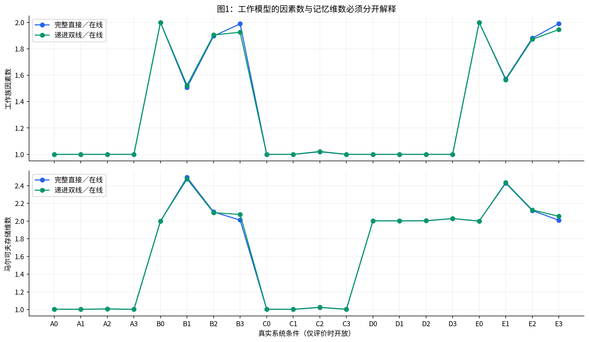

横轴是评价端的20个真实条件，纵轴分别是工作族因素数和Markov存储维数的预测权重平均。两条线为完整直接在线M3和递进双线在线M4。上图只能描述有限候选族倾向，下图描述记忆容量；D类若需要两个存储坐标，并不能宣布发现第二个物理原因。权重接近整数也不等于真实因素数已确定。

### 图2：递进相对强对照的真实增量

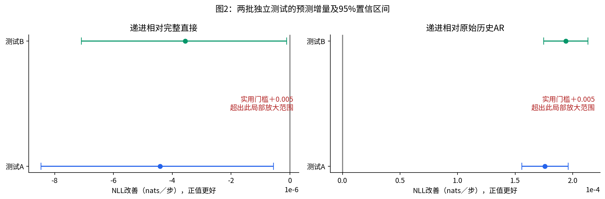

点为5000长度下所有条件平均NLL增量，横线为分层bootstrap95%区间；A/B是独立测试轨迹。右侧为正代表递进更好。坐标局部放大显示微小增量及区间，预先冻结的＋0.005实用门槛远超图示范围，红字单独注明。左图才是架构的主要公平比较；右图与有限阶原始历史AR比较，不能替代与完整直接状态模型的比较。

### 图3：新增预测证据是否重复出现

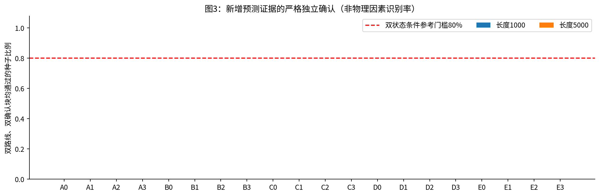

每柱分母20个独立训练种子。只有双路线、双确认块、校正检验和极点匹配都通过才计一次支持。1000与5000是嵌套数据长度，不能当两次独立复现。A和D柱升高意味着假新增风险，B柱升高意味着额外预测模式证据；C、E不能仅凭柱高命名真实独立因素。

### 图4：预测时距和概率区间

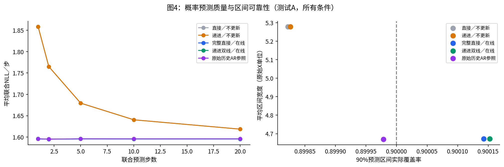

左图用不同预测步数组成的联合NLL按步归一化，越低越好；右图同时显示90%区间覆盖与宽度。覆盖接近90%且宽度较小更有意义，不能只扩大区间换覆盖。无更新组长时间停止滤波，本来就可能显著变差，它不能证明递进结构优于直接结构。

### 图5：只看X时的状态均值和不确定性

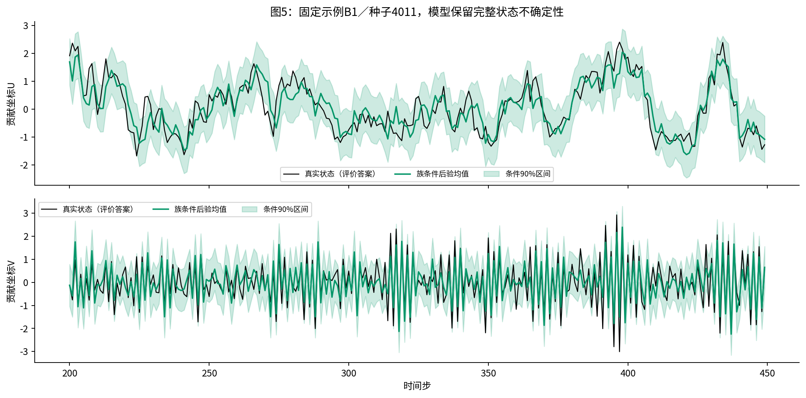

固定B1／4011／测试A第一条轨迹，未按效果挑选。黑线是真值，彩线与阴影是拟合双AR1族下的条件均值及90%边际区间；若递进提案缺失，绘图退回直接R并在图的生成代码中保留此逻辑。曲线相似只证明该族条件下恢复了一部分动态信息，单次落在区间内也不能代替整体覆盖评价。

### 图6：两个状态的联合不确定性

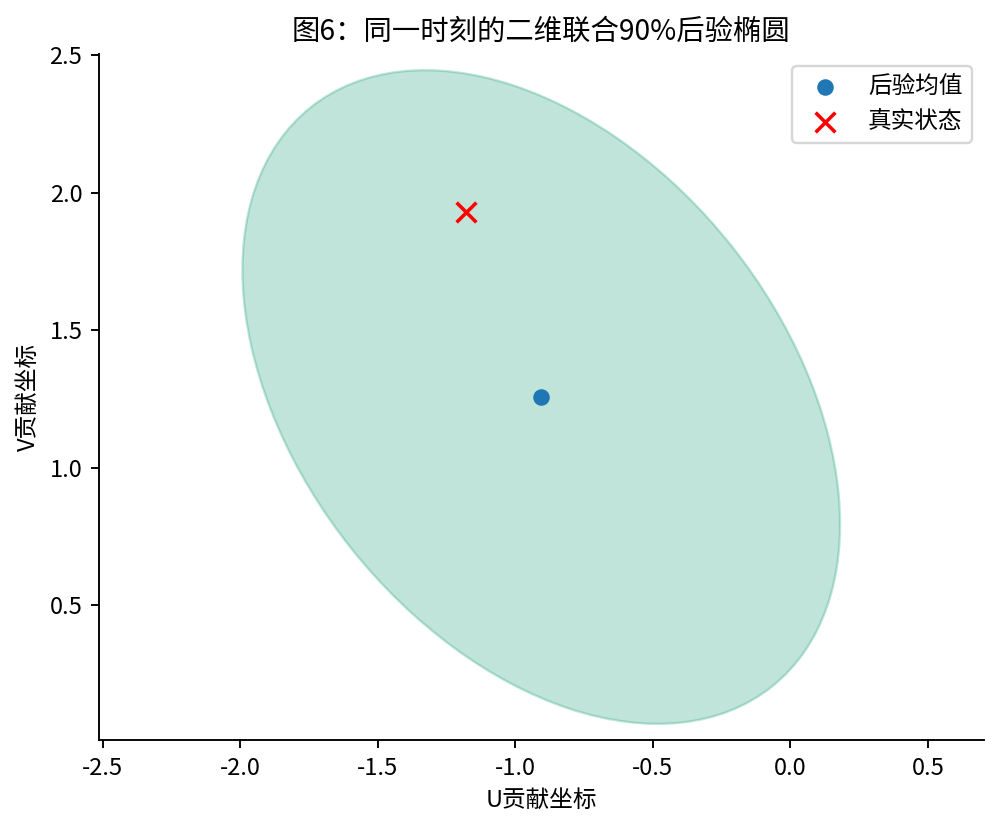

图5同一示例第350步的二维90%高斯椭圆。椭圆倾斜说明观测到二者之和后，U/V条件后验会相互依赖，即使工作过程创新独立。红叉为评价真值，圆点为后验均值；此图强调保留联合协方差，不能把两个边际点估计当独立证据。

### 图7：一个因素可以需要两个记忆坐标

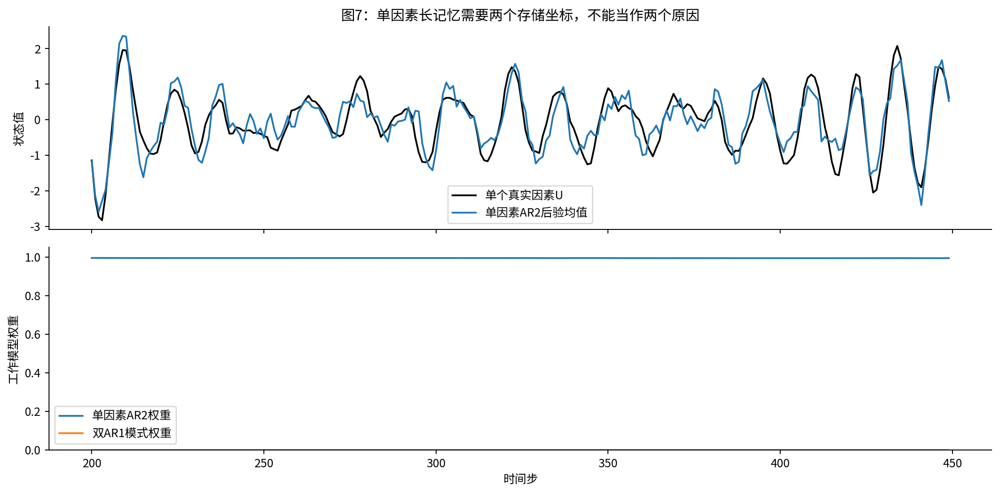

D0／4011的真实因素是一个AR2过程。上图展示单因素AR2后验对U的跟踪；下图展示单因素AR2和双AR1的模型解释权重。模型需要保存U当前与过去值，不表示现实中有两个不同原因。振荡根也可能使双实AR1拟合不足，因此必须保留长记忆强对照。

### 图8：不同数据训练后的功能复现

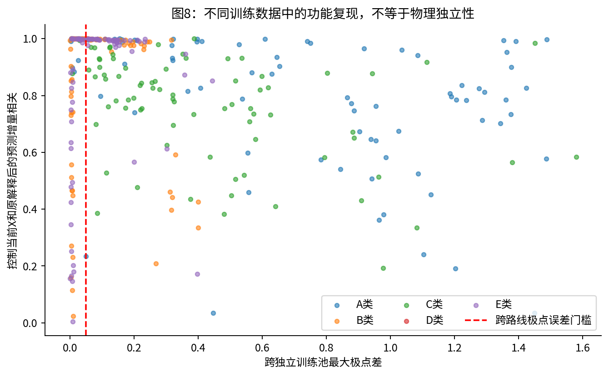

横轴为独立R／D训练路线的最大极点差，越小表示响应时标越接近；纵轴为控制当前X及单因素预测后的两条增量预测残差相关。高相关和低极点差支持预测功能复现，但不证明物理状态身份，也不把同一X的不同窗口当独立传感器。

### 图9：真实族条件后的恢复与覆盖

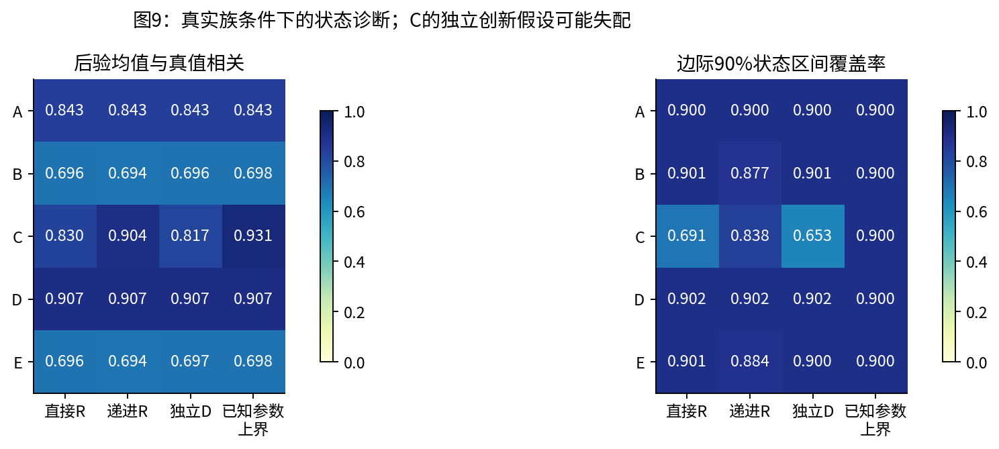

热图汇总测试A的状态相关和边际覆盖，平均跨4条件、20种子及目标坐标。oracle使用真实生成参数，其余是拟合模型。真实族由评价端选择，因此这不是自动因素数识别准确率。C的独立创新工作假设可能给出与真实物理后验不同的区间，预测好并不能免除这一问题。

### 图10：信息子空间能否被独立读出

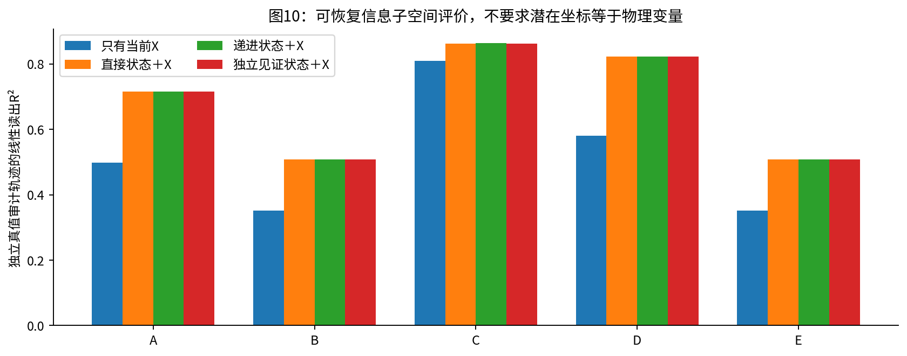

只用独立审计轨迹前半拟合线性读出、后半评价R²；柱高表示所选工作表示中有可用于恢复真状态的信息。它允许混合、缩放与符号差异，不要求某个坐标就是U或V。与当前X比较可看历史状态表示的帮助，但读出监督并未提供给原模型，不算完成了无监督物理身份识别。

### 图11：不同物理解释可以预测完全相同

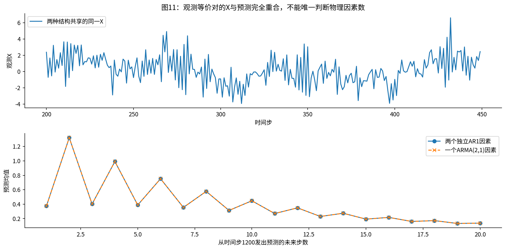

E1／4011同一X可同时被解释为两个独立AR1因素或一个ARMA21因素。下图两条未来预测均值重合，协方差和逐点似然也经数值审核相同。这里没有通过加大噪声制造困难，而是精确观测等价；更长数据不能消除这种身份不确定性。

### 图12：相同X不保证相同隐藏状态后验

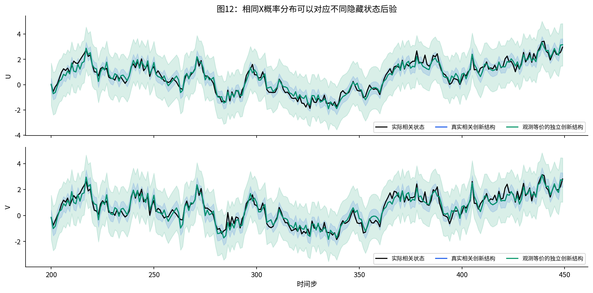

固定C0／4011，两种内部创新结构产生相同完整X分布，但U/V的条件均值与区间不同。黑线是真实相关状态，两种彩线各自在其结构假设下成立。图中差异说明：模型可以拥有可靠X预测，却无法仅凭X决定哪一套内部状态解释是真实物理结构。

### 图13：递进增量是否跨条件稳定

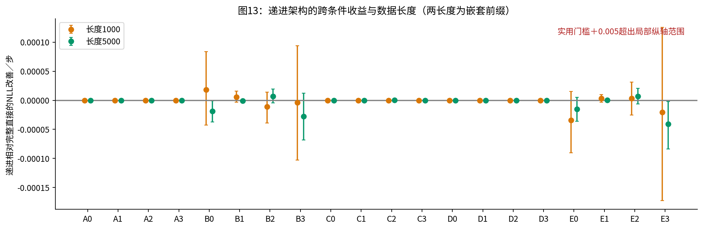

每条件给出1000／5000长度下M3−M4及95%区间。正值表示递进NLL更好；是否超过0.005和多重校正应看contrasts.csv，不能只挑正向条件。两长度共享原始轨迹前缀，图仅用于数据长度敏感性；测试B的独立复现另外保留在数据表中。

## 10. 下一步边界

20个条件是单因素参数变体，并非完整参数空间扫描，未覆盖非线性、非平稳与联合极端条件。本轮结果针对当前后验提案式递进原型、有限模型族和预算，未证明所有递进方法都不可能获益。本轮将预测模式支持与物理身份识别分开报告。若统计参考门槛未通过，应先处理候选证据强度与模型失配；即使通过，精确等价仍阻止唯一物理身份结论。在只有X且没有额外可识别约束／可控干预的设定下，不能直接把潜在模式连成真实上游因果链，更不能假定尚未影响X的上游突变已经被看见。

后续研究应明确可检验附加假设与等价类，并在独立实验中验证。此次没有启动ARD、Split-Merge、PCMCI+、SCM、因果强度估计或失效预警；没有将本轮的模型族修改归因于Yang方法。出版商及Crossref访问均为403，仅保留用户提供的思想来源，不声称核验／复现原论文。

## 文件索引与复现

- PROTOCOL.md／SYSTEMS.json：冻结协议与参数。
- CODE_REGISTERED.json、MODELS_FROZEN.json、DECISIONS_FROZEN.json、TEST_A/B_FROZEN.json：顺序与哈希。
- results/test_A/B.csv.gz：所有预测方法逐轨迹指标；family_A/B.csv.gz：单候选对照。
- results/confirmation_tests.csv、confirmation_checks.csv：全部确认及失败记录。
- results/state_quality.csv、state_readout.csv：真值审计。
- results/equivalence_audit.csv、online_audit.csv、replay_audit.csv、stability_audit.csv：数值审核。
- results/各组合/model_1000/5000.json：完整参数、协方差、最佳初值的EM轨迹、各初值终值似然与权重依据。
- RUN.md：完整从头运行与只复核现有模型的方式。
