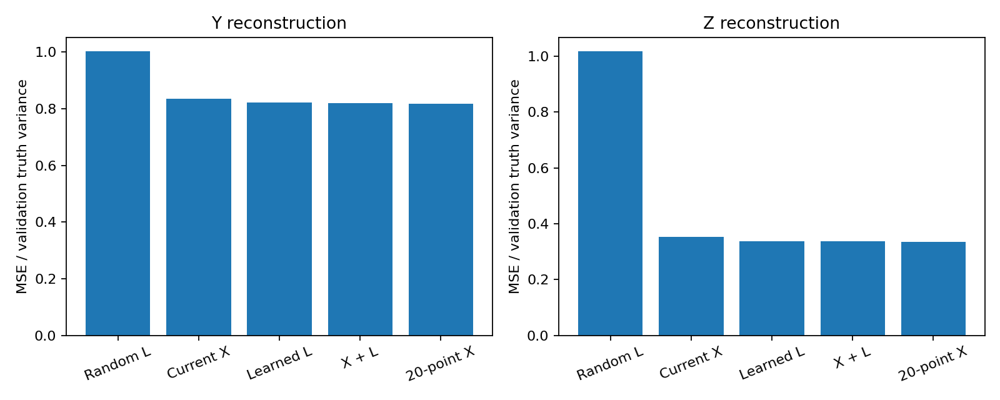
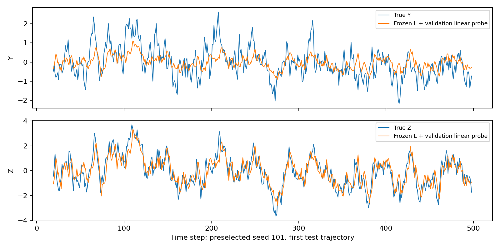

# L1：仅凭 X 历史学习二维隐藏表示的基础验证

2026-11-16，按用户最新方案在云端实际运行。本轮只做线性高斯系统的隐藏动态信息提取，不做 DVGNN 关系变化、结构分类或预警；也没有沿用 D1 的结构识别成功假设。

**结论：部分成功。** X-only 预测训练得到的 L 包含真实隐藏状态信息，尤其是中间 Z；对上游 Y 的恢复较弱。两个潜在坐标高度冗余，未证明分别恢复了两个独立隐藏状态。相对于完整 X 历史，加入 L 未带来进一步预测收益。

## 1. 逐项落实的配置

真实生成器完全使用用户给定方程：

```
Y[t+1] = 0.8 Y[t] + εY[t]
Z[t+1] = 0.7 Z[t] + 0.5 Y[t] + εZ[t]
X[t+1] = 0.5 X[t] + 0.8 Z[t] + εX[t]
```

用户未给出噪声数值，故运行前固定三种 ε 均为彼此独立、跨时间独立的 N(0, 0.5²)，作为本轮“中等噪声”的操作定义，不代表标准化的通用中噪声等级。

每个随机种子生成 1000 条独立轨迹，先热身 200 步，再保留 500 点；按轨迹切分训练 600／验证 200／测试 200。三个独立种子 101、202、303 重复完整实验，因此总共生成 3000 条，测试 600 条。既重新采样数据，也重新初始化模型，而不是把同一批测试时间点当独立重复。

历史窗严格为 X[t-19:t] 共 20 点；预测 X[t+1]；隐藏真实性检查对齐当前 Y[t]、Z[t]，不是挑最有利延迟。每条测试轨迹贡献 t=19..498 的 480 个评价点；统计区间以轨迹为单位。

编码器 20→32 tanh→32 tanh→2；预测头为 [当前 X, L1, L2]→线性单输出。损失仅为下一步 X 的 MSE，不用隐藏状态、结构标签、动态正则或预警损失。Adam，学习率 0.001，batch 512，最多 4000 步；每 100 步看固定 16000 个 X-only 验证窗口，连续 8 次不改善早停。最佳步数分别为 1900、3000、4000；第三个种子达到预设训练上限，未在看测试结果后延长训练。

## 2. 真实答案如何隔离

每个种子单独保存 `X_only.npz` 与 `sealed_truth.npz`。

1. 编码器训练和 X-only 验证仅打开 X 文件。标准化仅由 600 条训练 X 确定。
2. 保存 frozen.pt 和带时间、SHA256 的 FREEZE.json，冻结编码器。
3. 此后才首次读取 Y/Z：用 200 条验证轨迹拟合隐藏状态的线性探针，测试答案不参加拟合。
4. A4 是明确隔离的有真实 Y/Z 的 oracle 预测参考：仅其预测头在训练轨迹上使用真实隐藏状态；它不反馈给编码器或普通预测头。
5. 所有预测对照头只用训练轨迹拟合；隐藏重构探针只用验证轨迹拟合；测试集只评价。没有在测试集旋转、调符号、选延迟或拟合映射。

线性头统一采用带截距的标准化 ridge，固定 α=0.001。隐藏探针的有答案训练是诊断步骤，不意味着编码器训练看到了答案，也不意味着无监督模型自动知道 L 对应哪个物理变量。

运行前冻结 [PROTOCOL.json](PROTOCOL.json)、[REGISTERED.json](REGISTERED.json) 与 run.py 哈希，测试后核对未变。

## 3. L 是否含有 Y 和 Z 的信息？

下表是三个种子共 600 条测试轨迹的均值。相关系数为每条轨迹内预测值与当前真实状态的相关，再对轨迹平均。重构误差越小越好；NMSE 使用各自验证答案的方差归一化，不是 1−相关系数平方。

| 重构输入 | Y 平均相关 | Y MSE | Y NMSE | Z 平均相关 | Z MSE | Z NMSE |
|---|---:|---:|---:|---:|---:|---:|
| 随机二维 L | -0.002 | 0.69787 | 1.00177 | -0.004 | 1.70606 | 1.01672 |
| 当前 X | 0.390 | 0.58161 | 0.83489 | 0.799 | 0.59183 | 0.35269 |
| 仅学习到的二维 L | **0.407** | **0.57317** | **0.82277** | **0.809** | **0.56678** | **0.33776** |
| 当前 X＋L | 0.412 | 0.57098 | 0.81962 | 0.810 | 0.56522 | 0.33684 |
| 完整 20 点 X 历史 | 0.414 | 0.56959 | 0.81763 | 0.811 | 0.56083 | 0.33422 |
| 完整 X 历史＋L | 0.414 | 0.56965 | 0.81772 | 0.811 | 0.56088 | 0.33425 |

相对于随机 L，学习 L 重构 Y 的 MSE 降低约 17.87%，Z 降低 66.78%。这证明其不是任意两个随机数。

但更严格的比较是当前 X：学习 L 仅额外降低 Y 重构 MSE 约 **1.45%**，Z 约 **4.23%**。所以不能把全部 0.81 的 Z 相关都归功于复杂表示学习——当前 X 本来已包含很强的 Z 信息。



原始单坐标相关也保存，不能只看映射后结果：

| 种子 | Corr(L1,Y) | Corr(L2,Y) | Corr(L1,Z) | Corr(L2,Z) |
|---|---:|---:|---:|---:|
| 101 | -0.416 | -0.423 | -0.813 | -0.817 |
| 202 | 0.425 | -0.427 | 0.817 | -0.818 |
| 303 | -0.410 | -0.415 | -0.812 | -0.815 |

符号翻转不影响信息是否存在；这些相关是测试集全部点汇总的单坐标相关，与上表逐轨迹相关的平均口径不同。

**两个维度没有被分别识别为 Y 和 Z。** L1、L2 的绝对相关为 0.990～0.995，第一主成分占原始 L 方差 99.52%～99.76%。这说明主要变化几乎沿同一个方向，不能据此声称恢复了两个独立物理坐标；较小方差方向仍可能携带少量有用信息，单看 PCA 也不能证明其完全无用。



图中的橙线来自固定编码器＋验证集线性探针，只用当前及过去 X；没有使用未来平滑。上游 Y 的独立创新先影响 Z、再影响 X，因此当前 Y 的部分随机成分尚未出现在当前 X 中，对它恢复弱有信息限制上的原因。不过本实验没有计算严格最优恢复界，不能把全部残差都归因为不可观测而排除模型不足。

## 4. 是否帮助预测 X？

所有普通预测头均在同一训练集拟合，同一测试窗口评价下一步 X。A3 的 L 由相同历史确定，因此不增加观测信息；在线性高斯系统中，一个足够好的历史线性预测器通常已经能够利用预测均值所需的信息。

| 方法 | 测试下一步 X 的 MSE |
|---|---:|
| A1：当前 X | 0.62820 |
| A2：20 点 X 历史 | **0.60869** |
| A3：X 历史＋学习 L | 0.60871 |
| 随机对照：X 历史＋随机二维 L | 0.60870 |
| A4：X 历史＋真实 Y、Z | **0.24994** |
| 编码器自身预测头：[当前 X,L] | 0.61272 |

A2 相比 A1 降低 MSE **3.11%**；A3 相比 A2 没有改善（差值 +0.0000223，轨迹配对 bootstrap 95% 区间约 [-0.00000260, 0.0000470]）。不能据此宣布 L 对完整历史有新增预测价值。

A4 接近理论下一步不可约噪声方差 0.25，是有答案的理想参考。它比 A2 降低约 58.94%，说明不知道当前真实隐藏状态仍造成明显预测不确定性；但不保证所有这部分差距都能靠 X-only 表示弥补，因为当前 Z 含尚未传到 X 的独立创新。

普通 A2 是训练数据拟合的经验历史预测器，不应称为已知参数的理论最优上界；A4 也不能作为普通隐藏状态发现方法参与“无监督成功”的叙述。

## 5. 可支持和不可支持的结论

本轮支持：在这一固定系统下，纯 X 预测任务学到的二维 L 确实含有可检验的隐藏动态信息，Z 的恢复明显强于上游 Y；相对仅用当前 X，L 有少量额外隐藏重构信息。不同随机种子的结果方向一致。

本轮不支持：已经独立找到了真实 Y 与真实 Z；已经识别因果图；L 比完整 X 历史带来新信息或稳定预测优势；已经能够提前预警。这些都没有被本实验验证。

当前的主要限制是下一步预测目标可能只需一个主要预测方向，所以二维编码器仍学出高度冗余的坐标。这里是对观测到的冗余现象的解释假说，不是本轮已经排除其他原因的结论。没有在结果出来后改训练目标来获得更好的 Y/Z 恢复率。

## 6. 统计、核验和复现

完整 10800 条“种子×轨迹×任务×方法”指标在 trajectory_metrics.csv.gz；单坐标相关、每种子的结果、探针权重、预测头、全部模拟数据、编码器权重和测试预测均保留。

paired_intervals.json 使用每个种子内部按 200 条独立测试轨迹配对重采样，再平均三个种子，3000 次 bootstrap。它描述这三个冻结模型条件下的测试抽样不确定性，未将所有时间点当独立样本，也不能仅凭三个训练种子声称充分估计了训练随机性。这里是探索性基础验证，未做多重比较校正，不以单个区间为最终因果发现证明。

核验通过：

- 方程回代的创新方差均接近 0.25，最大跨创新相关 <0.0028。
- 改变某时刻之后的所有 X，不改变该时刻及以前的 L，差值为 0。
- 窗口、下一步预测、当前隐藏状态对齐及轨迹切分正确。
- 运行前代码与协议哈希、模型冻结哈希一致；指标无重复。

```bash
export OPENBLAS_NUM_THREADS=1
python run.py
python analyze.py
python audit.py
```

运行 run.py 会重建该目录的实验输出，复现时应复制到新目录，保留此次存档。CPU 版 PyTorch 2.5.1；三次完整训练及评价本机各约 5～6 秒。Python／包版本见 results/environment.json。当前报告是用户最新的隐藏表示基础实验，不是上一条截图中 G0～G7 的 DVGNN 复跑。
