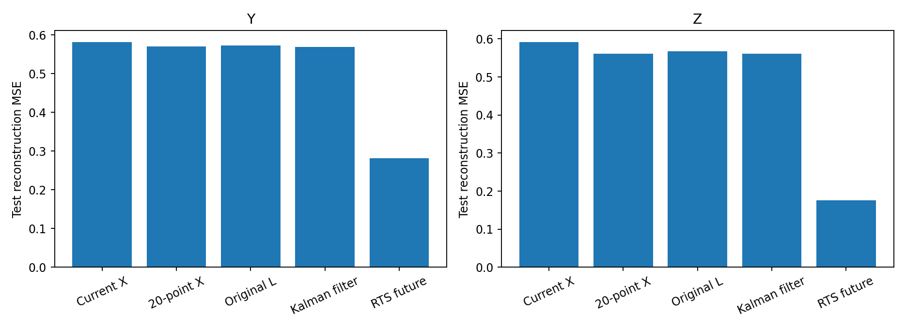
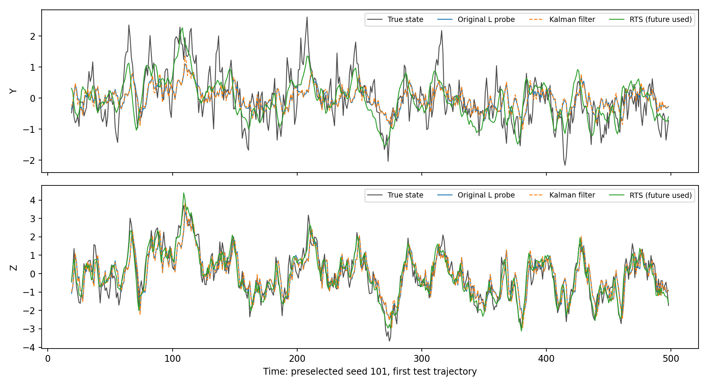
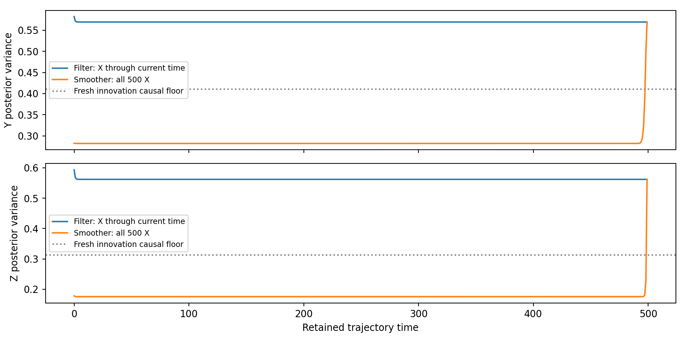

# L2-A：已知线性高斯系统下，X 允许恢复多少隐藏状态？

2026-11-16，云端实际执行。**只完成用户指定的 L2-A；未重训 L1，没有开展 L2-B、L2-C、结构识别或预警。**

核心结论：**L1 恢复当前 Y 较弱，主要不是因为编码器远远没学好，而是这个系统中当前及过去 X 本来就对当前 Y 信息有限。** 已知真实参数的最优因果均方估计，也只比原 L 降低 Y MSE 0.66%、Z MSE 1.08%。未来 X 能大幅改善回溯，但不能计作实时预警。

这是当前固定线性高斯系统、固定噪声及当前时刻重构任务的结论，不可推广成任意系统的因果可识别性证明。

## 1. 完全复用 L1，未偷换模型

源存档：GitHub 提交 `a033238a17ccab47c417ea2f03e6da4f5bf0f9e6`，目录 `experiments/L1_hidden_representation`。

逐字节复制三个种子 101／202／303 的 X_only.npz、sealed_truth.npz、frozen.pt、probe_maps.json、FREEZE.json；另存 L1 协议、代码、原报告与逐轨迹指标。来源及 SHA256 见 [SOURCE_MANIFEST.json](SOURCE_MANIFEST.json)。原 L1 文件和分支均未修改。

每个种子 1000 条独立轨迹，600／200／200 划分，零初值热身 200 后保留 500 点；本轮只评价同一批测试轨迹，每种子 200 条、总共 600 条。既未生成新测试集，也未选择更有利种子。

真实系统不变：

```
Y[t+1] = 0.8 Y[t] + εY[t]
Z[t+1] = 0.7 Z[t] + 0.5 Y[t] + εZ[t]
X[t+1] = 0.5 X[t] + 0.8 Z[t] + εX[t]
εY, εZ, εX 独立，均为 N(0, 0.25)
```

A=[[0.8,0,0],[0.5,0.7,0],[0,0.8,0.5]]；Q=0.25I；H=[0,0,1]；R=0。X 的过程创新仍在 Q 中，不能因为 X 直接可观测就把它的过程噪声也设为零。

初始均值为零。按照 L1 实际代码，首个保留状态是从零状态经过 201 次转移后的状态，故初始先验协方差精确递推 201 次。与平稳先验的相对差约 4.41×10⁻¹⁶。热身期间的 X 没有提供给本轮估计器。

## 2. 五个主对照与信息权限

| 方法 | 实际信息／参数 | 是否使用未来 X |
|---|---|---|
| A1 当前 X | 原 L1 验证集拟合的当前 X 线性映射 | 否 |
| A2 20 点历史 | 原 L1 验证集拟合的 Ridge 映射 | 否 |
| A3 原始 L | 原冻结编码器，输入 20 点 X；原验证集 L-only 探针 | 否 |
| A4 卡尔曼滤波 | 全部截至当前 X；真实 A、Q、H、R 与初始先验 | 否 |
| A5 RTS 卡尔曼平滑 | 整条 500 点 X；同一真实参数 | **是** |

不重新拟合任何 A1～A3 映射，不重训编码器。读取测试真实 Y、Z 只用于指标，不送给滤波／平滑。对 L1 的原始逐轨迹 MSE 复算，最大差 **5.55×10⁻¹⁷**，确认确实复用了原模型结果。

滤波计算 E[S_t | X_0,...,X_t]，平滑计算 E[S_t | X_0,...,X_499]。上传要求中两个条件期望均写成仅给 X[0]，与文字描述冲突；这里按文字含义实现，未把只看单个初始 X 误当滤波。

主要指标与 L1 完全对齐：每条轨迹 t=19..498 的 480 点，估计**同一时刻** Y_t、Z_t；未事后平移潜在曲线。平滑能使用 t=499 的 X，但 t=499 不在主评价区间，以保持 L1 窗口一致。

额外只加一个诊断参照 D：知道参数、但每次只给同样 20 点历史的卡尔曼估计，用来区分“知道方程”与“历史更长”的贡献，不是额外训练模型。

## 3. 实际测试结果

MSE 越小越好。RMSE=汇总 MSE 的平方根。相关是逐轨迹相关的均值。NMSE 延续 L1，使用各种子验证集真实隐藏状态方差归一化，再平均；不等同于 1−相关²。

| 状态 | 方法 | MSE | RMSE | NMSE | 平均相关 |
|---|---|---:|---:|---:|---:|
| Y | 当前 X | 0.581608 | 0.762632 | 0.834885 | 0.390316 |
| Y | 20 点历史 Ridge | 0.569589 | 0.754711 | 0.817630 | 0.413922 |
| Y | 原始 L＋原探针 | 0.573168 | 0.757078 | 0.822772 | 0.406826 |
| Y | **已知参数卡尔曼滤波** | **0.569361** | **0.754560** | **0.817303** | **0.414440** |
| Y | **使用未来的 RTS 平滑** | **0.281532** | **0.530596** | **0.404130** | **0.766171** |
| Z | 当前 X | 0.591828 | 0.769304 | 0.352690 | 0.799278 |
| Z | 20 点历史 Ridge | 0.560830 | 0.748886 | 0.334220 | 0.811403 |
| Z | 原始 L＋原探针 | 0.566777 | 0.752846 | 0.337758 | 0.809234 |
| Z | **已知参数卡尔曼滤波** | **0.560665** | **0.748775** | **0.334122** | **0.811470** |
| Z | **使用未来的 RTS 平滑** | **0.175862** | **0.419359** | **0.104804** | **0.944686** |



### 原 L 距离最优因果估计还有多远？

卡尔曼滤波相对原 L：

- Y MSE 只降低 **0.664%**，配对差 -0.003807，95% 区间 [-0.004312,-0.003307]。
- Z MSE 只降低 **1.078%**，配对差 -0.006112，95% 区间 [-0.006634,-0.005585]。

差异稳定存在，但实际幅度很小。不能把这解读为原 L 已经识别了两个物理隐藏变量；它只是已接近当前状态平方误差意义上的可达到性能。

卡尔曼滤波相对 20 点历史 Ridge 仅降低 Y MSE 0.040%、Z MSE 0.029%。已知参数的 20 点估计与全历史卡尔曼滤波的平均 MSE 差在 10⁻¹⁰ 量级。因此在这个参数设置下，20 点窗已足以近似实现全历史的当前状态估计；单纯继续加长历史不太可能带来巨大提升。

### 未来观测能帮多少？

平滑相对滤波，Y MSE 降低 **50.55%**，Z 降低 **68.63%**。配对差的 95% 区间分别为 [-0.291886,-0.283796] 与 [-0.387974,-0.381670]。

这表明未来 X 含有当前尚未充分传出来的隐藏状态信息。但平滑结果要拿到整条轨迹后才能获得，不能倒过来宣称在那些过去时刻已经实时知道隐藏状态。



## 4. 理论参照：后验方差意味着什么？

在线性高斯、真实参数已知的条件下，卡尔曼条件均值是**所有仅用同样 X 信息的估计器中，期望平方误差最小的估计**，不局限于线性神经网络。其后验方差给出该条件下剩余的不确定性；这是依赖真实模型成立的参照，不是从未知系统中无监督学来的保证。

| 状态 | 不看 X 时的理论方差 | 滤波理论平均 MSE／后验方差 | 平滑理论平均 MSE／后验方差 | 滤波剩余方差占比 | 平滑剩余方差占比 |
|---|---:|---:|---:|---:|---:|
| Y | 0.694444 | 0.569248 | 0.282892 | 81.97% | 40.74% |
| Z | 1.697118 | 0.561970 | 0.175889 | 33.11% | 10.36% |

因此当前／过去 X 能解释 Y 约 18.03% 的总体方差、Z 约 66.89%。这里的“解释”指条件均值下的总体方差分解，不是因果效应占比。

理论总体滤波相关约 Y=0.4246、Z=0.8178；平滑约 Y=0.7698、Z=0.9468。它们与上表逐轨迹相关均值口径不同，不应要求小数逐位一致。

测试误差与理论后验方差接近。理论 95% 单时刻后验区间的测试覆盖率：滤波 Y 95.11%、Z 95.07%；平滑 Y 95.04%、Z 95.00%。这是逐点覆盖，不是“整条轨迹同时有 95% 覆盖”；存在时间相关，不能据此把所有时间点当独立校验样本。

后验方差曲线见下图。滤波很快稳定；平滑在末尾回升，因为末尾没有足够未来数据，最后一个时刻平滑等于滤波。完整时间步曲线保留在 posterior_variance_by_time.csv.gz。



## 5. 延迟与其他观测不确定性，分别有多少？

以 εY,k 表示从 k 到 k+1 的源创新：

```
Y[t] = 0.8² Y[t-2] + 0.8 εY,t-2 + εY,t-1
```

截至 X_t，最新两次源创新 εY,t-2、εY,t-1 尚未传入 X 历史。它们彼此独立，且独立于当前可用的全部 X，故任何实时 X-only 估计对 Y 的期望 MSE 至少有：

```
0.25 × (0.8² + 1) = 0.4100
```

这项占滤波 Y 后验不确定性 **72.02%**；其余约 **0.15925** 来自更早状态仍无法由带噪、混合的 X 完全确定。

Z_t 中尚未观测到的独立项至少为 `0.5 εY,t-2 + εZ,t-1`，其方差为 **0.3125**，占滤波 Z 后验不确定性 **55.61%**；其余约 **0.24947** 为更早状态的剩余条件不确定性。

两者的联合不可见新创新协方差为 [[0.41,0.10],[0.10,0.3125]]，与计算出的后验协方差下界一致。这里分解的是独立新创新造成的确定下界，并非把所有其他噪声效应完全单独因果归因；剩余项也包含更早传播信息的模糊性。

这一计算解释了为什么“模型只要更强，就应该实时准确还原当前 Y”的预期不成立。延迟不仅意味着时间标记偏移，还意味着最新独立随机变化根本尚未进入观测信息。

## 6. 三个种子和原 L 的冗余

| 种子 | Y 原 L MSE | Y 滤波 MSE | Y 平滑 MSE | Z 原 L MSE | Z 滤波 MSE | Z 平滑 MSE |
|---|---:|---:|---:|---:|---:|---:|
| 101 | 0.572430 | 0.568949 | 0.281726 | 0.567611 | 0.560963 | 0.175438 |
| 202 | 0.576186 | 0.573467 | 0.283915 | 0.561633 | 0.559207 | 0.176579 |
| 303 | 0.570887 | 0.565666 | 0.278956 | 0.571088 | 0.561824 | 0.175569 |

三个种子方向一致。原 L 没有变化：|Corr(L1,L2)| 仍为 0.990～0.995，第一主成分占比 99.52%～99.76%。不重训、不更换映射，因此这些指标与 L1 一致。

后验不确定性不是 L 的 PCA 方差；一个描述估计真值还剩多少未知，另一个描述表示内部是否冗余，不能混为一谈。两个坐标高度相关仍不排除小方差方向含有有用信息。

## 7. 对六个研究问题的回答

1. **仅看 X 能恢复多少当前 Y？** 在当前真实已知系统下，最优滤波期望 MSE 约 0.56925，约剩余 81.97% 总体方差；只能恢复部分持续信息，无法准确追踪每次独立新变化。
2. **能恢复多少当前 Z？** 最优滤波期望 MSE 约 0.56197，剩余 33.11% 总体方差，明显好于对 Y 的相对恢复程度。
3. **L 距离最优有多远？** 在这批独立测试轨迹上，卡尔曼滤波比原 L 的误差仅降低 Y 0.66%、Z 1.08%，可改善的当前状态 MSE 空间很小。
4. **未来 X 是否明显帮助？** 是，平滑误差约降低一半／三分之二；这是回溯证据，不是提前预警证据。
5. **信息缺失主要来自什么？** 延迟使最新独立创新尚不可见，是主要组成；更早状态经过传递、混合与独立噪声后仍有不确定性，不能都解释成简单“整体晚两步”。
6. **主要瓶颈是什么？** 就这组数据的当前状态重构而言，主要是可观测信息限制，表示学习不足为次要差距。就“是否分离真实两个物理机制”而言，本实验没有给出识别成功证明。

L2-B 的多时间尺度任务可能改变表示的冗余或动态组织，但在同一观测和同一重构损失下，不应期待它大幅突破这里的最优因果参照。本轮没有运行 L2-B，也未用测试结果修改其训练目标。

## 8. 验证与存档

- 与独立构造的 32 步联合高斯条件分布比对：滤波均值最大误差 5.33×10⁻¹⁵，平滑 4.88×10⁻¹⁵；协方差误差 ≤1.78×10⁻¹⁵。
- 截断未来 X，不改变过去前向滤波均值，误差为 0。
- R=0 时观测 X 被精确重构，滤波／平滑协方差均半正定，平滑协方差不大于滤波。
- 所有原始输入、L1 权重和探针哈希验证通过；运行前配置／代码冻结哈希验证通过；7200 条逐轨迹指标无重复。
- 每种子原始 X/Y/Z、L1 权重、映射、全部测试估计、逐时间步协方差、逐轨迹／逐种子指标、统计区间和图表均已保留。

配对区间以独立轨迹为重采样单位，每个种子内重采 200 条、再平均三个种子，3000 次；不把 480 个时间点当独立实验，也不把三个种子视为足以估计所有训练随机性的分布。本轮已使用的测试集正是用户要求复用的 L1 集；它不是此前从未查看的新测试集，因此不宣称新的盲测模型选择成功。理论参照无需靠该测试集选择参数。

未做多重比较校正，区间用于诊断差距大小，不能视为因果结构发现证明。有限测试 MSE 可能略低于理论期望后验方差，属于样本波动，不表示突破最优界。

```bash
export OPENBLAS_NUM_THREADS=1
python run.py
python validate.py
python analyze.py
```

run.py 只读取归档 inputs，不再运行 prepare.py；prepare.py 记录本次从 L1 工作区复制输入的过程，其原路径不保证其他机器存在。完整复跑会重建 results，应在副本中执行。模型结构由 encoder.py 原样加载，未创建优化器。多步联合训练、参数估计、动态结构学习、其他噪声或新系统均不属于本次实验。
