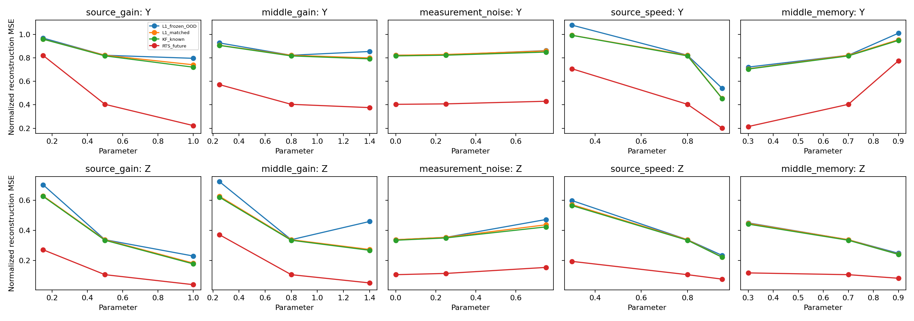
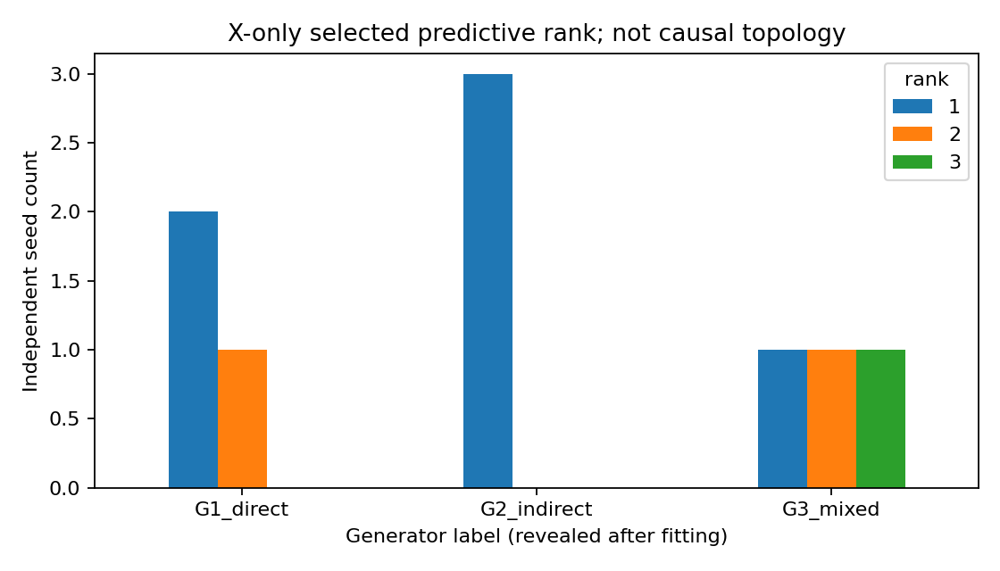

# L2-B 条件扫描、L3-A 预测结构尝试、L3-B 不可识别边界

2026-11-16，云端实际运行。采用用户最新定义的 L2-B（改变系统条件），不是此前曾拟议的“神经网络多时间尺度目标”同名实验。保留 L1、L2-A 和更早实验。

**结果：找到了隐藏状态更容易／更难恢复的条件，但没有实现可靠的直接、间接、混合因果结构分类。** 在不预先给定隐藏个数的 X-only 预测模型中，选出的动态维度并不稳定对应真实隐藏变量数；离散系统的精确反例还证明，有些不同路径产生完全相同的 X 分布。

尤其要区分：**恢复隐藏状态信息、识别预测状态维度、确定真实因果路径，是三个不同目标。** 本轮没有用前两个的成功替代第三个。

## 1. 范围、规模与冻结

- L2-B：五个单因素扫描，每个三档，与一个共同基线合并为 11 个独立条件；三个种子 101/202/303，每条件每种子 1000 条、600/200/200 划分。合计 33000 个条件内轨迹实例，测试 6600 条，形成 66000 条“方法×状态×轨迹”指标。跨条件共用随机种子形成配对，不是 33000 条相互独立的跨条件样本。
- L3-A：直接、间接、混合各三种子，每次 1000 条，合计 9000 条，测试 1800 条。其数据种子独立于条件扫描；三个图的隐藏状态数不同。
- L3-B：三类精确等价对、三个种子、两个机制各 200 条，合计 3600 条平稳轨迹；没有用这些标签训练结构分类器。
- 每条长度 500，通常零初值热身 200。L3-B 为验证平稳输出等价，直接从平稳状态初始化。
- [PROTOCOL.json](PROTOCOL.json)、[REGISTERED.json](REGISTERED.json) 在实际测试前记录系统条件、训练规则、模型与输入哈希。所有预设条件、种子均保留，没有放宽标准或按结果挑曲线延迟。

原 L1 的数据、权重和探针逐字节复制到 inputs；源提交为 `a033238a17ccab47c417ea2f03e6da4f5bf0f9e6`。基线直接复用，不重训冒充原结果。变条件数据按记录的方程、参数、种子重生成；原 L1 文件不修改。

## 2. L2-B：怎样公平地改变条件？

基线仍是：Y[t+1]=0.8Y[t]+εY；Z[t+1]=0.7Z[t]+0.5Y[t]+εZ；X[t+1]=0.5X[t]+0.8Z[t]+εX；三个过程创新独立，方差 0.25。

| 因素 | 三档 | 控制方式 |
|---|---|---|
| Y→Z 系数 α | 0.15、0.5、1.0 | 其余基线参数不变 |
| Z→X 系数 β | 0.25、0.8、1.4 | 其余基线参数不变 |
| X 测量噪声标准差 | 0、0.25、0.75 | Xobs=Xphysical+ν；X 过程创新方差仍为 0.25 |
| 源持续性 a | 0.3、0.8、0.95 | 调整 qY，使长期 Var(Y)=0.25/(1−0.8²) 不变；a 越大越持久 |
| 中间记忆 c | 0.3、0.7、0.9 | 调整 α，保持 DC 增益 α/(1−c)=0.5/0.3 不变；c 越大记忆越长 |

所有观测方法只读 Xobs，真实状态仅用于冻结后的验证探针和最后评价。卡尔曼参照知道各条件的真实 A/Q/R，不假装这些参数由未知 X 自动识别。

中间记忆扫描保持 DC 增益，但 qZ 固定，因此随 c 改变，中间独立创新的稳态累积也改变；它不是把一切幅度／噪声统计量都固定的纯延迟实验。这些结论不能外推成“所有慢传递系统都一样”。

每个条件比较五个方法：

1. **L1_frozen_OOD**：原 L1 权重、归一化、原探针完全固定，用于观察跨条件迁移。
2. **L1_matched**：同样 20→32 tanh→32 tanh→2 编码器，在该条件训练 X-only 下一步预测；冻结后用该条件验证集拟合 L-only 探针。基线直接用原权重。
3. **history20**：该条件验证集拟合的 20 点 X 线性重构参照。
4. **KF_known**：已知参数、当前及全部过去 X 的最优均方滤波。
5. **RTS_future**：已知参数、整条 X 的事后平滑，不能用于实时预警。

神经模型训练规则与 L1 一致：最多 4000 步，固定学习率 0.001、batch512、每100步用 X 验证、8次无改善早停，三个相同优化种子。没有根据真实 Y/Z 挑 checkpoint。每次冻结权重后才拟合有答案的诊断探针。评价 t=19..498，与 L1 相同，未选择最有利滞后。

## 3. L2-B 结果：什么时候 X 更有信息？

下表为已知参数卡尔曼滤波对当前 Y 的逐轨迹平均相关；它反映该条件的信息能力参照，不是未知模型已经发现了真实 Y。

| 因素 | 第一档 | 基线档 | 第三档 |
|---|---:|---:|---:|
| α：0.15／0.5／1.0 | 0.195 | 0.414 | 0.516 |
| β：0.25／0.8／1.4 | 0.293 | 0.414 | 0.443 |
| 测量噪声：0／0.25／0.75 | 0.414 | 0.407 | 0.374 |
| a：0.3／0.8／0.95 | **0.040** | 0.414 | **0.704** |
| c：0.3／0.7／0.9，DC 增益匹配 | 0.531 | 0.414 | 0.217 |

在本轮测试范围内，作用更强、源更持续、观测噪声更低，有助于恢复当前上游 Y。对快速变化源 a=0.3，Y 滤波 NMSE 约 0.993，几乎无法从当前 X 恢复；a=0.95 时降到 0.453。

这一速度效应有明确的因果信息下界：级联需要两步传到 X，最新两次独立 Y 创新尚未被当前 X 看到；保持 Var(Y) 不变时，这部分误差占 Y 总方差至少 `1−a⁴`。a=0.3 时为 **99.19%**，所以即使完美模型也不能指望当前 Y 的恢复很好。a=0.95 时该下界为 18.55%，有更大的可恢复空间。该下界依赖本轮独立创新、无直接路径的真实级联，不是所有未知系统的通用公式。

中间状态与源头可能呈相反趋势：c 从0.3增到0.9，Z 的滤波相关从0.741升到0.864，但 Y 从0.531降到0.217。**更容易恢复中间状态，不等于更容易恢复上游原因。**



同条件重新训练的简单编码器通常接近卡尔曼参照；例如：

| 条件 | Y 的匹配 L NMSE | Y 的 KF NMSE | 原冻结 L 跨条件 NMSE |
|---|---:|---:|---:|
| 基线 | 0.823 | 0.817 | 0.823 |
| a=0.3，快速源 | 0.993 | 0.993 | 1.080 |
| a=0.95，持续源 | 0.455 | 0.453 | 0.541 |
| α=1，强源作用 | 0.741 | 0.721 | 0.797 |
| c=0.9，长记忆 | 0.955 | 0.949 | 1.011 |

原冻结 L 退化不一定代表 X 没有信息，也可能是归一化、编码器、探针的分布迁移。匹配重训能弥补一部分，但不能突破已知模型的信息参照。

没有把 NMSE≈1 自动等同为严格不可识别，它只是本次当前状态估计接近无信息基准。所有相对误差的归一化分母使用对应条件验证状态方差。完整 MSE、相关、后验方差、种子结果和配对区间见 scan_summary.csv、scan_by_seed.csv、scan_paired_intervals.json。

匹配编码器依然普遍高度冗余：第一主成分占比范围 98.06%～99.90%，不能认为改条件就自动分离出两个物理坐标。signed 相关跨种子可能符号翻转，不能把其直接平均误作低冗余；原始逐种子数值已保存。

## 4. L3-A：不告诉模型隐藏个数，是否能学出结构？

本轮采用一个简单、可复现的 **X-only 预测状态基线**，没有把真实直接／间接／混合标签用于分类训练，也没有在测试前指定真实隐藏个数：

- 输入 20 点 X 历史，只用训练 X 拟合线性降秩多未来预测，未来点为1、2、4、8步。
- 当前 X 单独旁路；L 表示相对当前 X 的额外预测方向。
- 搜索额外预测维度 d=0,1,2,3,4；仅用验证集未来 X 的 MSE 选 d，差≤10⁻⁶时取小者。
- 选择并冻结后，才揭开 Y/Z 做诊断。知道生成图的是实验记录器，fit_x 函数只接受训练／验证 X。

这是预测秩／随机实现的候选动态结构搜索，**不是能将潜在坐标命名为真实因果节点的拓扑发现算法**。没有训练一个监督图分类器来满足表面上的三分类。预测维度无法合法映射为因果标签时，保留“结构证据不足”。

| 真实生成器（训练后揭晓） | 三种子选中的额外预测维度 |
|---|---|
| G1 直接，Y→X | 1、1、2 |
| G2 间接，Y→Z→X | 1、1、1 |
| G3 直接＋间接 | 3、2、1 |



这些结果**没有可靠恢复真实隐藏变量个数，更没有区分出三种因果图**。尤其不能把 G2 选一个方向说成“发现它其实是直接原因”；它只说明这套有限样本预测目标偏好一个额外方向。

当前 X 旁路也影响潜在表示解释：L 已先对当前 X 作残差化，因此 L-only 重构刻意排除了 X 本来携带的信息。其单独诊断较弱，全部原始结果保留在 structure_state_metrics.csv.gz，未删除。

### 单独登记的事后诊断：完整可用状态 [X,L]

看到 L-only 结果后，补充检查当前 X 旁路与 L 联合的表示。此项明确登记为**事后诊断**，不是原主判据；不改变预测模型、选中维度、参数、时间对齐。所有补充线性映射仍只在验证答案拟合，测试答案不用于调整。登记见 JOINT_DIAGNOSTIC_REGISTERED.json。

| 真实组别 | 隐藏状态 | 当前 X 相关 | [X,L] 相关 | 完整20点历史相关 |
|---|---|---:|---:|---:|
| 直接 | Y | 0.668 | 0.672 | 0.672 |
| 间接 | Y | 0.385 | 0.412 | 0.411 |
| 间接 | Z | 0.797 | 0.809 | 0.809 |
| 混合 | Y | 0.496 | 0.547 | 0.546 |
| 混合 | Z | 0.854 | 0.866 | 0.866 |

因此总预测状态能保留接近历史线性参照的隐藏信息，但其坐标个数和因果路径仍不能等同。原来的“隐藏信息可用”与“结构命名失败”可以同时成立。

### 拒判的准确含义

本轮没有为九个模型声称唯一真实因果图。这里的拒判是基于模型假设审查与等价机制证据的**预设保守解释规则**，不是神经网络自动学会识别一切不可识别场景的实证能力。也没有把拒判率100%当作一个高性能结构分类器的成功。

所以 L3-A 的实际结果是：完成了未知维度的预测表示尝试，**未完成可靠因果图识别**。不报告一个凭预测秩硬凑出的因果分类准确率。

## 5. L3-B：三类精确不可识别反例

对平稳线性高斯系统，证明 X 自协方差／谱完全相同，即证明所有有限维 X 分布完全相同；不是通过“统计检验不显著”推断等价。

### 反例1：直接与带中间创新的间接，X 分布相同

共同 X 自衰减0.5、输出系数0.8、X过程噪声方差0.25：

- 直接：源持续性0.8、源噪声方差0.5。
- 间接：源持续性0.8、中间记忆0.4、α=√0.68，源和中间创新方差均0.25。

间接中间状态的谱分子恰好抵消中间极点，得到直接源的同一输出谱。源尺度若规范为相同方差0.25，也可将直接系数改为0.8√2，输出不变；单靠 X 不能凭空认证真实源噪声／强度的物理尺度。

### 反例2：正的直接＋间接路径抵消一个极点

混合源 a=0.3、中间 c=0.8、α=β₂=β₁=0.5，qY=0.25、qZ=0；与 a=0.8、β=0.5、qY=0.25 的直接模型输出相同。

以 z 表示一步滞后，混合分子 `β₁+(αβ₂−β₁c)z = 0.5(1−0.3z)`，恰好抵消源的极点。**正路径和无独立中间噪声也不自动排除等价。**

### 反例3：源与中间时钟交换

无独立中间创新时，交换源0.8与中间0.4的持续性，保持αβ不变，X 分布不变；即使知道有两个动态环节，也未必知道哪一个属于源、哪一个属于中间。

三对机制的101个滞后协方差最大相对误差≤**2.87×10⁻¹⁶**，频谱核验≤**7.36×10⁻¹⁶**。解析相等是论证，浮点误差是实现核对。每对两个机制各三个种子200条平稳轨迹均保留统计记录。

对这两个已明确给定且等先验的等价候选，任何 X 的正确似然后验都是0.5／0.5，应拒绝唯一分类。该0.5由已知模型的数学等价给出，**不是一个仅靠未知数据自动校准的结构置信度**。若有外部结构先验，后验可以不同，但 X 本身不提供区分证据。

第一对含独立中间噪声；后两对取 qZ=0 作为额外边界案例，不混入前面 qZ=0.25 的条件扫描均值。

## 6. 本轮对研究目标的回答

1. **什么条件更能看到隐藏信息？** 本轮范围内，源更持久、作用更强、噪声更低有利于当前上游恢复；不同隐藏环节可呈相反趋势。
2. **是否已找到可靠区分直接／间接的充分实证条件？** 没有。当前通用预测秩方法没有做到；有限数据中区分某些预测规律，也不能自动保证唯一因果路径。
3. **什么情况下不能区分？** 已给出精确相同 X 分布的不同结构，增加样本、未来 X 或网络复杂度都不能解决这些配对的唯一性。
4. **怎样提高能力？** 已知独立噪声结构、排除极点抵消／非最小实现、给源与中间提供时间尺度角色约束，可能支持受限候选家族辨识；更直接的信息是新增中间观测或已知针对源的外部输入／干预。本轮没有用这些额外信息冒充 X-only 结果。
5. **能否据此预警？** 本轮未植入机制失效、未比较预测失效时间，因此不能报告预警成功。即使可恢复状态，仍需单独检验状态异常是否预示失效，及证据到达 X 的时间。

研究取得的是一张受条件约束的可恢复性图谱与不可识别反例；尚不是未知动态系统的通用因果拓扑发现器。

## 7. 验证、统计及复现

audit.json 核对所有冻结代码／输入哈希、33个匹配权重冻结哈希、66,000条扫描指标、3,000条主结构状态指标、3,600条反例记录；无重复。含测量噪声的滤波／平滑与独立联合高斯条件分布最大差约9.83×10⁻¹⁵，截断未来不改变过去滤波。

扫描区间在每种子内部对200条测试轨迹配对重采样、平均三个种子，1500次，条件于冻结模型；时间点不算独立样本。11条件网格是预先指定的描述性扫描，无多重校正，不挑某个显著区间冒充总体因果发现。三个种子可显示方向稳定性，不能穷尽所有训练随机性。

完整轨迹级指标、模型权重、诊断映射、参数与种子、所有条件前三条测试轨迹的估计曲线保留。为控制存档体积，变条件没有重复保存所有原始训练轨迹和全部测试预测；它们可由种子确定重建。replay.py 可生成任一条件全部200条测试轨迹的原始状态、X、L、匹配模型估计、KF/RTS及后验方差。

```bash
export OPENBLAS_NUM_THREADS=1
python replay.py --cell source_speed_0.95 --seed 101 --out replayed_case.npz
python audit.py
```

完整重跑在目录副本中执行 `python rerun_archived.py`；它复用归档inputs，不依赖main.py首次复制时的原机器绝对路径。重训后的模型字节与存档可能因环境不同而变化，不能改旧哈希冒充同次实验。`python analyze.py`重建主要汇总；`diagnostic_joint.py`重建明确标注的事后联合探针诊断。L1、L2-A以及主分支未覆盖。
