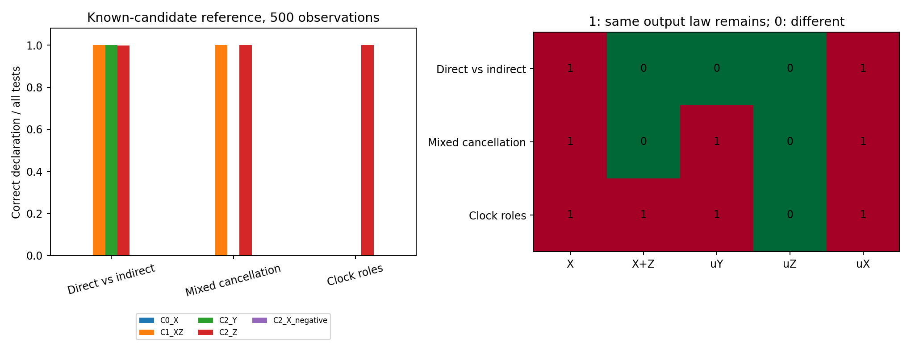
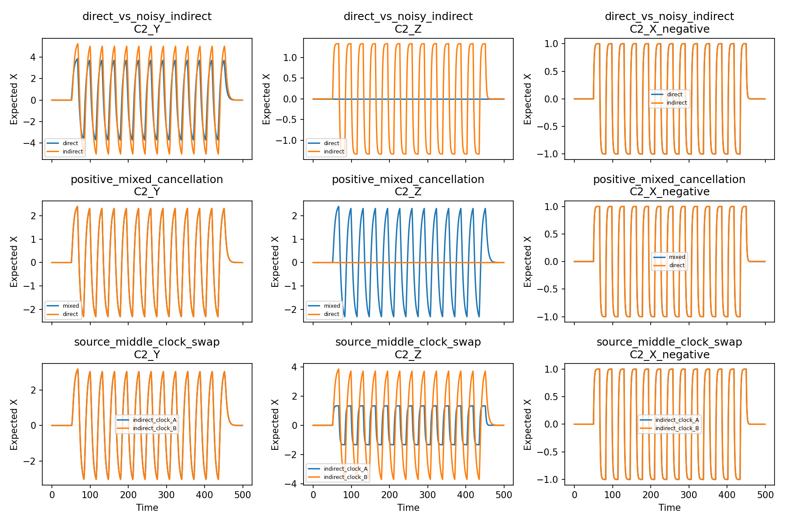

# L3-C：什么额外信息能打破直接／间接机制的歧义？

2026-11-17，云端实际运行。按用户要求**只开展 L3-C**，没有训练 L3-D 因果分类器，也没有进行 L4 失效预警。

**结论：额外观测或干预能够打破某些歧义，但不保证全部有效；干预必须命中能让候选响应不同的位置。** 对源／中间时间尺度交换的歧义，增加 Z 观测、扰动 Y 都无效，本轮直接扰动 Z 才有效。错误物理先验还会导致高信心的错误判断。

## 1. 这是信息诊断参照，不是未知参数因果发现器

本轮要区分“新增信息是否真正存在区分依据”和“学习算法能否提取依据”。因此使用**完全指定的有限候选线性高斯模型**计算精确观测似然，而非重训复杂网络。

估计器知道候选方程、参数、测量噪声与输入位置／增益，但不知道本条轨迹由哪个候选生成；每条推断只接收对应信息条件的观测和已知输入。真实状态、真实生成标签只用于最后评价，不送入似然选择器。

所有候选等先验；最大候选后验≥0.95才作唯一声明，否则拒判。该数值是**给定这组已知候选与参数时的条件后验**，不是未知系统中经过训练校准的通用因果置信度。候选集合之外仍可能有其他解释。本轮的高识别率不意味着已经解决 L3-D。

[PROTOCOL.json](PROTOCOL.json)、[REGISTERED.json](REGISTERED.json) 在模拟测试前冻结方程、条件、输入、阈值及代码；配对协方差与受控均值是否相同也在模拟测试前计算。测试结果未用于修改参数或阈值。

## 2. 公平定义“观测 Z”与三种目标路径

所有模型都包含同一物理通道 [Y,Z,X]，方程统一为：

```
Y[t+1] = a Y[t] + εY[t] + uY[t]
Z[t+1] = c Z[t] + α Y[t] + εZ[t] + uZ[t]
X[t+1] = 0.5 X[t] + β1 Y[t] + β Z[t] + εX[t] + uX[t]
```

一次只有一个输入位置被激励。三个过程创新相互独立。

- G1 直接目标路径：β1>0，β=0。Z 是真实存在、可测量的旁支状态，不影响 X。
- G2 间接目标路径：β1=0，β>0，Y→Z→X。
- G3 混合目标路径：β1>0，β>0。

这样不会通过“G1 根本没有 Z 数据列，其他组有”泄露标签，也不把不存在的 Z 用零列伪造。代价是 G1 表示“到 X 只有直接目标路径”，并不表示整个世界只有两个变量。

三结构普通面板基线 a=0.8,c=0.7,α=0.5，创新方差均0.25；G1 的 β1=0.8、β=0；G2 的 β1=0、β=0.8；G3 的 β1=0.4、β=0.8。这三个固定候选的 X 本来就不完全等价，因此另有精确等价配对作为关键主检验。

## 3. 信息条件与模拟设置

| 条件 | 提供的信息 | 作用 |
|---|---|---|
| C0 | X 的观测，无输入 | 原始参照 |
| C1 | 同一 X，加独立测量的 Z | 检验联合分布是否不同 |
| C2-Y | X，加已知位置／增益的源输入 uY | 检验源干预响应 |
| C2-Z | X，加已知中间输入 uZ | 检验中间环节响应 |
| C2-X | X，加已知末端输入 uX | 无反馈系统的无效信息负对照 |
| C3 | X，加预先指定的物理约束 | 检验先验排除候选的贡献及失配风险 |

X/Z 测量噪声独立，标准差0.05、0.25、0.75；X 自身过程创新仍保留，不能把过程噪声与测量噪声混为一谈。C0 与 C1 的 X 观测逐点完全相同。

输入在 t=50..449 施加幅度0.5、每16步翻转符号的方波，输入位置、单位加性增益已知，不依赖真实结构标签。方波用于信息检验，不是按测试数据优化的波形，也不是模型失效事件。

每种真模型、种子101/202/303、噪声等级各200条测试轨迹，每条500点。从平稳状态初始化；同时评价前100点和全部500点，前缀不使用未来观测。输入／测量条件共享底层随机扰动，按同一轨迹配对。总计201600条“方法×前缀×真模型×轨迹”记录，其中主三结构面板64800，三类等价配对129600，弱先验配对7200。

这些不是201600条相互独立物理轨迹。改变输入会产生新的响应版本，改变噪声会产生同一底层状态的不同观测版本；统计按同一信息条件及噪声分层，不把重复版本当独立样本扩大置信度。

## 4. 主要结果：哪些信息真正打破歧义？

以下表格是**候选预测分布是否精确相同**的理论判断，而非“统计检验未显著”。前两行是目标拓扑歧义，第三行是同一间接拓扑内部的时钟角色归属歧义。

| 歧义 | 仅 X | X＋Z | 已知扰动 Y | 已知扰动 Z | 已知扰动 X |
|---|---|---|---|---|---|
| 直接 vs 带中间创新的间接 | 仍等价 | **不同** | **不同** | **不同** | 仍等价 |
| 正混合路径抵消 vs 直接 | 仍等价 | **不同** | 仍等价 | **不同** | 仍等价 |
| 源／中间时钟互换 | 仍等价 | 仍等价 | 仍等价 | **不同** | 仍等价 |

500点记录下，三个噪声等级与三个种子的**正确且达到0.95声明门槛的比例**，分母包含拒判轨迹：

| 配对 | 仅 X | X＋Z | 扰动 Y | 扰动 Z | 扰动 X |
|---|---:|---:|---:|---:|---:|
| 直接 vs 间接 | 0% | 100% | 99.97% | 99.83% | 0% |
| 混合抵消 vs 直接 | 0% | 100% | 0% | 100% | 0% |
| 时钟角色互换 | 0% | 0% | 0% | 100% | 0% |

这些配对在500点下有效信息条件的错误声明率均为0；未达到100%的部分为拒判。对理论精确等价的条件，拒判率为100%，候选后验始终约0.5／0.5。不能把强制 argmax 因浮点误差给出的约50%对错率当识别能力。

前100点时，可区分并不意味着每条样本已有充分证据：直接／间接配对的源干预正确声明率仅52.75%，中间干预40.11%；时钟配对中间干预96.94%。因此须区分“分布有差别”和“有限记录足够有把握”。



## 5. 为什么这些结果成立？

### 5.1 增加 Z：要检查联合规律，不能只靠多一列数据

直接／间接配对沿用 L3-B 的精确 X 等价机制，直接候选增加一个不影响 X 的 Z 旁支。额外调整该旁支 α，使两候选的 **Z 自身平稳分布也相同**：αD=αI/√2，qYD=0.5、qYI=0.25。

Z边际的101个滞后协方差最大差在浮点误差内。C1的区分信息来自 X-Z 的联合时滞关系，而非拿“某模型 Z 方差更大”作标签捷径。

但源／中间时钟互换配对中，Z 的驱动传递函数含 `(1−az)(1−cz)`，交换 a/c 后整个 Z 过程规律不变；X 又由同一个 Z→X 环节驱动。因此**联合 X/Z 分布也相同**。多看一个中间变量仍不能决定哪个隐藏时钟属于源。

### 5.2 扰动 Y：有些极点抵消连干预响应也一起抵消

正路径抵消的混合模型取 a=0.3,c=0.8,α=β1=β=0.5、qZ=0；直接候选源a=0.8、β1=0.5。它们不仅正常 X 谱相同，对单位源输入的传递函数也相同，故 C2-Y 仍无区分信息。

同理，源／中间时钟互换时，源输入到 X 的两个分母因子可交换，响应仍相同。不能说“只要干预源头就一定能判断有几个传递环节”。

### 5.3 扰动 Z：本轮三类歧义都产生不同响应

在直接目标路径模型中，Z 不影响 X；在间接／混合中会影响 X。对时钟互换，直接输入 Z 绕过了上游，其响应只包含中间 c 的时间尺度，从而能确定 c 的角色。

这依赖能够**独立、已知增益地作用于同一物理 Z**。若真实执行器同时影响 Y/X、目标位置不明或增益未知，结论不能直接照搬。

### 5.4 扰动 X：不是所有“主动输入”都有新结构信息

本轮无反馈、X 自衰减都为0.5，所以直接扰动 X 的额外响应只取决于该已共同指定的末端自动态。等价配对的原随机 X 规律又相同，因此 C2-X 完全无法打破歧义。



这些判断来自候选谱／传递函数的解析关系与状态空间协方差核计算。有限个滞后核的数值一致是实现核对，不单独冒充一般相等证明。受控均值差与协方差差逐项记录在 pretest_law_comparisons.json。

## 6. 三种普通目标路径面板

对于 G1/G2/G3 这三个已完全指定、彼此 X 分布不同的固定候选，500点的总体正确声明覆盖率：

| 条件 | 正确声明覆盖率 | 错误声明率 | 拒判率 |
|---|---:|---:|---:|
| C0 X | 70.24% | 0.31% | 29.44% |
| C1 X＋Z | 99.98% | 0% | 0.02% |
| C2 扰动 Y | 99.61% | 0.04% | 0.35% |
| C2 扰动 Z | 70.69% | 0.30% | 29.02% |
| C2 扰动 X | 70.24% | 0.31% | 29.44% |

这里中间输入对 G2/G3 的 β=0.8 提供相同额外响应，因此总体提升很小；在不同配对中有效的 uZ，不代表对所有候选组合都最有用。源输入则对该三结构集合更有辨别力。

C3的共同正确物理界限未排除三个点候选中的任何一个，因此与 C0 相同，未制造虚假的先验收益。由于 C0 已经知道完整候选参数，这个三点面板不能代表从完全未知系统中学图；任何集合外等价候选仍可能破坏唯一解释。

## 7. C3：物理约束有用，但“正确先验”是额外信息本身

预先固定三种强约束，不根据本次真实标签临时选择：

1. 直接／间接配对：假设有独立标定的 qY=0.25 和 Z→X 系数β=0.8，排除原直接候选。
2. 混合抵消配对：假设真实传递实现是最小实现、不允许精确极点抵消，排除混合候选。
3. 时钟互换：假设有独立标定“源持续性a≥0.7”，排除源a=0.4的候选。

同一约束不随标签变化；实际真模型仍包含“被该假设错误排除”的另一半，以保留先验失配测试。

当约束真实成立，剩余候选正确，条件后验为1。但当约束不成立，系统仍后验为1，**错误声明率100%**。原 X 规律完全相同，所以仅靠 X 无法发现自己把真模型排除了。这不是模型突然学会或不会推理，而是新增假设决定了允许的解释集合。

特别是第1种强约束含有非零路径系数的外部知识，已经提供了部分路径答案；其成功**不能当作 X-only 发现该边的证据**。第2种最小性也不能只从同一 X 认证，真实系统可能就是非最小实现。

另设弱约束反例：只标定 qY=0.25，同时保留直接作用强度自由度。将直接候选系数β1改为0.8√2，仍可与间接候选得到完全相同 X。二者都满足这个噪声先验，全部测试继续拒判。因此**知道一项物理量，并不必然足以破除歧义**。

强先验失配的10800条方法记录全部保留；没有悄悄删除先验错误的真实模型，也没有声称建立了自动识别所有错误先验的检测器。

## 8. 本轮确切回答了什么？

- **C1能否帮助？** 可以，但应检查 X/Z 联合分布；对于时钟角色歧义，新增 Z 仍不够。
- **C2能否帮助？** 可以，但必须针对候选响应有差异的位置。已知输入不是万能的，源输入与末端输入都有明确无效反例。
- **C3能否帮助？** 可以缩小候选集合，前提是约束真实、来自外部；弱约束可能无效，错误强约束可以高信心选错。
- **是否已经完成未知参数因果分类？** 没有。本轮是已知候选信息诊断，尚未检验参数估计误差、集合外结构、执行器失配或训练置信度校准。
- **是否已经能预警预测失效？** 没有植入失效、没有失效时间指标，也未运行 L4；不能从结构可分直接跳到预警成功。

研究进展是确定“哪些新增信息在这些机制中确实提供了辨别依据”，为后续 L3-D 选择合理的信息条件，而不是继续盲目提高网络复杂度。

## 9. 验证、统计与复现

验证通过：

- Kalman创新似然与独立80点联合高斯密度的最大对数似然差8.53×10⁻¹⁴，包含双通道观测与有输入场景。
- 修改100点之后的全部观测，不改变100点前缀的似然，差为0。
- C0/C1的底层状态和 X 观测逐点相同。
- 冻结配置／代码哈希一致，201600条指标无重复，每个真模型／种子／噪声／方法／前缀都有200条记录；声明／错误／拒判划分完备。
- 理论仍等价条件全部拒判；弱先验仍等价；错误强先验记录完整保留。

置信区间按**噪声分层**记录在 rate_intervals.json；单层轨迹独立，未把同一底层随机轨迹的三个噪声版本合并当独立样本。配对覆盖率增量按种子和真模型分层重采样独立轨迹，1000次，见 paired_coverage_intervals.json；没有把时间点／两个前缀当独立实验。总体跨噪声率仅作描述性均值。未做多重比较校正，不以某个显著区间宣称通用因果发现。

所有代码、候选参数、每条测试决策、统计量及固定示例保存；完整原始轨迹可按种子重建，无神经网络权重需要训练。本轮来源记录保留上一轮L3-B的原参数证明文件及提交SHA。

```bash
export OPENBLAS_NUM_THREADS=1
python run.py
python analyze.py
python audit.py
python replay.py --pool 3 --truth 0 --seed 101 --noise .25 --info C2_Z --out replayed_case.npz
```

完整重跑应在目录副本执行，保留当前冻结存档；软件版本见 results/environment.json。源码、参数和结果在独立分支，L1、L2-A、L2-B/L3-A/L3-B及主分支未覆盖。
