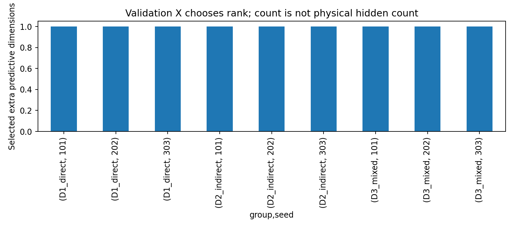
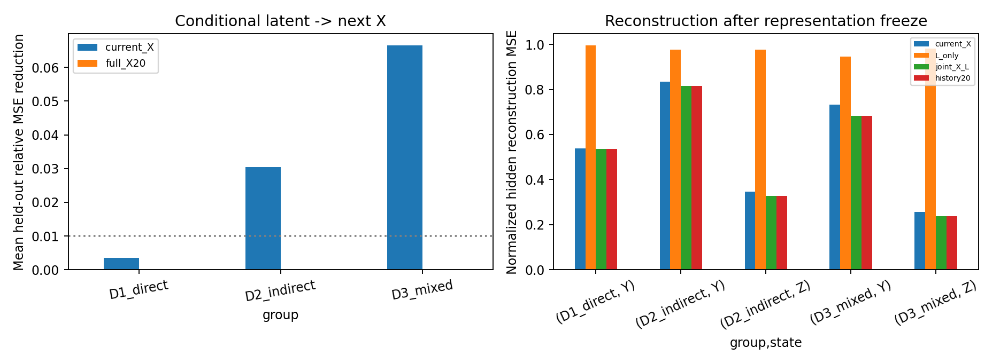

# L3-D：X-only 隐藏状态提取与逐层因果链恢复尝试

2026-11-17，云端实际运行。采用用户最新定义的 L3-D（逐层链恢复），不是之前曾规划的“额外信息下的拒判分类器”同名任务。

**本轮没有恢复出可信的 X-only 物理因果链。** 但三个对照给出了明确诊断：

1. 控制完整 X 历史后，L 的独立预测增益为数值误差量级。这是 L 由同一历史确定的必然信息性质，不是证明现实中没有隐藏原因。
2. 固定二维容量诊断中，旋转潜在坐标可以保持预测及联合状态重构不变，却改变候选滞后图，且不只是简单交换两个坐标名称。
3. 将真实 Y/Z 作为可见状态的理想参考时，九次独立数据重复均恢复了正确的一步滞后图。这个参考增加了信息，不能反推 X-only 模型应当达到同样效果。

## 1. 系统、规模与隔离

仍使用线性高斯系统，所有过程创新独立、方差0.25，X直接观测，无额外测量噪声：

```
D1: Y[t+1]=0.8Y[t]+εY
    X[t+1]=0.5X[t]+0.8Y[t]+εX

D2: Y[t+1]=0.8Y[t]+εY
    Z[t+1]=0.7Z[t]+0.5Y[t]+εZ
    X[t+1]=0.5X[t]+0.8Z[t]+εX

D3: 同D2，但X[t+1]再加0.4Y[t]
```

D1没有伪造Z变量。每组、每种子1000条独立轨迹，零初值热身200后保留500点，按轨迹切分600训练／200验证／200测试。种子101/202/303，对应新的数据命名空间 `960000+1000*group_index+seed`，不复用此前看过的测试集。共9000条轨迹、1800条测试轨迹。

三个种子是独立的数据重复；线性求解没有神经网络初始化的随机性。所有组与种子均保留。

实际生成程序知道真状态，但 X-only 学习函数只接收训练／验证X。模型选择并冻结后，才使用真实Y/Z拟合独立验证探针和真实状态参考。真实标签、隐藏数量、真参数均没有进入X-only表示或关系模型。

## 2. 第一层：从X选择潜在维度

采用简单的线性降秩预测状态模型，避免用复杂网络掩盖信息问题：

- 输入最近20点X，当前X单独旁路。
- 只用X训练，联合预测未来1、2、4、8步X，统一尺度、等权重。
- 搜索额外潜在维度k=0/1/2/3/4；仅看验证集未来X的MSE，差≤10⁻⁶时取更小维度。
- 冻结编码矩阵、预测头、归一化与维度后，才做隐藏状态诊断。
- L表示当前X之外的额外预测方向；完整可用预测状态是[X,L]，不能把L-only和完整状态混为一谈。

| 真实组别 | 真隐藏状态数（事后评价） | 三种子选择的额外预测维度 |
|---|---:|---|
| D1直接 | 1 | 1、1、1 |
| D2间接 | 2 | 1、1、1 |
| D3混合 | 2 | 1、1、1 |

这没有正确恢复D2、D3的隐藏数量。也不能因为D1数量恰好一致，就宣布找到了物理Y。有限预测目标可能偏好一个综合方向，较弱的第二方向未带来足够验证收益；本次未在看结果后扩大模型或修改选择规则。



冻结后，在验证集真实答案上拟合线性映射，在独立测试集评价：

| 组别 | 状态 | 当前X重构相关 | [X,L]重构相关 | 完整20点历史相关 |
|---|---|---:|---:|---:|
| D1 | Y | 0.669 | 0.672 | 0.672 |
| D2 | Y | 0.386 | 0.412 | 0.412 |
| D2 | Z | 0.799 | 0.811 | 0.811 |
| D3 | Y | 0.497 | 0.547 | 0.547 |
| D3 | Z | 0.856 | 0.867 | 0.867 |

可见联合预测状态含有一定隐藏信息，接近历史线性参照。但主模型只有一个额外L，未分别输出真实Y、Z。L已对当前X残差化，L-only相关较弱，不应将它与含当前X的完整表示作不公平比较。L-only、所有单坐标相关及各方法MSE/NMSE均完整保留。

## 3. 第二层：条件预测能筛选“直接作用状态”吗？

对每个L_j做留一比较：完整模型包含X基线及全部L；简化模型删去L_j，其他L保持。两者均只用训练数据拟合普通最小二乘，控制模型容量、预测时刻和样本一致。

- 实用候选门槛：验证MSE相对降低≥1%。
- 独立测试支持：测试相对降低也≥1%，且轨迹配对bootstrap的误差改善区间下界>0。
- 主判据用下一步X，分别报告未来2/4/8步作为诊断，避免把长时间的间接影响称为直接边。
- 同时设置“只控制当前X”的受限预测对照，以及“控制完整20点历史”的严格对照。

| 组别 | 仅控制当前X：L对下一步X的平均误差降低 | 控制完整历史：平均降低 |
|---|---:|---:|
| D1 | 0.345% | 数值误差量级 |
| D2 | 3.050% | 数值误差量级 |
| D3 | 6.662% | 数值误差量级 |

D2、D3在受限基线下有稳定预测贡献，但在完整历史下没有。全历史直接预测比较的最大绝对MSE差约1.42×10⁻¹⁵。

### 为什么这不是普通的“模型失败”？

模型冻结后，L_t=g(X[t−19:t])。因此在给定同一段完整历史时，L不再带来新的观测信息：

`I(X未来; L | 完整X历史, 已冻结模型) = 0`

本轮L是线性的，普通最小二乘又能利用全部历史，所以增加L列不会改变预测函数空间，数值结果正好验证这一点。对有限、受限或正则化模型，L可以改善压缩、优化或样本效率，但这种改善也不自动证明真实因果路径。

因此，用户提出的“完整X历史＋L是否有独立增益”不能作为识别物理隐藏直接原因的通用判据。它会把所有由同一历史确定的表示排除，并非判定现实中不存在隐藏作用。



## 4. 第三、四层：向上寻找与双向滞后关系

对预测状态[X,L]建立滞后1步与5步的条件方向比较：

- 测试源状态过去是否改善目标状态未来预测。
- 同时控制目标自身及所有其他状态的相同长度历史，两个方向都测试。
- 再加入完整覆盖的X历史作对照：滞后p时覆盖20+p−1点，包含所有源L历史所用的X，避免较老X偷偷成为“新增信息”。

在只控制编码状态的有限滞后时，可以出现显著候选关系，甚至双向关系。加入完整覆盖X后，额外状态历史的最大绝对MSE变化约3.07×10⁻¹⁵，全部失去主判据支持。

主模型三个系统都只选一个额外L，因此没有两个独立潜在坐标可用于恢复完整L2→L1链。在主直接状态筛选未通过后，逐层规则按预设停止，**没有强行增加L3或输出因果链**。同一X历史反复加工也不会自动创造缺失的上游观测信息。

本轮由此没有完成直接／间接／混合三种物理图的可靠X-only分类。保留“无法确定唯一物理结构”，而不是凭一个预测维度硬判为直接因果。

## 5. 潜在坐标混合检查：同样预测，不同候选图

为检查“关系图是否只是表示坐标的产物”，预先登记一个固定二维容量诊断。这**不是主模型选择的维度**，也不假装算法自动知道真实隐藏数为2。

将二维L乘正交矩阵Q，预测头乘Qᵀ，测试0、π/8、π/4、π/2四个角度：

- 全部未来X预测保持不变，最大差1.78×10⁻¹⁵。
- 联合[X,L]对Y/Z的线性重构可保持不变，独立核验最大差9.33×10⁻¹⁵。
- 条件滞后模型推断的候选图却产生变化：每个组／种子有3～4种带坐标标签的图；即使允许交换L1/L2名称，仍有2～3种不同拓扑。

例如D2、seed101：原坐标的支持边为L1→X、X→L1、L1→L2；旋转π/4后增加了L2→X和X→L2，而预测完全相同。该差异不仅是符号反转或坐标改名。

这些是满足同一预设验证／测试阈值的预测关系，不是物理干预边。它们说明“内部状态预测彼此”的图可以依赖坐标选择。降低相关性、白化或旋转潜在空间，都不能单独解决真实因果节点的命名与解混问题。

选中一个维度的主模型不会被该诊断偷偷替换；完整旋转结果及映射误差见rotations.json、rotation_summary.json。

另外，L由X计算而来，检出X→L也可能只是编码更新的计算关系，不代表物理X反向影响了真实Y。直接在软件里改L后看到预测变化，也不是对物理隐藏原因的外部干预；本轮没有这样的物理绑定或干预验证。

## 6. 真实Y/Z理想参考

单独给参考模型真实状态[Y,X]或[Y,Z,X]，其训练允许使用这些真实轨迹，但不向X-only学习器反馈。参考也不直接输入真实边标签：对所有节点方向执行同样的滞后条件预测比较。

主参考为lag=1，三个种子结果：

| 组别 | 实际检出的支持边 | 正确重复数 |
|---|---|---:|
| D1 | Y→X | 3/3 |
| D2 | Y→Z、Z→X | 3/3 |
| D3 | Y→X、Y→Z、Z→X | 3/3 |

九次参考均无额外误边，见oracle_graph_evaluation.json；lag=5亦完整保存，没有事后挑选最佳lag作为主结论。

这个结果依赖本轮真实状态全可见、线性滞后结构、独立过程创新等已知仿真假设。它说明在**增加真实变量观测的信息条件下**，这些关系可以被条件预测检出；不说明同一X-only数据已经足以确定它们，更不意味着时间先后本身就是普适因果证明。

### 多步预测为什么不能直接命名“直接原因”？

D2真实Y没有直接到X的边。控制当前Z和X历史后，真实Y对X预测的平均误差降低却为：

| 预测距离 | 1步 | 2步 | 4步 | 8步 |
|---|---:|---:|---:|---:|
| 真实Y的条件贡献 | 约0% | 13.23% | 31.58% | 16.38% |

它对更远未来有独立预测贡献，是因为作用通过Z传过去；这仍不是直接路径。以“能预测未来X”定义直接原因，会把真实间接源也算进去。

作为对照，D2的真实Z对下一步X贡献约53.10%；D3真实Y的下一步条件贡献约21.93%。完整各距离结果在oracle_horizon_contrast.csv。

## 7. 对研究问题的回答

1. **能提取隐藏信息吗？** 可以，完整预测状态[X,L]有可验证的信息，但本轮额外维度均选择1，未分离两个真实隐藏变量。
2. **能筛选直接作用状态吗？** 受限预测器下可筛选候选动态特征；控制全部来源历史后没有新增信息，不能把该判据当物理直接性证明。
3. **能逐层恢复上游链吗？** 本轮未能。主筛选没有得到通过完整历史验证的直接隐藏状态，规则停止；二维诊断的关系图还依赖坐标基。
4. **能区分三种真实结构吗？** 真实状态参考在本轮假设下可以；X-only逐层方法没有可靠恢复唯一物理图。
5. **是否说明所有X-only方法都没用？** 不是。表示可以压缩预测信息；在额外物理约束或有效干预下可以进一步研究结构。但不能把同一X的不同特征当成新增独立观测。

关键改进方向应是明确潜在坐标的物理含义与可识别条件，而不是仅凭预测贡献、时间先后或更多内部状态就声明因果链。此前L3-C验证过额外观测／有效干预可以打破部分歧义；本轮没有使用它们，也没有开展预警。

## 8. 核验、统计与复现

- 测试前配置／学习代码SHA256与存档一致，九个冻结模型哈希正确。
- 修改某时刻之后所有X，不改变该时刻及以前L，误差0；窗口／目标索引核验通过。
- 564项边比较、112800条逐轨迹边指标、12000条状态重构指标无重复，每项边比较有200条独立测试轨迹。
- 全历史控制的MSE差为数值误差，旋转预测／联合重构等价核验通过。
- 验证集选候选与维度；测试集仅确认／评价；隐藏重构探针只在验证答案拟合。

区间以配对的独立测试轨迹为重采样单位，1000次；不把时间点当独立样本，也不将同一轨迹的旋转版本、预测距离或滞后设置当独立重复。每种子的边区间均条件于该已冻结表示。未对大量候选作多重比较校正，故“支持边”是预设阈值下的探索性预测关系，不是控制全局因果错误率的结论。参考图9/9正确也不能保证新系统上同样表现。

代码、冻结模型、全部条件预测映射、诊断映射、测试X／真状态／L／预测／重构结果、指标与图表均已保存。重建无需拟合新模型：

```bash
export OPENBLAS_NUM_THREADS=1
python replay.py --group D2_indirect --seed 101 --out replayed_estimates.npz
python audit.py
```

完整实验在副本内运行main.py，再运行analyze.py；完整重跑会生成新冻结时点，不应覆盖本次存档。候选维度、阈值和lag均在看测试结果前固定，未为了恢复更漂亮的链条改结果。
