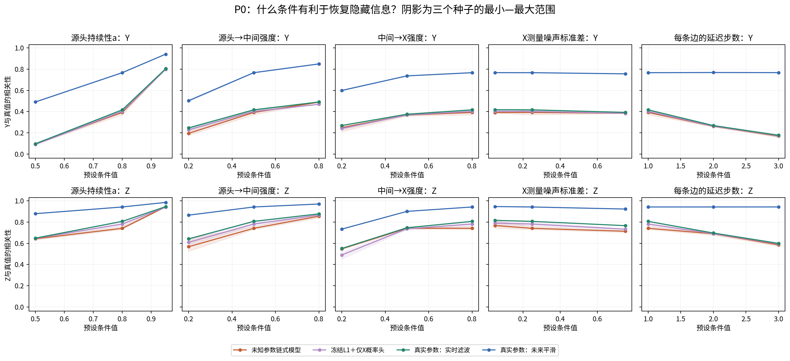
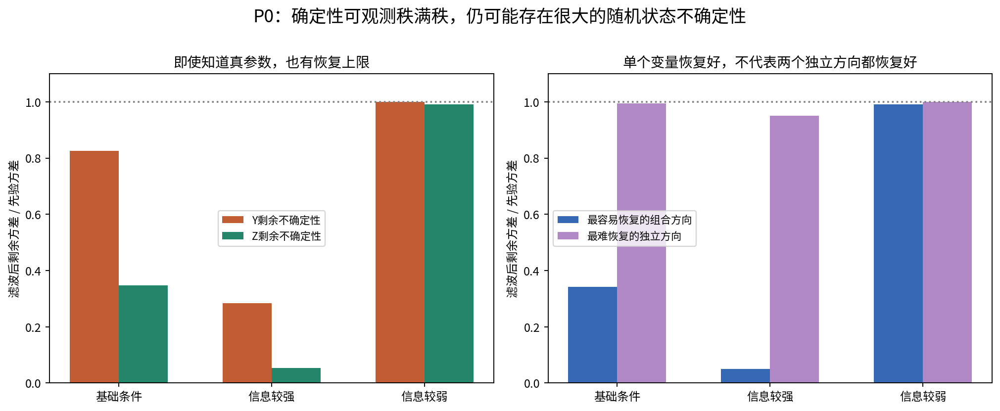
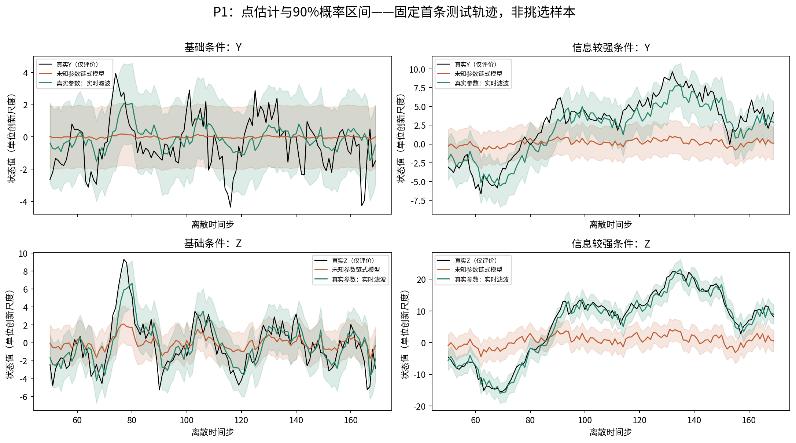
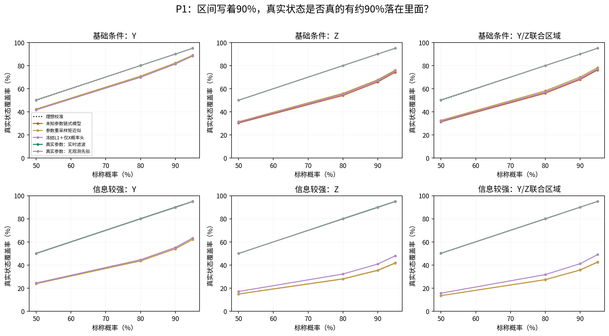
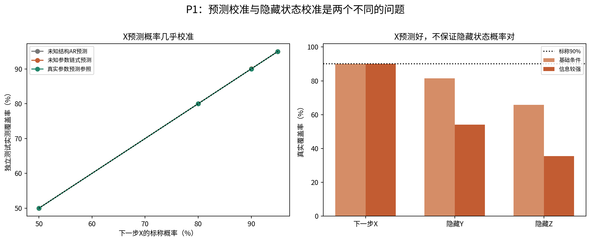
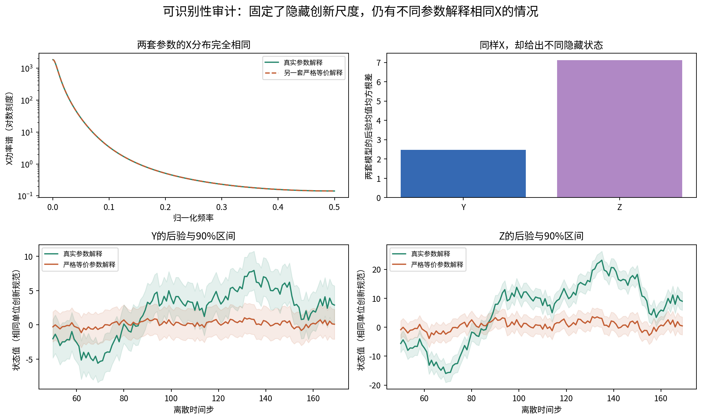
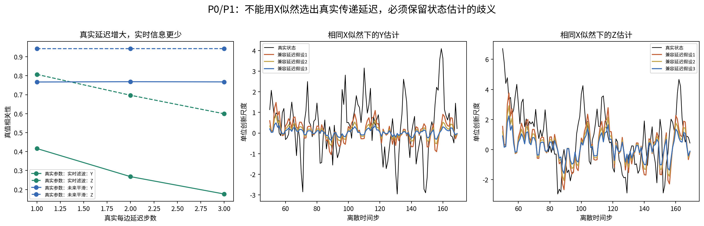
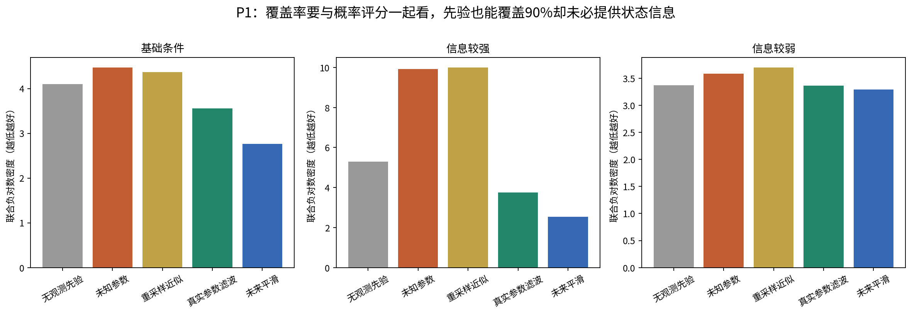
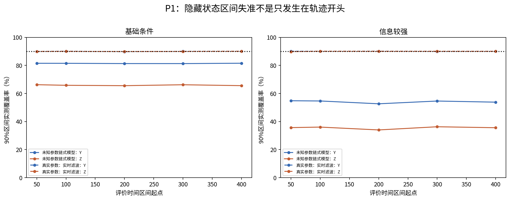
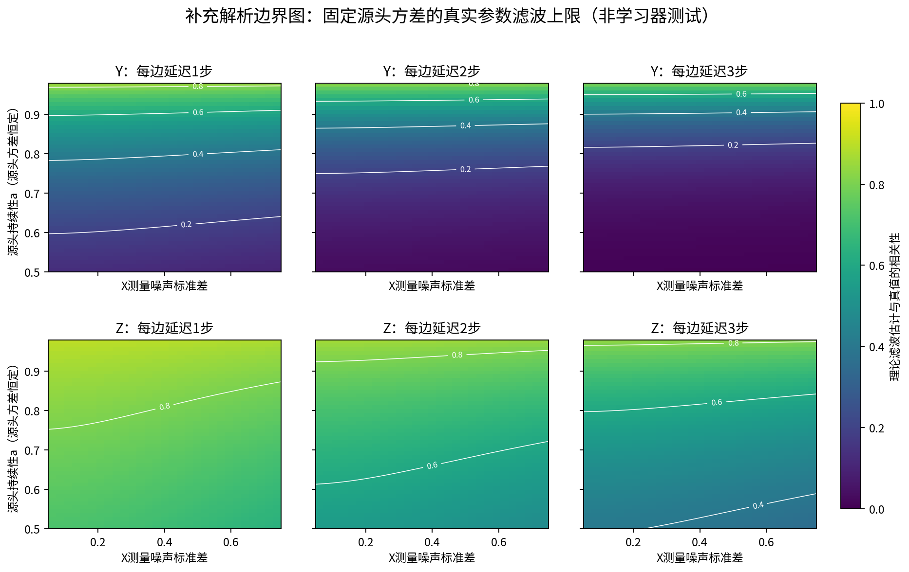

# P0 P1 单变量可观测性与隐藏状态概率估计实验

日期：2026年11月20日。

结论：P0完成了可恢复性与信息边界验证；P1完成了联合概率估计实现，但未知参数模型对真实命名Y、Z的概率恢复未通过预设标准。因此本轮不进入基于物理Y→Z→X链的P2。模型对X的概率预测几乎达到真实参数参照，并不能据此认定其隐藏状态后验正确。
研究问题是在单变量X观测下，哪些隐藏信息可以恢复，后验概率是否可信。实验限定为平稳三变量线性高斯串联，不改变因果连接、不植入异常、不运行预警。本轮没有验证提前量、误报率或动态因果失效检测能力。
新运行13个条件、每条件3个独立数据种子，共39组、39000条独立轨迹，每条500步。每组600条训练、200条验证、200条测试；共有7800条独立测试轨迹。五因素采用单因素扫描加两个预设组合端点，不是243条件的全因子实验。原L1模型及原数据保留不变。
参数和概率输出全部在揭示新测试隐藏状态前冻结；真实Y、Z只用于最终评价，不做真值对齐、不校正概率、不选择最接近答案的参数或延迟。图中的隐藏状态统一用创新标准差归一化，属于坐标尺度规范，不代表识别出物理幅值。

## 实验条件

| 因素 | 设置 |
|---|---|
| 源头持续性a | 0.5、0.8、0.95 |
| Y→Z系数 | 0.2、0.5、0.8 |
| Z→x系数 | 0.2、0.5、0.8 |
| X测量噪声标准差 | 0.05、0.25、0.75 |
| 每条边延迟d | 1、2、3步 |
| 固定项 | 中间记忆b=0.7；下游记忆c=0.5；物理过程创新标准差各0.5 |
| 较强端点 | a=0.95；Y→Z=0.8；Z→x=0.8；测量噪声0.05；d=1 |
| 较弱端点 | a=0.5；Y→Z=0.2；Z→x=0.2；测量噪声0.75；d=3 |

## 方法与信息权限

| 设置 | 允许的信息 | 输出及边界 |
|---|---|---|
| A 未知物理结构 | 仅X；AR阶数1/5/20/40由验证集选择 | 输出X预测概率；不强行给物理Y/Z后验 |
| B 已知候选链但参数未知 | 仅X；正系数链、单位潜在创新尺度；参数未知 | 输出联合状态Gaussian后验；延迟1/2/3分别保留 |
| 冻结L1对照 | 原L1编码器只读；新概率头仅学习X-only SSM后验 | 不用旧真值读出；衡量压缩后概率信息 |
| C 真实参数参照 | 知道真实方程及参数，但仍只能看同一X | 先验、当前X、实时滤波分别列出 |
| C 未来平滑 | 真实参数及整段未来X | 事后参考，不能计作实时方法 |
| 参数重采样近似 | 基础/较强/较弱条件各12次训练轨迹重采样 | 矩匹配Gaussian；延迟固定1；不是完整Bayesian后验 |

生成系统为Y[t+1]=aY[t]+eY，Z[t+1]=bZ[t]+alpha·Y[t+1−d]+eZ，x[t+1]=c·x[t]+beta·Z[t+1−d]+eX，实际观测X[t]=x[t]+测量噪声。d是每条边的步延迟，因此Y到X最早需2d步。各轨迹从各条件的稳态分布独立初始化。
B模型使用单位潜在创新方差作坐标规范，未知系数与X过程/测量噪声由X学习。用长度40的非重叠块Gaussian边际复合似然拟合，4个L-BFGS-B初始化、最多180轮，随后按独立验证整序列精确似然选初始化。它不是每条整轨迹的精确极大似然，也不声称每次达到全局最优。
线性Gaussian条件下使用精确卡尔曼概率滤波，无需引入粒子滤波的蒙特卡洛近似。未来RTS平滑单列。B的插件协方差只反映选定模型下的状态不确定性；额外的12次轨迹重采样仅在基础/较强/较弱条件评估有限样本参数敏感性，不能修复未识别的隐藏身份。
新L1概率读出利用冻结原编码器，从X-only SSM后验均值和协方差学习条件读出，未读真实Y/Z或旧真值探针。它是压缩对照，继承SSM模型假设；不能作为完全独立的物理状态概率估计器。旧L1报告的Y/Z相关0.407/0.809保留为历史结果，该数据没有额外测量噪声，与新条件不能直接同表作公平优劣比较。

## 隐藏状态概率恢复结果

| 条件 | 方法 | Y相关 | Z相关 | Y 90%覆盖 | Z 90%覆盖 | 联合90%覆盖 | 联合负对数密度 |
|---|---|---|---|---|---|---|---|
| 基础 | 未知参数滤波 | 0.392 | 0.741 | 81.45% | 65.86% | 67.98% | 4.473 |
| 基础 | 重采样矩近似 | 0.396 | 0.746 | 82.30% | 67.79% | 70.12% | 4.364 |
| 基础 | 冻结L1＋仅X概率头 | 0.401 | 0.782 | 81.44% | 66.96% | 68.94% | 4.427 |
| 基础 | 真实参数滤波 | 0.416 | 0.807 | 90.00% | 90.00% | 89.96% | 3.558 |
| 基础 | 真实参数未来平滑 | 0.767 | 0.942 | 90.06% | 90.03% | 90.06% | 2.761 |
| 信息较强 | 未知参数滤波 | 0.573 | 0.599 | 54.04% | 35.50% | 35.76% | 9.931 |
| 信息较强 | 重采样矩近似 | 0.575 | 0.600 | 54.12% | 35.29% | 35.62% | 10.005 |
| 信息较强 | 冻结L1＋仅X概率头 | 0.733 | 0.837 | 55.23% | 40.85% | 41.17% | 8.280 |
| 信息较强 | 真实参数滤波 | 0.849 | 0.973 | 90.08% | 90.06% | 90.08% | 3.759 |
| 信息较强 | 真实参数未来平滑 | 0.964 | 0.994 | 90.11% | 90.03% | 90.08% | 2.538 |
| 信息较弱 | 未知参数滤波 | 0.004 | 0.094 | 95.00% | 82.37% | 85.62% | 3.585 |
| 信息较弱 | 重采样矩近似 | 0.005 | 0.094 | 97.68% | 81.82% | 88.04% | 3.701 |
| 信息较弱 | 冻结L1＋仅X概率头 | 0.003 | 0.076 | 95.13% | 83.20% | 86.27% | 3.572 |
| 信息较弱 | 真实参数滤波 | 0.003 | 0.096 | 90.01% | 90.04% | 90.08% | 3.364 |
| 信息较弱 | 真实参数未来平滑 | 0.095 | 0.361 | 90.01% | 90.06% | 90.12% | 3.295 |

相关性越高越好；覆盖率应接近标称90%；负对数密度越低越好。所有隐藏状态概率使用相同创新尺度，未用新真值校准。

## 下一步X概率预测

| 方法 | 平均MSE | 平均负对数密度 | 90%覆盖 |
|---|---|---|---|
| 当前X预测 | 0.797632 | 1.277734 | 90.02% |
| 未知结构AR | 0.767251 | 1.260982 | 90.01% |
| 未知参数链模型 | 0.767213 | 1.260958 | 90.01% |
| 真实参数参照 | 0.767189 | 1.260944 | 90.00% |

上述为39组的等权平均；每种方法使用完全相同测试X。无故障事件，表中不是预警成绩。

## 图1 P0：什么条件有利于恢复隐藏信息？阴影为三个种子的最小—最大范围

怎么看：上排是Y，下排是Z，五列分别改变源头持续性、两段作用强度、测量噪声和每边延迟。曲线用同一方法在三个新数据种子上的平均相关性；阴影为种子最小—最大范围，不是时间点独立置信区间。

结果：知道真实参数的实时滤波，在持续性a=0.5、0.8、0.95时，对Y的相关性约为0.096、0.416、0.804。真实每边延迟从1增至2、3步时，Y相关性约从0.416降至0.268、0.176。较强端点的Oracle对Y、Z相关性达到约0.849、0.973。

解释：持续的源头和较强传递能增加下游可用信息，延迟与噪声会增加恢复困难。本扫描固定过程创新方差，持续性改变也改变了源头稳态方差，不能把全部改善归为时间记忆。未知参数模型的曲线还受隐藏身份/参数等价性影响，不能把它与Oracle的差距全归为网络容量或样本不足。未来平滑使用整段未来X，只是事后参考。

## 图2 P0：确定性可观测秩满秩，仍可能存在很大的随机状态不确定性

怎么看：左图是Oracle滤波后的Y、Z方差与先验方差之比；右图是对联合先验白化后，最容易与最难恢复的两个独立线性组合方向的剩余方差比例。越小表示获得的信息越多。

结果：基础条件剩余Y方差约82.60%、Z约34.70%；较强条件为28.43%、5.44%；较弱条件仍约100.00%、99.03%。较强条件最容易恢复方向剩余约4.97%，最困难独立方向仍约95.05%。这些条件的确定性观测矩阵在各自增广维度上均满秩。

解释：确定性满秩不保证随机状态能够高精度实时恢复。两个边际变量都相关较高，也不代表两个独立隐藏方向都被充分识别。较强条件的Y、Z本身高度联系，可利用的主要信息可能集中在一个组合方向。组合方向是Oracle诊断，不是学习器自动识别出的物理变量。

## 图3 P1：点估计与90%概率区间——固定首条测试轨迹，非挑选样本

怎么看：固定种子101的首条测试轨迹，左列基础、右列较强，上排Y、下排Z。黑线为评价真值；橙色为未知参数链模型；绿色为真实参数实时滤波。阴影为各自90%状态后验区间，横轴为离散步数。

结果：未知参数后验没有稳定覆盖真实状态。基础条件Y、Z的90%区间实际覆盖约81.45%、65.86%；较强条件下降至54.04%、35.50%。Oracle覆盖则维持在约90%。这些数值来自全部测试轨迹，不是由这条展示样本计算。

解释：后验分布是在某套模型参数成立的条件下得到的。模型内部计算正确，不保证这套参数对应真实物理Y、Z。图示同样使用创新尺度规范，没有用测试答案拟合线性变换或旋转来改善重构。不能把未知参数后验直接作为可信上游传感器。

## 图4 P1：区间写着90%，真实状态是否真的有约90%落在里面？

怎么看：横轴是模型声称的50%、80%、90%、95%概率，纵轴是真值实际落入相应区间或联合椭圆的比例。沿对角线表示校准。联合区域用完整二维协方差和卡方阈值，不是将两个边际90%区间简单相乘。

结果：基础条件未知模型联合90%覆盖约67.98%，重采样近似约70.12%；较强条件分别约35.76%、35.62%。冻结L1加仅X概率头也没有解决失准。Oracle滤波和无观测先验都接近对角线。

解释：加入状态方差、参数重采样或两个潜在维度，不会自动解决物理状态不可识别。无观测先验即便完全不跟踪状态，也能达到90%覆盖，因此校准必须结合区间宽度、误差和严格概率评分判断。参数重采样只有12次，且没有完整覆盖结构/延迟不确定性。

## 图5 P1：预测校准与隐藏状态校准是两个不同的问题

怎么看：左图汇总39组数据的下一步观测X预测概率，右图比较基础与较强条件中未知参数模型对下一步X、隐藏Y、隐藏Z的90%覆盖。预测X_t只使用X到t−1；状态滤波则可以使用当前X_t，两种任务时序不同。

结果：未知结构AR、未知参数链模型、Oracle的X 90%覆盖都约为90.0%；全条件平均X预测MSE分别约0.7673、0.7672、0.7672。与此同时，较强条件下该链模型对Y、Z覆盖仅约54%、36%。

解释：观测预测分布可以被很好地学习，而隐藏状态的物理解释仍然错误。这是本轮最重要的证据之一。这里AR只是完全未知结构的预测基线，不代表已搜索并发现未知因果图；它拒绝给没有锚定的潜在坐标强加Y/Z身份。

## 图6 可识别性审计：固定了隐藏创新尺度，仍有不同参数解释相同X的情况

怎么看：两套不同参数给出重合的X功率谱，但对同一段X给出不同的Y、Z后验及90%区间。这张图是发现结果之后进行的解析等价审计，不是用于选模型的新训练方案。替代解释按最大下游持续性固定选择，没有按状态评价成绩挑选。

结果：基础和较强端点各能构造6套合法的规范化链式参数解释。较强条件的两套固定解释，X下一步均值最大差约7.1×10的负15次方、序列对数似然差约2.3×10的负13次方；Y、Z后验均值均方根差却约为2.47、7.13个规范化状态单位。

解释：即使固定了单位潜在创新尺度，并且知道是串联候选结构，未知动力学和噪声仍允许交换动态角色。这比单纯的尺度自由度更强。精确替代参数来自数学构造，仅用于说明不可识别性，没有反馈学习器，也没有替换原来的失败结果。

## 图7 P0/P1：不能用X似然选出真实传递延迟，必须保留状态估计的歧义

怎么看：左图显示真实延迟增大时Oracle恢复能力的变化；中、右图在同一条真实延迟3的测试轨迹上，画出学习器三个兼容延迟假设的Y、Z估计。三个假设均保留，没有根据真实答案选“最好的延迟”。

结果：所有测试中，这三个延迟模型的逐轨迹X对数似然最大差仅约2.3×10的负13次方；隐藏状态均值却不同。P0也显示延迟越大，当前Y、Z中尚未传到X的独立创新越多。

解释：在本轮平稳线性高斯纯串联设定中，延迟只改变隐藏噪声到X的相位，功率谱中的模平方消去了它。相同X分布不能决定真实的传递时间。因此不能靠调报警阈值、增加轨迹或只提高预测似然解决真实起点与传递时间的混淆。非平稳变化或已知干预是不同实验，不包含在此结论内。

## 图8 P1：覆盖率要与概率评分一起看，先验也能覆盖90%却未必提供状态信息

怎么看：比较Y/Z联合负对数密度，越低越好。每一列是同一个条件下的比较，不应跨列把绝对值直接当成方法优劣，因为先验状态分布不同。

结果：基础条件未知参数模型比Oracle联合负对数密度差约0.914，分层配对95%区间约[0.831,0.997]；较强条件差约6.172，[5.778,6.646]。较弱条件中Oracle与无观测先验的概率评分十分接近，说明X几乎没有新增状态信息。

解释：宽泛先验可以校准但无信息，未知参数模型则可能既过度自信又命名错误。概率评分同时惩罚错误中心和过窄/过宽的分布，比单看相关性或覆盖率更全面。区间按独立训练种子再按轨迹配对重采样，只有3个独立拟合种子，不能当作大规模独立模型复现。

## 图9 P1：隐藏状态区间失准不是只发生在轨迹开头

怎么看：横轴是评价时间段的起点，每段汇总同一组测试轨迹的状态覆盖；实线为未知参数链模型，虚线为Oracle；颜色区分Y、Z。

结果：舍弃前50步后，未知参数模型的覆盖缺口在中后段仍然存在，Oracle约保持90%。这排除了“仅仅是初始状态尚未收敛”的解释，图中并未用时间分段结果重新设定区间。

解释：本轮是平稳系统，没有植入故障。持续失准来自模型与真实隐藏身份/参数解释之间的差距，并非一次动态异常报警。时间点彼此相关，覆盖曲线仅作诊断，统计重采样仍以轨迹和独立拟合种子为单位。

## 图10 补充解析边界图：固定源头方差的真实参数滤波上限（非学习器测试）

怎么看：这张补充地图用已知真实参数求解稳态Riccati方程，不重新训练模型，不是额外独立测试。横轴是测量噪声，纵轴是源头持续性；三列为每边延迟1、2、3步，上下排评价Y、Z。颜色越亮，理论相关性越高；白线为相同相关性的等值线。

结果：共计算4263个参数点。保持源头稳态方差为基础值、只调整创新方差抵消持续性带来的幅度变化。在噪声0.25、延迟1时，源头持续性0.5到0.95仍使理论Y恢复相关性提高，但改善幅度不同于固定创新方差的主扫描。解析协方差与逐步滤波在基准点的最大差约2.2×10的负15次方。

解释：这排除了把主扫描全部趋势简单归因于源头幅值变大的做法，并将可恢复性显示为连续条件图。它仍是知道方程与参数、使用当前及过去X的条件参考，不证明未知参数学习器可以识别这些真实状态，也不改变P1失败和P2未通过的结论。

## 可识别性与信息边界

可识别性结论限定于本轮平稳、独立Gaussian创新、串联和单一X观测假设。规范坐标下的X谱可写成 S_X=R+[q_x+v²/D_b+u²v²/(D_aD_b)]/D_c，D_r=|1−r·exp(−iω)|²。纯传递延迟不出现在这个谱里；平稳Gaussian过程相同均值与全协方差意味着相同整个X过程分布。

此外，改变a、b、c的角色，并合法调整q_x、u、v，可以保持同一个谱。基础条件例如真实(a,b,c)=(0.8,0.7,0.5)，另一解释为(0.7,0.5,0.8)，规范系数约(u,v,q_x)=(0.56786,0.30472,0.4)，原解释为(0.5,0.4,0.25)。两者潜在创新方差都是1，因而这不只是把隐藏变量乘上一个常数。

物理尺度也仍有自由度：Y变为rY、Z变为sZ，同时令alpha变为s·alpha/r、beta变为beta/s并相应变换创新方差，X保持不变。创新尺度规范可以统一表示单位，但不能声称从X测出了真实物理幅值或因果作用的物理单位。

本轮确定性可观测矩阵在3/5/7维增广状态上满秩，但每一步都有新独立创新进入，未来尚未到达X的部分不能靠当前X读取。Oracle已知参数的信息上限与未知参数下的模型身份不可识别，是两个不同层次；不能用满秩或Oracle恢复好来代替P1成功。

## 是否进入P2

运行前冻结的条件门槛：基础与较强条件的3个种子均须满足Y/Z边际90%覆盖偏差不超过3个百分点、联合90%覆盖偏差不超过3个百分点、两个边际PIT描述性KS距离不超过0.05、Y/Z MSE不超过Oracle的1.2倍、联合负对数密度比Oracle最多差0.2。

结果：主模型要求通过的6次独立拟合为0/6通过；参数重采样近似也是0/6。加上物理身份与真实延迟未识别，本轮不批准进入“恢复真实Y→Z→X后做上游预警”的P2。判定没有依据测试成绩降低标准或排除失败种子。

下一步有两条清晰路线。若保留物理隐藏因果链目标，先单独检验能够排除参数/延迟等价解释的锚定条件，例如可验证的时间尺度顺序、健康参数锚点、已知外部输入或额外观测；这些属于新增假设，应另立P1扩展协议。若坚持完全未知且仅X，则应先研究可识别的预测充分状态/下游风险函数，将“物理Y先变”的解释保留为待验证假说。

本轮X预测概率接近Oracle，为后续研究预测风险函数提供了积极基础，但没有测试任何失效事件，也没有证明上游因果预警有效。这个结果既不是课题已经成功，也不意味着所有单变量概率建模都无效，而是确定了下一步必须补足的识别条件。

## 归档与复现

结果目录保存每条测试轨迹的误差、覆盖、CRPS、概率评分，按条件/种子汇总，并保留所有初始化、选模和重采样参数。10张中文图及每图解释对应本轮数据及解析诊断；图6是事后数学审计，图10是固定源头方差的补充解析地图。没有将概念示意当实验结果，也没有声称复现附件所列论文。

云端保留全部原始X、封存真值和冻结的完整概率输出。Git归档完整模型、种子、生成器、逐轨迹指标、示例曲线和原始输出哈希；原始大数组及完整概率输出不重复提交。replay.py可由归档模型与生成种子重建对应完整概率输出，基础与较强条件的示例已逐字节核验。

复现示例：OPENBLAS_NUM_THREADS=1 OMP_NUM_THREADS=1 python replay.py --case case000_101 --out /tmp/p0p1_new_replay 。输出目录须不存在，不覆盖既有结果。requirements.txt及REGISTERED.json记录版本；native_mean.cpp是数值等价加速，原生/参考递推在无关开发数据上核验过。

156次主初始化150次按优化器成功标准停止，6次未成功停止的结果也保留，未因表现差而删除。区间使用2000次分层配对重采样，独立训练重复仅3次；PIT KS是描述性距离，不利用时间点独立假设给显著性结论。

[PDF图文报告](P0P1中文实验报告.pdf) · [HTML报告](index.html) · [预注册方案](PROTOCOL.json) · [P2判定](results/P2_DECISION.json)