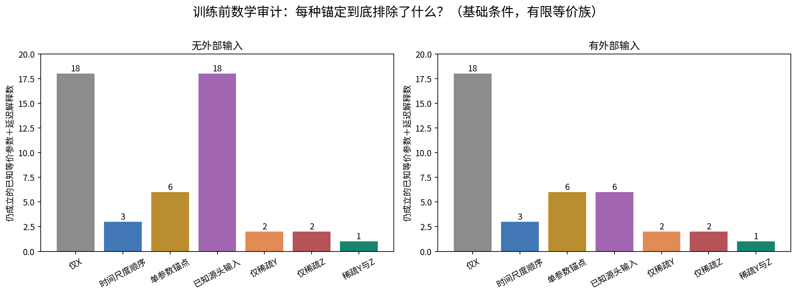
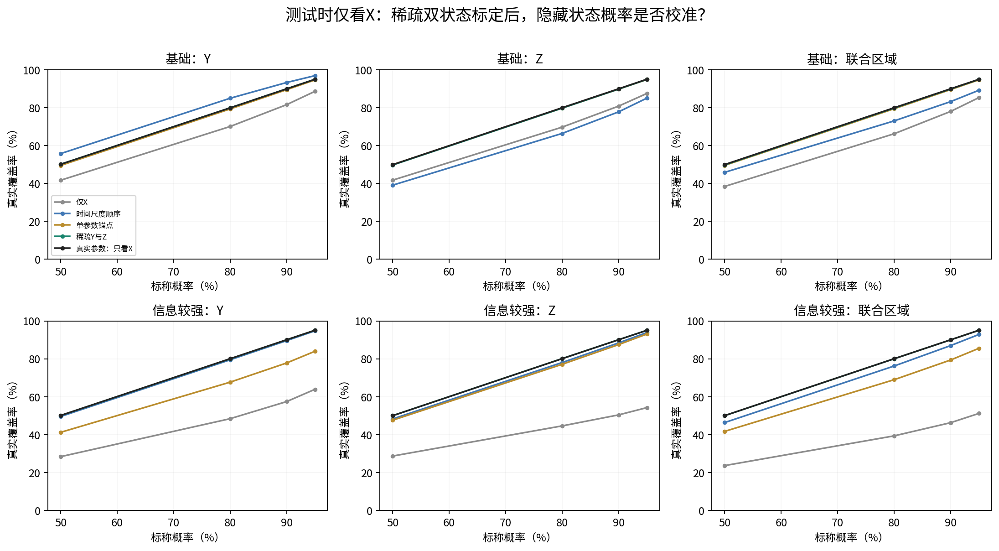
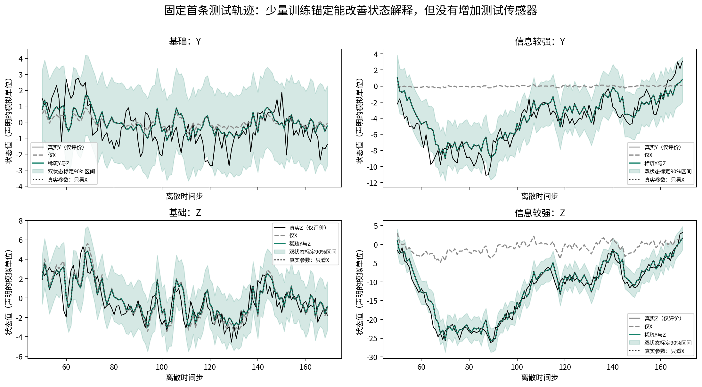
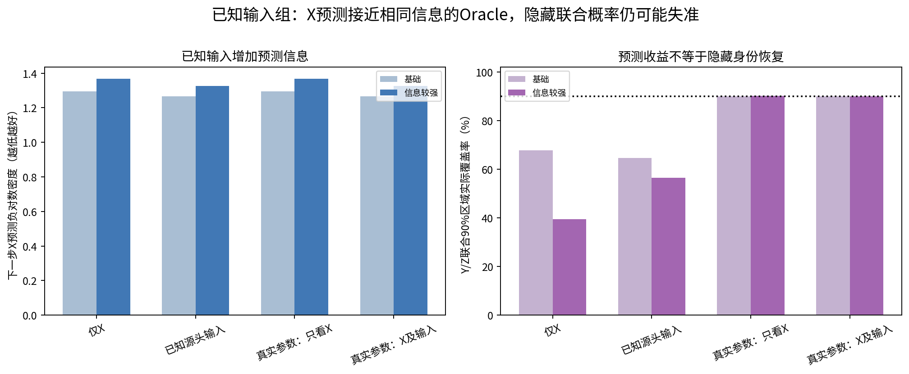
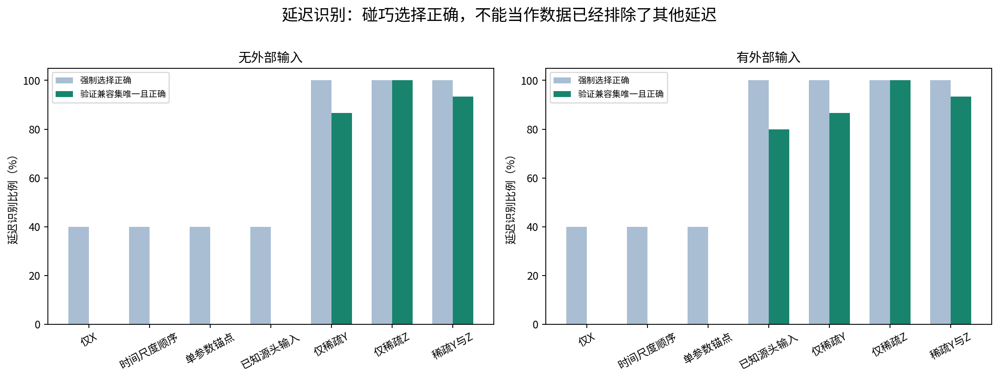
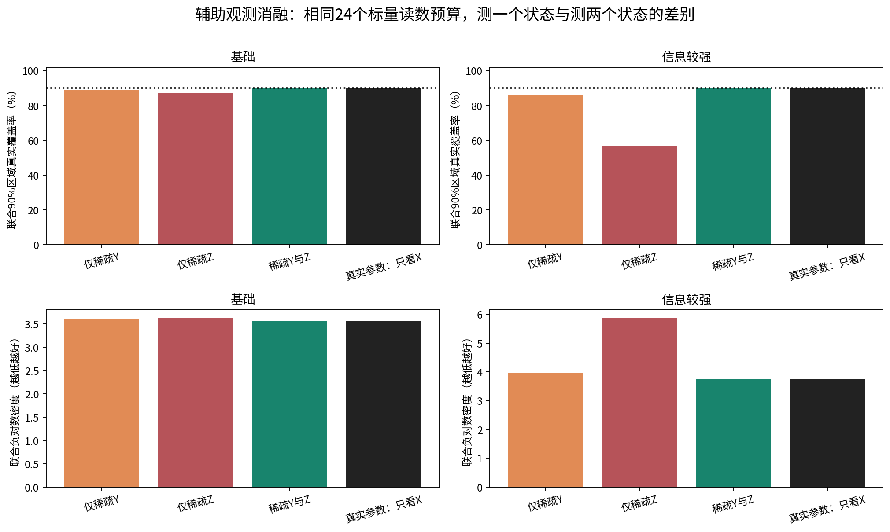
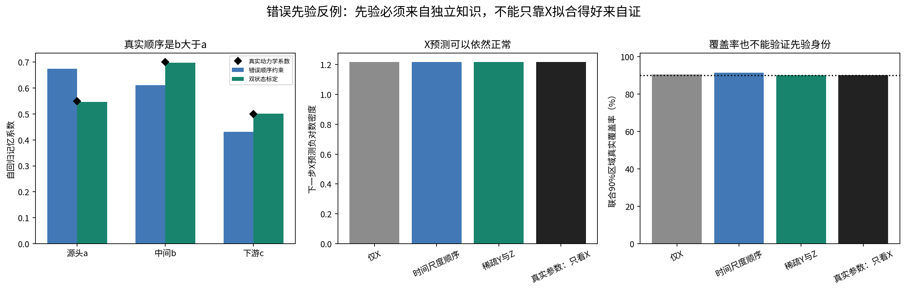
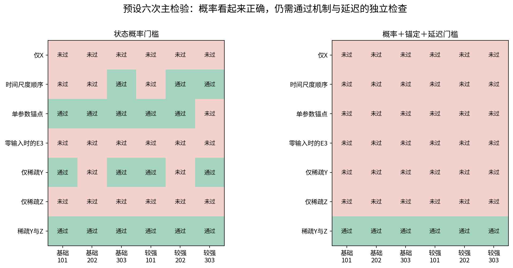
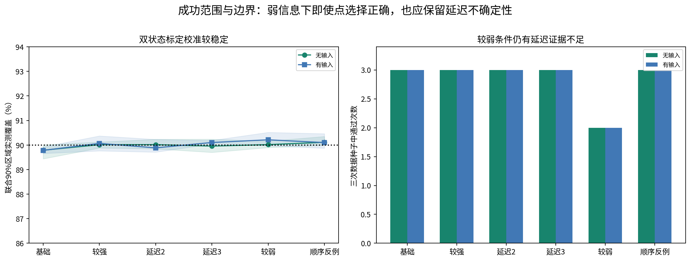

# P1 Extension 隐藏因果链锚定与概率恢复实验

日期：2026年11月20日。

结论：在本轮已知正系数链、线性Gaussian与共同边延迟候选假设下，稀疏同时标定Y、Z的E4YZ通过了预设6/6次主检验，测试仍只看X，概率表现接近同样只看X的真实参数参照。它是带稀疏标定的单变量在线估计成功，不是完全未知系统中的纯X-only因果链发现。
时间尺度顺序、一个精确参数锚点、已知源头输入以及单节点稀疏观测，各自排除了一部分歧义，但在注册主条件中都没有同时满足身份、尺度、延迟及概率门槛。已知输入能改善预测并帮助识别共同延迟，却仍保留隐藏参数角色的等价解释。
新实验包含6个条件、3个数据种子、输入/无输入两种配对情景，共36组、36000条轨迹记录，每条500步，每组600训练、200验证、200测试。两情景共享内在噪声，最终是3600对测试轨迹、7200条测试记录，不能将配对两侧当作完全独立样本。
本轮没有运行预警、改变因果连接或定义预测失效事件。所有完整测试状态在允许信息模型全部冻结后才用于评价。P0–P1原数据、模型和报告不修改；以下数字来自本轮新数据内的配对比较。

## 信息预算与比较方案

| 组别 | 允许信息 | 边界 |
|---|---|---|
| E0 | 仅X | 单位创新代理状态；不宣称物理幅值被锚定 |
| E1 | X＋独立的a>b>c顺序知识 | 错误顺序另设负对照，不计有效先验成功 |
| E2 | X＋理想化精确下游记忆系数c | 只提供一个参数，不提供其他参数/状态 |
| E3 | X＋已知源头输入序列 | 源头单位换算loading未知并估计；无输入时精确复用E0 |
| E4Y | 只在训练/验证稀疏测Y | 每轨迹24个标量读数；测试只给X |
| E4Z | 只在训练/验证稀疏测Z | 每轨迹24个标量读数；测试只给X |
| E4YZ | 只在训练/验证同时稀疏测Y、Z | 每轨迹12个配对时刻，共24个标量；测试只给X |
| C_X | 真实参数参照，仍只看X | 输入情景中也不读取实际输入值 |
| C_XI | 真实参数参照，读取X和已知输入 | 只作为E3相同信息条件的参照 |

系统为Y→Z→x，观测X=x＋独立测量噪声，每条边共享候选延迟d∈{1,2,3}。状态采用原P0–P1的单位创新坐标：Y、Z内在创新方差均1，基础u=0.5、v=0.4，x过程方差0.25、测量标准差0.25；这与原物理变量除以0.5后的被动X分布族一致，不是向学习器提供真实噪声幅值。
基础a=0.8、b=0.7、c=0.5；较强条件a=0.95、u=0.8、测量标准差0.05；延迟2/3只改变d；较弱条件u=0.2、v=0.1、测量标准差0.75、d=3。错误顺序负对照将a设为0.55，保持b=0.7、c=0.5，故E1先验不成立。
已知输入为独立Gaussian源头输入，标准差0.6，物理注入系数为1。E3估计创新坐标中的输入loading，并由它换算Y的输出单位，未偷偷固定真实loading；Z仍只有单位创新规范。E0/E1/E2不读取输入序列，不能把其代理状态当作已锚定的物理幅值。
辅助测量传感器标准差0.05，准确度假设已知。E4Y/Z在每40步块的19、20位置各测一个状态，E4YZ只在20位置同时测两个状态。每条500步轨迹均为24个标量预算；双状态只占12/500=2.4%的时刻。训练与验证提供这些带噪标定，测试不提供任何辅助状态值。读数数量匹配不等于两种传感器的硬件成本相同。
拟合使用40步Gaussian边际块复合似然及解析协方差梯度，按各组允许的观测拟合和验证。每组9次参数优化；可辨别延迟的组每个延迟3次初始化，X-only延迟等价组将9次初始化用于规范d=1并保留全部3个延迟解释。每次最多140轮，所有未成功停止结果保留。
输出是选定参数条件下的联合Gaussian状态后验，未做测试真值对齐或校准，不是完整Bayesian参数后验。验证兼容延迟使用配对轨迹似然差和三个两两比较的Bonferroni阈值，因复用了选模验证集，它是保守的兼容性诊断，不解释为严格标定的图后验置信度。

## 新实验配对结果

| 条件 | 组别 | Y相关 | Z相关 | Y 90%覆盖 | Z 90%覆盖 | 联合90%覆盖 | 联合负对数密度 |
|---|---|---|---|---|---|---|---|
| 基础（无输入） | E0 | 0.394 | 0.794 | 81.54% | 80.78% | 77.98% | 3.976 |
| 基础（无输入） | E1 | 0.408 | 0.796 | 93.23% | 77.75% | 83.15% | 3.989 |
| 基础（无输入） | E2 | 0.415 | 0.808 | 89.44% | 89.77% | 89.50% | 3.576 |
| 基础（无输入） | E4Y | 0.415 | 0.804 | 89.91% | 89.82% | 89.07% | 3.611 |
| 基础（无输入） | E4Z | 0.405 | 0.808 | 84.83% | 89.78% | 87.27% | 3.627 |
| 基础（无输入） | E4YZ | 0.415 | 0.808 | 89.91% | 89.75% | 89.79% | 3.564 |
| 基础（无输入） | C_X | 0.415 | 0.808 | 89.88% | 89.90% | 89.91% | 3.564 |
| 较强（无输入） | E0 | 0.514 | 0.720 | 57.43% | 50.41% | 46.30% | 14.313 |
| 较强（无输入） | E1 | 0.846 | 0.972 | 89.60% | 88.40% | 86.98% | 3.912 |
| 较强（无输入） | E2 | 0.750 | 0.972 | 77.81% | 87.51% | 79.39% | 4.389 |
| 较强（无输入） | E4Y | 0.846 | 0.971 | 90.04% | 88.45% | 86.22% | 3.967 |
| 较强（无输入） | E4Z | 0.559 | 0.972 | 53.59% | 90.09% | 57.02% | 5.874 |
| 较强（无输入） | E4YZ | 0.846 | 0.972 | 90.00% | 90.09% | 90.01% | 3.761 |
| 较强（无输入） | C_X | 0.846 | 0.972 | 90.06% | 90.06% | 90.03% | 3.761 |

相关性越高越好；90%区域覆盖应接近90%；联合负对数密度越低越好。E3无输入时与E0相同，未重复占表。

## 预设无输入主条件与E3有输入补充对照

| 组别 | 概率门槛 | 身份与共同延迟 | 完整候选门槛 |
|---|---|---|---|
| E0（无输入） | 0/6 | 0/6 | 0/6 |
| E1（无输入） | 3/6 | 0/6 | 0/6 |
| E2（无输入） | 5/6 | 0/6 | 0/6 |
| E3（无输入） | 0/6 | 0/6 | 0/6 |
| E4Y（无输入） | 4/6 | 0/6 | 0/6 |
| E4Z（无输入） | 0/6 | 0/6 | 0/6 |
| E4YZ（无输入） | 6/6 | 6/6 | 6/6 |
| E3（有输入，补充对照） | 2/6 | 0/6 | 0/6 |

## 图1 训练前数学审计：每种锚定到底排除了什么？（基础条件，有限等价族）

怎么看：计数来自训练前理论审计，展示基础条件下已登记的正系数极点置换及d=1/2/3候选中，仍能生成相同允许观测分布的解释数量。它不是所有可能机制的穷尽计数。

结果：无输入时，E0保留18个、E1保留3个、E2保留6个解释；单节点稀疏测量各保留2个，双节点保留1个。有输入时E3保留6个解释，虽然共同延迟被约束，参数角色仍可交换。

解释：锚定信息的作用不同。顺序知识主要约束角色，输入/辅助观测提供时序信息。只有候选解变少还不够，必须检查留下的是哪类歧义，以及先验本身是否独立成立。首次审计先于生成，稀疏布局修复后又在受影响方法训练前重新审计。

## 图2 测试时仅看X：稀疏双状态标定后，隐藏状态概率是否校准？

怎么看：横轴为50%、80%、90%、95%标称概率，纵轴为实际状态覆盖，虚线表示理想校准。上下排为无输入的基础与较强条件；右列为二维联合椭圆，不是两个边际区间简单相乘。

结果：E4YZ基础条件Y/Z/联合90%覆盖为约89.91%/89.75%/89.79%；较强条件为90.00%/90.09%/90.01%，接近C_X参照。E0的联合覆盖分别约77.98%、46.30%。

解释：稀疏标定帮助确定参数与输出状态的含义，因此独立测试只给X时也可以获得可信的状态概率。它没有增加测试的瞬时信息，也没有把完全不可观测的新创新恢复出来。其他锚点在部分重复中也能有良好覆盖，不能仅凭覆盖率认定机制已唯一。

## 图3 固定首条测试轨迹：少量训练锚定能改善状态解释，但没有增加测试传感器

怎么看：固定种子101、首条测试轨迹，左列基础、右列较强，上排Y、下排Z。真值只用于展示评价，绿色为E4YZ后验，阴影为其90%区间，另对照E0与C_X。没有挑选最漂亮的轨迹。

结果：E4YZ轨迹基本贴近真实参数滤波器。总体基础Y/Z相关约0.415/0.808，较强约0.846/0.972，几乎达到相同信息的C_X。基础Y仍有大量不可恢复起伏，较强条件也有剩余不确定性。

解释：这是参数/身份锚定成功后的概率估计，不是完整读取真实隐藏状态。它仍受P0的信息上限约束。稀疏观测来自训练/验证，图示测试轨迹从未向学习器提供Y/Z。

## 图4 已知输入组：X预测接近相同信息的Oracle，隐藏联合概率仍可能失准

怎么看：这张图只比较有外部输入的情景。左图为下一步X负对数密度；右图为隐藏状态联合90%覆盖。C_XI知道相同输入序列，C_X不知道，信息预算不同。

结果：E3的X预测接近C_XI，并优于没有输入信息的C_X/E0参照，但其基础、较强联合90%覆盖约64.52%、56.45%，未恢复到90%。理论审计仍有多个输入响应和X分布完全相同的参数解释。

解释：输入能提高预测和辨别总时延，却不自动解决每个隐藏动态角色。E3没有固定真实源头噪声尺度来人为消除歧义，输入loading也要估计。输入施加位置Y由设计告知，不能将本结果当作自动发现因果方向。

## 图5 延迟识别：碰巧选择正确，不能当作数据已经排除了其他延迟

怎么看：浅色为强制选出的延迟是否正确，深色为验证兼容集是否只留下正确延迟。统计覆盖五个顺序有效条件，每个情景15次数据重复；E1错误先验负对照在这里排除。

结果：E0/E1/E2固定采用规范d=1，部分条件碰巧正确，但没有数据支持唯一延迟。E3有输入时所有点选择正确，但只有部分条件能排除其他候选。E4YZ共36组点选择全对，含弱条件的验证唯一支持为34/36；两组弱信息重复保留了延迟不确定性。

解释：不能将“算法给出一个数字”当作“识别出了这个数字”。本模型假定两边共享d；若允许两边独立延迟，已知源头输入通常只约束两边延迟之和，而不能单独决定每一边。

## 图6 辅助观测消融：相同24个标量读数预算，测一个状态与测两个状态的差别

怎么看：E4Y只测Y，E4Z只测Z，E4YZ在更少的时刻同时测两者，三种方案每条轨迹都是24个标量读数。上排覆盖率越接近90%越好，下排联合负对数密度越低越好。

结果：只测Y后，Y恢复接近Oracle，但Z仍存在替代解释；只测Z后，Z恢复接近Oracle，但上游Y仍可能严重失准。较强条件E4Y/E4Z联合覆盖约86.22%/57.02%，E4YZ约90.01%。

解释：测量多样性在本设定中比仅增加同一变量读数更能锚定整条候选链。但这里只比较一个预算和一种采样安排，不证明12个配对时刻是普遍最小值；也没有把双传感器成本与单传感器视为相同。

## 图7 错误先验反例：先验必须来自独立知识，不能只靠X拟合得好来自证

怎么看：负对照真实a=0.55、b=0.7、c=0.5，因此E1的a>b>c知识是错误的。左图看学到的动态角色，右侧看预测和概率覆盖是否仍可能看起来正常。

结果：E1可找到满足错误顺序的等价解释，X预测仍接近Oracle，联合90%覆盖均值甚至约91.48%。但它的角色排列不是真实的物理身份。E4YZ不使用该顺序假设，能够恢复相应参数与状态概率。

解释：先验必须来自独立可核验的知识。仅看X拟合好、预测好或概率区间看似正常，不能反过来自证某条无法从X验证的身份假设。此负对照不计为E1的有效锚定成功。

## 图8 预设六次主检验：概率看起来正确，仍需通过机制与延迟的独立检查

怎么看：左图只检查原先冻结的概率标准，右图还要求登记等价族唯一、局部秩、正确且验证唯一的共同延迟以及双状态单位锚定。列为基础和较强条件各3个数据种子。

结果：E4YZ通过6/6次概率检查及6/6次组合检查。E1概率3/6、E2为5/6、E4Y为4/6，但它们的机制组合检查均为0/6。本图E3是零输入对照；另在主动输入的6次检查中，E3概率2/6通过，机制组合仍0/6。没有根据成绩降低阈值或排除失败数据种子。

解释：可以将E4YZ视为后续“带稀疏标定、已知候选链和共享延迟”P2的候选基础，不是全未知系统因果恢复的证明。本轮只交付进入条件判断，没有启动预警实验。

## 图9 成功范围与边界：弱信息下即使点选择正确，也应保留延迟不确定性

怎么看：左图展示E4YZ各条件的联合90%覆盖，阴影为3个数据种子的最小—最大范围；右图看三次重复中完整门槛通过几次。上下文分有无输入两种配对情景。

结果：E4YZ全部36组都通过概率门槛，基础、较强、延迟2、延迟3以及顺序反例各情景均3/3通过组合检查。较弱条件每个情景只有2/3通过，因为一个重复的延迟证据不足，虽然强制点选择仍正确。

解释：区间校准、信息量和可识别性是不同评价。弱信息下可以得到正确但很宽的分布，仍不足以确定传递时间。保留这些拒判，才能防止把所有好看概率图都解释成因果机制识别成功。

## 结论的适用范围

本轮假设了两个隐藏变量及Y→Z→X的正系数线性Gaussian结构，没有搜索隐藏变量个数、直接与间接图结构，也没有证明从一个完全未知X自动发现这条链。E4通过的是带状态标签的稀疏标定路线；如果现实中完全无法取得这些辅助标定，它不能替代严格X-only目标。

同一d作用于两条边是保留P0的结构假设。若允许独立d_YZ、d_ZX，已知输入到X的传递函数包含z的1+d_YZ+d_ZX次方，(1,3)、(2,2)、(3,1)等边延迟对可有相同I/X联合分布。单凭输入响应不能宣称两条边的独立延迟都已识别。

等价审计枚举了登记的极点置换/延迟族，并检查局部协方差Jacobian秩；它没有穷尽任意非线性、额外隐藏驱动、相关创新或不同结构。唯一候选代表是限定模型内的证据，不应扩写为唯一真实物理因果链。

补充参数诊断按测量loading换算u_phys=u*hZ/hY、v_phys=v/hZ，不用测试真值拟合读出。E4YZ在本轮条件中u、v的平均绝对误差约0.0069、0.0023（模拟单位）；详见E4YZ_physical_parameter_errors.csv。这是已假设结构中的参数估计，不是独立因果效应识别。

辅助测量只评估了2.4%配对时刻、传感器标准差0.05、相同训练测试机制；未验证任意更稀疏、更嘈杂测量或机制漂移后仍能恢复。健康期标定成功不保证连接变化后还能从X重新识别所有参数。

本轮没有失效事件、报警阈值、提前量或失效误报率成绩。若后续进入P2，应明确保留稀疏健康标定这一信息来源，并分别记录真实源头变化、首个可见响应、报警与预测失效时刻；不能把本轮状态恢复直接称为提前预警。

## 完整记录与复现

原P0–P1数据和模型未修改。本轮模型、每个初始化、验证兼容性、逐轨迹概率指标、示例曲线、预注册与修复记录均归档。原始大数组与完整概率输出保留在云端，不重复推送Git；生成器、种子和冻结哈希可确定性重放。

首次生成时修复了一处标定元数据变量名错误，之后修复单节点辅助观测排布维度。原注册、修复前源码和理论审计均保留；受影响E4尚未完成训练时修复。144个已完成E0–E3模型文件原样复用，哈希核验；其协方差与导数在修复前后数值差为0。评价阈值及数据设计未改变。

完整测试状态只在所有允许信息模型全局冻结后打开。E2只读指定参数锚点，E3只读外部输入，E4只读训练/验证的稀疏带噪测量；E0/E1没有访问这些额外数据。测试辅助状态不提供给任何学习方法。

按独立数据种子再按配对轨迹做2000次分层重采样，只有3个独立数据种子，不将时间点当独立样本。主动/被动情景共享噪声，也不当成双倍独立复现。参数后验采用点估计条件Gaussian，未声称完整Bayesian不确定性。

[PDF中文图文报告](P1Extension中文实验报告.pdf) · [预注册方案](PROTOCOL.json) · [进入P2的条件](results/P2_DECISION.json) · [原P0–P1报告](https://github.com/lmo432185-lang/causal/blob/da6946a02eb05af5552692d3963af4a3c84906cc/experiments/P0P1_probabilistic_state/REPORT.md)