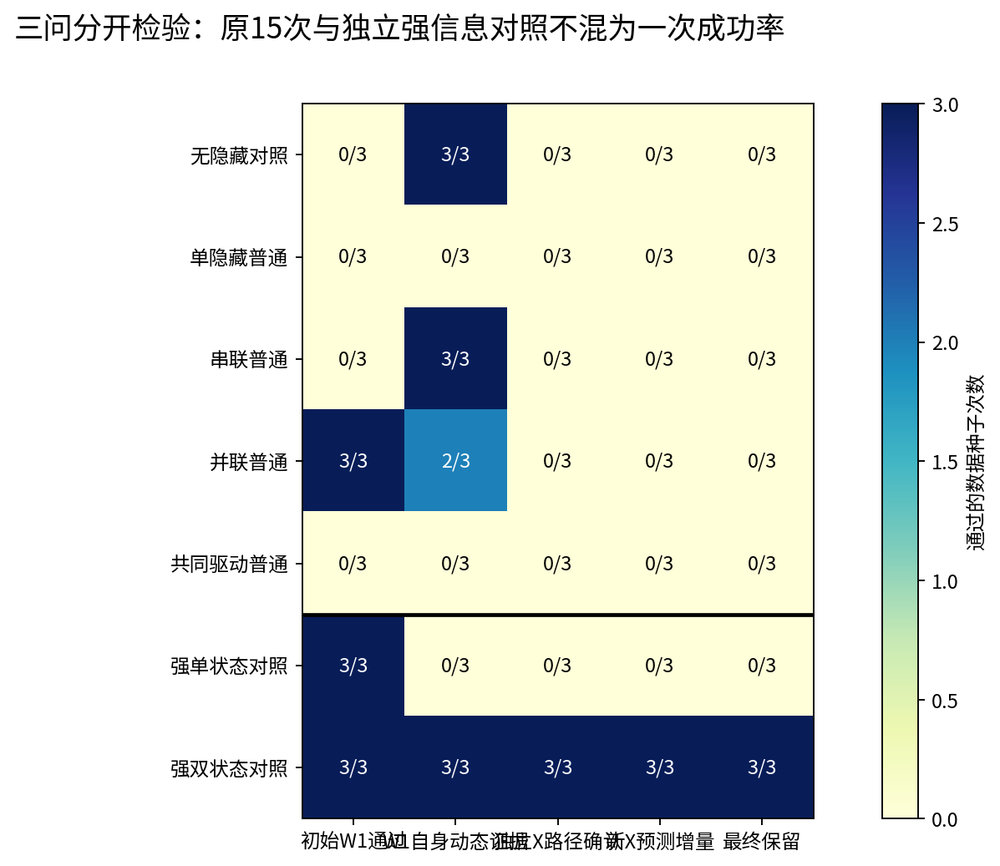
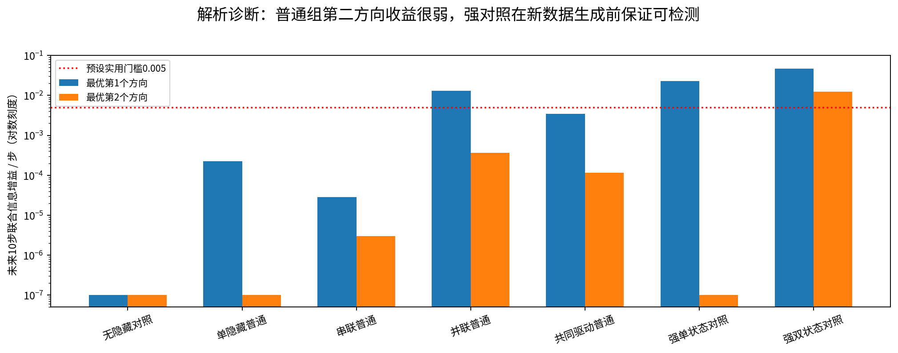
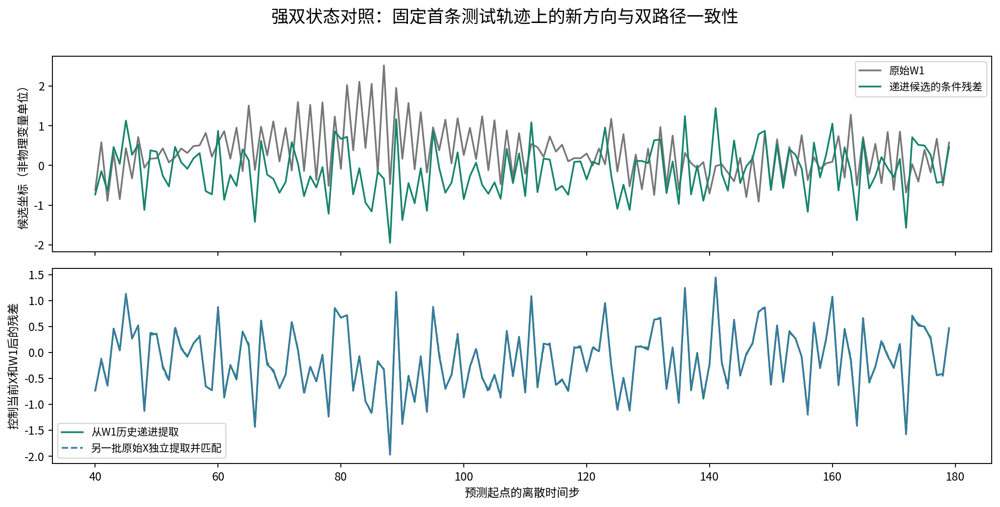
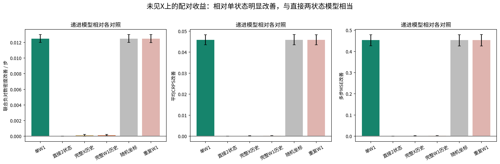
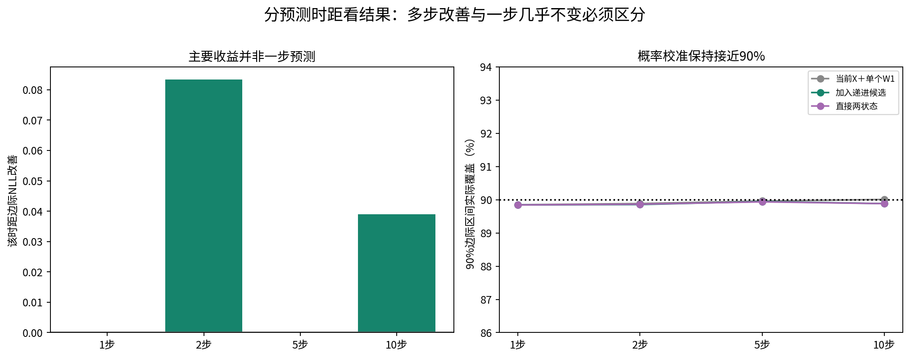
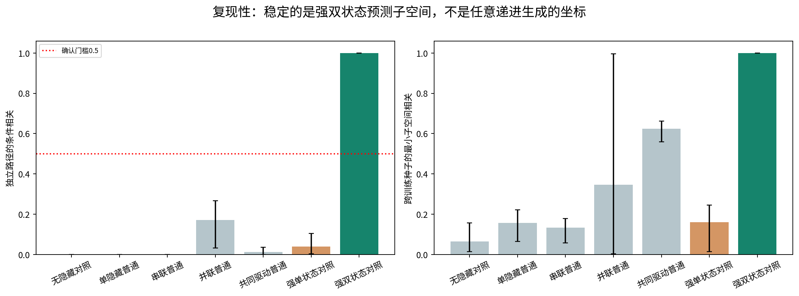
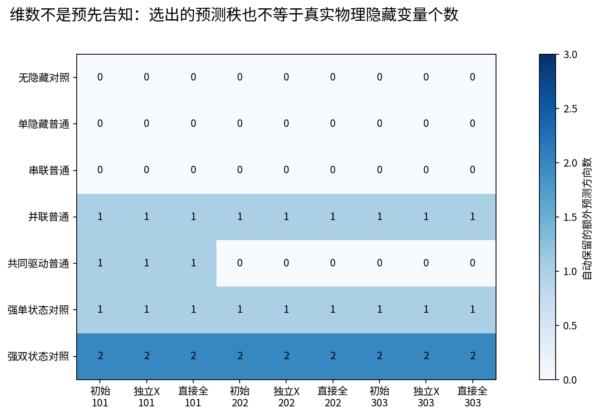
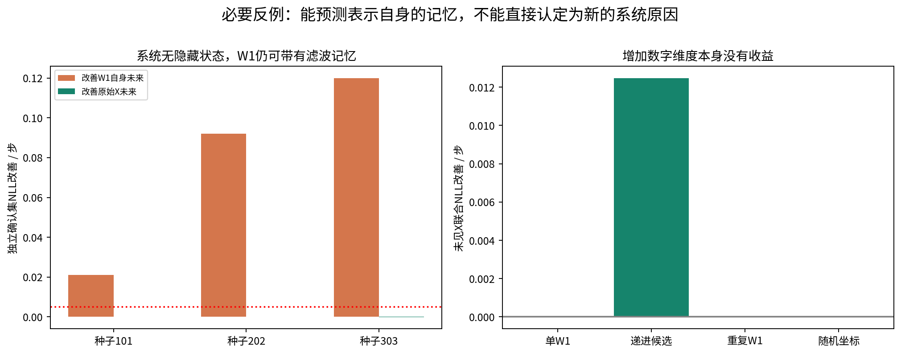

# E1＋E2：从单一观测递进扩展预测状态的小规模原型

实验日期：2026年11月23日。研究范围：X-only 隐藏预测表示提取与独立验证；未开展 E3 贝叶斯在线更新、物理因果链识别或失效预警。

## 结果先读

**有条件支持三问，但没有证明发现了新的物理原因。** 原始五种系统共15次重复，没有新状态通过全部门槛。保留这些结果后，另行登记、使用全新随机数据的强信息对照中，双状态系统3次均通过，单状态系统3次均没有被错误扩展。

|用户的问题|本轮答案|
|---|---|
|从 W1 能否找到新的独立动态信息？|强双状态对照可以找到超出“当前 W1”的预测方向；不是超出完整 W1 历史的信息。|
|能否从原始 X 独立验证？|可以：另一批 X 独立训练的编码器在未参与匹配的测试集上，条件相关约0.999。|
|加入后未见 X 的概率预测改善吗？|强双状态的未来10步联合概率预测改善；一步预测几乎不变。普通条件没有通过预设实用门槛。|

**最关键的限制：直接自动提取模型在强双状态系统中本来就选出了两个方向。E2 刻意从单个 W1 出发，验证能否补回第二个方向，没有证明递进方法找到了直接方法遗漏的信息，也没有证明优于直接两状态模型。**

## 实验方法与数据隔离

每个系统、每个种子生成800条独立轨迹，每条500步；种子101、202、303。分配为：初始编码200条、递进候选及预测头200条、独立原始 X 编码200条、选择50条、确认50条、最终测试100条。按整条轨迹隔离，不把同一轨迹相邻窗口拆入不同集合。原始15次共12000条；后续6次共4800条，分别报告。

采用线性高斯预测状态原型。模型只见 X，不提供真实隐藏变量、数量、结构或系统参数。初始编码从20步 X 历史提取预测方向；递进编码只读 W1 的20步历史，预测未来 W1，产生最多6个候选方向。另一路在独立200条原始 X 上学习40步历史的预测表示。维数由选择集的一标准误差规则选择，可为0，不由真实隐藏变量数指定。

概率头输出未来10步 X 的联合高斯分布，具有完整10×10残差协方差；NLL 除以10，以 nats/步报告。它是**观测预测分布**，不是 Y、Z 的真实状态后验，也不是粒子滤波或贝叶斯递进发现模型。固定线性编码器可能不适用于非线性系统。

候选在选择集上匹配；确认集执行固定门槛：预测收益≥0.005 nats/步，条件残差方差占比≥5%，独立路径条件相关≥0.5。原始15次×5项检验以 Holm 校正75次比较，强对照另校正30次。最终测试不参与选择、匹配、阈值或模型调整。主要收益同时要求超过初始单 W1 和长历史单 W1。完整 X 历史、完整 W1 历史、直接两状态、自动维数、重复 W1、随机坐标等均作为对照。

全部测试 X 预测及指标冻结后才读取真实隐藏状态；真实状态相关性仅作事后描述，不拟合测试集对齐映射。跨种子稳定性使用另外生成的共同 X 探针，不反过来挑模型。置信区间按种子和轨迹分层重采样；时间点不当成独立样本，仅3个种子限制了外推强度。

## 为什么增加强信息对照

原始五种系统为无隐藏 AR、单隐藏、串联、并联、共同驱动。过程创新方差均0.25，具体矩阵及种子见生成器和封存清单。原始结果冻结后，解析高斯有限历史诊断显示：并联组最优第二方向增益约0.000362，其他原始组更低，均远低于0.005的既定门槛。不能把没有通过解释为“系统没有隐藏变量”。

因此单独登记强单状态与强双状态对照，保持算法、数据分配、门槛不变，使用新种子族。强单状态持续系数0.97；强双状态分别0.97和−0.97，观测 X 为上一时刻状态之和加噪声，隐藏创新方差0.25、X创新方差4。新数据生成前，解析第二方向预期增益为0.012466。此设计验证已知有较强第二预测方向时管线能否通过；不是事后替换原始失败结果，更不是对任意未知系统的成功率估计。

## 图1：三项验证不能合成一个“发现成功”

每行一种系统，每格表示三个种子中通过的次数；黑线区分原始组与后续强对照。W1自身未来可被进一步预测，并不等于新信息对原始 X 有用。原始15次最终均不保留；强双状态3/3保留，强单状态0/3额外拆分。无隐藏对照的 W1 自身动态检查也可3/3通过，说明仅靠递进自预测会误把表示记忆当成系统隐藏作用。完整接受规则正是为阻止这个跳跃。

## 图2：原始组为什么没有通过

横轴为系统，纵轴为知道真实高斯生成机制时、最优有限历史预测方向的理论增量，对数刻度；零值为绘图显示放在极小正数，不能读成非零证据。虚线为预设实用门槛。原始组第二方向过弱，样本中的微小收益不足以支持扩展。强双状态第二方向高于门槛，而强单状态没有第二方向。解析计算只用于事后解释和单独登记的对照设计，没有进入原始拟合模型。

## 图3：新方向与独立 X 路径能否对应

选取预先固定的强双状态种子101第一条测试轨迹，没有挑最好看的样本。上图对比 W1 和候选条件残差，下图比较两路候选：一路从 W1 历史递进得到，另一路从不同训练轨迹的原始 X 得到。控制当前 X 和 W1 后，两条曲线仍高度一致，三个种子的测试条件相关分别约0.99938、0.99941、0.99899。

这里“独立”指独立编码训练轨迹与独立确认/测试；两路仍观察同一个系统 X，并共享选择阶段的坐标匹配规则，预测头也使用共同的递进训练集，不是独立传感器或完全独立的实验发现。候选能够精确写回原始 X 的线性滤波器只是代数一致性，不能当作这一独立验证。

## 图4：真正改善了多少，与谁相比

柱为递进模型相对横轴对照的配对改善，正数更好，误差线为分层95%区间。强双状态300条最终测试轨迹上：

|指标|当前 X＋单 W1|加入递进候选|变化|
|---|---:|---:|---:|
|未来10步联合 NLL/步|2.349252|2.336784|降低0.012468|
|跨时距平均 CRPS|1.593299|1.547421|降低2.88%|
|跨时距平均 MSE|8.007105|7.553134|降低5.67%|
|联合90%区域覆盖|89.62%|89.68%|均接近90%|

NLL 改善95%区间约[0.011982,0.012996]。直接两状态 NLL 约2.336787，差异近零，区间跨零；完整 X 历史约2.336888，差异也没有可靠证据。重复 W1 与随机数字没有相应改善。结果支持“补足有限表示”，不支持创造原始 X 以外的信息，也不支持递进架构独有优势。

## 图5：一步不变，多步改善

左图分开统计1、2、5、10步的边际概率评分；右图检查各时距90%预测区间的实际覆盖。一步 NLL 从约2.337002到2.336964，仅改善0.000038，几乎不变。收益主要来自较远时距以及联合预测结构，不能泛称“预测全面提高”。覆盖仍接近名义水平，表明改进不只是盲目扩大区间；但本轮不能保证任意尾部风险均已校准。

## 图6：结果能否复现

左图是不同训练数据路径在测试集的条件相关，右图是跨种子两维预测子空间最小典型相关，线表示三个重复或种子对的范围。强双状态子空间相关约0.9995以上，表示预测子空间稳定。强单状态被强行抽出的第二方向跨种子不稳定，不应保留。子空间稳定并不要求单一坐标符号或尺度相同，更不等于稳定恢复了真实 Y、Z 的物理身份。

## 图7：自动维数的关键限制

每种系统展示三个种子、三种原始 X 编码路径的自动预测秩。预测秩是额外预测方向数量，不等于真实隐藏原因数。强双状态的初始自动方法已经选出2；本次 E2 为测试逐层扩展，故意只取其第一方向作为 W1 起点。因而本轮成功应解释为“从受限起点找回第二预测方向”，不能宣称自动逐层发现优于一次性发现，也没有验证无限递归层数。

## 图8：最重要的失败对照

左图的系统根本没有物理隐藏状态，但 W1 是历史滤波结果，其历史可以进一步预测自身未来，造成显著自动态证据；原始 X 的未来却没有对应增益。右图表明重复 W1 或附加随机数不改善 X 预测。它说明：从表示里再找到规律，必须回到原始观测、独立样本与容量对照检验，不能把每次产生的新数字都命名为隐藏原因。

## 能支持与不能支持的结论

本轮支持：在第二预测方向足够强时，W1 历史能提供超出当前 W1 的动态记忆；独立原始 X 编码能验证同一预测子空间；补充坐标能改善未见 X 的多步概率预测。

本轮不支持：唯一识别真实隐藏变量、恢复直接或间接因果链、获得 X 尚未携带的上游信息、证明预警早于下游预测失效、递进模型全面优于直接方法。W1、Wy 均为 X 历史的确定性函数，数据处理关系决定它们不可能比完整 X 历史拥有更多真实信息。0/15原始通过率和3/3强双状态通过率都必须保留。

下一步若继续，应先在预先冻结的、更广泛新条件中检验“递进压缩”是否相对同容量直接提取有稳定增益，再考虑概率状态后验和机制监测；当前不以更深递归或更复杂模型替代可识别性验证。

## 文件、复现与审计

模型、逐轨迹指标、三种子结果、中文图、协议和冻结散列均随本目录保存。`results/case*/test_predictions.npz` 保存每次第一条测试轨迹的概率预测示例；全部100条测试轨迹的评分在压缩 CSV 中，未声称归档全部预测数组。原始模拟数组可由固定生成器重新生成，避免重复提交大体积数据。

`python audit.py` 校验冻结散列，并从固定种子重新生成21次实验数据、加载已存模型复算所有测试评分；不重新拟合。`AUDIT.json` 给出数值误差及未来扰动检查。运行 `python private_generator.py` 和 `python positive_generator.py` 可恢复数据；已有数据时请先使用全新目录，生成器禁止覆盖后续数据。环境见 requirements.txt。

首次确认前发现零维见证坐标的 JSON 空数组丢失形状，确认在首个无隐藏案例停止。仅在反序列化时恢复 `(rank_B,1)` 形状，未改权重或门槛，也未读取测试或隐藏答案；保留 `confirm_initial.py`、`REGISTERED_INITIAL.json` 和 `IO_SHAPE_BUGFIX.json`，修正后才完成确认。冻结记录如实保留这一修正，而非声称全流程无修改。
