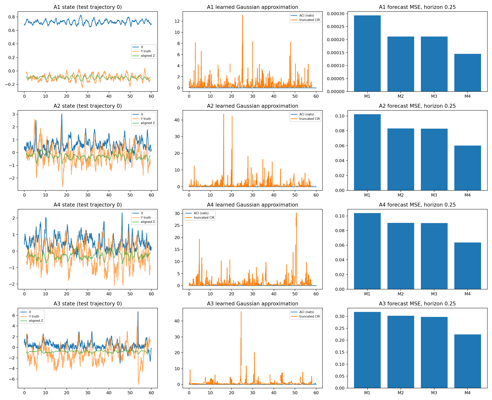
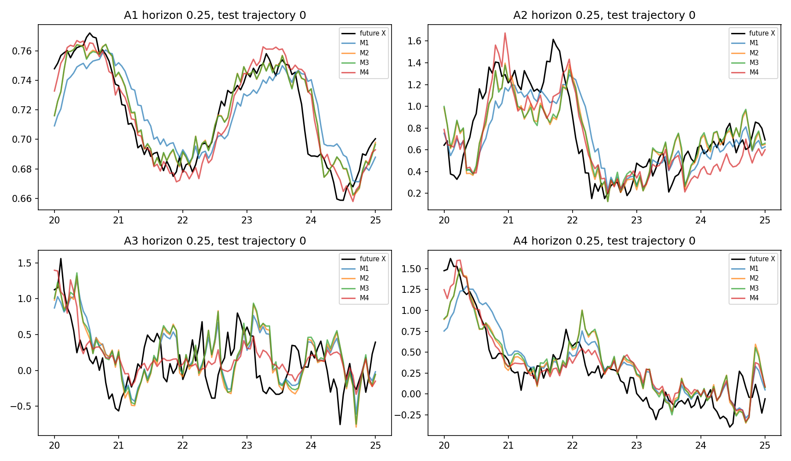
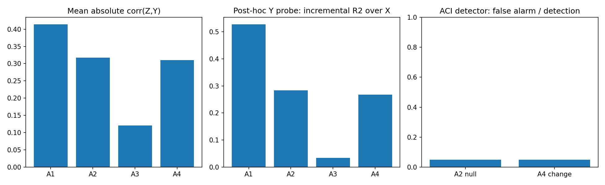

# 实验一：单隐藏变量动态状态发现——云端实测报告

运行日期：2026-11-12。结论：**基础可行性部分成立，完整成功判据尚未满足；当前方法不能可靠识别 A4 机制变化。**

## 实验设置

使用指定的双变量 SDE，两个方程都保留非线性反馈。Euler–Maruyama 积分步长 0.005，观测间隔 0.05，预热 10，正式轨迹长度 60。A1 噪声 (0.025,0.05)，A2 (0.5,1)，A3 (1,2)。A4 在 t=30–40 将 gamma 从 2 线性增至 3。参数与要求一致，但未独立核对原论文全文。

A1–A3 每组 60 条训练轨迹、20 条验证轨迹、100 条独立测试轨迹；A4 额外生成 100 条测试轨迹，使用 A2 模型且不提供参数变化信息。共生成 640 条独立轨迹。3 个训练种子使用相同的数据划分，以分离优化随机性。每条正式轨迹约 1201 个观测点。

延迟嵌入 21 个观测点，覆盖 1 个时间单位；潜在维度 k=1。编码器、潜在转移和预测头均为两层 32 单元 tanh 网络。潜在模型使用未来 X 增量预测损失、相邻潜在状态动力学约束及尺度约束训练；不输入 Y 或真实动力学方程。预测头同时预测 1、5、10 步（0.05、0.25、0.5）。训练 1000 次小批更新，批量 512；四个比较预测器各训练 800 次更新并按 X 验证误差选择检查点。

真实 Y 仅用于 M4 理想参照与事后验证。Z 的线性对齐系数、X/XZ 的线性探针只在验证集 Y 上拟合，测试 Y 不参与任何拟合或调参。测试轨迹与训练、验证按整条轨迹隔离。

M1 输入当前 X；M2 输入 X 历史；M3 输入相同历史与冻结编码器 Z；M4 输入历史与真实 Y。M4 是经验理想参照，不是数学上保证最优的上界。M2/M3 使用相同预测器层宽、优化预算及选模准则，但 M3 多了预训练编码器与一个输入，因此不能把改善全部归因于隐藏因果状态。

## 隐藏状态结果

| 条件 | 平均绝对相关 | 对齐 Y 的 NRMSE | XZ 相对 X 的事后 Y 解释增量 ΔR² |
|---|---:|---:|---:|
| A1 | 0.414 | 0.914 | 0.528 |
| A2 | 0.317 | 0.954 | 0.284 |
| A3 | 0.121 | 1.005 | 0.035 |
| A4 | 0.310 | 0.958 | 0.268 |

NRMSE 为对齐误差 RMSE 除以各测试轨迹 Y 的标准差；越低越好。绝对相关对符号不敏感。Z 单独恢复 Y 的能力较弱，但结合 X 的验证集线性探针得到明显额外解释能力，提示 Z 混合了 X 和隐藏动态信息。ΔR² 为相同测试轨迹上两种探针 MSE 之差除以该轨迹 Y 方差，不等于恢复真实物理变量的证明。高噪声显著削弱这种能力。

## 样本外预测

| 条件 | 预测时间 | M1 MSE | M2 MSE | M3 MSE | M4 MSE | M3 相对 M2 改善 |
|---|---:|---:|---:|---:|---:|---:|
| A1 | 0.05 | 0.000039 | 0.000034 | 0.000034 | 0.000030 | -0.06% |
| A1 | 0.25 | 0.000294 | 0.000212 | 0.000212 | 0.000145 | +0.16% |
| A1 | 0.50 | 0.000630 | 0.000450 | 0.000449 | 0.000295 | +0.26% |
| A2 | 0.05 | 0.015106 | 0.013572 | 0.013594 | 0.012336 | -0.17% |
| A2 | 0.25 | 0.102318 | 0.083159 | 0.082743 | 0.060088 | +0.50% |
| A2 | 0.50 | 0.187733 | 0.165762 | 0.165325 | 0.123448 | +0.26% |
| A3 | 0.05 | 0.057957 | 0.055608 | 0.054914 | 0.048742 | +1.25% |
| A3 | 0.25 | 0.318674 | 0.301844 | 0.297551 | 0.224008 | +1.42% |
| A3 | 0.50 | 0.502255 | 0.497249 | 0.495272 | 0.428660 | +0.40% |
| A4 | 0.05 | 0.015511 | 0.014137 | 0.014159 | 0.012553 | -0.15% |
| A4 | 0.25 | 0.103942 | 0.090424 | 0.090142 | 0.063732 | +0.31% |
| A4 | 0.50 | 0.184072 | 0.172815 | 0.172195 | 0.132670 | +0.36% |

A2 一步预测 M3 比 M2 约差 0.17%，0.25 时间单位预测改善约 0.50%；A3 在 0.25 时间单位改善约 1.42%，但其 Y 重构最弱。预测改善与恢复 Y 不等价。Z 是 X 历史的确定函数，不能产生超出该历史的新信息。

每个指标先在同一测试轨迹上对 3 个训练种子平均，再对 100 条独立测试轨迹计算均值、标准差与 t 近似 95% CI，避免把 300 个模型-轨迹组合当成独立样本。置信区间是给定本次训练数据和三个模型的轨迹不确定性；不涵盖重新抽样训练数据的全部不确定性。完整 MSE、MAE、相关、NRMSE、配对误差差值及其 CI 见 summary.json。多重比较未校正，因此小效应视为探索性结果。

## ACI、CIR 与机制变化

在冻结编码器轨迹上拟合条件线性高斯概率近似：z(t+1)=a0+a1*x+a2*x²+(a3+a4*x)*z+w；Δx=b0+b1*x+b2*x²+(b3+b4*x)*z+v。过程/观测方差由训练残差估计。滤波 p(z_t|X_≤t) 与利用未来 X 的平滑分布通过高斯递推计算；ACI 为 KL(平滑||滤波)。此概率近似学习自编码器状态，并非端到端似然训练的生成状态空间模型；忽略残差相关与异方差，未验证真实后验覆盖率。

CIR 使用 KL(完整平滑||有限未来平滑)/ACI 对未来时距积分，积分上限 2 时间单位（40 步），小 ACI 点剔除。它是有限范围近似，不是已验证的原论文 CIR 完整复现。不能用不同噪声模型间的 ACI 数值直接比较物理因果强度。精确 KL 在可逆坐标变换下不变；实际差异主要来自概率近似、拟合与数值截断，而非尺度变换本身必然改变 KL。

| 条件 | 平均 ACI（nats） | 平均截断 CIR（时间单位） |
|---|---:|---:|
| A1 | 0.00307 | 0.483 |
| A2 | 0.06504 | 0.871 |
| A3 | 0.05361 | 0.984 |
| A4 | 0.05156 | 1.001 |

A4 的 ACI 后期(40–60)减前期(10–30)均值为 -0.0323，95% CI [-0.0712, 0.0067]，包括零。M3 一步预测 MSE 的相同时间窗差值为 0.001218，95% CI [0.000858, 0.001578]；有误差上升迹象，但这不足以验证因果变化检测。

补充固定窗口 ACI 变化检测：用 20 条 A2 验证轨迹的绝对前后均值差的 95 分位校准阈值；在独立 A2/A4 测试轨迹上，误报率与检出率均为 5%。这是离线窗口比较，未测在线检测延迟。没有证据支持当前 ACI 能有效检出此次耦合变化。

## 检查与限制

高斯滤波/平滑的 ACI 已与完整联合高斯直接求条件分布核对；观测与潜在状态无关时 ACI 为零的检查通过；ACI 有限且非负检查通过。未完成积分步长收敛检验、k=2/3/4 扫描、网络/历史长度搜索、概率校准、多训练数据重复实验及强的概率状态空间基线。A1 使用极低随机噪声而非无噪声，因为该确定系统可能收敛固定点，单纯长时固定点数据不适合检验动态发现。

本轮使用两线程 CPU，无 GPU。所有参数事先在 config.json 固定；补充的线性探针与机制检测是结果后的诊断分析，未反馈修改训练，不能当作预注册验证。完整运行日志、每轨迹指标、3×3 个模型检查点与脚本均保留，可重跑生成原始轨迹。

## 如何判断本次实验

1. **学到部分隐藏动态：部分支持。** 低噪声和原噪声下，XZ 对 Y 有额外解释力；Z 单独恢复 Y 的表现不强。
2. **稳定恢复真实 Y：未达到。** 相关性和 NRMSE 不足以支持物理隐藏变量恢复。
3. **改善预测：局部支持。** 多步预测有小幅改善，一步预测并不统一改善。
4. **机制变化与因果分析：未达到。** 目前 ACI 检测没有有效判别能力，CIR 仅为概率近似下的截断诊断。

下一步应优先改进第一阶段的状态可辨识与模型训练，并加入校准的概率潜在状态模型及公平容量基线；暂不扩展双隐藏变量或宣称因果识别成功。

## 图表







## 复现

依赖：Python 3.12、torch 2.5.1 CPU、numpy、matplotlib。依赖版本见 results/environment.txt。

```bash
python run.py
python validate.py
python mechanism.py
python representation.py
python report.py
```

run.py 固定种子重建全部数据与主要结果；其余脚本执行检查、补充分析与报告绘图。