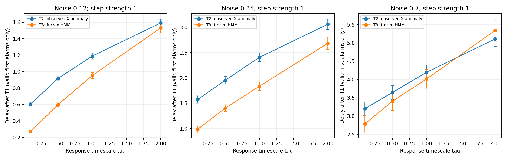
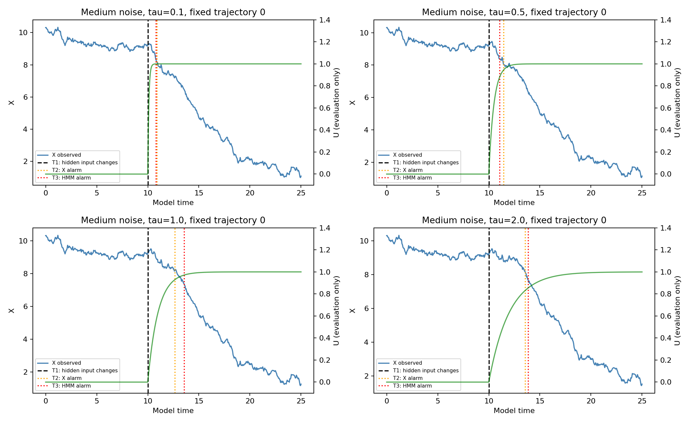
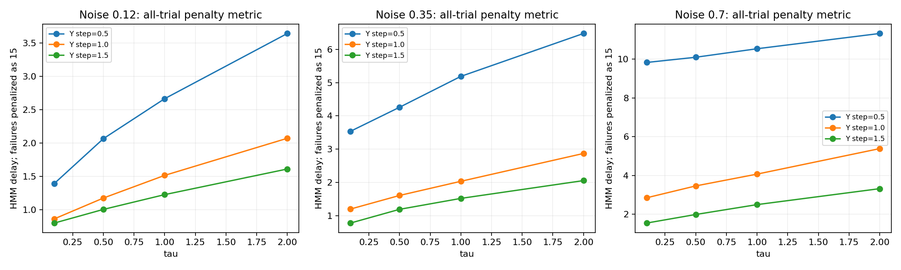

# 实验 A：隐藏输入变化、观测响应与实时报警时间

日期：2026-11-12。仅运行实验 A，未运行 B 的事后回溯或 C 的新预警方法。**本轮发现：响应越慢、噪声越大、作用越弱，冻结模型的报警通常越晚；T2 和 T3 不等同于真实变化时刻。**

## 保留与改动

直接保留上一轮两状态切换自回归 HMM 的 3×3 个模型参数。按上一轮原始数据种子重新生成训练 X 并重跑每种噪声的初始化种子 11，得到参数与保存检查点的最大差异均为 0。没有重新训练或根据本轮事件测试调参。support.py 保留上一轮生成、训练和前向推断的代码；主实验使用独立的严格前向实现。

在上一轮系统中增加 U：

```text
dX = (1.5 − 0.15 X − 1.5 U) dt + sigma dW
dU = (Y − U) / tau dt
Y(t) = 0, t < 10; Y(t) = strength, t >= 10
```

保留上一轮外部强迫 1.5，使正常速度围绕 10 波动。τ∈{0.1,0.5,1,2}，过程噪声 sigma∈{0.12,0.35,0.7}，阶跃强度∈{0.5,1,1.5}。共 36 条件，每条件 200 条测试响应，各用 3 个旧模型评估。模型时间间隔 0.05、时长 25、T1=10，所有表格使用同一模型时间单位，不是真实车辆标定秒数。Y 改变后持续到实验结束，不再是上一轮 2–5 单位脉冲，因此不能把这轮报警时间与上一轮 0.83 直接比较优劣。

每个噪声另有 200 条已知无事件轨迹拟合正常参考模型、500 条无事件轨迹校准报警阈值、500 条独立无事件轨迹测误报。所有检测器从时间 0 开始工作，不知道事件在第 10 时刻发生，不在真实 T1 重置。输入只有 X；真实 Y、U、τ、强度、T1 不输入检测器。τ/强度条件共享同噪声下的创新序列，以支持配对比较：每格有 200 条独立轨迹，但跨格不是独立样本，不能宣称总计 7200 个独立随机种子。

线性响应与加性过程噪声在每步做精确转移：U 用指数解，X 对该步连续 U 的作用精确积分，噪声使用精确 OU 转移方差，避免 τ=0.1 时 Euler 步长误差干扰。Y 是外部隐藏输入/状态的阶跃，本轮没有改变方程系数或因果结构；将其称作“隐藏机制变化”时，必须限定为隐藏作用的变化。

## T1、U 的响应时间、T2、T3 的区别

- **T1=10**：生成器中隐藏输入 Y 改变的真实时间，只用于评分。
- **U 响应**：一阶系统在 T1 后立刻缓慢响应，并不存在持续 τ 的完全无信号区间。U 达到最终作用 50% 的时间是 10+τ ln 2；τ 是时间尺度，不是纯传输死区。
- **T2**：预先固定的参考观测检测器第一次报警的数据时间，而非天然、唯一的“真实观测变化时间”。正常 X 由仅用无事件训练 X 拟合的 AR(1) 模型给出均值轨迹与方差；当实际速度显著低于正常预测且连续两点过阈时报警。
- **T3**：冻结 HMM 的负向作用状态前向后验对数几率连续两点过阈的第一次报警数据时间。估计状态所需的 X 已到达后才发出报警，不把时间回填为更早的隐状态时刻。

T2 和 T3 的阈值分别在同一批独立无事件校准轨迹上，按“整条轨迹任意时刻至少连续两点越界”的概率约 5% 校准。使用整条无事件轨迹来离线校准阈值是允许的；事件测试时每步严格只看当时及过去 X。两者目标误报预算相同，实际独立测试误报率会不同。

## 核心结果：强度=1

下表时间是第一次报警发生在 T1 之后的轨迹的条件均值。先于 T1 的误报单独统计，未报警不伪造报警时间。配对 T2−T3 只在两种方法都有有效首报的相同轨迹上计算，因此不必恰好等于两列均值相减。

| 噪声 | τ | 真实 T1 | 参考 T2 | 模型 T3 | 配对 T2−T3 | 模型有效首报比例 |
|---|---:|---:|---:|---:|---:|---:|
| 0.12 | 0.1 | 10 | 10.605 | 10.271 | +0.338 | 96.0% |
| 0.12 | 0.5 | 10 | 10.915 | 10.597 | +0.325 | 96.0% |
| 0.12 | 1.0 | 10 | 11.189 | 10.952 | +0.245 | 96.0% |
| 0.12 | 2.0 | 10 | 11.592 | 11.532 | +0.068 | 96.0% |
| 0.35 | 0.1 | 10 | 11.574 | 10.986 | +0.593 | 98.5% |
| 0.35 | 0.5 | 10 | 11.951 | 11.401 | +0.555 | 98.5% |
| 0.35 | 1.0 | 10 | 12.406 | 11.834 | +0.576 | 98.5% |
| 0.35 | 2.0 | 10 | 13.060 | 12.684 | +0.377 | 98.5% |
| 0.7 | 0.1 | 10 | 13.202 | 12.786 | +0.413 | 99.5% |
| 0.7 | 0.5 | 10 | 13.641 | 13.401 | +0.222 | 99.5% |
| 0.7 | 1.0 | 10 | 14.195 | 14.014 | +0.148 | 99.5% |
| 0.7 | 2.0 | 10 | 15.105 | 15.336 | -0.288 | 99.5% |

中等噪声下，τ 从 0.1 增至 2，模型从平均 T3≈10.99 推迟到 T3≈12.68。正常速度异常参考从 T2≈11.57 推迟到 T2≈13.06。τ=0.5 时模型比这个参考检测器平均早 0.555 个时间单位，配对 95% CI [0.483,0.626]。这只说明模型能比这一种参考规则更早利用微弱 X 信息，不是能在完全无观测信息时知道 Y，也不是实验 C 的普遍预警结论。

响应慢和高噪声同时存在时，模型也可能晚于参考。例如 sigma=0.7、τ=2、强度=1，配对 T2−T3≈−0.288，95% CI [−0.552,−0.025]。冻结 HMM 没有显式表示连续 U，存在响应模型失配；不能强行要求它所有条件都更早。

## 噪声与作用强度

固定 τ 时，强度=1 的模型报警延迟在三档噪声上逐步增加。固定噪声时，τ 越大延迟越长；与 τ=0.1 的配对全样本惩罚延迟差，在所有更大 τ 的常规强度条件下均为正，95% CI 不跨零。

例如 τ=2：

| 噪声 | 隐藏作用强度 | 模型条件平均延迟 | 模型有效首报 | 完全未报警 |
|---|---:|---:|---:|---:|
| 0.12 | 0.5 | 3.172 | 96.0% | 0.0% |
| 0.12 | 1.0 | 1.532 | 96.0% | 0.0% |
| 0.12 | 1.5 | 1.051 | 96.0% | 0.0% |
| 0.35 | 0.5 | 6.259 | 97.5% | 1.0% |
| 0.35 | 1.0 | 2.684 | 98.5% | 0.0% |
| 0.35 | 1.5 | 1.855 | 98.5% | 0.0% |
| 0.7 | 0.5 | 8.931 | 60.5% | 39.0% |
| 0.7 | 1.0 | 5.336 | 99.5% | 0.0% |
| 0.7 | 1.5 | 3.259 | 99.5% | 0.0% |

弱作用、高噪声、慢响应最困难：sigma=0.7、τ=2、强度=0.5，约 39% 到实验结束仍未报警，约 0.5% 首报发生在真实变化之前。只报告成功检测的平均延迟会低估困难，因此同时提供全样本惩罚指标：有效首报用实际延迟；变化前已误报或全程未报警统一记 15（T1 至观察结束的窗口长度）。这个指标是预先定义的失败惩罚，不是真实延迟或无偏生存期估计。

## 误报与统计

| 噪声 | 无事件 T2 误报率 | 无事件 T3 误报率 | 强度=1 事件发生前 T3 首报比例 |
|---|---:|---:|---:|
| 0.12 | 4.8% | 4.8% | 4.0% |
| 0.35 | 4.2% | 4.8% | 1.5% |
| 0.7 | 6.0% | 2.8% | 0.5% |

高噪声组中 T3 实际误报率比 T2 低（2.8% 对 6.0%），所以速度对比还受到实际保守程度不同的影响，不能把全部差异归因于状态估计质量。阈值未利用事件测试结果二次匹配。完整指标包括均值、标准差、中位数、近似 95% CI、早报/漏报比例以及每轨迹数据。

先对同一测试轨迹的三个模型平均，再以每格 200 条独立轨迹计算区间；跨 τ 使用同一创新序列的配对差。条件均值仅对有有效首报者计算；有早报或漏报时另报告全样本惩罚延迟。三个初始化共用上一轮训练集，不代表三次独立训练数据实验，区间不覆盖所有训练数据不确定性；多重比较未校正。本轮未搜索更好的传统基线或预警算法。

## 验证与本轮边界

已通过：旧模型重训复现、改变未来数据不影响早期 HMM 或 T2 输出、当前前向后验与上一轮前向结果一致、报警使用连续第二个越界点的数据终点、T1 前事件与无事件的同噪声观测完全一致、U 的指数响应时间尺度、独立矩阵指数与逐步精确转移一致、OU 噪声方差检查。详见 reproduction.json、validation.json。

本轮只完成 A：测量实时延迟。没有回溯 T1、没有计算 ACI/CIR、没有宣称恢复真实因果机制，也没有在 X 分布完全不变时预知事件。下一步 B 可在这个固定生成器上研究：显式建模 U 后，未来 X 能否帮助把隐藏输入变化时刻与响应开始显著的时刻分开。

## 图表







## 复现

```bash
OPENBLAS_NUM_THREADS=1 python run.py
OPENBLAS_NUM_THREADS=1 python validate.py
OPENBLAS_NUM_THREADS=1 python report.py
```

依赖 numpy、scipy、matplotlib；版本见 results/environment.txt。results/model_*.npz 是上一轮冻结模型，运行时读取而非重新覆盖。core_table.csv 是核心36条件结果，per_trajectory.csv 与 null_trajectories.csv 是逐轨迹数据，config.json 在运行前固定了设计。run.py 还重新生成并重训上一轮每档噪声的 seed=11 以核对复现。