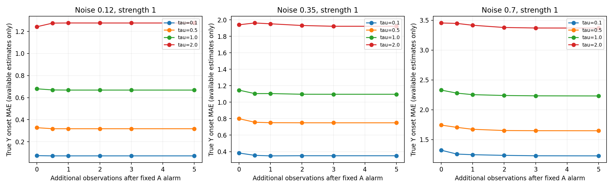
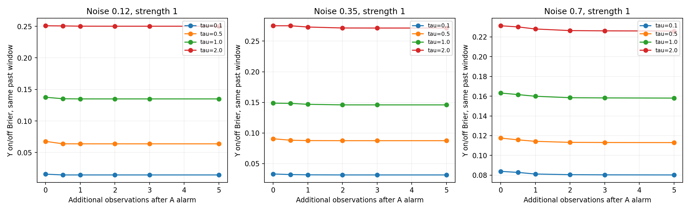
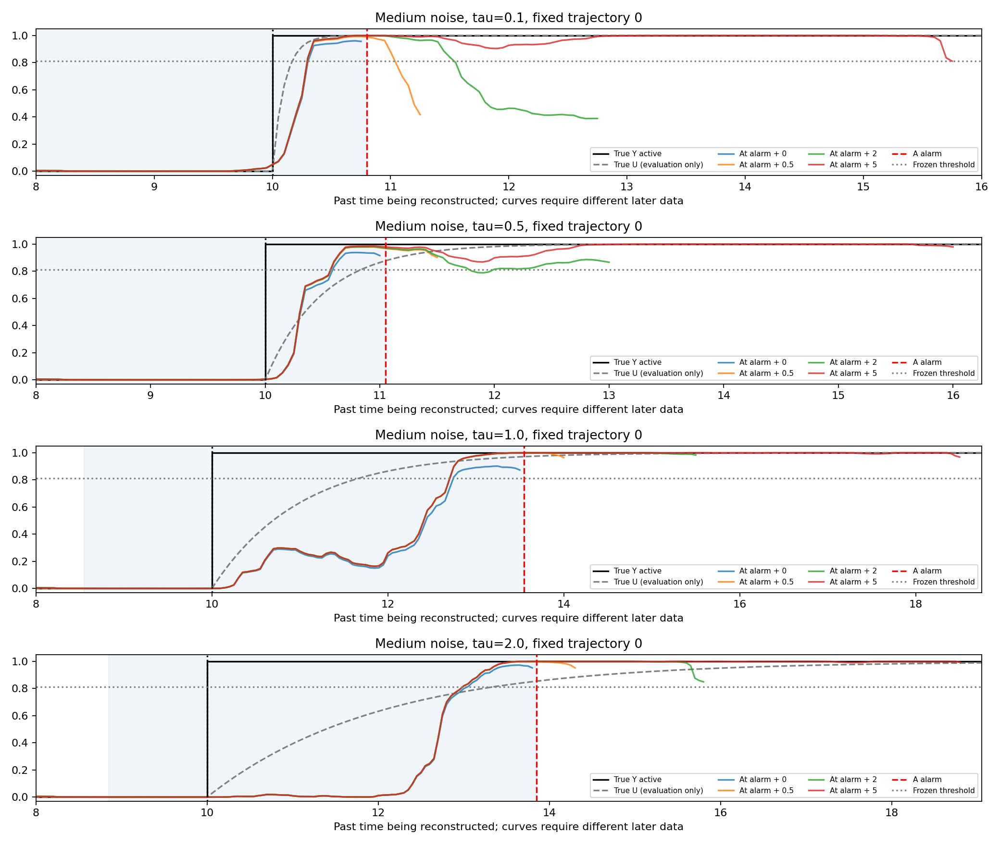
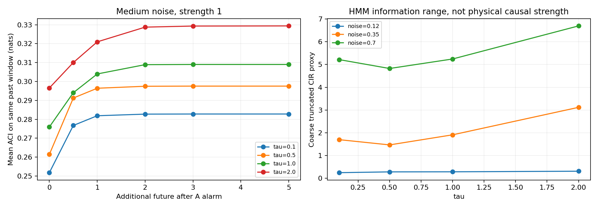

# 实验 B：沿用 A 的轨迹与模型，事后回溯隐藏作用起点

日期：2026-11-13。**本报告只研究 B：更多未来观测能否帮助重建已过去的隐藏作用。没有修改检测模型、没有使用真实 Y/U/τ 做推断，没有开展实验 C 或 D。**

## 本轮结论

**部分成功：平滑能把估计起点从实时报警时刻向前修正，但当前模型没有可靠找回真正的 Y 起点。** 中等噪声、标准强度下，tau=0.1/0.5/1/2，多看5后估计起点平均约为10.33/10.74/11.09/11.92；真实起点始终为10。慢响应条件残留的偏晚不是再多观察几段就自动消失。

新增未来相对“报警当时已经执行平滑”的增益较小：中噪声四个tau的配对MAE只再改善约0.03–0.06个时间单位。多数曲线在新增1–3后已基本稳定。主要收益来自报警当时已有数据的回溯，未来5并不代表把起点准确推回10。

慢响应时，平滑状态概率更贴近逐渐升起的U：例如tau=2，多看5后的Y开关Brier约0.271，而相对U/最终强度的误差约0.050。两种真值平滑程度不同，不能据此严格证明Z=U，但它与未显式建模U导致的响应失配相符。

无事件轨迹中，回溯也能撤销部分误报：中噪声报警时仍确认事件的比例4.8%，多看5后为1.0%。这改善的是事后确认，不会抹去当时已经发出的实时误报。

ACI与截断CIR代理已计算，描述模型后验被未来数据改变多少、对未来信息的依赖多远。CIR代理跨轨迹波动较大；点态KL比值不保证随未来时距单调，粗网格积分不能当作精确物理时间尺度。估计很稳定仍可能有系统偏差。

下一步优先在后续独立实验中显式建模作用传递U，并检验未知tau和Y起点能否分别识别；本轮按要求保留A模型，不用真tau减去固定延迟来制造“找回真实时刻”的结果。

## 固定的配对设计

复用 A 的精确响应系统：dX=(1.5−0.15X−1.5U)dt+sigma dW，dU=(Y−U)/τ dt；Y 在 T1=10 从 0 阶跃到 0.5、1 或 1.5。过程噪声 sigma=0.12/0.35/0.7，τ=0.1/0.5/1/2，时长25，采样间隔0.05。所有时间是模型时间单位。

按 A 的同一生成器、种子和精确积分方法重建每格 200 条 X/Y/U 轨迹，共36条件。跨 τ/强度使用同一噪声创新以进行配对；每格200条独立轨迹，不能把跨格重复噪声或3个模型种子视为额外独立样本。冻结 A 使用的9个 HMM 模型、阈值；所有108个条件-模型组合重新计算的200个 T3 均逐条与 A 的记录一致（含 NaN 漏报）。A_per_trajectory.csv、summary_A.json、calibration_A.json 和检查点保留为来源。

对同一条轨迹的同一个 T3，分别使用截至 T3+0、0.5、1、2、3、5 的 X 做精确 HMM 前向-后向平滑。0 也包含 T3 前已积累的观测，所以它已经是“报警当时的回溯”，不是实时逐点滤波。观测超过25时截断，并单独记录实际可用未来长度。完整25轨迹的平滑只作事后稳定性参考，不作为新的实时方法。

每个窗口都仅在 T3 时已过去的时间段寻找起点，取最早连续两点超过 A 冻结阈值的平滑状态；不提供 T1=10，不依据真实 Y 选择最接近答案的区间，不按测试结果寻找最佳时间平移。状态误差与 ACI 统一在 [max(0,T3−5),T3) 的同一段过去计算，不因未来窗口增加而改变评价对象。

## 这轮后验究竟是什么

**HMM 平滑的是 Z（学到的负向作用状态），不是已校准的真实 Y 后验。** A 的模型没有显式表示连续传递状态 U，也不知道 τ。因此不能把 p(Z_t|X_≤T′) 直接写成“已恢复真实 p(Y_t|X_≤T′)”。这轮要验证的恰好是：这个冻结模型的 Z 起点能否与真实 Y 起点一致。

主状态指标把 Y 转为是否开启（Y>0）的开关真值，用 Brier=mean((平滑状态概率−开关真值)²) 评分；不是连续作用力度重构误差。另与真实 U/最终作用强度比较，作为其更像“响应状态”还是“输入状态”的诊断，不反馈训练。

## 核心结果：中等噪声、标准作用强度

| τ | A 实时平均 T3 | 报警当时回溯 MAE | 多看0.5 | 多看1 | 多看2 | 多看3 | 多看5 |
|---|---:|---:|---:|---:|---:|---:|---:|
| 0.1 | 10.986 | 0.383 | 0.355 | 0.348 | 0.350 | 0.350 | 0.350 |
| 0.5 | 11.401 | 0.800 | 0.757 | 0.751 | 0.750 | 0.750 | 0.750 |
| 1.0 | 11.834 | 1.147 | 1.105 | 1.105 | 1.097 | 1.097 | 1.097 |
| 2.0 | 12.684 | 1.941 | 1.963 | 1.953 | 1.932 | 1.923 | 1.923 |

MAE=|估计起点−10|，只在 A 首报不早于 T1 且有过去起点估计的轨迹中计算。必须同时看可用率、早报和漏报，不能只看成功子集。

| τ | 多看5后平均起点偏差（正值=偏晚） | 回溯可用率 | 多看5相比报警当时的配对 MAE 改善与95% CI |
|---|---:|---:|---|
| 0.1 | 0.328 | 98.0% | 0.033，[0.018, 0.048] |
| 0.5 | 0.743 | 98.5% | 0.050，[0.038, 0.062] |
| 1.0 | 1.093 | 97.5% | 0.055，[0.039, 0.072] |
| 2.0 | 1.919 | 96.5% | 0.044，[0.033, 0.055] |

配对改善仅在同一轨迹的0和5两种窗口都有起点时计算，正值表示未来数据改善了起点定位，负值表示恶化。不能将两列条件 MAE 不同样本的直接相减当成配对收益。另有全样本误差惩罚指标：有效过去起点使用实际误差，A 早报/漏报或无可用起点统一计15。惩罚是分析约定，不是真实缺失误差。

## 隐藏状态重构与更多未来信息

| τ | 实时逐点滤波 Y-Brier | 报警当时平滑 | 多看1后平滑 | 多看5后平滑 |
|---|---:|---:|---:|---:|
| 0.1 | 0.12797 | 0.03313 | 0.03174 | 0.03154 |
| 0.5 | 0.20757 | 0.09063 | 0.08764 | 0.08747 |
| 1.0 | 0.27707 | 0.14874 | 0.14688 | 0.14591 |
| 2.0 | 0.41777 | 0.27506 | 0.27303 | 0.27135 |

Brier 在所有 A 有效首报的轨迹上评分，不要求平滑后阈值过线，因此比“仅成功定位的 MAE”更少受起点选择影响。但它仍不包含 A 完全漏报者：这部分在可用率和全样本惩罚误差中保留。更多数据使后验更稳定，不必然使失配模型的真实 Y 误差下降，尤其不能把状态概率更加确信当成更正确。

## ACI 与 CIR：模型内信息诊断

ACI(T′,t)=KL(Bernoulli平滑状态概率 || Bernoulli实时先验状态概率)。实时先验在时刻 t 只使用 X_≤t，后续增量在 t+0.05 才进入观测。全部 KL 使用概率截断1e−12防止 log(0)，单位 nats。比较同一段过去的 ACI，而不是随着 T′ 增长更换评分区间。

CIR 用完整25时长平滑作参考，对每个过去状态时刻 t，计算仅多看 h∈{0,0.5,1,2,3,5} 的平滑与完整平滑的 KL，比上完整平滑与实时先验的 KL，再对 h 做梯形积分。分母<1e−4的近零信息点剔除。这是**粗网格、截断5的 HMM 信息范围代理**，不是已验证的原论文 CIR 全积分复现，也不是物理影响传播时间 τ。记录末端未解释 KL 比例，避免把截断积分当作完整收敛。

| 中噪声 τ | 报警时 ACI 均值 | 多看5 ACI 均值 | 截断CIR代理均值 | 5时距剩余KL比例 |
|---|---:|---:|---:|---:|
| 0.1 | 0.25175 | 0.28279 | 1.699 | 0.000 |
| 0.5 | 0.26141 | 0.29755 | 1.469 | 0.000 |
| 1.0 | 0.27593 | 0.30901 | 1.911 | 0.000 |
| 2.0 | 0.29657 | 0.32941 | 3.118 | 0.000 |

额外记录“经验稳定窗口”：从某个测试未来长度开始，所有更长测试窗口的过去起点都距完整平滑起点≤0.1，且同一过去概率曲线平均绝对差≤0.02。这个判据用完整未来作事后参照，不用于在线决定什么时候停止观察。稳定不代表起点接近真实10。

| 中噪声 τ | 达到稳定的全样本比例 | 达到者平均额外观测长度 | 完整平滑起点MAE |
|---|---:|---:|---:|
| 0.1 | 98.0% | 0.082 | 0.350 |
| 0.5 | 98.5% | 0.104 | 0.750 |
| 1.0 | 97.5% | 0.197 | 1.097 |
| 2.0 | 96.5% | 0.282 | 1.923 |

ACI 非零表示未来改变了认识；CIR/经验窗口较短表示模型估计较快稳定。它们都不能单独证明找到了真实 Y 起点、证明因果机制变化，或证明某个未来长度最优。

## 误报、漏报与不确定性

A 中提前误报的轨迹不会在真实 T1 重置；它们的推断仍执行，但在主 Y 起点评分标为早报，不能作为成功发现。A 漏报轨迹没有触发后的回溯终点，不伪造其 T3 或起点。本轮另沿用 A 的每噪声500条独立无事件测试轨迹，检查在原有假报警后回溯是否仍确认过去有事件。

| 噪声 | 报警当时的无事件回溯确认比例 | 多看5后的确认比例 |
|---|---:|---:|
| 0.12 | 4.80% | 0.60% |
| 0.35 | 4.80% | 1.00% |
| 0.7 | 2.80% | 1.40% |

确认比例以全部500条无事件轨迹为分母，不只是假报警子集；每个未来窗口分别报告，不挑最好窗口。B 没有重新校准多窗口的整体错误发现率。

统计先对同条轨迹的3个冻结模型平均，再以每格200条独立轨迹计算均值、标准差、中位数和近似95% CI。跨未来窗口进行配对。模型种子共享训练集，区间不覆盖重新抽取训练数据的不确定性；多重比较未校正，细小收益仅作探索性结果。所有36格、6窗口、逐轨迹指标与区间在结果文件中公开。

完整逐轨迹窗口结果保存在 results/per_trajectory.csv.gz（标准 gzip 压缩CSV），核心汇总见 core_table.csv；信息指标见 information.csv 与 information_summary.json。

## 数值验证与复现

平滑分布与枚举短序列所有隐藏状态路径的精确结果一致；每条轨迹可有不同观测终点；终点之外的未来 X 修改不影响该终点平滑；有限未来后验与独立终点平滑一致；KL 同分布为零且非负；端到端缺失报警评分通过；108组 A 报警时间逐条复现。

```bash
OPENBLAS_NUM_THREADS=1 python run.py
OPENBLAS_NUM_THREADS=1 python validate.py
OPENBLAS_NUM_THREADS=1 python report.py
```

只依赖 numpy、scipy、matplotlib；版本见 environment.txt。source_A.py 与 support.py 固定生成器和旧训练代码；推断不读取生成器里的 Y/U/τ/T1。

## 图表







