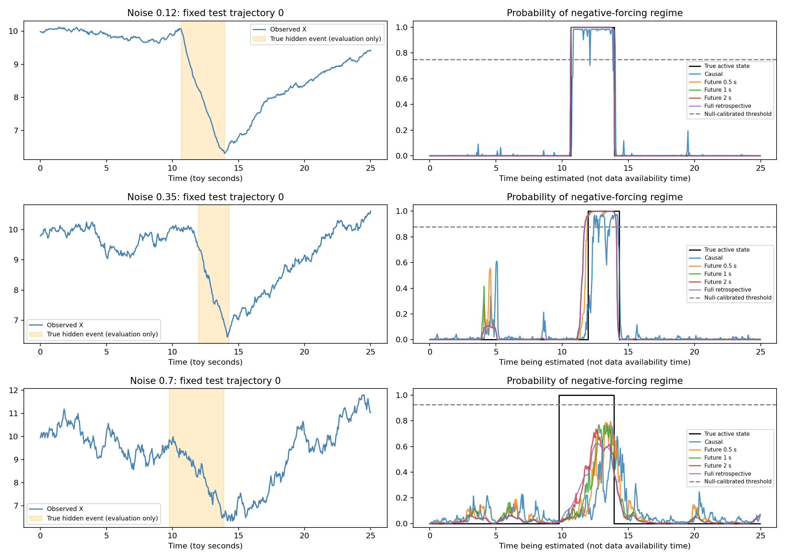
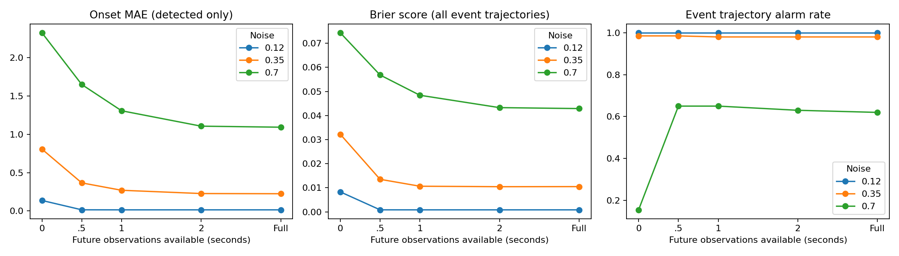
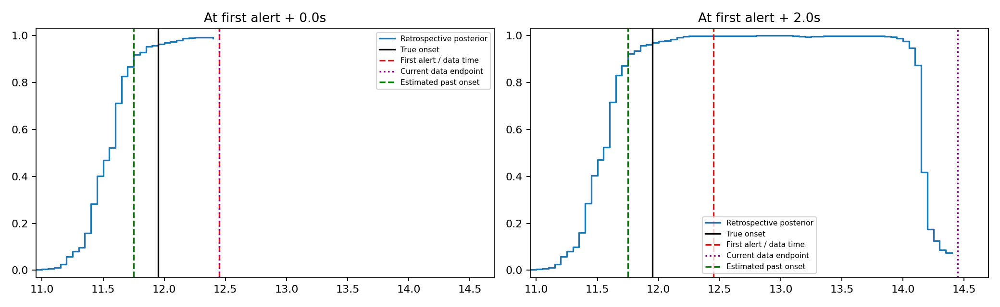

# 隐藏事件回溯实验：先发现 X 变化，再定位过去的隐藏作用

日期：2026-11-12。**结论：在本轮单一隐藏作用、正确模型族的简化模拟中，未来 X 显著帮助回溯隐藏作用的生效时刻；这不是提前预知，也不能自动识别刹车的物理身份或未知传递延迟。**

## 设计与信息隔离

真实生成过程为 x[t+1]=x[t]+0.05*(1.5−0.15*x[t]−1.5*y[t])+sigma*sqrt(0.05)*noise。每条轨迹长 25 个模拟时间单位（下文为便于阅读称“秒”，不代表真实车辆标定）。Y 为隐藏脉冲：起点在 6–12 秒均匀随机，持续 2–5 秒，力度 0.8–1.2；短脉冲测试持续 0.2–0.6 秒。每个条件只含一种可能的隐藏负向作用；观测过程没有额外传感器测量噪声，sigma 是过程噪声。模型不知道真实系数、事件起止或 Y。

低/中/高噪声分别为 0.12/0.35/0.7。每个噪声条件生成：200 条训练轨迹（约七成含脉冲）、100 条无事件验证轨迹、200 条常规事件测试、200 条无事件测试和 200 条短事件测试。主实验合计 2700 条独立轨迹；每条测试轨迹由 3 个训练初始化种子评估，不能当作 3 份独立数据。附加物理延迟挑战 200 条轨迹、原因歧义构造 200 对同观测轨迹。

训练方法为两状态切换自回归隐马尔可夫模型（HMM）：ΔX=beta*X+mu[state]+Gaussian noise。EM 只读取训练 X，学习 beta、两个状态的均值、共同噪声方差、转移矩阵和初始概率。每种噪声训练三个初始化，45 次 EM。两状态数、线性状态方程、高斯噪声是预先提供的结构假设；本轮没有自动发现状态维度。模型族与真实生成过程较匹配，是先验证可行性的有利条件。

Z 在本轮是隐藏状态的概率分布（报告负向作用状态概率），不是上一轮的任意连续编码。按学习到的作用方向给状态排序，无需真实 Y；“负向作用状态”在只有刹车这一种机制的模拟中对应刹车，但模型不能仅凭 X 给它命名。输出概率衡量开/关状态，不是对连续刹车力度的完整恢复。

阈值仅利用无事件验证轨迹，取每条轨迹跨时间、跨全部回溯方法的最大概率之 95 分位，同一噪声/模型的所有方法共用该阈值。报警需连续两个点过阈值。选用无事件验证集是一项已知“该时间段无事件”的校准信息；这不是完全无任何标签的阈值校准。训练状态学习仍然只用 X。

## 两种时间必须分开

1. 实时报警时间：看到 X 的数据后第一次确认有事件的时间。若在第 10 秒发生、第 10.8 秒报警，发现延迟是 0.8 秒。
2. 回溯定位时间：报警后用已积累的数据重新估计事件从哪一刻开始。例如估计为第 10.2 秒，定位误差是 0.2 秒。

同时计算每个 t 的实时 p(Y_t|X_≤t)，以及 p(Y_t|X_≤t+L)，L=0.5、1、2 秒和完整轨迹。后一类是在估计过去时刻 t，实际要等到 t+L 才可获得；曲线不能视为提前报警。

## 常规事件结果

| 噪声 | 实时首次报警平均延迟 | 报警后再看 2 秒的回溯起点 MAE | 该回溯结果可用率 |
|---|---:|---:|---:|
| 0.12 | 0.187 秒 | 0.015 秒 | 100.0% |
| 0.35 | 0.834 秒 | 0.225 秒 | 98.0% |
| 0.7 | 2.222 秒 | 0.912 秒 | 36.7% |

报警延迟对有报警的轨迹统计，回溯误差对有可用起点的轨迹统计，二者样本集合可能不同；不能只凭这两列直接计算收益。下面另给相同轨迹配对分析。高噪声下可用率只有约三分之一，不能据成功子集宣称整体恢复成功。

中等噪声下：实时平均晚 0.834 秒报警；在首次报警当时回看，起点 MAE 已为 0.254 秒，再积累 2 秒后为 0.225 秒。因此主要收益来自把已发生的变化正确回填到过去，而不是无限等待未来。配对比较中，共 196 条测试轨迹有相应结果，绝对报警延迟减回溯起点误差平均改善 0.603 秒，95% CI [0.556,0.651]。这比较的是“把报警时刻当起点”与“回溯估计起点”，并不代表报警被提前了。

## 多看未来数据的收益与代价

| 噪声 | 可用未来 | 起点 MAE（有过阈事件时） | 事件轨迹有报警比例 | 无事件误报率 | 全事件轨迹 Brier |
|---|---|---:|---:|---:|
| 0.12 | 无（实时状态） | 0.137 秒 | 100.0% | 0.0% | 0.00829 |
| 0.12 | 0.5 秒 | 0.015 秒 | 100.0% | 0.0% | 0.00083 |
| 0.12 | 1 秒 | 0.015 秒 | 100.0% | 0.0% | 0.00082 |
| 0.12 | 2 秒 | 0.015 秒 | 100.0% | 0.0% | 0.00082 |
| 0.12 | 完整轨迹 | 0.015 秒 | 100.0% | 0.0% | 0.00082 |
| 0.35 | 无（实时状态） | 0.806 秒 | 98.5% | 2.0% | 0.03222 |
| 0.35 | 0.5 秒 | 0.366 秒 | 98.5% | 3.5% | 0.01351 |
| 0.35 | 1 秒 | 0.270 秒 | 98.0% | 0.5% | 0.01063 |
| 0.35 | 2 秒 | 0.227 秒 | 98.0% | 0.5% | 0.01044 |
| 0.35 | 完整轨迹 | 0.225 秒 | 98.0% | 0.5% | 0.01047 |
| 0.7 | 无（实时状态） | 2.323 秒 | 15.5% | 0.0% | 0.07437 |
| 0.7 | 0.5 秒 | 1.648 秒 | 65.0% | 3.0% | 0.05683 |
| 0.7 | 1 秒 | 1.306 秒 | 65.0% | 2.5% | 0.04841 |
| 0.7 | 2 秒 | 1.106 秒 | 63.0% | 2.0% | 0.04327 |
| 0.7 | 完整轨迹 | 1.092 秒 | 62.0% | 1.5% | 0.04288 |

这里“有报警比例”表示整条轨迹出现至少一个持续过阈区间，可能包括错误或过早的起点，不等同于严格事件匹配检出率。起点取第一个持续过阈区间，不用真实 Y 挑选最合适的区间。提前超过真实起点 0.5 秒的比例另在 summary.json 的 early_alarm 字段报告。对未报警轨迹不伪造定位误差；漏报同时报告。Brier=mean((状态概率−真实开关状态)²)，对全部事件测试轨迹计算，越低越好，不会排除漏报。

中等噪声的全事件 Brier 从实时 0.0322 降至使用未来 1 秒时的 0.0106。以全部 200 条测试轨迹配对比较，收益置信区间见 paired_improvement.json。0.5–2 秒未来数据总体改善状态恢复，但单条轨迹、单一事件阈值指标不保证单调改善。

## 短事件与适用边界

| 噪声 | 实时有报警比例 | 完整回溯有报警比例 |
|---|---:|---:|
| 0.12 | 96.0% | 93.5% |
| 0.35 | 19.0% | 9.0% |
| 0.7 | 0.0% | 0.5% |

短事件在中/高噪声下大量漏报。高噪声时完整回溯仅 1/200 条轨迹过阈，单个成功事件的零定位误差没有总体意义。训练主要见到长脉冲，因此短脉冲也是持续时间分布外测试；HMM 学到的持续性先验和保守误报阈值都会影响表现。未来观测不会凭空补回被噪声掩盖的信息。

## 额外检查：未知物理延迟

在中噪声测试中，额外让“踩刹车”比“速度受到作用”早 0.5 秒，而模型仍然只看 X、没有获得这个延迟。完整回溯找到的起点相对真正动作时刻平均偏晚 0.735 秒；相对速度开始受作用的时刻平均偏晚 0.235 秒（有结果的 199 条轨迹）。多出的 0.5 秒没有被模型自动消除。

**这说明：本方法主要定位隐藏作用对 X 开始生效的时间；如果作用传递本身有未知延迟，仅凭 X 通常不能知道更早的真实动作时间。** 要进一步推回踩下刹车的时刻，需要已知或可识别的响应机制、标定实验、其他传感器或介入信息，不能主观把曲线向前平移。

## 额外检查：是不是一定能认出“刹车”

构造两种隐藏原因：刹车和上坡，只要产生相同净减速作用并使用相同噪声，X 可以完全相同。本轮成对构造中，X 的最大差异为 0，模型状态概率最大差异也为 0。因此它能识别负向作用模式，但不能从同样的 X 唯一辨认是哪种物理原因。

## 可靠性与限制

隐状态后验与枚举全部路径的精确结果一致；实时估计不受未来数据修改影响；有限回溯不读取指定窗口之外的未来；短轨迹上足够长的有限回溯等于完整平滑；按报警数据终点计算的回溯也通过数值核对。所有 EM 的似然迭代在浮点误差范围内不下降。详见 validation.json 与 checks.json。

置信区间先对同条轨迹的 3 个模型平均，再以独立轨迹为单位计算近似 95% CI，未校正多重比较。初始化种子共用同一训练集，置信区间不覆盖重复抽取训练数据的全部不确定性。概率未经额外校准，状态 MAE/Brier 不应替代物理力度恢复。未进行真实车辆数据、多个混合原因、多事件密集发生、非线性原系统或未知状态维度验证。

本轮没有计算 ACI/CIR。先用真实事件起点、漏报、误报与概率误差验证回溯是否正确，比仅凭 KL 信息变化更直接；下一轮可在回溯有效的基础上增加信息指标。

## 图表







## 复现

依赖 Python、numpy、scipy、matplotlib，版本见 results/environment.txt。

```bash
OPENBLAS_NUM_THREADS=1 python run.py
OPENBLAS_NUM_THREADS=1 python validate.py
OPENBLAS_NUM_THREADS=1 python diagnostics.py
OPENBLAS_NUM_THREADS=1 python report.py
```

模型、配置、逐轨迹结果、统计汇总、数值检查和示例数据已保存。所有 Y 只用于模拟生成与事后评分；检查脚本不会把真实 Y 反馈给训练。